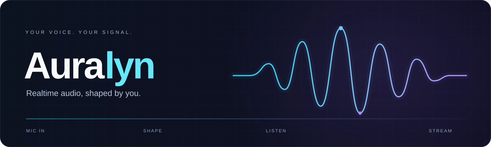
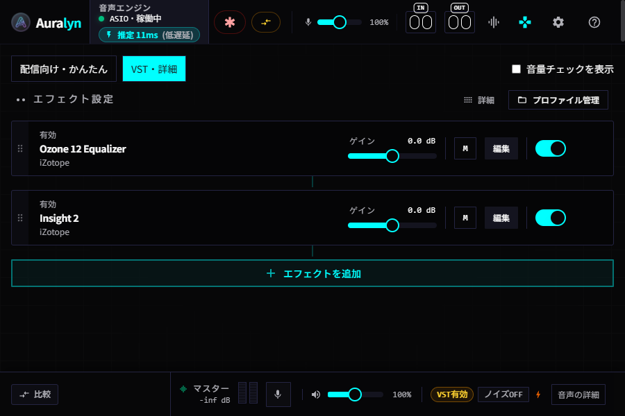
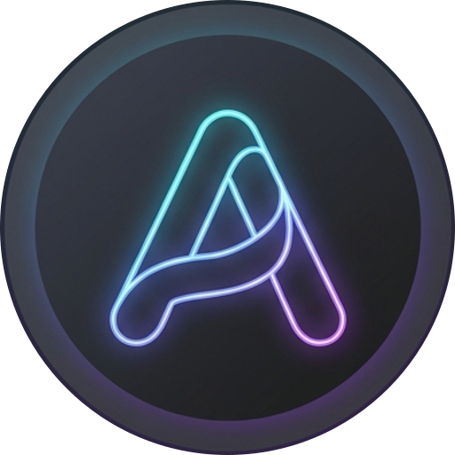

<p align="center">
  
</p>

<h1 align="center">いつものマイク、ちょっといい音に。</h1>

<p align="center">
  配信にも、通話にも。自分の声を、自分の好きな音へ。<br>
  <strong>Auralyn（オーラリン）</strong>は、Windows 向けのリアルタイム音声処理・VST3 ホストです。
</p>

<p align="center">
  <a href="https://kuro7983.com/apps/auralyn"><strong>ダウンロード ↗</strong></a> &nbsp; · &nbsp;
  <a href="#はじめる">はじめる</a> &nbsp; · &nbsp;
  <a href="#できること">できること</a> &nbsp; · &nbsp;
  <a href="#開発する">開発する</a>
</p>

<p align="center">
  
  
  <a href="LICENSE"></a>
</p>

<br>

<p align="center">
  
</p>
<p align="center">
  <sub>開発版の実画面 · 900 × 600 · ゲーミングテーマ<br>画面内の他社製 VST3 プラグインは使用例です。Auralyn には付属しません。</sub>
</p>

<br>

## 音を整える。その違いを、聴いて決める。

<table>
  <tr>
    <td width="33%" valign="top">
      <h3>01<br>つなぐ</h3>
      <p>セットアップと接続チェックで、マイクから配信までの経路を確認。</p>
    </td>
    <td width="33%" valign="top">
      <h3>02<br>整える</h3>
      <p>内蔵エフェクトと VST3。用途に合わせて、音作りをシンプルにも細かくも。</p>
    </td>
    <td width="33%" valign="top">
      <h3>03<br>確かめる</h3>
      <p>音量はメーターで、聴こえ方は試聴で。調整前後を比べて決められます。</p>
    </td>
  </tr>
</table>

## できること

### 配信の準備を、ひとつずつ。

- **用途に合わせた表示** — 「配信向け・かんたん」と「VST・詳細」を切り替えられます。
- **音量チェックと自動ゲイン** — LUFS・true peak をもとに音量を確認し、ゲインの提案・適用・復元まで行えます。発話中ずっと音量を追従させる機能とは異なります。
- **調整前後の聞き比べ** — ボイスチェックや原音比較で、処理の効果を耳でも確認できます。
- **OBS の設定支援** — 変更予定を確認してから適用・復元。OBS 側で後から変更した設定を上書きしないための確認も行います。

### 音作りは、シンプルにも、細かくも。

- **内蔵ノイズ低減・エフェクト** — 外部プラグインなしでも使えます。ノイズ低減はファン・空調などの持続的な音が対象で、周囲の会話や BGM を完全に消すものではありません。
- **VST3 ラック** — エフェクトの追加、並べ替え、ON/OFF、ゲイン調整、対応プラグインの独自 GUI を利用できます。
- **保存と呼び出し** — ラックの状態を保存し、プリセットや用途別テンプレートから呼び出せます。
- **WASAPI / ASIO** — 環境に合わせて入力・出力を設定。遅延はデバイス、バッファ、プラグインによって変わります。

### 配信中の操作と、毎日の起動も。

- **グローバルホットキー** — 背面でもミュート・原音比較・出力ゲインを操作。Stream Deck の標準「System → Hotkey」からも利用できます。専用プラグインやボタン表示との状態同期には未対応です。
- **設定移行と自動起動** — 通常版と MSIX 版は保存先を分離。設定を確認しながら移行し、自動起動も配布形式に応じて設定できます。
- **更新の確認** — 通常インストール版は自動確認と任意の自動ダウンロードに対応し、適用はユーザーの操作で行います。MSIX 版は入手元の更新経路を使います。
- **音声エンジンを別プロセスへ** — エンジン・スキャナーを UI から分離し、障害時の案内と再試行を用意しています。エンジン停止時の音声継続を保証するものではありません。

> この README は現行ソースの機能を紹介しています。公開バイナリに含まれる機能は、各 [Release の説明](https://github.com/blackflame7983/Auralyn-Releases/releases)を確認してください。

## はじめる

**必要なもの：Windows 11 x64 と、音声入力デバイス。** 外部 VST3 は必要に応じて追加できます。

1. [公式配布ページ](https://kuro7983.com/apps/auralyn)からインストーラーを入手します。署名・SHA-256・注意事項は配布する版の案内を確認してください。
2. アプリのセットアップで入力と出力を選びます。マイクのアクセス許可が必要な場合は、Windows の設定で許可してから再試行します。
3. 内蔵エフェクトや VST3 で音を整え、**ボイスチェックで聴いて確認**します。
4. OBS や Discord へ送る場合は仮想オーディオケーブルを用意し、接続チェック・アプリ内ガイドに沿って設定します。

<p align="center">
  <strong>マイク</strong> &nbsp; → &nbsp; <strong>Auralyn</strong> &nbsp; → &nbsp; <strong>仮想ケーブル</strong> &nbsp; → &nbsp; <strong>OBS / Discord</strong>
</p>

Auralyn 自体は仮想マイクを作成しません。他アプリへ送るには、仮想ケーブルなどの音声経路が必要です。仮想ケーブルのドライバーや他社製 VST3 は別途導入してください。

<details>
<summary><strong>配布形式と更新について</strong></summary>

- **MSIX** を今後の主軸として準備しています。現在の互換性試作は、正式な Microsoft Store 公開版ではありません。
- **通常版 EXE** は、MSIX の長時間試験と設定移行の確認が完了するまで維持します。Portable 版の更新は配布ページから行います。
- **Store 入手版**は Store、直接配布の **MSIX** は元の配布元から更新する設計です。試作での確認と、正式 Store での配信・更新確認は区別しています。
- **MSI** は今後のビルド・配布・検証対象から外しています。過去の公開済みファイルは削除しません。

詳しくは [リリース方針](docs/RELEASE_PLAN.md)、[MSIX 試作](docs/MSIX_PROTOTYPE.md)、[設定保存・移行](docs/MSIX_STORAGE.md)を参照してください。

</details>

<details>
<summary><strong>対応範囲と、使う前に知っておきたいこと</strong></summary>

- Windows 11 x64 のみ対応。macOS・Linux・ARM64 は対象外です。最小ウィンドウサイズは 900 × 600 です。
- 外部プラグインは **VST3 のステレオ処理対応エフェクト**が対象です。VST2・モノラル専用プラグイン・MIDI 入出力・オートメーションには対応していません。
- プラグインの独自 GUI は、製品や DPI 設定により互換性が異なります。
- WASAPI は共有モードです。排他モードには対応していません。
- プラグインごとの遅延の完全な自動補正には対応していません。実際の遅延や安定性は、使用環境で確認してください。
- ASIO の通知間隔のばらつきと遅延カウンター増加、数日間の連続稼働、正式 Store での更新は、引き続き確認する項目です。カウンターの増加だけで実際の音切れを断定することはできません。

</details>

## 開発する

**React + TypeScript** の UI と **Rust** の音声エンジンを、**Tauri** でつないでいます。音声処理と VST3 スキャンはサイドカーで実行します。

```text
React UI  ←→  Tauri / JSON-RPC  ←→  Audio engine
                                   VST3 scanner
```

<details>
<summary><strong>ローカル開発の準備とコマンド</strong></summary>

Windows 11 x64、Node.js、Rust、Microsoft C++ Build Tools、LLVM/Clang、ASIO SDK が必要です。バージョンと環境変数は [ビルドガイド](docs/BUILD_GUIDE.md)を参照してください。

```powershell
npm ci
npm run rebuild-engine
npm run tauri dev
```

配布ビルドは `npm run tauri build`。MSIX は[専用の梱包手順](docs/MSIX_PROTOTYPE.md)を使います。

公式 Source ZIP には、公式ビルドで利用した ASIO SDK 2.3.4 の `common` / `host` ソースとライセンスを含めています。Source ZIP から再ビルドする場合は、同梱 SDK を `CPAL_ASIO_DIR` に指定してください。ASIO SDK は GPLv3 の選択肢に基づいて利用しています。

</details>

| 開発の入口 | 内容 |
| :--- | :--- |
| [ビルド](docs/BUILD_GUIDE.md) / [テスト](docs/TESTING.md) | 開発環境、ビルド方法、検証範囲 |
| [作業方針](AGENTS.md) / [コーディング規約](docs/CODING_GUIDELINES.md) | 変更・レビュー時の約束 |
| [バージョン](docs/VERSIONING.md) / [依存管理](docs/DEPENDENCY_MAINTENANCE.md) | 番号の判断とメンテナンス |
| [リリース](docs/RELEASE_PLAN.md) / [対応ソース](SOURCE-DISTRIBUTION.md) | 配布条件とソースの提供 |

不具合や改善案は [Issues](https://github.com/blackflame7983/Auralyn/issues)へ。利用中の版、デバイス・ドライバー、再現手順があると確認しやすくなります。Pull Request も歓迎します。

---

<p align="center">
  <br>
  <strong>Auralyn</strong><br>
  <sub>声を整える時間も、心地よく。</sub>
</p>

### ライセンス・クレジット

現行版は [GPL-3.0-only](LICENSE) です。複製・改変・再配布・有料配布は、対応ソースの提供義務を含む GPLv3 の条件に従って行えます。過去に MIT License を添付して配布した版の権利は取り消しません。

公式バイナリと同一コミットの対応ソース ZIP・SHA-256・manifest は、同じ GitHub Release から無償で取得できます。詳細は [SOURCE-DISTRIBUTION.md](SOURCE-DISTRIBUTION.md)を参照してください。

[Tauri](https://tauri.app/) · [React](https://react.dev/) · [Rust](https://www.rust-lang.org/) · [vst3-rs](https://crates.io/crates/vst3) · [cpal](https://crates.io/crates/cpal) · [nnnoiseless](https://crates.io/crates/nnnoiseless) と、そのほかのオープンソースプロジェクトに支えられています。全ライセンスと権利表示はアプリの「設定 → ライセンス情報」から確認できます。

VST® は Steinberg Media Technologies GmbH の登録商標です。<br>
ASIO is a trademark of Steinberg Media Technologies GmbH, registered in Europe and other countries.
