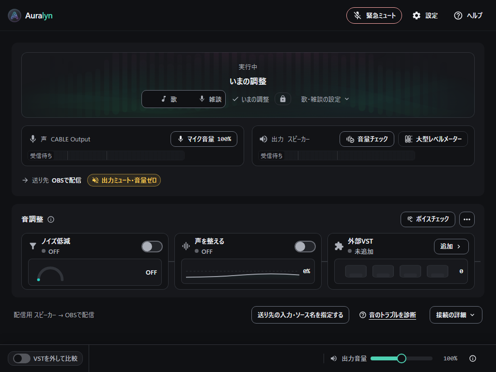
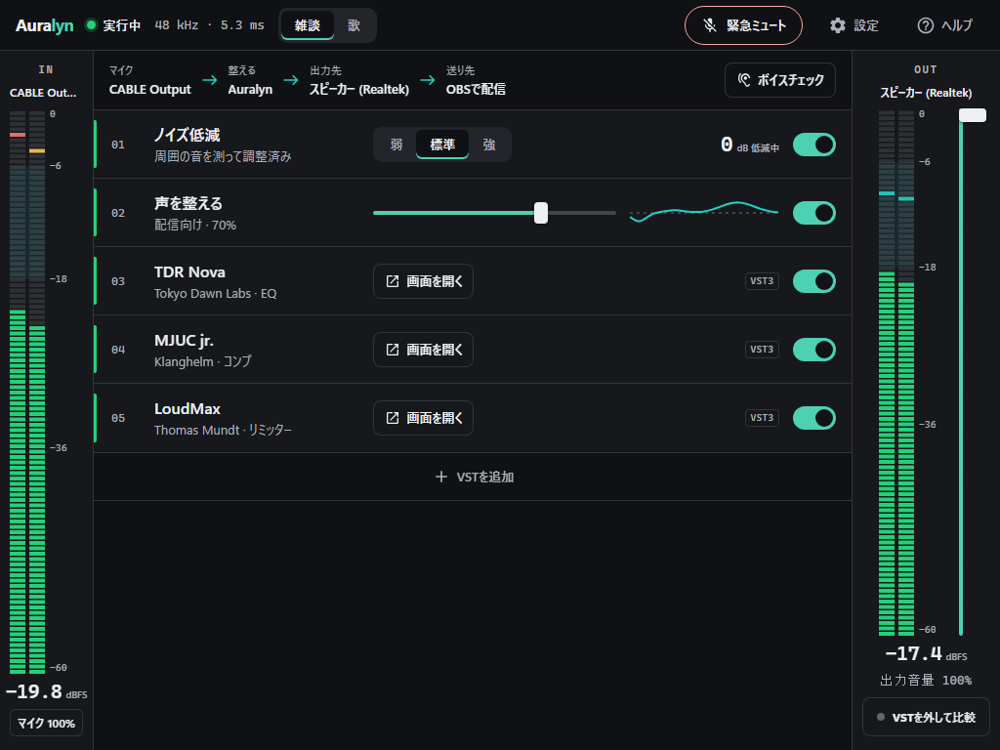
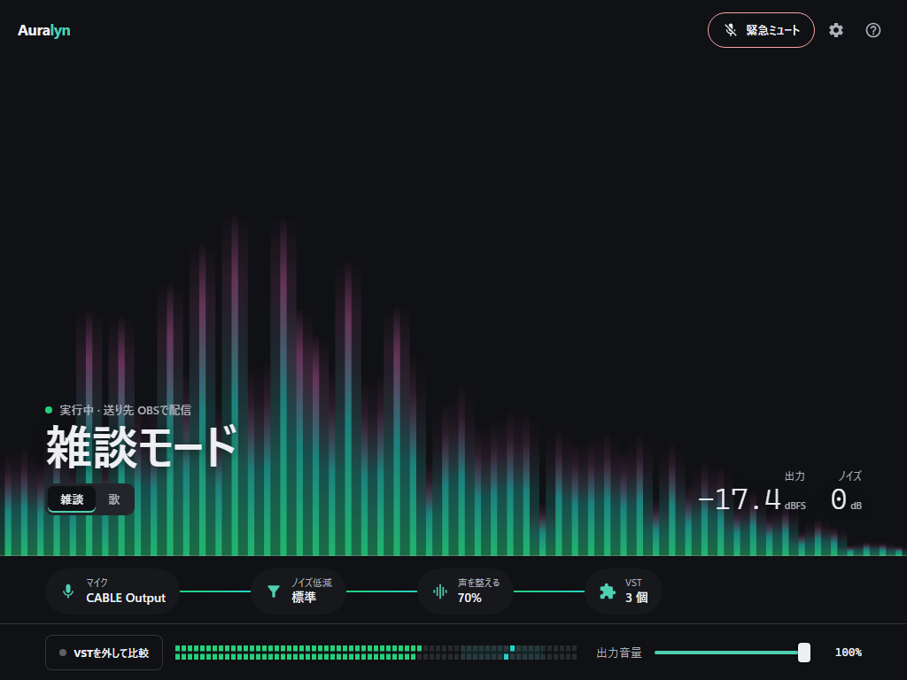
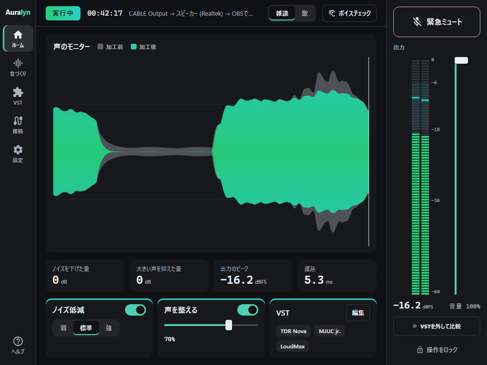
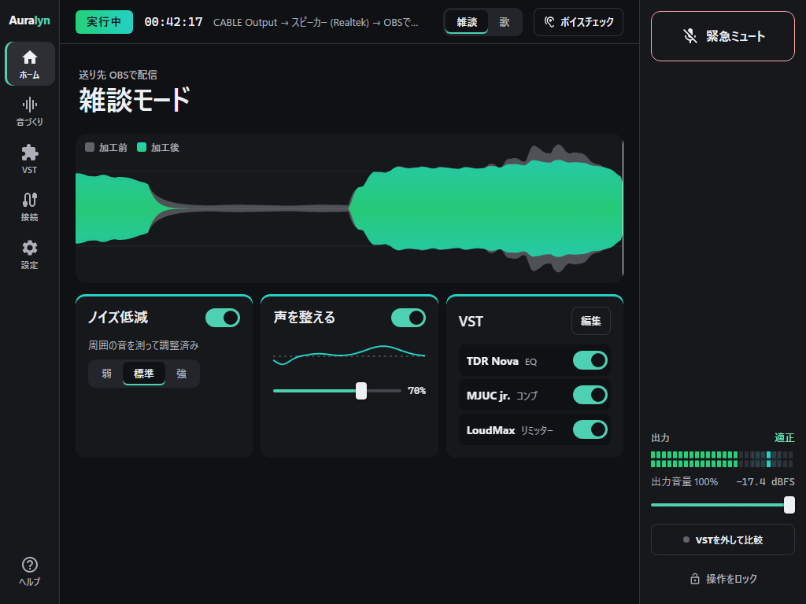
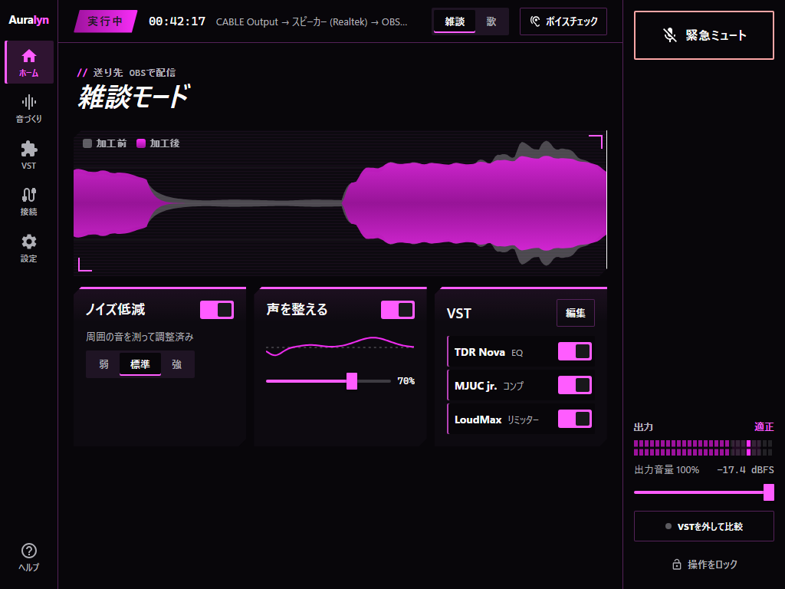
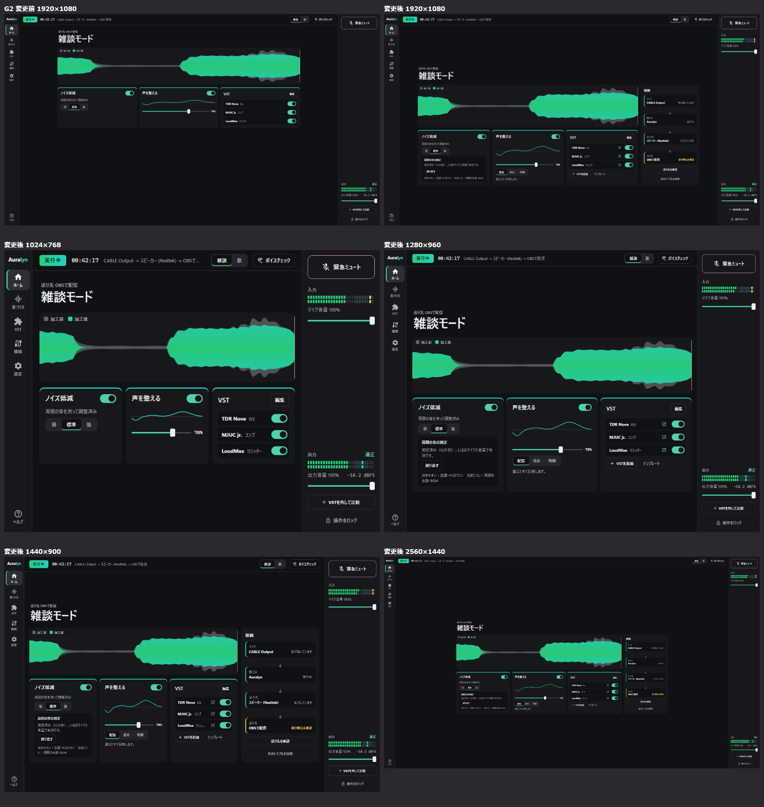
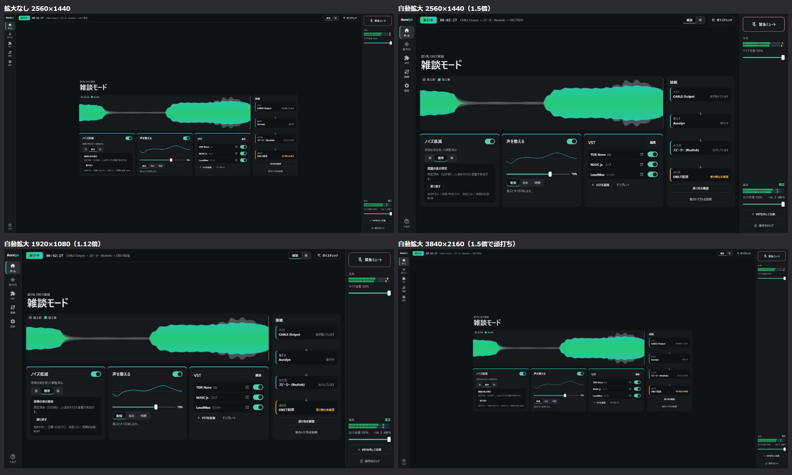
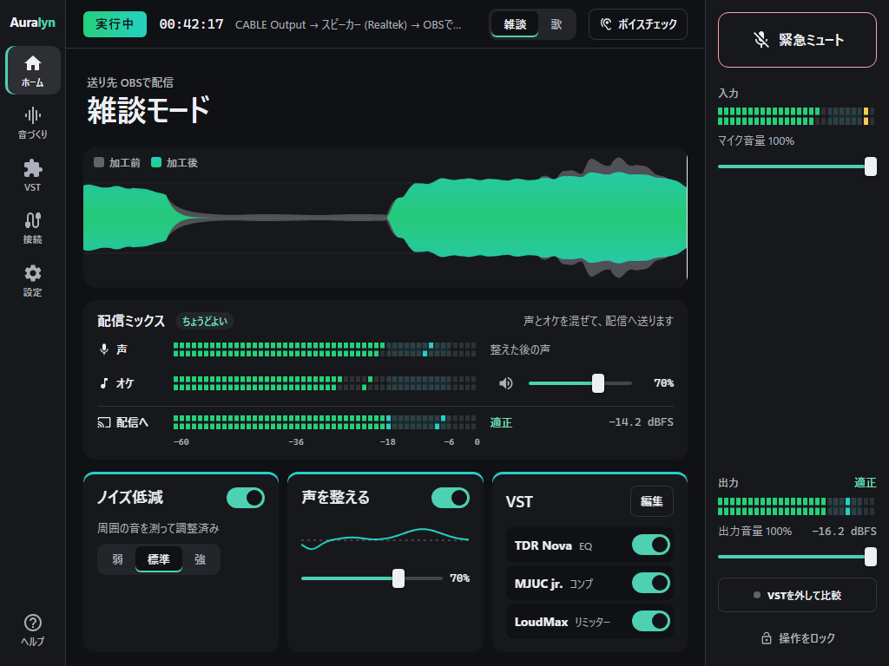

# Auralyn デザイン刷新の監査と提案（2026-11-12）

`codex/design-renewal-2026-11-12` での調査・試作の記録です。製品コードは変えていません。
この文書は提案であり、実装・実機検証の証拠ではありません。採否は利用者が決めます。

- 見たもの: 開発プレビュー（`?mock=`、Tauri なしのブラウザ、Playwright の Chromium）で全19画面。テーマ3種、1024×768・1920×1080・900×600・1280×720の150%。
- 判断の種類: 各項目に【根拠】（利用者の場面・測った値・参考プロダクトの考え方）か【好み】（私の審美的な判断）を付けました。参考プロダクトの記述は私の知識によるもので、今回あらためて実物を調べ直してはいません。
- スクリーンショット: `docs/verification/design-renewal-2026-11-12/`（`current_*` が現行、`proposal_*` が試作、`compare_*` が並べた比較）。
- 見ていないもの: 末尾の「確認できなかったこと」にまとめました。

---

## 1. 総評：イケていない理由は、構造の問題が5つ

色や角丸の調整では直りません。次の5つは構成と部品の問題です。

### 1.1 主役がいない【根拠：測った値】

ホーム（音声処理中、1024×768）で、最も大きい文字は17pxです。文字の大きさと太さの組み合わせは9種類ありますが、すべて12〜17pxに収まっています。枠線のある箱は16個、ボタンは32個あり、どれも同じ強さで並びます。3秒で目が止まる場所がありません。

音のアプリの主役は、本来メーターか波形です。現行の入出力メーターは高さ18px・幅322pxで、本番帯（936px幅）の中で脇役の寸法です。

### 1.2 オーロラが、飾りにも情報にもなっていない【根拠：測った値と規約】

本番帯のオーロラは不透明度0.2で、高さ135pxの箱の中にあります。暗い画面ではほぼ見えません。規約（`DESIGN.md` 5.1）は「オーロラは飾りで、状態の意味は持たせない」と定めています。つまり、ブランドの唯一の光が「意味を持ってはいけない、目立ってもいけない」場所に置かれています。その結果、本番帯は「空の大きな箱」に見えます。

### 1.3 面の差が小さく、枠線で区切っている【根拠：測った値】

背景 `rgb(16,17,20)` とカード `rgb(23,24,28)` のコントラスト比は約1.06:1です。面の明るさでは区切れないため、箱の中に箱を入れて枠線（背景との比 約1.5:1）で区切っています。本番帯は「カード → 枠付きの舞台 → 枠付きのメーター欄」の3重です。業務用の設定画面に見える主な原因です。

ボタンの高さは8種類（20・24・26・30・32・34・36・40px）、角丸は5種類（4・8・10・12px・丸）あります。そろっていないものは、雑然として見えます。

### 1.4 「声が良くなった」手応えを見せる場所がない【根拠：利用者の場面】

配信者が欲しいのは「自分の声が良くなっている」実感です。現行のホームが見せるのは、設定の状態（ON/OFF、%）と入出力の音量だけです。ノイズ低減がいまどれだけ下げているか、大きい声をどれだけ抑えたかは、どこにも出ません。ボイスチェックを開いて録音しないと分かりません。

数字も足りません。既定では dBFS の値が隠れており、機材らしい信頼感を作る材料（等幅の数字、目盛り）が画面にありません。

### 1.5 画面の大きさと利用者に、構成が応えていない【根拠：測った値と依頼の前提】

- 1920×1080では、中身は幅1180px（61%）で止まり、下に232pxの空白が残ります。広い画面を買った人ほど「スカスカ」に見えます。
- 設定はモーダルで、開くとメーターも本番中の操作も隠れます。音を聞きながら機器を変える作業と合いません。
- 音楽鑑賞の利用者は `DESIGN.md` 1.2 の表にいません。ホームは「マイクの声」の語彙（歌・雑談、ボイスチェック）で組まれています。

---

## 2. 画面ごとの批評

重要度は 高（第一印象や本番の安全に効く）／中（使うたびに気になる）／低（細部）です。番号は `issues.md` と対応します。

### 2.1 ホーム（音声処理中）

`current_home_live_aurora_1024x768.png`、`current_home_live-home_aurora_1920x1080.png`

- **第一印象**: 何かの管理画面。音のアプリだと分かる要素が小さい。古くはないが、記憶に残らない。
- **使いたくなるか**: 触りたくなるのは音調整の3枚だけ。ただし OFF の状態では、灰色の弧・平らな線・灰色の四角4つが並び、読み込み中の骨組みに見える。
- **使い続けたくなるか**: 毎日開いたときに「今日も動いている」と一目で分かる大きな表示がない。「実行中」は13pxの灰色の文字。
- **使いやすさ**: 配信者には十分。音楽鑑賞の人には、歌・雑談の切替とボイスチェックが自分に関係ないものとして目に入る。

| # | 重要度 | 指摘 | 測った値・根拠 |
| :--- | :--- | :--- | :--- |
| H-01 | 高 | メーターが小さい | 18×322px。本番帯の幅の34% |
| H-02 | 高 | オーロラが見えない | 不透明度0.2、舞台135px |
| H-03 | 高 | 最大の文字が17px | 9種類の組み合わせが12〜17pxに集中 |
| H-04 | 高 | 箱の3重入れ子 | 枠付き16個。カードと背景の比1.06:1 |
| H-05 | 中 | 「いまの調整」が2回出る | 舞台中央の見出しと、切替の右のチェック付きラベル |
| H-06 | 中 | 歌／雑談の切替で、文字が右に寄る | 選択の印がないとき、左に空きができる【好み】 |
| H-07 | 中 | 音調整の OFF 表示が骨組みに見える | 弧・線・四角が灰色のまま |
| H-08 | 中 | 信号の線が VST のカードの右へはみ出す | 右端に短い線が残る |
| H-09 | 中 | フッターに縦線が2本あり、空の区画ができる | 比較スイッチの右と、出力音量の左 |
| H-10 | 中 | 下段で一番強いボタンが「送り先の入力・ソース名を指定する」 | たまにしか使わない操作が、枠付きで最も目立つ |
| H-11 | 中 | ボタンの高さが8種類 | 20〜40px |
| H-12 | 中 | 1920×1080で下に232pxの空白 | 中身は791pxで終わる |
| H-13 | 低 | 角丸が5種類 | 規約は操作10px・カード12px |
| H-14 | 低 | ヘッダー64px＋フッター57pxで、768pxの16%を使う | 中身は「ロゴ・3ボタン」と「スイッチ・スライダー」だけ |
| H-15 | 低 | 数字が等幅でなく、値が変わると幅が揺れる | 100%・dB の表示【好み】 |

### 2.2 ホーム（停止中）

`current_home_stopped-home_aurora_1024x768.png`

- **第一印象**: 壊れてはいないが、灰色が増えて沈む。「音声を開始」は見つかる。
- 「音声停止中」が7か所に出ます（舞台、入出力メーター2つ、音調整3つ、ノイズ低減の中）。規約 2.5 は「同じ停止文言を繰り返さない」としています（S-01、高）。
- 主ボタン「音声を開始」は高さ36pxで、右の説明文と同じ行に並びます。停止中の唯一の主操作にしては小さい（S-02、中）【好み】。
- 止まっているのに、歌／雑談の切替や音調整のスイッチは通常の濃さです。何が押せて何が効かないのかが読めません（S-03、中）。

### 2.3 ホーム（未設定・セットアップ）

`current_home_first-run_aurora_1024x768.png`

- **第一印象**: いきなりダイアログ。背後のホームは暗くて読めない。
- 開いた直後に、閉じるボタン（×）にフォーカスの輪が付きます。画面で一番目立つのが「閉じる」です（U-01、高）。ほかのモーダル（設定、プラグイン選択、ガイド）でも同じです。
- 4枚のカードの下に約130pxの空きがあります（U-02、低）。
- 「VB-CABLE 等の仮想ケーブルを通して送ります」が残っています。2026-11-04の決定では標準の方法ではなくなっています（U-03、中。OBS プラグインの公開待ちという事情は承知しています）。
- 表示言語の選択欄が、見出し「送り先を選んでください」より上にあります（U-04、低）。

### 2.4 設定：オーディオ

`current_settings-audio_live_aurora_1024x768.png`

- **第一印象**: 業務ソフトの設定画面。枠にかぶる見出し（fieldset の legend）が古く見える。
- 枠付きの箱は26個、文字の組み合わせは13種類です（A-01、高）。
- 選択欄は幅約800px・高さ41pxで、中身は「CABLE Output」のような短い値です。横に長い入力欄が縦に並び、どれも同じ重さに見えます（A-02、中）。
- 左メニューの選択中は、白い枠の箱です。主色でも下線でもなく、ほかの画面の選択表示（下線・淡い面）とそろっていません（A-03、中）。
- 左メニューを包む角丸の箱が、下端の手前で終わります（A-04、低）。
- 下の固定バーの文が2行（「接続設定に変更はありません／音声が一瞬途切れます」）で、押せないボタンの横に並びます（A-05、低）。
- 開くと、メーターと緊急ミュートが隠れます（A-06、高。1.5 の構造の問題）。

### 2.5 設定：外観

`current_settings-appearance_live_aurora_1024x768.png`

- **第一印象**: 見た目を選ぶ画面なのに、見た目が分からない。
- テーマの見本は「Aa ●」の小さな札だけです。選ぶ前に雰囲気が分かりません（P-01、高）。
- 見出しの大きさがそろっていません（「ホームの表示」16px、「テーマ選択」20px）（P-02、中）。
- 行の右側が広く空きます。ラベルと操作が左に固まっています（P-03、低）【好み】。
- 「ホームの表示」（配信・通話向け／音楽鑑賞）は、音楽鑑賞の人にとって最初に知るべき設定ですが、外観タブの選択欄の1つです（P-04、高。1.5 の構造の問題）。

### 2.6 そのほかの画面（1024×768、オーロラ）

| 画面 | 第一印象と主な指摘 | # | 重要度 |
| :--- | :--- | :--- | :--- |
| VST 構成（右パネル） | 空の状態は破線の箱と主ボタン。パネルがホームに重なり、出力の列が隠れる | V-01 | 中 |
| VST を追加 | 空の一覧は文章だけ。フォルダの絵も、探す場所の案内ボタンもない | V-02 | 中 |
| 設定の保存・復帰 | タブ・区分・チェック・入力が1枚に詰まり、何を保存するのか読まないと分からない | V-03 | 中 |
| VST 構成テンプレート | 3枚のカードは分かりやすい。上の注意書きの箱が、カードより先に目に入る | V-04 | 低 |
| 配信ミックス | 折りたたみの中に選択欄が縦に並ぶ。音の絵がない | V-05 | 中 |
| ボイスチェック | 開いた直後に、上の折りたたみにフォーカスの輪。警告の箱、長い説明、押せないボタンが続き、録音ボタンが埋もれる | V-06 | 高 |
| 大型レベルメーター | 目盛りが 0・−6・−12・−24・−48 で、間隔が不ぞろいに見える。右端に細い棒2本だけ | V-07 | 中 |
| 音のトラブルを診断 | 小さなダイアログに1項目。背後が広く空く | V-08 | 低 |
| OBS 連携ガイド・使い方 | 文章が中心。図がない | V-09 | 低 |
| 設定：音づくり | スライダーと小さな区分が続く。音色の絵がなく、ホームのカードとつながらない | V-10 | 中 |
| 設定：ホットキー | 表はそろっている。「キーを入力」「一覧から選ぶ」が全行に並び、密度が高い | V-11 | 低 |
| ライセンス | 問題なし | — | — |

### 2.7 テーマ

- **ライト**（`current_home_live_light_1024x768.png`）: 読みやすい。ただしオーロラはほぼ見えず、枠線の箱がより目立つ（T-01、中）。
- **ゲーミング**（`current_home_live_gaming_1024x768.png`）: すべての枠がマゼンタになり、箱の多さが強調される。オーロラがないため、本番帯は完全に空の箱（T-02、中）。

---

## 3. 参考にした例と、持ち込める考え方

実物の見た目を写すのではなく、なぜ良いのかを言葉にしました。私の知識による整理で、今回の調査で新たに確かめたものではありません。

| 例 | なぜ良いか | Auralyn に持ち込める考え方 |
| :--- | :--- | :--- |
| FabFilter Pro-Q などのプラグイン | 画面のほとんどが1枚の表示で、操作はその上で行う | 表示を主役にし、操作を表示の近くへ寄せる |
| iZotope 系、NVIDIA Broadcast | 処理が「何を取り除いたか」を見せる。効いている実感がある | ノイズを下げた量、抑えた量を、加工前後の差として見せる |
| RME TotalMix、Elgato Wave Link、ハードのチャンネルストリップ | 入力から出力まで、信号が通る順に並ぶ。両端にメーター | 両端に入出力のメーター、間に処理の段 |
| Ableton Live | 飾りがない。色は状態だけに使う。密度が高いのに疲れない | 色は音と状態に集める。面は平らにする |
| ハードのミキサー、配信用の卓 | ミュートは大きく、いつも同じ場所にある。目で探さない | 本番中の操作を、画面の端に固定する |
| ハードの表示（LED の段、7セグの数字） | 段と等幅の数字は、機材として信頼できる印象を作る | LED の段のメーター、等幅の数字 |
| Roon などの再生ソフト | 大きな1枚の絵と、少ない文字。長く開いていても疲れない | 音楽鑑賞では、表示を大きく、操作を少なく |

### Auralyn の弱み

- 競合（Live Audio Assist、Stream Gear Mixer）と並べたとき、画面で覚えてもらえる特徴がない。
- メーターが小さく、数字が隠れていて、機材らしさがない。
- 音楽鑑賞の人のための画面がない。

### Auralyn だけの見せ場

- **ノイズ低減・声を整える・外部 VST が、1本の流れに入っている。** 内蔵処理と VST を同じ列で見せられるアプリは少ない。
- **加工前後を聴き比べる仕組み（ボイスチェック、VST を外して比較）を既に持っている。** 「良くなった」を見せる材料がある。
- **本番中の3操作（緊急ミュート・比較・出力音量）を規約で守っている。** 配信卓の作法として見せられる。
- **オーロラという、音と相性の良いブランドの絵がある。** 光の柱は、そのまま音の帯域の表示になる。

---

## 4. 3つの方向性

動く試作を `src/prototypes/` に追加しました。色を変えた案ではなく、骨格が違います。

### 開き方

1. 開発サーバーを起動します。この文書の URL は、作業時に使った手元のプレビュー（ポート1440、リポジトリには入っていない設定）のものです。`npm run dev` で起動した場合は、ポートを1420に読み替えます。
2. ブラウザで開くときは、`?mock=live-home` を付けます（Tauri の代わりの模擬応答が要るため）。
   - E: `http://localhost:1440/?proto=e&mock=live-home`
   - F: `http://localhost:1440/?proto=f&mock=live-home`
   - G: `http://localhost:1440/?proto=g&mock=live-home`
3. 下の「試作」バーで、方向（E・F・G）、画面（処理中・停止中・未設定・設定：オーディオ・設定：外観）、用途（配信・音楽鑑賞）、「動きを減らす」を切り替えます。「現行の画面（模擬）」で、同じ状態の現行ホームへ移れます。
4. 実アプリ（`npm run tauri dev`）では、Ctrl+Shift+P で試作ラボを開き、バーから E・F・G を選びます。実アプリのウィンドウでは未確認です。

メーターと波形は擬似信号です（`src/prototypes/renewal/signal.ts`）。音声エンジンと保存設定には触れません。外観のテーマ切替だけは、実際のテーマ設定（`vst_host_theme`）を書き換えます。

### 4.1 E「ラック」— 暗い部屋で光る機材

- **ひとことで**: 1枚のチャンネルストリップ。左に入力メーター、中央に機材の段、右に出力メーターとフェーダー。
- **刺さる人**: VST で作り込む人。機材が好きな配信者。**離れる恐れ**: 「ノイズを消したいだけ」の人には、段と数字が難しく見える。
- **色**: 面は平らな無彩色。光るのは LED の段と、ON の段の左端の線だけ。**文字**: 名前は16px、数字は等幅（Cascadia Mono）。**余白**: 段の間は1pxの線だけ。**形**: 角丸は小さく、段は角ばらせる。**メーター**: 画面の高さいっぱいの縦の LED。目盛りと適正域の帯。**動き**: メーターだけ。**手応え**: スイッチで段の左端が灯る。「−8 dB 低減中」の数字が動く。
- **ホームの構成**: ヘッダーに状態・歌／雑談・緊急ミュート。上に音の流れ（マイク → Auralyn → 出力先 → 送り先）。その下に段（01 ノイズ低減、02 声を整える、03〜 VST）。右の列に出力音量（縦フェーダー）と比較。フッターはなし。
- **設定**: 中央だけが設定に替わり、両端のメーターと右の操作は残る。項目は「ラベル｜操作」の行で、枠の箱を使わない。
- **ブランド**: オーロラの緑〜青緑を LED の色に使う。光のカーテンは置かない。Aura は「機材の灯り」として表れる。
- **制約の守り方**: 緊急ミュートは右上、出力音量と比較は右の列の同じ位置。色だけに頼らず、スイッチと下段の文字で ON/OFF を示す。900×600では段が縦にスクロールする。

### 4.2 F「リスニングルーム」— 静かな部屋に、音の光が一つ

- **ひとことで**: オーロラを、出力の帯域の表示にする。画面の6割が光で、文字は大きな1行。
- **刺さる人**: 音楽鑑賞の人。配信画面の横に置いて見せたい配信者。**離れる恐れ**: VST で作り込む人には、操作が奥にあって遅い。
- **色**: 面は背景1色。色は光の柱だけ（下が緑、上へ青緑、強い帯域の先端に淡い赤紫）。**文字**: 状態は34〜64pxの大きな1行。数字は細い等幅で大きく。**余白**: 広い。**形**: 丸い。**メーター**: 光の柱そのもの。下端に横の出力メーター。**動き**: 光だけ。**手応え**: 声や曲に合わせて光が立ち上がる。
- **ホームの構成**: 上に光と状態。その下に音の流れの1行（マイク ― ノイズ低減 ― 声を整える ― VST）。押すと、その段の操作がその場で開く。下端のドックに比較・出力メーター・出力音量。
- **未設定**: 「どのマイクの音を整えて、どこへ送る。」という1文の空欄を埋める形。
- **設定**: 右からのシート。左に光が見えたまま変えられる。項目は「名前｜いまの値」の行。
- **ブランド**: 「静かな面、一か所の光」をそのまま強める。ただし「オーロラは飾りで意味を持たせない」は改め、音の表示にする。
- **制約の守り方**: 緊急ミュートは右上、比較と出力音量は下端のドック。光は装飾ではなく計測値なので、止める設定（「音の光を表示」）を残す。動きを減らす設定では静止する。

### 4.3 G「オンエア卓」— 声がどう良くなったかを見せる配信卓

- **ひとことで**: 3列の卓。左に行き先、中央に加工前後のモニター、右に本番中の操作。
- **刺さる人**: 配信者。**離れる恐れ**: 音楽鑑賞の人には「卓」が大げさ（用途を音楽鑑賞にすると、モニターと VST だけに減らす）。
- **色**: 面は2段（背景とカード）。色はモニターの加工後の帯と、状態の札だけ。**文字**: 数字のタイルは24pxの等幅。**余白**: 中くらい。**形**: カードは角丸14px、枠線なし。**メーター**: 右の列に縦の LED と縦フェーダー。**動き**: モニターが右から左へ流れる。**手応え**: 灰色（加工前）のうち、青緑（加工後）からはみ出た部分が「下げた分」として見える。下の数字が「ノイズを下げた量」「大きい声を抑えた量」を示す。
- **ホームの構成**: 上の帯に状態の札・経過時間・音の流れ・歌／雑談・ボイスチェック。中央にモニター、数字のタイル4つ、音調整のカード3枚。右の列に緊急ミュート（高さ64px）、出力メーターとフェーダー、比較、操作ロック。
- **設定**: モーダルをやめ、左のレールから中央のページとして開く。右の列は残る。オーディオでは「いまの接続」を横に置き、入出力のメーターを見ながら変えられる。
- **ブランド**: オーロラの緑〜青緑を「整えた後の声」の色にする。Aura（声の雰囲気）を整えた結果が、画面の中央に出る。
- **制約の守り方**: 本番中の3操作は、どの画面でも右の列の同じ位置。緊急ミュートは現行の約1.8倍の高さ。状態の札は色だけでなく文字（実行中・停止中・未設定）で示す。「配信中」「ON AIR」とは書かない（受け側への到達を推測しない規約のため）。

### 4.4 比較表

| | 現行 | E ラック | F リスニングルーム | G オンエア卓 |
| :--- | :--- | :--- | :--- | :--- |
| 骨格 | 縦積みのカード＋モーダル | 3列（入力・段・出力） | 光＋1行＋ドック | 3列（レール・モニター・操作） |
| 主役 | なし | 両端のメーターと段 | 音の光 | 加工前後のモニター |
| 配信者 | ○ | ○ | △（操作が奥） | ◎ |
| 音楽鑑賞 | △ | ○ | ◎ | ○ |
| VST で作り込む人 | ○ | ◎ | △ | ○ |
| 「良くなった」手応え | なし | 数字（低減量） | 光の動き | 差が絵で見える |
| 本番中の操作の位置 | 右上とフッター | 右上と右の列 | 右上と下端 | 右の列に集約 |
| 設定中にメーターが見えるか | 見えない | 見える | 見える | 見える |
| 1920×1080 | 下に232pxの空白 | メーターと段が伸びる。段が少ないと下が空く | 光が広がる | モニターが広がる |
| 今の構成からの距離 | — | 中 | 大 | 大（設定をページにする） |
| 5秒間の描画（Task） | 512ms | 157ms | 514ms | 291ms |

描画の値は、Playwright の Chromium・1280×768・模擬応答での1回の計測です（`Performance.getMetrics` の差分）。WebView2 での値ではなく、現行は模擬応答の処理を含むため、方向どうしの大小の目安としてだけ読んでください。「動きを減らす」では、G の描画は0.2msでした。F は柱ごとにグラデーションを2回塗るため重く、採るなら描き方の軽量化が要ります。

並べた比較: `compare_home-live_1024x768.png`、`compare_home-stopped_1024x768.png`、`compare_home-unset_1024x768.png`、`compare_settings-audio_1024x768.png`、`compare_settings-appearance_1024x768.png`、`compare_home-live_1920x1080.png`

---

## 5. おすすめと、変える道筋

### 5.1 おすすめ：G を骨格にし、E と F を部分に使う

- **骨格は G（オンエア卓）**。
  - 【根拠】依頼にある配信者の「声が良くなっていると感じられる手応え」に、画面の中央で直接答えるのは G だけです。
  - 【根拠】動かせない事情の第一である本番中の安全を、最も強く守ります。3操作が1列にまとまり、設定を開いても消えません。
  - 【根拠】2026-11-05 の比較で、A 案は「分かりやすいが、並べて使いたくなると思えなかった」と評価されました。G は A の分かりやすさ（区画が少ない）を保ったまま、見せ場を足します。
- **VST のページは E（ラック）の段**。作り込む人のための密度は、ホームではなくレールの「VST」に置きます。ホームは3枚のカードのまま軽く保てます。
- **音楽鑑賞のホームは、G のモニターの位置に F の音の光**。音楽には「加工前後の差」よりも、帯域の光が合います。骨格は同じなので、部品を1つ差し替えるだけです。
- 【好み】3つを単独で比べるなら、見た目の強さは F が一番です。ただし F を骨格にすると、操作が1段奥に入り、本番中の速さと作り込みの密度を失います。

### 5.2 変える道筋

| 段階 | 内容 | 見た目の変化 | 使いやすさの変化 |
| :--- | :--- | :--- | :--- |
| 1. 先に効く小さな変更（方向が決まらなくても直せる） | 枠の入れ子を減らす。ボタンの高さを3種類にそろえる。数字を等幅にする。「いまの調整」「音声停止中」の重複をなくす。モーダルを開いたときのフォーカスの輪。フッターの縦線。信号の線のはみ出し。テーマの見本 | 雑然とした印象が減る。主役はまだいない | 停止中・未設定の読みやすさが上がる |
| 2. 部品とトークンの作り直し | LED の段のメーター（横・縦、canvas）。数字の表示部品。面の段階を3つに（比1.15:1以上）。文字の段階に大きな表示用と数字用を追加。操作の高さ 28・36・44px | メーターと数字が機材らしくなる。ここで初めて「音のアプリ」に見える | 音量の読み取りが速くなる |
| 3. 構成の変更 | フッターをやめ、右の操作列へ。本番帯をモニターへ。設定をレールのページへ。VST のページを段に。音楽鑑賞のホーム | 第一印象が変わる | 設定中もメーターと安全操作が見える。広い画面を使い切る |

段階3は、音声エンジンから受け取る値が増える可能性があります（下の「委ねたいこと」6）。段階1と2は、今ある値だけで進められます。

### 5.3 規約の改訂案

| 規約 | いまの記述 | 改訂案 | 捨てるもの／得るもの |
| :--- | :--- | :--- | :--- |
| `BRANDING.md` 3「色の考え方」 | オーロラは本番帯の奥にだけ灯る | オーロラの色（緑〜青緑、先端に淡い赤紫）は、音の表示（メーター・モニター）に使う。面には使わない | 捨てる：飾りとしての光のカーテン。得る：ブランドの色が、常に動く主役になる |
| `DESIGN.md` 5.1 | オーロラは飾りであり、状態の意味は持たせない | 音の光は計測値の表示。到達確認や音質の判定には使わない（この後半は維持） | 同上 |
| `DESIGN.md` 1.2 | 利用者は2者 | 音楽鑑賞ユーザーを加え、3者にする | 得る：音楽鑑賞のホームの根拠 |
| `DESIGN.md` 2.3・2.5 | 出力音量と比較はフッター。本番帯に入出力メーター | 緊急ミュート・出力メーター・出力音量・比較・操作ロックは、右の操作列に置く。どの画面でも同じ位置 | 捨てる：フッター。得る：設定中も消えない安全操作 |
| `DESIGN.md` 2.3 | 遅延・dBFS は「数値の詳細を表示」で出し分け | ピークの dBFS と低減量は既定で出す。内部の計測値（バッファ、フレームなど）は従来どおり隠す | 捨てる：数字のない静かさ。得る：機材らしい信頼感と手応え |
| `DESIGN.md` 5.1 文字 | 20・16・13pxの3段 | 表示用（28・40px）と数字用（等幅、20・24px）を加える | 得る：主役を作れる |
| `DESIGN.md` 5.1 面 | 枠を重ねず、余白と面の明るさで区切る | 面の段階を3つ定め、隣り合う段の比を1.15:1以上にする。枠線は入力欄と警告だけ | 得る：規約が実際に守れるようになる（今は面の差が1.06:1で、枠に頼っている） |
| `DESIGN.md` 5.7 | ライブステージ（オーロラの舞台） | モニター（加工前後。音楽鑑賞では音の光） | 捨てる：舞台。得る：中央の見せ場 |
| `DESIGN.md` 設定 | 設定はモーダル | 設定はレールから開くページ | 捨てる：モーダルの実装とフォーカス復帰の規則の一部。得る：音を見ながらの設定 |

### 5.4 判断を委ねたいこと

1. **方向**: G を骨格にする案でよいか。E か F を骨格にしたいか。
2. **設定をモーダルからページへ変えるか。** 影響が最も大きい構成変更です。
3. **オーロラを「飾り」から「音の表示」に変えるか。** `BRANDING.md` の改訂になります。
4. **dBFS と低減量の数字を、既定で出すか。** いまの既定（数字を隠す）は、設定に関心のない利用者を守るための決定でした。
5. **ゲーミングテーマをどうするか。** 3方向とも、マゼンタの主色のままでは緑のメーターと色がぶつかります。残す・作り直す・やめる、のどれか。
6. **「ノイズを下げた量」「大きい声を抑えた量」を、音声エンジンから受け取るか。** G のモニターと数字の核です。入出力のレベルは今もありますが、低減量を UI が受け取っているかは確認していません。受け取れない場合、モニターは入力と出力の音量の差だけを見せる形になります。
7. **状態の語**: 札の文字は規約どおり「実行中」にしました。配信者には「配信中」「ON AIR」のほうが気持ちは上がりますが、受け側への到達を推測しない規約と衝突します。

---

## 6. 確認できなかったこと

- **実機のアプリ**: `tauri-mcp-cli` での起動はしていません。実際の音でメーターが動く様子、起動の体験、ウィンドウの枠は見ていません。
- **現行のメーターの動き**: 開発プレビューの模擬応答はレベルを送らないため、メーターは「受信待ち」のままでした。現行の LED メーターとオーロラが音に合わせて動く姿は評価していません。1.1 と 1.2 の指摘は、寸法と不透明度の値に基づきます。
- **直接開けない画面**: トースト、右クリックのメニュー、歌・雑談の設定メニュー、モード登録、配信ミックスのポップオーバー、音切れの表示は操作していません。
- **セットアップの2手順目以降**、エラーの状態、VST が入った状態の右パネルは見ていません。
- **900×600 と150%拡大**: 現行・試作とも撮影しました。試作は一覧で崩れがないことを見ましたが、現行の2枚は細部まで読んでいません。150%は、1280×720を1.5倍で描いた画像で、実際の 1920×1080・150% のウィンドウではありません。
- **英語表示**、キーボード操作の順序、スクリーンリーダー、強制カラーは確認していません。試作のコントラスト比は測っていません（色はすべて既存のトークンです）。
- **重さ**: 4.4 の値は Chromium での1回の計測です。WebView2、長時間、OBS やゲームとの同時利用では測っていません。
- **試作の範囲**: ホーム3状態と設定2タブだけです。VST のページ、音づくり、ボイスチェックなどは作っていません。歌／雑談の切替や機器の選択は見た目だけで、動作しません。
- **参考プロダクト**: 記憶に基づく整理で、今回スクリーンショットや公式資料を確認していません。
- **lint**: `npx eslint` は設定ファイルが見つからず実行できませんでした。`npx tsc --noEmit` は通っています。既存のテスト（Vitest、Playwright）は実行していません。

---

## 7. 追記：利用者の反応と G2（2026-11-12）

G を見た利用者の反応と、その場で決まったこと、それを受けた試作 G2 の記録です。

### 7.1 反応と決定

| 項目 | 利用者の反応・決定 | 扱い |
| :--- | :--- | :--- |
| G のモニター | 大きすぎる。配信や音楽鑑賞の道具ではなく、ミキサーの道具に見える | G2 で細い帯にした（7.2） |
| オーロラを音の表示にする | 悪くない | 採る前提で進める。`BRANDING.md` の改訂は方向の確定後 |
| ゲーミングテーマ | 残す。ゲーミング感を強め、ゲーマーにも使ってもらえるものにしたい | 作り直しの対象にする（未着手。7.4） |
| 状態の語 | 道具としての役割から「実行中」が適切 | 決定。「配信中」「ON AIR」は使わない |
| 設定はモーダルかページか | 問い：ページのほうがモダンに見えるか | 回答は 7.3 |
| dBFS の数字 | 配信者にとってどれだけ嬉しいか次第。音楽鑑賞ではゲージで足りそう | 回答は 7.3 |
| 低減量を音声エンジンから受け取るか | 問い：おすすめは | 回答は 7.3 |

### 7.2 G2「モニター控えめ」

開き方: `http://localhost:1440/?proto=g2&mock=live-home`（試作バーの「G2 モニター控えめ」）。G との比較は `compare_G-vs-G2.png`。

G からの変更点:

- **主役を「いまの状態」の1行に替えた。** 「雑談モード」（音楽鑑賞では聴く機器の名前）を28〜44pxで置き、その上に送り先を小さく添える。
- **モニターを細い帯にした。** 高さは72〜190px（1024×768で約190px、G は約400px）。加工前後の差は見えるが、画面を占めない。
- **数字のタイル4つをやめた。** 低減量の数字は、エンジンから値を受け取れると分かるまで出さない。
- **右の列から、縦の LED メーターと縦フェーダーをやめた。** ミキサーに見える一番の原因だったため。横の出力メーター、「適正／小さめ／大きすぎ」の一言、小さな dBFS、横の音量スライダーにした。緊急ミュートの位置と大きさは G と同じ。
- **音調整の3枚を大きくした。** 声を整えるには音色の形、VST には1つずつの名前と ON/OFF を置く。
- **停止中と未設定は、主役の1行の右に主ボタンを置く。** モニターの上に重ねない。

G2 で残っている弱み:

- 1024×768で、カードの下に約100pxの空きが残る。1920×1080ではさらに広く空く。カードの中身（ノイズ低減の測定結果、VST の並べ替えなど）を足すか、帯を伸ばすかは未決。
- 右の列は、中段が空く。配信ミックスの音量や歌モニターなど、本番中に触る操作を置く場所になりうるが、試作していない。

### 7.3 問いへの回答

**設定はページにする（おすすめ）。ただし理由は「モダンに見えるから」ではない。**

- 【根拠】最近の道具（Discord、Spotify、Linear、Elgato Wave Link など。私の知識による）は、設定をウィンドウ内のページとして開くものが多い。モーダルの設定は一世代前の作りに見えやすい。
- 【根拠】Auralyn では、それよりも「機器を変えながら、メーターと緊急ミュートが見えている」ことの価値が大きい。現行は設定を開くと両方が隠れる。
- モーダルのままがよいもの：ボイスチェック、VST を追加、確認のダイアログ。短く終わり、終わったら元の場所へ戻る作業はモーダルが合う。

**dBFS は「出力の1か所だけ、小さく」。主役は色の帯と一言にする（おすすめ）。**

- 【根拠】配信者が知りたいのは数値ではなく「このままで大丈夫か」。答えは「適正／小さめ／大きすぎ」の一言と、メーターの適正域の帯で伝わる。
- 【根拠】一方で、OBS の音声ミキサーも dB で表示する。Auralyn の出力と OBS の入力を見比べるとき、同じ単位の数字が1つあると照合できる。出力の横に小さく1つ置く。
- 入力のピーク、低減量、遅延は、これまでどおり「数値の詳細を表示」で出す。音楽鑑賞では、出力の数字も隠してよい。
- G2 はこの形にしてある（右の列の「適正」と「−17.4 dBFS」）。

**低減量は、まず受け取らない。今ある入力と出力のレベルだけで帯を描く（おすすめ）。**

- 【根拠】コードを検索した範囲では、低減量に当たる値はピーク保護とボイスチェックにあり、ホームへ常に届く形のものは見当たらなかった（`gain reduction`・`reduction dB`・`attenuation` などの語で検索。網羅的な調査ではない）。
- 【根拠】`AGENTS.md` は音声コールバックの無割当・非ブロッキングを求めている。値を足すなら、既存のレベル通知に相乗りできるかをエンジン側で確かめてからにする。見た目の刷新と混ぜない。
- 帯は、入力と出力の音量の差だけで描ける。静かな所で灰色が残り、大きな所で青緑が抑えられる様子は、今ある値で出せる（実データでは未確認）。
- 数字（「ノイズを −8 dB」）が欲しくなったら、別の Issue としてエンジンの調査から始める。

### 7.4 ゲーミングテーマを強める方向（未試作）

次の試作の候補です。まだ何も作っていません。

- 主色のマゼンタは残し、メーターと帯もマゼンタ〜シアンではなく**マゼンタ1色の濃淡**にする。紫とシアンのグラデーションは、2026-10-31に外した表現に戻るため避ける。
- 形を角ばらせる（角丸を小さく、斜めの切り欠き）。数字は等幅を大きく使い、ゲームの HUD の語彙に寄せる。
- 光は、ピークを打った瞬間のメーターの先端と、緊急ミュートの縁だけにする。常時の発光は、重さの制約と合わない。
- ゲーマー向けの置き方（ゲーム音とボイスチャットの音を別々に見せる、など）は機能の話になるため、テーマとは分けて検討する。

---

## 8. 追記：ゲーミングテーマを強める試作（2026-11-12）

7.4 の案を、G2 の上で試作しました。変えたのは試作の CSS（`src/prototypes/renewal/renewal.css` の末尾）だけで、`src/index.css` のゲーミングのトークンには触れていません。

開き方: `http://localhost:1440/?proto=g2&mock=live-home` を開き、試作バーで「設定：外観」→ テーマ「ゲーミング」を選びます（実際のテーマ設定が切り替わります）。比較は `compare_gaming-strong.png`、各状態は `proposal_G2-gaming-strong_*`。

### 変えたこと

| 要素 | 強める前 | 強めた後 | 判断 |
| :--- | :--- | :--- | :--- |
| 音の色（帯・メーター） | オーロラの緑〜青緑のまま。マゼンタの主色とぶつかる | マゼンタ1色の濃淡（暗いマゼンタ → ネオン → 先端だけ白に近い桃色）。注意・危険の色は共通のまま | 【根拠】主色と音の色が2系統あると、どちらが状態か読めない |
| 形 | 角丸14pxのカード | 角丸をやめ、左上と右下を斜めに切る。ボタン・スイッチ・つまみも角ばらせる | 【好み】ゲーム機器やゲームの HUD の語彙 |
| 文字 | 通常の書体 | 状態の1行を太い斜体に。小さな見出しは等幅にし、頭に `//` を付ける | 【好み】 |
| 帯の飾り | なし | 細い走査線と、対角の2隅の括弧。どちらも静止した模様 | 【根拠】描画の負荷を足さない範囲で、画面らしさを出す |
| 状態の札 | 四角 | 平行四辺形 | 【好み】 |
| 光 | なし | 緊急ミュートを押している間とミュート中、主ボタンを押している間だけ光る | 【根拠】常時の発光は、長時間開く前提と「全体の発光を避ける」に反する |
| ON のしるし | 青緑 | マゼンタ（カード上端の線、VST の行の左の線、スイッチ） | 色だけに頼らず、スイッチの位置でも示す |

### 守ったこと・守れていないこと

- 紫とシアンのグラデーション、すりガラス、常時の発光は使っていません。
- 本番中の3操作の位置と大きさは、ほかのテーマと同じです。
- 「適正」の一言をマゼンタにしたため、ゲーミングでは「正常＝緑」の約束から外れます。色だけでなく言葉で示しているので読めますが、状態色の規約（`DESIGN.md` 5.1）とどう折り合うかは未決です。
- 斜めの切り欠き（`clip-path`）は、フォーカスの輪と選択中の枠の角も切り落とします。キーボード操作での見え方は確認していません。採るなら、切り欠きを枠ごと描く方法に替える必要があります。
- マゼンタの面積が広い帯は、長時間見ると疲れる恐れがあります。一度明るさを下げましたが、実際に長く使っての確認はしていません【好み】。
- コントラスト比は測っていません。文字はすべて既存のトークンの組み合わせです。
- 現行のゲーミングにある背景の光と格子は、試作では使っていません。

### ゲーマーに使ってもらうために、見た目の外で要ること（未着手）

テーマだけでは「ゲーマーの道具」にはなりません。次は機能と構成の話で、今回は提案だけです。

- ホームの用途に「ゲーム・ボイスチャット」を足す（いまは配信・通話向けと音楽鑑賞の2つ）。主役の1行を「ボイスチャット中」などにし、送り先を Discord に寄せる。
- ゲーム中は画面を見ないため、ホットキーと小さな常駐表示（ミュートの状態だけ）の価値が上がる。
- ゲーム音と自分の声を別々に見せるかは、音声経路の機能になるため、テーマとは分けて検討する。

---

## 9. 追記：ゲーミングの色の候補と、広い窓の下側（2026-11-12）

### 9.1 ゲーミングの色（候補として保留）

利用者の意見：マゼンタだけでなく、ゲーミングらしい色がもう少し欲しい。虹色は使い勝手が最低になるので避ける。黄色などを随所に入れるのはありうる。**色の議論は UI が決まってからでよく、いまは候補として残す。**

候補（未試作・未決定）:

- 主色はマゼンタのまま、**差し色を黄色1色**にする。使う場所は、数字（dBFS、%）、小さな見出しの `//`、帯の隅の括弧、選択中のしるしなど「小さく、点で」。面には塗らない。
- 注意の色（`warning`、`meter-warning`）も黄色系のため、差し色の黄色と見分けが付くかを先に確かめる。付かなければ、差し色をライム寄りか白に替える。
- 色数の上限を決める（主色・差し色・状態色の3系統まで）。色が動く表現（色相が回る、流れる）は使わない。

### 9.2 広い窓で下側をどう埋めるか（提案、未試作）

課題：G2 は 1024×768 でカードの下に約100px、1920×1080 ではさらに広く空く。ほかの配信者向けの道具は、レベルメーターが複数あるので大きくして釣り合いを取れる。Auralyn は入力1つ・出力1つ・処理3つが基本で、同じ手が使いにくい。モニターを大きくする手は、ミキサーに見えるため採らない。

考え方：**飾りや拡大で埋めず、「1つ奥にあるもの」を窓の大きさに応じて手前へ出す。** 現行の「1200px以上では VST 構成を横に並べる」（`DESIGN.md` 2.3）と同じ考え方を、ホーム全体に広げる。

| 窓の大きさ | 出すもの | いまはどこにあるか |
| :--- | :--- | :--- |
| 基本（〜約1100×800） | G2 のまま：状態の1行、細い帯、音調整3枚 | — |
| 高さに余裕がある | 音調整の3枚が、それぞれの2段目を見せる。ノイズ低減：周囲の音の測定の状態と「測り直す」。声を整える：音色の形を大きくし、配信／低め／明瞭の選択。VST：並べ替えと各 VST の画面を開く操作 | 設定の「音づくり」、右の VST 構成 |
| 幅に余裕がある（約1400px〜） | 4列目として「接続」を出す。マイク → 出力先 → 送り先の各区間の状態、機器名、確認の入口 | ホーム下部の音声チェックの1行、接続の詳細 |
| さらに大きい | 中身の最大幅と最大高さで止め、窓の中央に置く。それ以上は伸ばさない | — |

右の操作列の中段の空きは、**入力のメーターとマイク音量**を上に、出力を下に置いて埋める。Auralyn が実際に持っているメーターは、入力・出力のほか、自分用と配信用に分けたときの2系統、配信ミックスのオケがある。使っている機能の分だけメーターが増える形にすれば、ほかの道具の「複数のメーターで釣り合いを取る」に近づく。使っていない機能のメーターは出さない。

判断の種類:

- 【根拠】出すものは、どれも既にある機能と情報で、利用者が実際に触るもの。空きを埋めるための新しい表示は作らない。
- 【根拠】小さい窓の見た目（G2）は変わらない。本番中の3操作の位置も変わらない。
- 【好み】3枚のカードを主役として縦に伸ばすのが、Auralyn を「音を整える道具」に見せる一番素直な形だと考える。

懸念:

- 窓の大きさで出るものが変わると、「さっきあった操作がない」と感じる恐れがある。大きい窓で出すものは、小さい窓でも必ず1回の操作で開ける場所に置く。
- 音調整のカードに設定の中身を出すと、設定の「音づくり」と二重になる。どちらを正とするかを決める必要がある。
- 段階の境目の寸法（1100×800、1400px）は仮の値で、測って決めたものではない。

---

## 10. 追記：広い窓の試作（2026-11-12）

9.2 の案を G2 に入れました。開き方は G2 と同じ（`?proto=g2&mock=live-home`）で、ブラウザの窓の大きさを変えると切り替わります。

画像は `proposal_G2-adaptive_*`（6サイズと、1920×1080 の停止中・未設定・音楽鑑賞・ゲーミング・ライト）。

### 入れたもの

| 条件（仮の値） | 出るもの |
| :--- | :--- |
| どの大きさでも | 右の操作列に、入力のメーターとマイク音量。出力は下のまま |
| 高さ860px以上 | 音調整の2段目。ノイズ低減：周囲の音の測定の状態、「測り直す」、効きやすい音・効きにくい音。声を整える：音色の形を2倍の高さに、配信／低め／明瞭の選択。VST：各 VST の画面を開くボタン、「VSTを追加」「テンプレート」。帯は150〜240pxに伸びる |
| 幅1400px以上 | 4列目の「接続」。マイク → Auralyn → 出力先 → 送り先を縦に並べ、区間ごとに状態を1行で示す。送り先は「受け側は未確認」を注意色と文字で示す |
| それ以上 | 中身は幅1480pxまでで止め、縦は窓の中央に置く |

### 見えたこと

- **1920×1080**: 中身がひとかたまりになり、上下に均等な余白が付く。変更前の「上に寄って下が空く」印象はなくなった。【好み】私はこの余白は意図したものに見えると思うが、「まだ空いている」と感じるかは見て判断してほしい。
- **1280×960、1440×900**: 音調整の2段目が出て、カードが主役らしい大きさになる。1440×900 では「接続」の列も出る。
- **1024×768、900×600**: 見た目は G2 とほぼ同じ。増えたのは右の列の入力メーターだけ。
- **2560×1440**: 中身が窓の中央の小さな島になる。文字や部品の大きさを変えていないため。この大きさの画面では OS の拡大（125〜150%）を使う人が多いはずだが、100%のまま最大化する人には小さい。全体の拡大率を選べるようにするかは未決。
- 右の操作列は、入力を足しても中段に空きが残る。自分用と配信用に分けたときの2本目、配信ミックスのオケを置けば埋まるが、その状態は試作していない。

### 未確認・未決

- 境目（860px、1400px）は仮の値。実際のウィンドウの枠や、150%拡大での実効サイズでは確かめていない。
- 音調整の2段目は、設定の「音づくり」と中身が重なる。どちらを正にするかは未決。
- 「接続」の区間の状態（「音が届いています」など）は仮の文言。受け側への到達を推測しない規約に合わせ、送り先だけ「未確認」にしてある。
- 窓を広げたり狭めたりしたときの切り替わりに、動きは付けていない。

---

## 11. 追記：大きい窓では全体を拡大する（2026-11-12）

利用者の指摘：最大化して使うものではないが、WQHD（2560×1440）では中央の寂しい島になる。

対応：G2 に、**窓が大きいときは画面全体を同じ比率で拡大する**処理を入れました（`ProtoG.tsx` の `useAutoScale`）。

- 基準は 1700×960。窓の幅と高さがこれを超えた分だけ拡大し、上限は1.5倍。基準より小さい窓では何も変わらない。
- 拡大するのは全体（レール、上の帯、中身、右の操作列）。文字・ボタン・メーターが一緒に大きくなるので、配置は 1920×1080 のときと同じまま。
- 画像は `proposal_G2-scaled_*`。

| 窓 | 拡大率 | 見え方 |
| :--- | :--- | :--- |
| 1440×900 以下 | 1倍 | これまでと同じ |
| 1920×1080 | 1.13倍 | 余白がほぼなくなり、窓に合う |
| 2560×1440 | 1.5倍 | 窓に合う。島にならない |
| 3840×2160 | 1.5倍（上限） | 再び中央の島になる |

判断と懸念:

- 【根拠】中身を増やして埋める手（9.2）は、Auralyn の機能の数で頭打ちになる。それ以上は、大きさで応えるしかない。
- 【根拠】遠くから横目で見る本番中は、文字とメーターが大きいほうが読みやすい。
- 【好み】上限を1.5倍にしたのは、それ以上だと部品が大きすぎて見えると感じたため。4K を100%表示で最大化する使い方は少ないと考えて、島のままにしてある。上限を外すかは見て決めてほしい。
- 大きい窓に「より多くの情報」を期待する人には合わない。採るなら、外観の設定に「表示の大きさ：自動／100%」を置く。
- 試作は CSS の `zoom` を使っている。WebView2 での動作、文字のにじみ、VST 構成のパネルやモーダルとの組み合わせは確認していない。メーターは段の数が増える形で描き直している。
- 一度、拡大の指定を誤って画面の3分の2に縮む不具合を出し、直した。実装するときは、窓の大きさを変えながらの確認が要る。

---

## 12. 追記：配信ミックスのメーター（2026-11-12）

利用者の問い（類似製品のように、メーターやフェーダーが並ぶほうが便利か）への答えとして、「並べる価値があるのは、複数の音のバランスを取る場所だけ」と整理しました。Auralyn でそれに当たる配信ミックスを、G2 に試作しました。

開き方: `http://localhost:1440/?proto=g2&mix=1&mock=live-home`（試作バーの「配信ミックス（G2）」のチェック）。画像は `proposal_G2-mix_*`。

### 入れたもの

- 帯と音調整の間に「配信ミックス」の区画を置く。配信・通話向けで、設定済みのときだけ出す（音楽鑑賞と未設定では出さない）。現行の規約（`DESIGN.md` 5.7：本番帯の直下、音調整の手前。使っているときだけ表示）と同じ位置。
- **声・オケ・配信へ**の3本を、同じ目盛り（−60〜0 dB）で縦に並べる。上下で見比べれば、どちらが大きいかが分かる。
- 見出しの横に、バランスの一言（ちょうどよい／オケが大きめ／声が大きめ／オケなし）。色だけに頼らず言葉で示す。
- オケの行に、ミュートと音量のスライダー。動かすと、オケと「配信へ」のメーターが変わる（擬似信号）。
- 「配信へ」の行に、適正／小さめ／大きすぎの一言と、小さな dBFS。
- フェーダーは横のスライダーのまま。縦フェーダーとツマミは使っていない。

### 見えたこと

- 1024×768 では、配信ミックスが入ることで下の空きがなくなり、画面が埋まる。使っている機能が多い人ほど画面が埋まる、という形になった。
- 声とオケを上下に並べると、目盛りがそろっているので差が読みやすい。【好み】3本が限度で、4本以上になるとミキサーの見た目に戻ると思う。
- **900×600 で不具合を見つけて直した。** 中央の中身が窓より高くなると、列全体が伸びて、右の操作列の「VSTを外して比較」と「操作をロック」が画面の下へ切れていた。中央だけを縦にスクロールさせ、右の列は窓の高さに収まるようにした。本番中の操作が隠れる不具合なので、実装では最小サイズの確認が必須。
- 900×600 で配信ミックスを出すときは、帯を畳んで音調整までを1画面に収めた（高さ680px以下）。レベルは配信ミックスのメーターで分かるため。

### 未確認・未決

- バランスの一言のしきい値（オケが声より大きいと「オケが大きめ」など）は仮。歌配信で実際に聴きやすい比率を調べたものではない。規約は効果を保証する書き方を避けるため、「ちょうどよい」という語が言いすぎでないかは検討が要る。
- 現行の配信ミックスにある、時間差、配信音を仕上げる VST、歌モニター、経路の確認、保存は、試作に入れていない。
- 自分用と配信用に分けたときの2本目の出力メーターは、試作していない。
- メーターの値は擬似信号。現行の実装が声・オケ・配信音のピークを UI へ渡していること（模擬応答の `voicePeak`・`accompanimentPeak`・`mixPeak`）は見たが、実際の値で描いた確認はしていない。

## 13. 追記：設定と、ホーム以外のページの試作（2026-11-12）

実装の前に、画面の外枠を決めるための試作です。製品コードは変えていません。

### なぜ先に試作したか

- 実装の1段目は、左のレール・中央・右の本番操作列という外枠になる。設定をページにするかどうかと、レールの行き先の数で、この外枠の作りが変わる。
- 「設定を開いても緊急ミュートと出力メーターが隠れない」は、G2 では「オーディオ」と「外観」でしか見ていなかった。項目の多い区分で、中央の幅が足りるかが未確認だった。

### 決めたこと

**レールの行き先は5つにした。** ホーム・音づくり・VST・接続・設定。

| 行き先 | 入れるもの |
| :--- | :--- |
| ホーム | 毎回触る音調整 |
| 音づくり | 現行の設定「音づくり」の全部。小区分は 基本／歌・雑談／歌向け／音量の保護 |
| VST | 並び・追加・プリセット。音が通る順を1行で示す |
| 接続 | 現行の設定「オーディオ」の全部 |
| 設定 | 外観／ホットキー／OBS連携／システム |

現行の設定は6区分・操作部品198個。このうち「オーディオ」と「音づくり」（計95個）をレールへ出したので、設定は4区分になった。
全項目の対応は `docs/verification/design-renewal-2026-11-12/settings-inventory.md`。

**ホームと「音づくり」の住み分けを決めた。**

| 置き場所 | 置くもの | 条件 |
| :--- | :--- | :--- |
| ホームの1段目 | ON/OFF、強さ、整え具合、VST の ON/OFF | すぐ反映し、毎回触る |
| ホームの2段目（高さ860px以上） | 測定の状態と測り直し、声の種類、VST の画面を開く・追加 | すぐ反映する |
| 音づくりのページだけ | 詳細、歯擦音、歌・雑談の登録、歌向け（残響）、音量の保護 | 適用が要る、またはたまにしか触らない |

【根拠のある判断】ホームには、すぐ反映するものだけを置く。現行の「歌向けに整える」と「大きな音を抑える」は、数値を変えても適用するまで音が変わらない。これをホームに置くと、「動かしたのに変わらない」操作が本番中の画面に混ざる。

ホームのカードと音づくりのページは、同じ値を見せる。値を2つ持つのではなく、置き場所が2つある。ホームの2段目に「詳しく調整」を置き、ページへ行けるようにした。

### 見えたこと

- **900×600 でも、どのページでも右の本番操作列が残る。** 中央の幅は約570px。2列は幅1100px以上のときだけにし、狭い窓では1列で縦に送る形にした。
- **保存が要るページでは、保存のボタンを見える場所に固定した。** 接続は、広い窓では右に「いまの接続」を置き、変更があると「変更の内容」に変わる。狭い窓では下に貼り付ける。ホットキーも下に固定した。
- **ホットキーは、1操作あたりの部品が4個から2個になった。** 現行は11操作に「入力・一覧・修飾キー・通常キー」が並ぶ（48個）。試作は「いまのキー・キーを入力・一覧」の1行。
- **診断情報は、システムの中に開かない。** 現行は稼働統計と遅延の内訳の表が50行以上、設定の中に開く。試作は入口だけを置いた。
- 設定の最初の区分は「外観」にした。OBS連携は配信をする人だけが使うため。

### 見つけた問題

- 音づくりのページの見出しに置いた「ボイスチェック」が、上の帯の同じボタンと重なった。ページ側を消した。
- 900×600 の接続で、下の保存の帯が2行に折り返した。送り先の表示を省き、1行に収めた。

### 未確認・未決

- **ホームとページの値はつながっていない。** 試作では別々の状態を持つ。ホームで動かした値は、音づくりのページに反映されない。
- **「ノイズ低減の詳細」の中身は仮。** 現行の詳細は開いて読めておらず、試作の2項目は置き場所を示すための仮のもの。
- ホットキーの「一覧」は、幅1100px未満で隠れる。キーを押せない利用者のための手段なので、実装ではキー入力の中から必ず開けるようにする必要がある。
- 診断情報、設定の移行の取り込み手順、OBS の変更予定の一覧、分けて出すときの構成の取得は、置き場所だけ決めて描いていない。
- ASIO 選択時、OBS 接続時、VST 読み込み時にだけ出る項目は、読み出せていない。
- 音楽鑑賞向けのときの「音づくり」（声向けの項目をどう見せるか）は試作していない。
- キーボードだけでの操作、コントラスト比、英語表示、実機（Tauri／WebView2）は未確認。確認は Chromium のスクリーンショットによる。

### 開き方とスクリーンショット

- `?proto=g2&mock=live-home&screen=sound`（`&tab=modes|singing|guard`）、`screen=vst`、`screen=settings-audio`（接続）、`screen=settings-obs|settings-appearance|settings-keys|settings-system`
- `&home=stopped` で、停止中のまま各ページを開く。
- `proposal_G2-pages_*`（41枚：10画面 × 900×600・1024×768・1920×1080、ほかにゲーミング・ライト・停止中・ホーム）
- `compare_G2-pages-overview.png`（一覧）、`compare_G2-pages-vs-current.png`（現行のモーダルとの比較）

### 実装へ進む前に残っていること

1. 【確認済み、2026-11-12】実機（WebView2）で、`zoom` による全体の拡大が動いた（14章）。表示倍率 150% は未確認。
2. ASIO 選択時などの画面で、設定項目の読み出しをやり直す。
3. 【決定済み、2026-11-12】次の3点は、利用者が試作のとおりで承認した：OBS連携は「設定」に置く、設定の最初の区分は「外観」、ホームの2段目は測定の状態・声の種類・VST の追加まで。

## 14. 追記：実機（Tauri／WebView2）での拡大の確認（2026-11-12）

G2 の「大きい窓では全体を拡大する」（11章）が、実機の WebView でも動くかを確かめた。製品コードは変えていない。

### 条件

- Tauri の開発版（debug ビルド、`src-tauri/target/debug` の既存のビルド領域を再利用）。WebView2 は Edg/157。
- 設定の上書きで、窓の最初の URL を試作（`/?proto=g2&screen=live&bar=0`）にした。上書きファイルはリポジトリの外の作業用フォルダーに置き、`tauri.conf.json` は変えていない。
- 画面の表示倍率は 100%（`devicePixelRatio` = 1）。窓の大きさは Tauri MCP から論理ピクセルで指定した。
- メーターは擬似信号。

### 結果

| 窓の大きさ | 拡大の倍率 | 全体の大きさ | 右の操作列の幅 | 横・縦のはみ出し | 緊急ミュートの当たり判定 |
| :--- | :--- | :--- | :--- | :--- | :--- |
| 900×600 | なし（1） | 900×600 | 212px | なし | 合っている |
| 1024×768 | なし（1） | 1024×768 | 212px | なし | 合っている |
| 1920×1080 | 1.13 | 1920×1080 | 240px | なし | 合っている |
| 2560×1440 | 1.5 | 2560×1440 | 318px | なし | 合っている |

- **`zoom` による全体の拡大は、WebView2 で動いた。** 拡大後も全体が窓にぴったり収まり、スクロールは出なかった。
- **拡大した状態でクリックが効いた。** 2560×1440（1.5倍）で、緊急ミュートを押すと ON、もう一度押すと OFF になった。レールの「音づくり」を押すと、ページが切り替わった。
- メーターの canvas は、拡大後の表示サイズと同じ解像度で描かれていた（2560×1440 で 275×30）。ぼやけはスクリーンショットでは見られなかった。
- スクリーンショット：`native_G2_home-live_aurora_900x600.png`・`_1920x1080.png`・`_2560x1440.png`、`native_G2_sound-basic_aurora_2560x1440.png`

### この確認で分かったこと（試作の外）

- **アプリの本体画面を開かなくても、起動した時点で音声処理が始まった。** 保存済みの設定で、ホスト側が自動で開始する（ログ：`Auto-start successful`）。試作の URL だけを開けば音声は始まらない、という見込みは誤りだった。実機で画面を確かめるときは、音声が始まる前提で時間を短くするか、隔離した設定で起動する必要がある。
- 通常の終了要求（窓を閉じる操作に相当）では、アプリが終了しなかった。確認後は、起動したアプリと音声エンジンのプロセスを強制終了した。終了しなかった理由は調べていない。

### 未確認

- 表示倍率 150% での拡大（`devicePixelRatio` = 1.5 のときの見え方と、メーターのにじみ）。
- 実際の音でのメーター、長時間の負荷、窓の大きさを連続して変えたときの動き。
- キーボード操作と、拡大時のフォーカスの輪。
- 実機のスクリーンショットは、Chromium のものより緑がやや淡く見える。撮影の方法による差か、表示の差かは切り分けていない。

## 15. 追記：規約の更新案（2026-11-12）

実装の前に、規約へ刷新後の規則を書き込んだ。

- `docs/DESIGN.md`：10章「2026-11 の刷新：画面の骨格（決定済み・実装前）」を足した。1.1 と 1.2 に音楽鑑賞の利用者を加えた。置き換える予定の節（2.3、2.5、5.1 のオーロラ、5.5、5.7）の先頭に、10章への案内を置いた。
- `docs/BRANDING.md`：オーロラを「本番帯の奥の光」から「音の表示」へ改めた。

【根拠のある判断】既存の節は書き換えず、10章を足す形にした。`DESIGN.md` は現行画面の細かい規則（フッター、右パネル、舞台の寸法など）を持つ正本で、実装は段階的に進む。既存の節を先に書き換えると、実装が済むまで正本が現行画面と食い違い、現行画面の不具合修正の基準がなくなる。同じ文書の 5.7 に「この節は、それ以前の規則と食い違うときに優先する」という前例がある。

寸法（高さ860px、幅1400px、拡大の上限1.5倍など）は仮の値として書いた。ゲーミングの色と、釣り合いの一言の語は、未決として書いた。

書き換えていないもの：4章の用語集、`SETTINGS_APPLY_RULES.md`、`COPY_GUIDELINES.md`、利用者向けドキュメント（`user-docs/`）。行き先の名前が変わるため、実装と同じ変更で直す必要がある。

