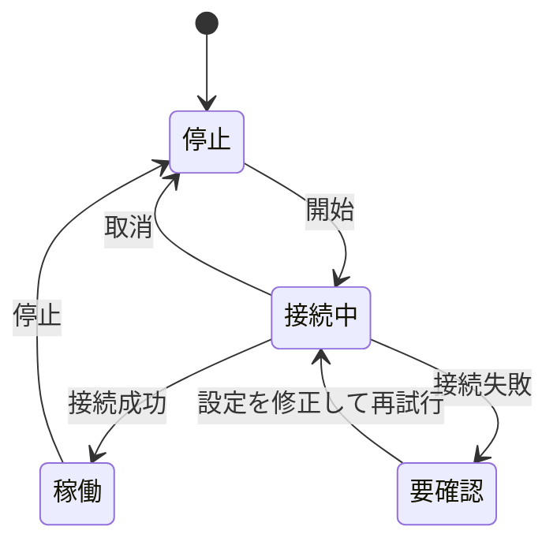

# コードベースのガードと検証

新規・変更コードで、型逃げ、依存の逆流、所有者のない副作用を増やさないための検査である。
成功は仕様全体の正しさや実音声の品質を保証しない。

## 一つの入口から検証する

初回は`npm ci`と、Python 3.12以降で次を実行する。

```powershell
python -m pip install --target node_modules/.cache/auralyn-python -r requirements-dev.txt
npm run verify -- --changed
```

| コマンド | 対象 |
| --- | --- |
| `npm run verify -- --static` | 設定指紋、Python、Rust抑制・RT検査適用、検査器の負例試験、用語、制御文字（全ファイル） |
| `npm run verify -- --changed` | staticと同じ検査。制御文字は未コミット・新規ファイルだけ |
| `npm run verify -- --full` | staticと、`scripts/*.test.cjs` のスクリプト試験 |
| `npm run verify -- --static --rust` | staticと、容量・他ビルド確認、直下の Rust fmt、Clippy全target（ワークスペース全体、`-D warnings`）、auralyn-core・auralyn-ui-model の試験、gain ramp・比較・native変換の既存試験、`auralyn-gpui` の試験（Windows） |

RT の禁止API・型の検査（`clippy.toml`）は `crates/vst-host` にだけ置く。直下に置くと `src-gpui` にも効いてしまう。
Tauri 版の TS/E2E の検査（ESLint・Vitest・Playwright・型検査）は 2026-11-28 に画面と一緒に取り除いた（利用者の承認）。CI は Windows で `verify --full`、Linux で直下の `cargo fmt` と `auralyn-core`・`auralyn-ui-model` の Clippy と試験を見る。RustSec の監査は直下の `Cargo.lock` を見る。

成功時は検査名と所要時間、失敗時は末尾の診断・再実行コマンド・詳細ログを表示する。
実行ごとに`test-results/gardening/<時刻>/summary.json`と各ログを残す。ignore済みの検証証跡であり、コミットしない。
Rustは既存のCargo targetを再利用する。大容量領域の準備・終了時の整理は[BUILD_GUIDE](BUILD_GUIDE.md)に従う。

## 既存違反を固定する

例外台帳は、既存違反をファイル・ルール・宣言のソース指紋・件数・理由で固定する。改行コードは正規化し、抑制・言い訳コメントは診断箇所の内容も固定する。

- 新規の宣言・ファイル・違反、件数増加は失敗する。
- 違反を持つ宣言を編集すると免除は失効する。残る違反も修正し、不要な台帳項目を削除する。
- 同じファイルの別宣言の編集では、未変更の既存負債まで書き直さない。
- 違反を減らしたときは台帳の件数・不要項目を減らす。指紋を書き換えて追認しない。
- 台帳を自動生成・更新するコマンドは提供しない。新しい例外は、人間が対象・理由・撤去条件を承認した場合だけ追加する。

PythonはRuffの重大エラー・未定義名・裸のexcept・抑制を検査し、ASTで同じ隔離方式を使う。導入時のPython例外は0件である。
Rustの既存`allow/expect`は`config/gardening-rust-baseline.json`でファイル指紋ごとに固定する。Rustの抑制検査は属性の字句的検出であり、完全なRust AST解析ではない。

## 検査対象と限界

Rustは`await_holding_lock`をdenyし、`gain_ramp`・`comparison`の製品処理と`native_stream`の入出力変換でClippyの禁止API・型を有効にする。
`Cargo.toml`では禁止API・型のlintを既定でallowとし、上記RT境界のdeny属性で有効にする。禁止リストを設定しただけで制御処理・テストのI/Oまで警告にしないための適用範囲指定である。
制御スレッドの有限待機や起動時の確保まで禁止しない。新しいRT経路には同じ検査を付け、既存の割当・解放計測も実行する。
禁止リストは全呼出し先を解析するRT安全証明ではない。間接的な確保・プラグイン内部・実機driverは別途検証する。
コメントの禁句検査は候補の検出にすぎない。数学・仕様・公開API・`SAFETY:`・ライセンスは残し、コードの言い換えや古い説明はレビューで取り除く。

## 設定変更をレビューする

`config/gardening-policy.json`は検査設定、台帳、検査器、検証コマンド、CIの承認済み指紋を持つ。改行コードの違いは無視する。
`package.json`はscriptsを検査する。アプリの版は直下 `Cargo.toml` の `[workspace.package]` にある。
`Cargo.toml`はlintsセクションを検査する。
指紋の不一致は失敗する。必要な強化・例外削除・依存更新でも、対象差分と実結果を確認して指紋を更新し、更新理由をレビューへ示す。通過のための緩和や負債の追認には使わない。

`.github/CODEOWNERS`はガード変更のレビュー先を指定する。実際の強制にはGitHub側で必須チェックとCode Ownerレビューを保護する設定が必要である。
同じ書込権限を持つ実行者は検査器と指紋の両方を変更できるため、指紋だけを敵対的改ざんへの防壁とは扱わない。GitHub設定の変更は対象と影響を示し、明示承認を得て行う。
2026-11-17の設定確認と、承認後に必須CIを適用した記録は[整備後の確認](proposals/gardening-follow-up.md)を参照する。

## UI・非同期フローを確認する

[feature-map](feature-map.md)から画面・テストへ進む。画面（GPUI 版）は Windows の実機で確かめ、手順は [src-gpui/README.md](../src-gpui/README.md)。規則の試験と実機・聴感・長時間運転を分けて記録する。
複雑な状態変更の説明には、次のようなユーザー視点の図を添える。変更する実装のイベント・取消・失敗に合わせて書き換え、図だけで検証済みと扱わない。


