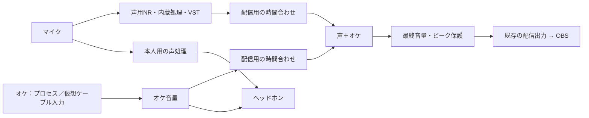

# プロセス単独入力から、マイク＋オケとミックス後VSTへ拡張する

作成日: 2026-11-02。状態: 段階1の単独入力をローカル実装済み。2026-11-03にChrome・VLC各65分を再計測し、利用者の指示に従って段階2〜3へ着手した。実機・聴感の未確認条件は別に残す。
追跡: [Issue #233（段階0〜1）](https://github.com/blackflame7983/Auralyn/issues/233)。
2026-11-03の継続指示: [再計測の原データと結果](../PROCESS_INPUT_REMEASUREMENT_2026-11-03.md)を揃えて段階2〜3へ進む。自動計測の成功を、物理マイク・ASIO・OBS・聴感の合格へ読み替えない。
2026-11-02の再判断: 原音を本人が聴かない別の出力先へ送れる環境ではプロセス入力を使い、それができない環境では仮想ケーブル入力を使う。単一の再生先だけでプロセス入力を成立させる条件は外す。
2026-11-02の追加判断: 別再生先で取得音が残ることを確認したため、利用者の指示に従って段階1へ着手した。聴感・実アプリ・長時間運転など未確認の条件は、完了と混同せず[検証記録](../PROCESS_LOOPBACK_STAGE1.md)で管理する。
コード確認基準: `a69c75d3de15f5b3f8f8ab09def8b8b2b1f50a26`。実装着手時に差分を再確認する。

最初に、Chromeや音楽アプリを一つ選んで取り込み、既存VSTで加工して聴けるようにする。
プロセス入力を使えない環境でも、従来の仮想ケーブル入力で同じ用途を続けられるようにする。
その入力経路をオケ用に再利用し、マイクとの同時入力、配信用の時間合わせ、ミックス後VSTの順に追加する。
第1段階では入力・出力・ラックの役割を分けるが、複数入力の汎用ミキサーは作らない。

本書は実装の分割と受入条件を定める。実装済み・実機確認済み・公開済みを意味しない。
本書の合否条件と、現在の実装・検証結果を区別する。現在地は[段階0の記録](../PROCESS_LOOPBACK_STAGE0.md)で追跡する。

### 前倒しする理由と、戦略文書との関係

[優先順位の見直し案](../STRATEGY_REVISION_2026-11.md)では、ゲーセン配信を差別化の中心にし、許諾を得た配信者の実際の配信素材をAuralyn経由で聞いてNRを確認すると決めている。
別の出力先を使える環境では、プロセス単独入力により仮想ケーブルの導入を省ける可能性がある。ただし、元アプリの出力先の変更と原音の抑止は必要になる。
このため段階0〜1は、ゲーセン素材でNRを評価する手段として前倒しする。
段階1の完了条件には、取り込んだ配信素材にNRを掛けて比較できることを含める。

プロセス入力を作れば、マイクとオケを別々に扱う土台にもなる。段階2〜3はその延長の歌枠向け機能で、評価手段とは別の判断である。
見直し案の「汎用ミキサーの拡充は当面行わない」は維持し、本計画はマイク一系統とアプリ音声一系統の固定構成に限る。
段階2以降の着手順は、段階1の完了時に#93（NR再比較）、#109（導線）、保存・復帰（I-97a・I-98a）と並べて改めて決める。

D-03（OBSソースプラグイン）とは送り先の段で接する。
本計画は既存の配信出力を使う。段階2では各入力を主処理のクロックへ追従させ、声とオケの相対的な時間差を調整する。
D-03はミックス済みの音をOBSのクロックへ追従させる。入力側と送信先側の速度差補正は別の境界で必要になり、声とオケの時間合わせを代替しない。
同じ相対オフセットをAuralynとOBSで重ねて設定しないよう、D-03の設計時に各補正の対象と所有箇所を明示する。

## 1. 単独入力を先に完成させる

| 段階 | 利用者ができること | 前提と完了の判断 |
| --- | --- | --- |
| 0: 技術検証 | 別出力先を使うプロセス取得と、仮想ケーブルで代替する構成を確認する | API、期限内停止、別出力先の原音抑止と取得の両立、仮想ケーブルへの切替手順が成立する |
| 1: アプリ単独入力 | 環境に応じてプロセス入力または仮想ケーブル入力を選び、声として（NR込み）または音楽としてVSTを使う | 両経路で二重再生を防ぎ、配信素材でのNR比較、選択・保存・開始・停止・再選択と従来入力の回帰確認が済む |
| 2: マイク＋オケ | マイクと、プロセスまたは仮想ケーブル経由のオケを同時に取り込み、音量と配信の時間差を調整する | 独立したクロック、本人への返し、OBS最終録音を確認する |
| 3: ミックス後VST | 声用VSTと、声＋オケ全体に掛けるVSTを別々に調整する | 二つのラックの保存・復元・失敗時保護が成立する |

第1段階はWASAPI出力・ステレオ処理を最初の対応範囲とする。
従来の機器入力に対するASIO対応は維持する。プロセス単独入力からASIOへ出す組合せは、段階2の混在検証で追加する。
製品サポートはWindows 11 x64を維持し、APIの最低OS条件を製品の対応範囲へ広げない。

[既存の取り込み調査](../PLAYBACK_CAPTURE_RESEARCH.md)では、機器全体のループバックを先に検証する案だった。
今回の利用目的に合わせ、その実装順序を本書で変更する。二重再生・自己循環・実機未検証という制約は引き継ぐ。
機器全体のループバック、複数アプリの同時取得、タブ単位の取得、オケ専用VST、内蔵プレイヤー、OBS専用転送プラグインは本計画の対象外とする。
まず一つのプロセスツリーと既存のOBS出力経路に範囲を絞り、入力の安定性と同期を確認するためである。
評価の再現性にはWAVファイル入力が向くが、配信アーカイブを直接流す用途を置き換えないため、本計画とは別に扱う。
配信でオケや市販楽曲を使う権利の案内も本計画の対象外とする。
Chrome限定のタブ取得、独自の仮想オーディオドライバー、APO、他アプリへのDLL挿入は採用しない。既存のプロセス取得と仮想ケーブルで対応範囲を明示する。

### 入力経路を環境に応じて選ぶ

| 環境 | 採用する入力経路 | 元アプリと本人用出力の関係 |
| --- | --- | --- |
| 本人用とは別の、有効な再生先を利用でき、原音を聴かずに取得できる | プロセス入力 | 元アプリを別再生先へ送り、Auralynの加工後だけを本人用出力へ返す |
| 別再生先を用意できない、またはその再生先で原音抑止と取得が両立しない | 仮想ケーブル入力 | 元アプリを仮想ケーブルの再生側へ送り、Auralynで録音側から受けて本人用出力へ返す |

ここでいう別再生先は、Windowsが利用可能な再生エンドポイントであり、使っていないディスプレイのHDMI音声などを含む。
ヘッドホンが一台でも別エンドポイントを使える環境はあるが、同じエンドポイント一つだけでのプロセス入力は対応条件に含めない。
デバイス名が一覧にあるだけでは対応とせず、接続状態、対象アプリからの再生、原音を抑止した状態での取得を確認する。
仮想ケーブルは`device`入力として扱い、新しい入力種別やドライバーは作らない。経路の切替は利用者が停止中に選んで行い、無断でインストール・切替しない。
対象アプリや保護されたコンテンツに取得制限がある場合、仮想ケーブルでも解消できるとは保証しない。

## 2. 現行の境界を使い、入力と出力の接続方式を分ける

| 現行の箇所 | 確認した構造 | 計画での扱い |
| --- | --- | --- |
| `src-tauri/src/ipc.rs` の `Command::Start` | `host`、入力／出力名・ID、rate、buffer、チャンネル指定を受け取る | 入力種別を追加し、機器名や入力IDにPIDを埋め込まない |
| `src-tauri/src/audio.rs` の開始処理 | 共通hostでマイク権限を確認し、`ActiveAudioConfig`を保存する | 実際の入力種別に応じて権限と起動条件を判定する |
| `audio_engine/core/startup.rs` | 同じCPAL hostから入出力機器を解決し、入力から有界キューへ渡す | 入力機器を前提にした箇所（ノイズ学習の識別、チャンネルスキャン、ASIOの構築順、入力エラー通知、入力側MMCSS）を入力元から切り離し、プロセス入力ではCPALの入力機器解決を通さず同じ後段へ接続する |
| `audio_engine/core.rs`、`plugins.rs` | 入力ストリームと既存ラックを一系統ずつ所有する | 第1段階では一系統を維持し、ラックと入力機器の所有を切り離す |
| `audio_engine/split_monitor.rs`、`live_output.rs` | 本人用の内蔵処理と配信用のNR／VSTを分離できる | 第2段階の本人用／配信用分岐の土台にする |
| `audio_engine/resampling.rs` | 異なる公称rateを固定比率で変換する | 公称rate変換と、独立クロックの速度差補正を区別する。既存依存の`rubato`の可変比変換を補正方式の候補にする |
| `src/lib/audioPreferences.ts`、`startHomeAudio.ts` | 入力機器が存在する前提で選択・開始・保存する | 設定画面以外の開始・復旧経路も入力種別へ対応させる |

JSON-RPCとHost／Engine／Scannerのサイドカー境界は維持する。
キャプチャはEngine内の専用スレッドが所有し、UIスレッドや出力callbackでCOM初期化・待機を行わない。
VSTの隔離はEngine単位であり、VSTごとの障害隔離があるとは扱わない。

### 最初から固定する契約

以下は新設予定の概念名であり、現行APIではない。実装時にRustとTypeScriptの型・JSON表現を揃える。

| 契約 | 第1段階 | 後の拡張 |
| --- | --- | --- |
| 入力元 `InputSourceConfig` | `device` または `process_loopback` のタグ付き型 | 同じ型をオケ入力へ使う |
| 用途 `InputPurpose` | `voice`（NR・ノイズ学習・内蔵処理を通す）または`music`（通さない） | primaryは`voice`、accompanimentは`music`に固定する |
| トラック `primary` | 入力元を一つ持ち、既存VSTラックへつなぐ | マイクをprimary、プロセスまたは仮想ケーブル経由のオケを`accompaniment`へ割り当てる |
| 出力設定 | 接続方式、機器ID、チャンネル、処理rateを入力から独立して持つ | ASIOマイク＋WASAPI取得＋配信用WASAPI出力を表現する |
| ラックの役割 | 既存ラックを`primary`として扱う | 第3段階で`post_mix`を追加し、操作対象を明示する |
| 実行状態 | 入力元、取得状態、実フォーマット、キュー、世代、失敗理由 | トラック別・出力枝別の状態と時間合わせを追加する |

`device`は入力側のhost・機器ID・チャンネルを持つ。`process_loopback`は選択アプリの識別情報と取り込み条件を持つ。
出力側のhostを変えても、プロセス入力やマイクの種類が暗黙に変わらないようにする。
用途は入力元と独立に持ち、プロセス入力を声として扱う評価用途と、音楽として扱う鑑賞・オケ用途を区別する。
第1段階では`primary`だけを実装し、空のオケ入力、第二ラック、任意の配線グラフは保存しない。

プロセスの保存情報と実行中の識別は分ける。
保存するのはアプリの候補を再表示するための識別情報で、PIDは次回起動の接続先として保存しない。
実行時はPID・生成時刻・選択世代を照合し、PIDの再利用や古い一覧の応答で別プロセスを取得しない。
アプリ再起動後は保存情報から候補を示し、利用者が選び直す。初期対応では自動再接続しない。
同じ実行ファイルの複数起動を勝手に合算せず、選択した一つのルートと子プロセスだけを対象にする。

### 既存設定を変えずに移行する

新スキーマの欠落は従来の機器入力として解釈し、旧`host`を従来の入出力へ写す。
旧入力チャンネル、機器ID、ASIOの独立出力／insert、rate、bufferを維持する。
新旧両方の設定がある場合の優先規則を一つにし、矛盾は開始前に拒否する。
未知の入力種別を既定マイクへ置き換えない。新しいHostと古いEngineの組合せも能力確認で拒否し、入力指定を無視して開始させない。

`last_audio_config.json`、フロントの保存値、フルプロファイル、配信状態bundle、Engine再起動の全経路を点検する。
新形式を表現できない保存・適用機能は、その組合せを明示して拒否するか、対応スキーマを実装してから有効にする。
入力情報を落として「保存成功」にしない。保存失敗後は起動成功と保存成功を区別し、元の設定を保持する。

## 3. 段階0で、APIと原音の経路を先に検証する

既存の`windows`クレート（0.62.2。`Win32_Media_Audio`と`Win32_System_Com`を有効化済み）で、必要なAPIだけを包む実装を第一候補とする。
`wasapi`クレートのアプリループバックAPIは比較対象とする。
採用する場合は実際の版、依存する`windows`の版と二重ビルドの有無、ライセンス・配布条件、依存差分を確認する。
既存CPALや音声処理ライブラリの更新は混ぜない。

確認した公開ソースでは、`wasapi`の`new_application_loopback_client`が条件変数で完了を待ち、待機期限を設けていない。
`wasapi`を採る場合も期限付きのadapterが必要になり、APIを包んでもらう利点は小さい。
Host側のタイムアウトだけで取得スレッドも停止したとは扱わない。
非同期activationを期限付きで管理するadapterを検証し、遅れて返る完了通知まで必要なCOM資源を保持する。
取消後の完了は世代で拒否し、安全に解放する。スレッドの強制終了や、試行ごとに停止できないスレッドを残す方法は採用しない。

検証用プログラムは通常設定と出力を分離し、明示的に選んだ試験アプリを取得する。
音声開始前に入力先・出力先と音量を確認できる形にする。

- `ActivateAudioInterfaceAsync`の成功・失敗・完了しない状態と停止要求を扱う。完了待ちがHostやUIを塞がないことを確認する。
- 完了通知の`IActivateAudioInterfaceCompletionHandler`を、agile objectとして`windows`の`#[implement]`で実装できるか確認する。
- キャプチャクライアントの生成・使用・解放とCOM終了を同じ所有スレッドに置く。`AudioClient`の`!Send`／`!Sync`を迂回しない。
- 子プロセス込みの取得だけを使う。OSの除外モードは「指定以外の全体音」になるため、初期UIへ出さない。クレートのbool引数は名称だけで判断せず、固定した版の実装と照合する。
- プロセスループバックで使えない形式・周期・buffer照会APIを通常デバイスと同じように呼ばない。明示フォーマットで初期化し、実際の受信量と状態を観測する。
- 試験の開始値は48kHz・2ch・f32とし、44.1kHzの再生素材、mono、無音、再開、子プロセスの作り直しを確認する。非対応形式や保護されたコンテンツの取得を保証しない。
- 音声がない状態と、取得失敗・対象終了を分ける。別アプリの通知音とAuralynの加工後出力が混入しないか確認する。

**キャプチャは元アプリの再生を止めない。** 元の音と加工音が同時に耳へ届けば、音が二重になる。
元アプリを本人が聴かない別の再生先へ向け、その出力デバイス側をミュートする構成を検証する。
[段階0の実測](../PROCESS_LOOPBACK_STAGE0.md)では、アプリのセッションをミュート／音量ゼロにすると取得音もゼロになった。この操作を原音抑止の案内には使わない。
出力デバイス側のミュートは別の制御であり、追加検証ではFS2333とRealtek Digital Outputで取得音が残ることを確認した。未確認の機器やドライバーにも同じ結果を保証しない。
既定デバイスや全アプリの出力先は自動変更しない。利用者が対象アプリだけを振り分け、変更した再生先・元の設定・戻し方を確認できる手順にする。
抑止するのは原音用の再生先だけであり、Auralynの本人用出力や、他アプリが使う出力を一括でミュートしない。
必要な再生先を用意できない場合や、その再生先で取得音を保てない場合は、従来の仮想ケーブル入力を案内する。

### Stream Gear Mixerの調査から採る条件

[SGM説明書の追加照合](../COMPETITOR_SGM_MANUAL_2026-10.md)に、2026-11-02の画面確認と同梱説明書の再確認を記録した。
説明書p.9は、APPキャプチャが音をコピーすることと、使っていない別出力への割当て・その出力デバイス側のミュートを案内している。アプリ自体のミュートは取得まで無音にすると説明している。
これは今回の二経路方針の参考資料であり、Auralynでその構成が検証済みという意味ではない。SGMの内部API・単一エンドポイントでの解決・実際の音声品質も確認していない。
SGMの通常モニターと配信側の`STREAM FX`は別であり、説明書p.36では`STREAM FX`を本人用の返しに適用しない。取得・本人用モニター・最終配信音の確認を、同じ機能として扱わない。

### 見直した段階0の合否条件

- 別再生先へ試験アプリを割り当て、出力デバイス側をミュートしても取得音が残り、原音が耳へ届かず、Auralynの返しは聴けることを録音と聴感で確認する。アプリのセッション音量・デバイスの音量・取得音を分けて記録する。
- その再生先を利用できない条件では、仮想ケーブル入力へ切り替え、未加工／加工後を一経路で聴けることを確認する。入力用ケーブルと加工後の出力を同じ経路へ戻して自己循環させない。
- 対象アプリの出力変更、再起動、無音からの再開、別再生先の切断・無効化を確認する。経路が崩れたら無音停止と再確認へ移り、既定出力や別のアプリへ自動接続しない。OSや機器によって直接再生が再開する場合も記録し、Auralynだけで原音を抑止し続けるとは保証しない。
- 別アプリの音やAuralynの出力が混入しないこと、既定デバイスと無関係なアプリの出力設定を変えないこと、利用者が元の設定へ戻せることを確認する。

単一エンドポイントだけでプロセス入力を成立させることは合否条件から外す。別再生先での取得・原音抑止と、別再生先がない場合の仮想ケーブルへの案内を合否条件にする。
対応するプロセス入力の経路が一つも成立しなければ、その製品UIへの組込みは保留する。仮想ケーブル経由の素材評価は独立して続けられる。

この段階の成果物は、再現プログラム、採用するAPI／版、対応する経路、停止期限・キュー容量・速度差補正の方式と上限、30分以上の取得記録とする。
数値は取得周期と実フォーマットを測って決め、段階1の実装契約へ反映する。
安全な再生経路または期限内の停止が成立しなければ、製品UIへの組込みを保留し、原因と代案を記録する。

## 4. 段階1で、アプリ単独入力を製品の操作として完結させる

### 1-0: 入力元を開始処理から切り離す

`core/startup.rs`の入力側（`audio_prod`、resampler、timing、キュー診断、入力エラー通知、入力側MMCSS）を「入力元」としてまとめ、まず機器入力だけをその形へ置き換える。
ノイズ学習の識別、チャンネルスキャン、ASIOの構築順など、入力機器を前提にした箇所を洗い出し、入力元から受け取る形にする。
この単位では挙動を変えず、既存の試験とWASAPI／ASIO実機の回帰確認だけで完了を判断する。

### 1-A: 入力種別と保存・IPCを通す

入力設定をタグ付き型へ移し、HostからEngineへの開始・再起動・状態取得を対応させる。
プロセス単独入力ではマイク機器を開かず、マイク権限を開始条件にしない。
従来の機器入力の権限確認は維持する。
設定画面だけでなく、ホーム開始、起動時復元、本番保護、プロファイル適用、配信設定の復旧へ同じ契約を通す。

候補一覧は通常権限で、利用可能な全再生エンドポイントの音声セッション（`IAudioSessionManager2`）を列挙して取得する。
`IAudioSessionManager2`は機器ごとの管理であるため、既定出力だけに限定しない。原音の二重再生を避けるために別の再生先へ移したアプリも取得対象に含める。
音を出しているアプリだけを候補にし、セッションのPIDからルートプロセスをたどって選択単位へ対応づける。Chromeでは音声担当の子プロセスがセッションを持つ。
複数の機器やセッションで同じ対象が見つかった場合は、ルートPIDと生成時刻で重複排除する。同じ実行ファイル名でも別起動のプロセスはまとめない。
再生先変更後の更新でも、同じ実行中プロセスの選択を保持する。音声待ちを対象終了と誤認して別プロセスへ接続しない。
表示名と選択用の不透明な識別子をUIへ渡す。
一覧取得ではキャプチャを始めない。生成時刻や実行ファイルの照合はバックエンドで行う。
取得できないプロセスは選択不可とし、権限を自動昇格しない。
ウィンドウ名やコマンドライン、利用者名を含むフルパスを診断ログへ記録しない。
自分自身のHost／Engine／Scannerとその子孫を候補・開始検証の両方で拒否する。

### 1-B: キャプチャを既存DSPへ接続する

新設候補は`src-tauri/src/audio_engine/process_capture/`とし、OS列挙、キャプチャ所有、PCM転送の責務をまとめる。
`loopback_probe`は到達確認用として残し、常時取得に転用しない。
出力callbackを音声処理の進行基準とし、取得したステレオPCMを事前確保した有界キューから読む。

callbackと音声転送中には、ヒープ確保・解放、待機ロック、ファイルI/O、文字列ログを持ち込まない。
OSイベント待ちはキャプチャスレッドだけで行い、停止イベントも待機対象に含める。
フォーマット変換・作業領域は開始前に準備し、OSから届くパケット長を検証して分割処理する。
OS APIの不正なbuffer値を使った巨大確保を避ける。

無音期間も出力の時間軸を進め、フラグ付きの無音bufferではデータを無条件に参照しない。
欠落やキュー不足は無音で補い、上限を超える滞留は状態を通知して枝を止める。
停止・再選択・再起動では世代を更新し、キューと変換器の残音を破棄する。旧パケットや旧ACKで新しい取得を再開しない。
固定rate変換だけでは長時間の速度差を吸収できないため、プロセス入力側に有界の速度差補正を設ける。
通常運転の補正には、`rubato`の可変比変換など、継続して追従できるSRCを使う。方式と補正上限は段階0で、速度差の正負、音質、段階2での再利用を確認して決める。
`queue_recovery`は、一度だけフェードして滞留フレームを破棄する回復処理であり、通常運転の速度差補正の代わりにしない。
追従範囲を超えた滞留や欠落への対処は、異常時回復として別に定める。回復に伴う無音・破棄・測定の失効を記録し、繰り返しの破棄で速度差を隠さない。
現行の機器入力の回復処理やSRCは、この変更だけを理由に置き換えない。

入力の用途によって、適用する処理を分ける。
声として扱う場合は、マイク入力と同じNR、ノイズ学習、内蔵処理を通す。ゲーセン素材の評価はこの用途で行う。
ノイズ学習や周囲測定は入力機器の識別に紐づいているため、プロセス入力用の識別を定め、マイクの学習結果を流用・上書きしない。
音楽として扱う場合は、マイク用NR、自動ゲイン、ノイズ学習、歌唱用内蔵処理を適用しない。
開始前に適用される処理を示し、既存のマイク設定は上書きせず保持する。
既存VSTラックは明示選択したものを使い、入力変更時にプラグインを無断で複製・差し替えしない。
ボイスチェック等の声を前提にする機能は、音楽の用途では非対応として案内する。通常のVST操作と停止・緊急ミュートは維持する。

### 1-C: アプリ選択と再選択を完成させる

設定に「機器／アプリ」の入力選択を追加し、アプリの場合は候補一覧・更新・選択・用途（声／音楽）・開始を示す。
Chromeはプロセスツリー単位であり、特定タブだけを選べる表現にしない。
取得中、音声待ち、対象終了、開始失敗を区別し、原音と加工音を確認する経路案内を置く。
アプリを選ぶ前に、原音を送る別再生先を利用できるか確認する。利用できない場合は、元アプリの出力を仮想ケーブルの再生側へ、Auralynの機器入力を録音側へ設定する案内につなぐ。
仮想ケーブルが未導入の場合は必要な準備を示し、通常のマイクを代替として自動選択しない。別再生先・仮想ケーブル・本人用出力の役割を表示する。
原音の直接再生を止めたうえで、同じ返し経路の処理を有効／無効にして比較する。既存のVSTバイパスと、NRを含む比較の範囲を区別する。
原音が直接鳴り続ける状態で、原音だけと「原音＋加工音」を比較して完了にしない。
再生先変更やEngine再起動を必要とする適用は停止中に行う。本番保護中は入力変更を拒否する。
通常の音楽鑑賞では、オケ入力欄やミックス後ラックを表示しない。

### 段階1の受入条件

- 単体・実IPC: 旧設定の読込み、不正指定、能力不足、マイク権限拒否下のプロセス入力、PID再利用、対象終了、古い応答、開始成功後の保存失敗を検出する。
- RT: 停止・無音・再開・キュー不足／満杯・異率変換を含め、対象callbackとPCM転送のalloc/free 0を確認する。合成クロックで速度差の正負と補正の上下限を確認し、通常時の追従と範囲外の異常時回復を別々に検証する。
- UI: 全再生エンドポイントからの候補取得、同じ対象の重複排除、再生先変更後の選択保持、候補更新の競合、非対応理由、再選択、キーボード操作、狭い画面、既存マイク入力への復帰を確認する。別再生先がない／使えない場合の仮想ケーブル案内と、停止中の明示切替も確認する。
- 実機: 別再生先を使うプロセス入力と仮想ケーブル入力の両方で、Chromeと音楽アプリを個別に確認する。別アプリの通知音、原音の二重再生、自己循環、アプリ再起動、出力消失、1時間以上の連続再生と停止後の解放を確認する。別再生先のミュート中にも加工後の本人用出力が聴けることを確認する。
- 評価: 許諾を得たゲーセン配信素材を声の用途で取り込み、NRの有無・方式を切り替えて比較できる。プロセス／仮想ケーブルの使用経路を記録し、直接再生と返しが重ならない状態で聞き比べる。マイクのノイズ学習結果は変わらない。
- 回帰: 既存のWASAPI／ASIOマイク、仮想ケーブル、チャンネル指定、VST保存・復元、本番保護、緊急ミュートが従来どおり動く。

APIが動いても二重再生を解消できない経路は、音楽鑑賞の対応構成へ含めない。
ローカル試験と実機確認は別々に記録し、片方の成功だけで段階1を完了にしない。

## 5. 段階2で、配信用の時間合わせと本人への返しを分ける

追加するのはマイク一系統とオケ一系統の固定構成とする。
段階1の入力契約を`accompaniment`へ接続し、別再生先を使える場合は`process_loopback`、使えない場合は仮想ケーブルの`device`入力を使う。`primary`には従来のWASAPI／ASIOマイクを使う。
主処理の時間軸は、段階1と同様に通常出力（本人用）のcallbackを基準とする。
同じhostでも別の機器ではクロックが独立し得るため、hostの一致だけで同期を保証しない。ASIOマイクとWASAPI出力の組合せも、各境界の実際のクロック関係で判断する。

| 境界 | 追従先 | 補正の責務 |
| --- | --- | --- |
| マイク入力 → 主処理 | 通常出力のクロック | 独立クロックの場合は、入力側で継続的な速度差補正を行う。共通クロックを確認できる構成では不要な補正を加えない |
| オケ入力 → 主処理 | 通常出力のクロック | プロセス入力は段階1の速度差補正を再利用する。仮想ケーブル入力も実際のクロック境界を確認し、独立していれば継続補正する |
| 主処理 → 追加配信出力 | 配信先機器のクロック | 既存`live_output`の有界の速度差補正を維持する。D-03へ置き換える場合はOBSとの受け渡し境界で設計する |

マイク側への補正の接続方法と、共通クロックを確認する条件・非対応の組合せを、2-Aの開始前に決める。
配信出力をマイクと同じhostに限ることを、速度差補正の代替条件にしない。
速度差への追従を行ったうえで、配信枝で声とオケの相対的な時間差を調整する。

両トラックに音量・ミュート・メーターを設け、声用NR／内蔵処理／VSTはマイク側だけに置く。
加算で音量が上がるため、内部はfloatの余裕を保ち、ミックス前後のメーターと最終ピーク保護を用意する。
トラックの追加だけで既存の音量設定を無断で正規化しない。

図は処理分離を使う歌配信の構成案で、矢印の時間差がないことを表さない。
オケのヘッドホン経路にも取得・出力の遅延はあるが、配信用の追加待ち時間は掛けない。
元アプリを直接聴く構成ではAuralyn側のオケ返しを切り、本人が聴くオケを一経路にする。
機器の直接モニターを使う場合も、Auralynの声返しとの重複を確認する。
各取得キューは一つの消費側が所有し、分岐点で音を複製する。同じconsumerや可変DSP状態を複数スレッドで共有しない。

### 時間合わせは、既知の処理待ちと手動調整を分ける

声とオケを処理rate上の共通時間軸へ揃え、速い側を待たせて混ぜる。
遅い音を未来から取り戻す補正は行わない。
利用者の調整値は「オケを遅らせる／声を遅らせる」の符号付き値として持ち、実装は各枝の非負の遅延へ変換する。
初期案は±2,000ms・1ms刻みとし、固定容量の遅延bufferと境界値試験を用意する。適用時は急な読出し位置変更でクリックや旧音が出ないよう遷移させる。

VSTの申告値、NR・SRCの既知の待ち時間、キューの観測値と、手動オフセットを別々に持つ。
内部情報から分かる差は補正に使えるが、本人が聴く経路や歌唱タイミングまで自動測定したことにはしない。
タイムスタンプが取得できない区間は不明として扱い、単なるcallback到着時刻を信号発生時刻へ読み替えない。
内部観測を耳やOBSまでの総遅延へ流用しない。

同じ48kHzでも独立クロックのずれは残るため、トラックごとにキュー量・欠落・補正量を監視する。
段階1の補正を再利用し、本人用の出力callbackを配信用workerの待機で止めない。
VST変更・rate変更・経路変更で補正の前提が変われば、確認済みの表示を失効させて再確認へ案内する。
OBSへ混ぜた音を一系統で渡しても、映像との時間差は残る。従来のOBS同期オフセットを重ねないよう、現在値を確認して手動調整する手順を設ける。
OBSで同じマイク・オケ・デスクトップ音声を重複取得しないことも最終録音で確認する。

オケ終了時はオケ枝を無音にしてマイクを続行し、対象終了を表示する。別アプリへ自動接続しない。
マイクの致命的失敗は配信全体を無音停止する。本人用・配信用の失敗分離は既存方針を維持する。
緊急ミュートでは声・オケ・残響・待機中の音を全て対象にし、解除後に古い音を流さない。

### 段階2の受入条件

同じテスト信号を両入力へ与える合成試験で、既知の遅延差、符号、上限、rate変換、キューの速度差、無音復帰、遅延値変更を確認する。
異なる音源の波形を比べただけで自動同期できたとは扱わない。
実機ではWASAPIマイク＋アプリとASIOマイク＋アプリを別々に確認する。
オケを仮想ケーブルで受ける構成も確認し、マイクとケーブルの入力側hostが異なる場合を2-Aの設計で扱う。
同一条件で2時間以上の歌配信相当の運転を行い、開始時・途中・終了時の時間差、欠損、CPU、本人への返し、OBS最終録音を記録する。
許容する時間差は本人の返し経路と測定方法を固定して受入前に決め、都合よく判定値を変えない。
既存の48〜72時間の長時間受入は別に残し、短い合成試験や2時間の成功で代替しない。

## 6. 段階3で、配信ミックス専用のVSTラックを追加する

声用の既存ラックは維持し、時間合わせ後の声＋オケに`post_mix`ラックを追加する。
処理順は「各トラックの音量・声用処理 → 時間合わせ → ミックス → ミックス後VST → 最終音量 → ピーク保護 → 配信出力」とする。
両出力の最終保護は、各出力trimを含めて機能する位置を確認する。
sample peak保護をTrue Peak保証として表示しない。
ミックス後VSTは初期状態では本人への返しに掛けず、音楽鑑賞も従来の単独ラック表示を維持する。
本人用の返しだけでミックス後VSTの効果を評価せず、配信枝の最終録音で有効／無効を比較する。最終配信音を返す専用試聴機能は本計画に含めない。

ラックの操作・順序・bypass・エディタ・プリセット・遅延申告・復元状態に役割を付ける。
一つのVSTインスタンスを両ラックや両出力枝で並行処理しない。
複数インスタンス不可や高負荷のVSTも検証し、追加ラックの処理時間が音声の期限を超えないか測る。
ミックス後VSTの遅延は声とオケへ共通に加わるが、OBS映像との同期や最終到達時刻には影響する。

旧プリセットは既存ラックだけに読み込み、`post_mix`へ自動複製しない。
新しい全体保存には両ラックの役割、順序、状態、入力とミックス設定を含める。
`audio/session_rack.rs`、`audio_engine/core/session_rack.rs`、`audio/mode_vst.rs`、復元journalと配信bundleを対象に、世代・revision・ACK・無音保護を両ラックへ拡張する。
歌／雑談切替で変更するラックを明示し、ミックス後ラックは初期仕様では切替対象外とする。
影響範囲の復元が全て完了するまで送出せず、片方だけ成功した状態を完了表示にしない。
ミックス後ラックの致命的失敗では配信枝を無音停止し、本人用の返しは可能な範囲で継続する。無断bypassで音作りを変えない。

段階3では、二つのラックの区別、旧保存データ、欠落VST、一部復元失敗、再起動、順序変更、緊急停止を単体・実IPC・UIで検証する。
実VSTで既知遅延・遅延変更・重い処理・エディタ開閉を確認し、OBS録音、本人の聴感とCPU負荷を段階2と比較する。

## 7. 実装を分割し、段階ごとに検証する

| 作業単位 | 主な変更候補 | 次へ進む前の確認 |
| --- | --- | --- |
| 0 | 隔離した取得probe、依存評価記録 | 別再生先の原音抑止・取得・停止と、仮想ケーブルで代替する構成の確認 |
| 1-0 | `core/startup.rs`、`core.rs`、入力キューと診断 | 挙動の変化なし（既存試験とWASAPI／ASIO実機の回帰） |
| 1-A | `ipc.rs`、`audio.rs`、`commands/audio.rs`、`src/api/audio.ts`、保存型 | 旧設定・旧Engine・全開始経路の契約 |
| 1-B | `process_capture/`、`core/startup.rs`、`core/lifecycle.rs`、入力キュー | 取得、速度差補正、世代、RT契約 |
| 1-C | `AudioSettings`、`audioPreferences.ts`、`startHomeAudio.ts`、セットアップと診断 | 環境に応じた経路案内・単独入力の操作・配信素材でのNR比較・両経路の実機受入 |
| 2-A | オケ設定、二入力のキュー・分岐、ミックス、トラック別UI | 各クロック境界の追従、追加オフセット0での二入力と失敗分離 |
| 2-B | 遅延buffer、時間観測、本人用／配信用分離、OBS案内 | 時間合わせと長時間の実機受入 |
| 3-A | ラック役割、保存schema、session rack、mode VST、journal | 両ラックの原本保護と復元 |
| 3-B | 配信用worker、ミックス後VST、最終保護、ラック選択UI | 実VST・OBS・聴感・負荷 |

分割中に未対応の入口から新形式を使わせない。UIの有効化は保存・起動・停止が一通り揃ってから行う。
入力切替、ミックス有効化、ラック構成変更には、停止中の下書き・検証・適用・保存・失敗時復旧を設ける。
既存の保存ファイルを退避せず上書きする移行は行わない。通常の変更・保存の成功と、復旧原本の保護を別に検証する。

実装中は[TESTING.md](../TESTING.md)に従って対象試験を実行する。
音声処理・IPC変更の完了時は、[BUILD_GUIDE.md](../BUILD_GUIDE.md)のRust test/check/clippyとフロントの全体試験・型・buildを実行し、Rustのfmtも確認する。
IPC・プロセス寿命の変更には実sidecar試験、画面変更には関連DOM・ブラウザ試験を含める。
配布依存を追加する場合はライセンスと配布方針のチェックも行う。
実Tauriの保存・再起動試験は実音声の試験と区別する。

この計画書の作成では、リンク・差分・文章を確認する。コードのbuildや音声取得は必要としない。
各実装の報告は、ローカル自動試験、実機、OBS最終録音、聴感、長時間、未確認事項を分け、対象commit・機器・OS・アプリ・VST・rate・buffer・経路を添える。
公開番号は段階名から決めず、公開時に[VERSIONING.md](../VERSIONING.md)に従って判断する。

## 8. 段階0で確定する未解決事項

| 論点 | 現時点の方針 | 決定に必要な結果 |
| --- | --- | --- |
| API層と停止方法 | 既存`windows`で必要APIを包む案を第一候補、`wasapi`を比較対象とし、どちらも期限付きactivation adapterで扱う | 完了通知の`#[implement]`実装、`wasapi`が依存する`windows`の版、非完了・取消試験 |
| 別再生先を使えない環境 | 仮想ケーブル入力を使う。単一エンドポイントでのプロセス入力は対応範囲外 | ケーブルへの設定手順、未導入時の案内、未加工／加工後の一経路での比較、既存入力の回帰 |
| 速度差補正の方式 | 通常時は`rubato`の可変比変換などのSRCで継続追従し、`queue_recovery`等の異常時回復を分ける | 速度差の正負と上限、長時間の音切れ・音質、回復時の無音・破棄・測定失効、段階2での再利用 |
| 候補一覧の取得元 | 全再生エンドポイントの音声セッションを列挙し、ルートPIDと生成時刻で重複排除する | 非既定出力、再生先変更後の選択保持、Chrome・パッケージアプリの対応づけ |
| Chrome等の選択単位 | 一つのルートと子プロセス。実行ファイル名による全件合算はしない | 音声子プロセス再生成と同アプリ複数起動の取得範囲 |
| 二重再生の防止 | 元アプリを別再生先へ送り、その出力デバイス側で原音を抑止する。成立しない環境は仮想ケーブルへ案内 | 出力デバイスのミュートとアプリのセッション音量を分けた実測、加工後の返し、再生先消失時の挙動と戻し方 |
| rate・buffer・速度差補正 | 48kHzステレオを開始値とし、観測から有界の設定を決める | 受信周期、最大パケット、滞留、音切れ・音質 |
| 新設定の識別情報 | PIDを永続化せず、ローカルなアプリ識別と実行時照合を分ける | デスクトップ／パッケージアプリ、同名・複数起動の識別 |

## 参照した一次資料

2026-11-02確認。クレート採用時は固定した版の資料とソースを再確認する。

- [Microsoft: Application loopback audio capture](https://learn.microsoft.com/en-us/samples/microsoft/windows-classic-samples/applicationloopbackaudio-sample/) — 対象プロセスツリー、音声なしの動作、OS条件。
- [Microsoft: AUDIOCLIENT_PROCESS_LOOPBACK_PARAMS](https://learn.microsoft.com/en-us/windows/win32/api/audioclientactivationparams/ns-audioclientactivationparams-audioclient_process_loopback_params) — 対象PIDと包含／除外モード。
- [Microsoft: IAudioSessionManager2](https://learn.microsoft.com/en-us/windows/win32/api/audiopolicy/nn-audiopolicy-iaudiosessionmanager2) — セッション列挙の対象は、管理インターフェースを取得した再生エンドポイント単位。
- [wasapi 0.26.0: AudioClient](https://docs.rs/wasapi/0.26.0/wasapi/struct.AudioClient.html) — 対応API、スレッド所有、プロセス取得で使えない照会API。現行依存へ採用済みという意味ではない。
- [wasapi公開ソース](https://docs.rs/wasapi/latest/src/wasapi/api.rs.html) — 説明と実装の照合用。`include_tree=false`を「子を含めない」と解釈しない。
- [Stream Gear Mixer公式配布ページ](https://booth.pm/ja/items/8177399)、[同梱説明書と画面の照合記録](../COMPETITOR_SGM_MANUAL_2026-10.md) — 説明書p.9の別出力先とミュート、p.36の本人用／配信用処理の違い。Auralynの実機合格の代用にはしない。
- [SINGING_MONITOR.md](../SINGING_MONITOR.md)、[FRAME_TIMING.md](../FRAME_TIMING.md)、[LIVE_MODE_VST_TRANSACTION.md](LIVE_MODE_VST_TRANSACTION.md) — 現行の分岐・内部観測・復元保護。過去の検証記録は新経路の合格証拠にしない。
