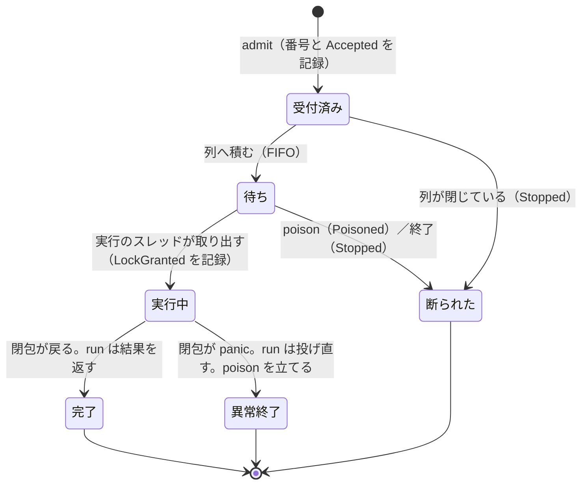
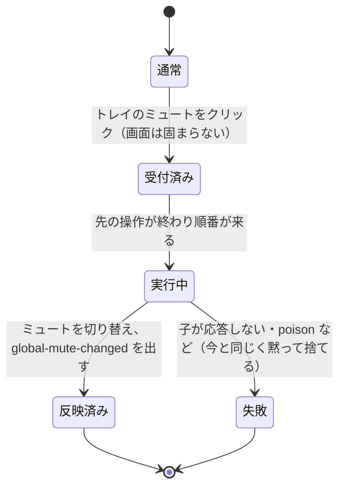
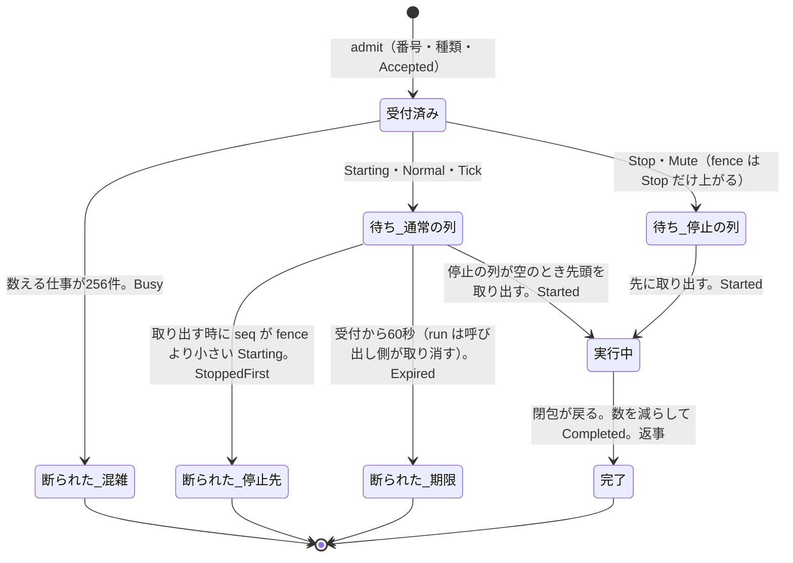
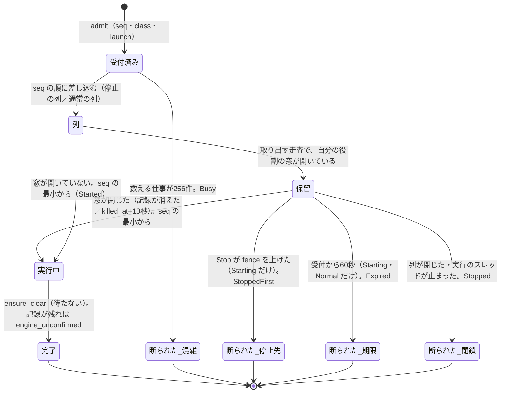
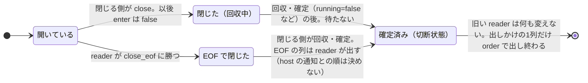
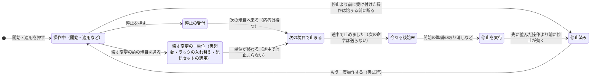

# F1b-0b セッションの中心部の作り直しの設計（第1版・骨子）

状態：設計の骨子（第2版）。Gemini 4 Neon のレビュー（条件つき）を受け、7章で方式と分け方を決めた。段ごとの詳細設計は、8章（F1b-0b-0）・9章（F1b-0b-1）・10章（未決の決定）・11章（F1b-0b-2a）・12章（F1b-0b-2b：停止の優先と受付の上限）・13章（F1b-0b-3：reaper と N3）・14章（F1b-0b-4：N2 の完全な形。Sol のレビュー2回（どちらも BLOCK）と Neon への相談を受けた第3版。閉じる側の待ちは無い。要承認の候補は無い。着手前に決めることは残っていない。次段・実装時の未決と選択肢だけの O12 を14.15 に挙げた）まで書き、F1b-0b-4 を実装した（実装との差は14.21）。15章（F1b-0b-2c：実行中の停止。J-20。第2版。Sol のレビュー〔BLOCK〕と統括の決定を受け、原則 P〔境目は壊す変更の前と一単位の後にだけ置く〕で境目 23 地点と区間の入口 3 か所に直した。子の起動の門は作らない。コードは未実装で、設計だけ。要承認の候補は E。A・B は利用者の決定〔2026-11-24〕で推奨案。未決は 15.15。2c-1・2c-2 に分ける案は 15.19。実装との差は 15.21〔実装後に書く〕）を書いた。**15章（F1b-0b-2c）は利用者の決定（J-22、2026-11-24）で見送り、F1b-0b はここで締める。**

前提の文書：
- 今の事実：`audio-session-f1b0b-inventory.md`（bcd2dca2 の時点。以下「洗い出し」）。
- 変わる挙動：`audio-session-f1b0-changes.md`（C1・C4・N1・N2・N3、J-17・J-18・J-20）。
- 土台：`audio-session-f1b0a-design.md`（F1b-0a-1）、`audio-session-f1b0a2-design.md`（F1b-0a-2）。両方の既知の狭い競合3件（F1b-0a-1 の11章、F1b-0a-2 の6章）を、この段の合格の条件にする。
- 利用者の決定（2026-11-22）：F1b-0b は「部分的な作り直し」として進める。親の側のセッションの中心部（状態の持ち主・受付・接続）を `AudioControl` の後ろで新しく作り、今の95か所の入口はつなぎとして流す。子との IPC と旧い通知はそのまま。

## 1. この段で達すること

| # | 挙動（利用者から見て） | 今（洗い出し 4章） |
|---|---|---|
| C1 | 停止は、先に並んでいる通常の操作より先に実行する。停止より前に受け付けた「音を鳴らす・子を起動する」操作は、実行の前に断る | ロックを取れた順。std の `Mutex` は公平でない |
| C4 | 終わっていない操作が256件を超えたら断る。通常の操作は受付から60秒で始まらなければ失敗。停止は断らない。長い操作は一歩ごとの期限だけ（J-20） | 上限なし。`Admission` は記録だけで、件数も完了も持たない |
| N1 | トレイ・ショートカットは呼び出しのスレッドで待たない | トレイはイベントループのスレッドでホストのロックを待つ |
| N2 | 古い接続の通知を出さない（完全な形） | 通知の直前の確認だけ（1つの列が出うる） |
| N3 | 終了の確認の待ちで、ほかの操作が止まらない | `ensure_clear` がホストのロックと `Store.slots` を持ったまま最大10秒待つ |
| K1〜K3 | 既知の狭い競合3件をなくす | 洗い出し 2.4 |

変えないもの：子との IPC、旧い通知の名前・中身・順（K13・W5）、エラーの文言（C1・C4 で足す文言を除く）、`engine_generation` の更新点、読み取りが先の操作の完了を待つ境界（K2・K10）。

## 2. 方式の比較（決めること3つ）

### 2.1 実行の持ち主：どこで命令を実行するか

| 案 | 中身 | 良い点 | 危険 |
|---|---|---|---|
| 2.1-A 実行のスレッド（推奨） | 1本の「実行のスレッド」が `AudioHost`（主と配信ミックスの子を含む）を持つ。入口は `AudioControl::run(entry, |host| …)` で、閉包を受付の列に積み、結果を待つ。今の入口の本体は閉包の中身としてそのまま使う | 実行の順を1か所で決められる（C1・C4）。入口の本体を書き換えない。トレイは積んですぐ戻れる（N1） | 閉包の中で子の応答を待つ間、実行のスレッドは止まる（今のロックを持った待ちと同じ） |
| 2.1-B 今の `Mutex` の前に順番の入口を置く | ロックは残し、取る順だけを入口で決める | 変更が小さい | 第1回の方式比較で、ロックを貸し出す形を残すと二重の移行になると判断した（options 7.1） |

### 2.2 reader の役割：通知と状態の更新を誰が行うか

| 案 | 中身 | 良い点 | 危険 |
|---|---|---|---|
| 2.2-A reader は今のまま通知を出し、状態だけを1つの遷移にまとめる（推奨） | reader は今と同じく旧い通知を直接出す（W5・K13 の順を保つ）。ただし、reader と実行のスレッドの両方が触る接続の状態（`LinkState`・`ReplySlot`・`vst_operations` の終了の原因・配信ミックスの切断の記録）を、**1つの `Mutex` の下の1つの状態機械（`LinkCell`）**にまとめる。CAS と送り側の取り出しと原因の採取を、同じロックの区間で行う | 既知の狭い競合3件の根（2つの状態が別々に変わる）を直接なくす。通知の順は今のまま | reader が `LinkCell` のロックを取る間、`emit` をしない規則が要る |
| 2.2-B reader は行を実行のスレッドへ送るだけにし、通知も実行のスレッドが出す | 状態の持ち主が完全に1つになる | 閉包が子の応答を待つ間は、実行のスレッドが通知を出せない。応答より前に通知を出す今の順（K13）を保つには、待ちの中で受信箱を読む「ポンプ」が要り、再入の順が複雑になる（第1回の方式比較で、案 A の最大の危険とした点） |

### 2.3 終了の確認（N3）

| 案 | 中身 |
|---|---|
| 2.3-A reaper（推奨） | 子ごとに reaper のスレッドが `WaitForSingleObject` で待ち、終わったら `retired` の記録を消して実行のスレッドへ知らせる。`ensure_clear` は、期限まで reaper の知らせを条件変数で待つ（`Store.slots` のロックを持たない）。待つ間も実行のスレッドは止まるが、ほかの入口の受付（C1 の停止の受付、N1）は止まらない |
| 2.3-B 実行のスレッドの外で作り直しを待つ | 作り直しを要する操作を「保留」にして、終わったら再開する。段の状態機械が要る（F1b 本体の範囲） |

## 3. 推奨の組み合わせと、その理由

**2.1-A ＋ 2.2-A ＋ 2.3-A。**
- 閉包の中の待ちは、今の「ロックを持った待ち」と同じ性質なので、K2・K10・K13 の互換を保てる。2.2-B のポンプを避けられる。
- 既知の狭い競合3件は、どれも「reader と実行の側が、別々の状態を別々の順で変える」ことが根（洗い出し 2.4）。2.2-A の `LinkCell` で、その根を1か所で断つ。
- C1 の「停止を先に」は、受付の列の優先度で決まる。実行中の閉包は割り込まない（J-18）。
- N1 は、トレイ・ショートカットが閉包を積んで戻るだけになる。

## 4. 互換の安全網（洗い出し 5章の事実への対応）

- 公開の入口だけで書かれた試験（K 群、`control_tests`）は、そのまま通る必要がある。
- 内部に結び付いた試験（`post_mix_life_tests` 153 か所、`config_storage_tests` 128、`link_tests` 61、`engine_life_tests` 44、`reply_deadline_tests` 29 など）は、作り直しで壊れうる。**作り直しの前に、それらの試験の性質を、公開の入口（または `AudioControl::run` の上）から確かめる形へ移す段（F1b-0b-0）を置く。** 期待値は変えない。移せない試験は、理由と、代わりに守る性質を記録する。
- W5 は手動の測定。F1b-0b の後に測り直す。

## 5. 分け方（案）

| 段 | 中身 | 挙動 |
|---|---|---|
| F1b-0b-0 | 安全網を公開の入口へ移す（4章） | 変えない |
| F1b-0b-1 | `LinkCell`（2.2-A）。既知の狭い競合3件を根から直す | 競合の窓が閉じる（K1〜K3） |
| F1b-0b-2 | 実行のスレッド（2.1-A）と受付の列。C1・C4・N1 | 変える（J-17） |
| F1b-0b-3 | reaper（2.3-A）。N3 | 変える（ほかの入口が止まらない） |
| F1b-0b-4 | N2 の完全な形（`LinkCell` の世代で、通知の列の直前に照合） | 変える（古い通知が出ない） |

## 6. 未決（レビューで決めたいこと）

1. 2章の3つの選択（推奨の組み合わせ）は妥当か。
2. 2.2-A の `LinkCell` で、既知の狭い競合3件が本当に根から消えるか（洗い出し 2.4 の窓ごとに）。
3. 2.1-A で、閉包の中で子の応答を待つ間に実行のスレッドが止まることが、C1（停止を先に）・N3 と矛盾しないか（J-18：実行中の命令は応答を待ってから停止）。
4. F1b-0b-0（安全網を移す段）を先に置く判断と、その範囲。
5. 5章の分け方と順。

## 7. Neon のレビュー（骨子の第1版）を受けた決定

判定は「条件つき」。必須の3点を、次のとおり決めた（統括）。2.1-A・2.2-A は妥当、2.3-A は直す。

### 7.1 `LinkCell` の範囲を広げる（必須1：既知の狭い競合3件を根から閉じる）

- **競合1**：`begin`（`Open` の確認・`ReplySlot` の登録・`vst_operations.begin`）と、reader の `close_eof`（閉鎖・待ち手の取り出し・`take_exit`）を、同じ `LinkCell` のロックの区間にする。さらに、writer が書き込みの直前に `LinkCell` の下で操作を「送った」に上げ、`Aborted` になった操作を終了の原因から外す。`cut_off` の順（`vst_operations.response` が CAS の前）も、同じ区間の中の順にそろえる。
- **競合2**：配信ミックスの失敗の後始末を、`LinkCell::close(Intentional)` の1つの遷移にする。勝ったときだけ `discard_child()`、すでに EOF・期限切れで閉じていれば `detach_with()`（`enabled` を残す）へ分ける（今の「`settle()` の後に `detached` の数を比べる」2段をやめる）。
- **競合3**：経路 (b)（別の回収が待ち手を横取りする）は `LinkCell` で閉じる。経路 (a)（`reply_timed_out` が EOF に負けたとき、通知の前に `ENGINE_EXITED` を返す）は、負けたら `LinkCell` と通知の列のロックを持たずに、reader が通知の後に送る `Eof` を待ってから返す。

### 7.2 N3：作り直しの待ちを実行のスレッドの外へ出す（必須2。案 (a) を採る）

- 2.3-A のままでは、`ensure_clear` の最大10秒の待ちで実行のスレッドが止まり、停止もミュートも読み取りも止まる。N3 と C1 に反する。
- **決定**：子を起動しうる入口は、`retired` が空でなければ、**実行のスレッドへ入る前に**（受付の側で）reaper の知らせを期限まで待つ。待つ間、ほかの入口は実行のスレッドで進む。実行のスレッドの中の再確認で記録が残っていた場合は、待たずに今の規則（`engine_unconfirmed`）で答える。待っている間に C1 の停止が届いたら、待ちを起こして、その開始を断る（停止より前に受け付けた開始の扱い、C1）。
- `retire_child` の最大2秒の確認は、この段では今のまま実行のスレッドの中に残す（`engine_unconfirmed` の判定を変えないため）。reaper へ移すかは F1b で決める。

### 7.3 N2 の完全な形（必須3）

- 世代の照合だけでは、照合の直後に閉じたときの1列の窓が残る。**閉じる側は、閉じた後に通知の列のロックを1度通して、進行中の旧い列を掃き切ってから次へ進む**（または、通知の側の有効な世代の更新を、通知の列のロックの下で行う）。どちらにするかは詳細設計で決める。
- 旧い reader の `voice_activity.store(true)` が `kill_primary_engine` の後に残る窓と、`ensure_clear` の間に `engine_epoch` が古いまま `engine_event` が通る窓も、`LinkCell` の閉鎖と `retire_engine` にそろえて閉じる。

### 7.4 段の分け方の直し

| 段 | 中身 | 挙動 |
|---|---|---|
| F1b-0b-0 | 安全網の整理（範囲を絞る）：(1) 洗い出し 5.3 の固定していない約束（既知の競合3件、`cut_off`、`voice_activity`）の試験を足す。(2) `LinkCell`・reaper で壊れる試験（`link_tests`・`reply_deadline_tests`・`post_mix_life_tests`・`engine_life_tests` の内部の直接の参照）だけを、今の公開の入口と最小の継ぎ目へ寄せる。`config_storage_tests`・`device_scan_tests` は触らない | 変えない |
| F1b-0b-1 | `LinkCell`（7.1） | 競合の窓が閉じる |
| F1b-0b-2a | 実行のスレッドへの移し替えと N1（受付の順は今と同じ FIFO） | ほぼ変えない |
| F1b-0b-2b | C1・C4（受付の列の優先度と上限） | 変える（J-17） |
| F1b-0b-3 | reaper と、作り直しの待ちを外へ出す（7.2）。N3 | 変える |
| F1b-0b-4 | N2 の完全な形（7.3） | 変える |

### 7.5 詳細設計で扱うこと（Neon の未決3の指摘）

- 複数の IPC を続ける閉包（`apply_profile`・`set_output_gain` の100回の確認など）には途中の確かめの点がなく、停止が全段の後まで遅れる。J-20（一歩ごとの期限、停止が来たら次の命令を送る前に止める）の確かめの点を、共通の IPC の口に置く。
- トレイ・ショートカットのミュートが `interrupt_restore` を取らない（洗い出し 6.9）。C1 の停止の受付と同じ扱いにするかを決める。

## 8. F1b-0b-0 の詳細（安全網の整理。挙動は変えない）

前提：コードは main `5d4e8d31` のとおり。`ファイル:行` は `src-tauri/src/` を基準にする（試験は `audio/tests/`）。7章の決定は変えない。決め切れない点は「未決」として 9.9 にまとめた。なお、依頼にあった「`audio-session-f1a0-design.md` の 11章」は、このフォルダーに無い。同じ内容（既知の狭い競合3件）は `audio-session-f1b0a-design.md` の 11章にあるので、それを使った。

### 8.1 方針：継ぎ目を1か所に集める

- F1b-0b-1 で消える型は `ReplySlot`・`engine_exit::Operations`・`LinkState` の3つ（`audio.rs:292,293,298`）。試験がこれらを直接つかむ場所は、`ReplySlot` の `begin`・`deliver`・`close`・`cancel`、`Operations` の `begin`・`response`、`Reader` の構造体リテラル（`link`・`operations`・`replies`）、「reader の勝ちを真似る」ための `link.close(Eof)` と `pending_reply_tx.close()` の組、の4種類に限られる。
- F1b-0b-0 では、試験の側に **継ぎ目の窓口の1つのファイル `audio/tests/link_seam.rs`（新設。`#[cfg(test)]` の自由関数）** を置き、上の4種類をすべてここ経由にする。F1b-0b-0 の時点の中身は今の部品を呼ぶだけ。F1b-0b-1 では、窓口の中身だけを書き換える。
- 窓口の関数（案）：

| 関数 | F1b-0b-0 の中身（今） | F1b-0b-1 の中身 |
|---|---|---|
| `begin_request(&AudioHost, Option<&Command>) -> Result<Receiver<ReplyOutcome>>` | `pending_reply_tx.begin()`、続けて `vst_operations.begin(cmd)`（`audio.rs:1075-1076` と同じ順） | `link.begin(cmd)` |
| `deliver(&AudioHost, Response)`・`deliver_at(…, Instant)` | `pending_reply_tx.deliver*` | `link.deliver*` |
| `win_eof(&AudioHost) -> Option<Sender<ReplyOutcome>>` | `link.close(Eof)` が勝てば、`pending_reply_tx.close()` を返す（reader の勝ちの真似） | `link.close_eof()` の `waiter`（`exit` は**捨てる**。原因を見ない試験だけが使う） |
| `cas_eof(&AudioHost) -> bool`・`take_exit(&AudioHost) -> ExitPayload`（S5 専用の組） | `cas_eof` は `link.close(Eof)` だけ（送り側にも記録にも触れない）。`take_exit` は `vst_operations.take_exit()`（後から、`cut_off` の後に採る） | `cas_eof` は `link.close_eof()` を呼び、返った `EofWin` を窓口が保持する。`take_exit` は、**保持した `exit`（`close_eof` が返した原因）**を返す。S5 はこの原因を検査する |
| `finish_eof(reader) -> JoinHandle` | 先に `reader_for(&AudioHost, epoch)` で組んだ reader（`pause` を足せる）を受け取り、別スレッドで `finish()` を走らせる（通知の列を出し切り、待ち手へ `Eof` を送るところまで進める。ホストを別スレッドが持つ間も使えるよう、組む側と走らせる側を分ける） | 同じ（`mark_notified()` も呼ばれる） |
| `register_sent_operation(&AudioHost, &Command)` | `vst_operations.begin(cmd)` | `begin` の後に `mark_sent` |
| `reader_for(&AudioHost, epoch) -> Reader` | `Reader { link, operations, replies, … }` を組む（`link_tests.rs:30-41`、`reply_deadline_tests.rs:56-69` の2つを1つにする） | `Reader { link, … }` |
| `cancel(&AudioHost)` | `pending_reply_tx.cancel()` | `link.cancel()` |

- `host.link.is_open()`・`host.link.cause()`・`host.link.close(cause) -> bool`・`Writer::start(sink, host.link.clone())`・`set_link_for_test`・`attach_stdin_for_test`・`fail_writes_for_test`・`replace_writer_for_test` は、F1b-0b-1 の `LinkCell` が同じ名前と戻り値で残す（9.1）ので、寄せない。これで寄せる数が小さくなる。

### 8.2 足す試験の一覧（9本）

ID は 8章の中だけで使う（`S1`〜`S9`）。「今」の挙動を固定する試験は、名前に `today_` を付ける。F1b-0b-1 で期待値を変えるものは、9.6 の表で「どう変えるか」を決めてある。

| ID | 名前の案 | 置く場所 | 使う継ぎ目 | 確かめること（今の挙動） |
|---|---|---|---|---|
| S1 | `s1_today_an_unsent_vst_operation_is_named_as_the_exit_cause` | `link_tests.rs` | `reader_for` の `Reader::pause`（`reader.rs:289-292`）、`link_seam::begin_request`、`await_reply` に `Aborted` の `WriteDone` を直接渡す（`link_tests.rs:702` と同じ形）。pause の解放は別スレッドで少し後に行う | reader が EOF の CAS に勝って止まっている間に `begin_request(Some(LoadPlugin))` が通る。`await_reply` は `Engine Crashed/Exited`（ENGINE_EXITED）。解放後の `audio-engine-exited` の `cause == "vst_operation"`・`op == "load"`（送っていない操作が原因に載る。競合1） |
| S2 | `s2_today_an_eof_right_after_settle_drops_enabled` | `post_mix_life_tests.rs` | 新しい継ぎ目 `after_failure_settle`（`post_mix.rs` の `State` に `#[cfg(test)]` で足す。`post_mix.rs:1155` の `state.settle()` と `:1156` の `detached` の比較の間で呼ぶ。`after_exec_check`（`post_mix.rs:312,451-454`）と同じ型）。子は台本つきで `LoadPlugin` に `Error` を返す | 公開の操作 `Request::Add` が、切断ではない理由で失敗する。継ぎ目で子の `link.close(Eof)` を挟むと、`enabled == false`・`error` が立つ・`disconnected` が空（切断として数えられない）。競合2 |
| S3 | `s3_today_the_c3_loser_returns_before_the_eof_notices` | `reply_deadline_tests.rs` | `paused_eof_reader`（`reply_deadline_tests.rs:56-69` を窓口の `reader_for` に置き換える）、`await_reply`（`WriteDone` を12秒前にして期限切れを作る。`:161-170` と同じ形） | 負けた `reply_timed_out`（`audio.rs:1155`）は、reader を止めたまま `Engine Crashed/Exited` で戻る。戻った時点で記録された通知に `audio-engine-exited` が無い。解放後に3つの通知が出る。競合3 (a) |
| S4 | `s4_today_a_host_close_drops_the_waiter_before_the_eof_notices` | `link_tests.rs` | `Reader::pause`、`link_seam::begin_request`、`host.drop_connection(Intentional)`（`audio.rs:718`。試験から呼べる）。tick の待ち手を真似て `rx.try_recv()` を使う | reader が CAS に勝って止まっている間に、別の入口が `drop_connection` する。`rx.try_recv()` は `Disconnected`（`Eof` ではない）。このとき通知は未発行。競合3 (b) |
| S5 | `s5_today_cut_off_clears_the_operation_even_when_eof_won` | `link_tests.rs` | `link_seam::register_sent_operation(LoadPlugin)`、`link_seam::cas_eof`（**今の段では CAS だけで止める**。共通の `win_eof` は原因を捨てるので使わない）、`await_reply` に `broken_pipe()`（`link_tests.rs:55-60`）の `WriteDone`、`link_seam::take_exit` | EOF が先に勝っていても、`cut_off`（`audio.rs:1180-1183`）が `vst_operations.response(Error)` を CAS の前に呼ぶので、続く `take_exit()` の `cause == "unknown"`（本当の VST が消える）。`reply_timed_out` は同じ状況で `vst_operations` に触れない（`reply_deadline_tests.rs:189` の T13 が固定済み）ので、2つの経路の違いを並べて固定する |
| S6 | `s6_today_a_closed_reader_can_still_raise_voice_activity` | `link_tests.rs` | `reader_for`、`reader.handle_event(EngineEvent::VoiceCheckState{…})`（`reader.rs:64`）。`host.link.close(Intentional)`、`host.voice_activity.store(false)`（`kill_primary_engine` の `audio.rs:2819` の真似） | 閉じた接続の reader が、検査を通過していた1行で `voice_activity` を `true` に戻す（`reader.rs:191-199`）。F1b-0b-1 では変えない。期待値を変えるのは F1b-0b-4（7.3） |
| S7 | `s7_start_is_cut_off_at_its_deadline_retired_and_no_stop_is_sent` | `reply_deadline_tests.rs` | `silent_host` と同じ形で `("Start", [WaitGate("never")])`。`set_limits_for_test(None, Some(SHORT))`。`Start` は `frontend_bootstrap.rs:497` の組み立てに倣う | F1b-0a-2 設計 9章の1点目。`Start`（B）で `execute_command` が `REPLY_TIMED_OUT`、`link.cause() == ReplyTimeout`、子が回収される、`Stop` が送られない（`observer.sent()`）、`audio-error` が1回、`confirming_start` が偽、次の `execute_command` で作り直し（`spawn_count == 2`）。`Start` の `device_open` の記録が `timeout()` で残る（`engine_exit.rs:329-342`）ことが、作り直した接続へ持ち越されない（新しい接続の原因が `unknown`）。10秒の互換の試験（`commands/audio/compat_tests.rs:645`）は `SetChannelScan`（A。`:646`）のまま |
| S8 | `s8_t2_c3_keeps_the_saved_post_mix_settings_in_memory_and_on_disk` | `post_mix_life_tests.rs` | `t2_…`（`post_mix_life_tests.rs:717`）と同じ `Rig`。保存した設定は `Request::Save` で作る（`save_request`、`:728`）。`rig.host.post_mix.file_checkpoint()`（`post_mix.rs:424`）と `std::fs::read` | F1b-0a-2 設計 9章の2点目。期限切れの前後で、`state.saved`・`state.raw`・`post-mix.json` の中身が変わらない（`enabled` が残るだけでなく、保存した中身が残る） |
| S9 | 既存の `t12_the_retire_finishes_while_the_reader_is_stuck_in_emit_whether_c3_wins_or_loses`（`reply_deadline_tests.rs:266`）の拡張 | `reply_deadline_tests.rs` | `engine_life::seam::on_stage`（`engine_life.rs:569`）に `Stage::Retired(Role)` を足し、`retire_child`（`engine_life.rs:243-261`）の2つの出口（確認できた `:247-248` と、記録へ移す `:251-260`）の直後に呼ぶ。フックは cutter のスレッドで設定する（`seam` はスレッドごと）。**`eof_wins` の疑似 EOF（`:305` の `link.close(Eof)`）は、CAS で止めず、`link_seam::finish_eof` で通知の列を出し切るところまで進める**（通知は止めた記録器に塞がれるので、`f.recorder.release()` の後に完了する。完了してから `JoinHandle` を `join` する） | F1b-0a-2 設計 9章の3点目。`f.recorder.release()`（`:312`）の前に、回収の完了の印が立っていること（今は `wait_exit`＝子の終了だけで、回収の完了ではない）。勝ち・負けの両方。`eof_wins` では、解放の後に EOF の通知3件が出て、`finish_eof` が戻り、cutter が `ENGINE_EXITED` で戻る |

補足：
- S1・S3・S4 は、reader を止める継ぎ目が `Reader::pause` に限られる（`finish` の直後で止める）。`reader_for` の `Reader` を直接 `finish` させる形で、実プロセスは使わない。
- S2 の継ぎ目 `after_failure_settle` だけが、製品のコードへ足す試験用のコード（`#[cfg(test)]`）。S9 の `Stage::Retired` も同じ。挙動は変えない。
- S5 の「`reply_timed_out` との違い」を同じファイルで並べるのは、F1b-0b-1 で2つの経路が1つの規則（負けたら `vst_operations` に触れない）にそろうことを、差分として見せるため。
- **`Admission`・トレイのミュート・N1 の固定（洗い出し 5.3 の 4〜6）は、この段では足さない。** F1b-0b-2a 以降の対象で、`LinkCell` と無関係だから。

### 8.3 寄せる試験の一覧（期待値は変えない）

対象は、F1b-0b-1 の `LinkCell` で**コンパイルできなくなる**参照と、「reader の勝ちを真似る」組の意味が変わる参照。概算は次のとおり（grep の行数。1つの試験が複数行を持つ）。

| ファイル | 寄せる参照（概算） | 内訳と代表の例 | 寄せ先 |
|---|---|---|---|
| `link_tests.rs` | 約16か所 | `pending_reply_tx.begin()` 10行（`:159,173,188,201,230,245,250,350,360,717`）・`.deliver(…)`（`:160`）・`.close()`（`:203,362`）・`.clone()` で別スレッドへ渡す（`:251`）、`reader_for` の構造体リテラル（`:30-41`）。`link.close(Eof)` と `pending_reply_tx.close()` を続けて reader の勝ちを真似る組（`:202-203`） | `link_seam::begin_request`・`deliver`・`win_eof`・`reader_for`・`cancel`。期待値は変えない |
| `reply_deadline_tests.rs` | 約11か所 | `pending_reply_tx.begin()`（`:160,198,233,243,253`）・`.deliver_at(…)`（`:236,246`）・`vst_operations.begin(&load)`（`:195`。**これは `LinkCell` では「送った」に上げる前の操作になり、原因に載らなくなる**ので、`register_sent_operation` に寄せる）、`paused_eof_reader` の構造体リテラル（`:58-68`） | 同上＋`register_sent_operation` |
| `reply_deadline_tests.rs` の T3（`:155`）・T13（`:189`） | 2本の組み立て直し | 今は `await_reply` を試験のスレッドで呼び、**戻った後に** `pause.release()` する（`:180,208`）。F1b-0b-1 の競合3 (a) で、負けた側は `Eof` を待つので、戻らなくなる（試験が止まる）。**F1b-0b-0 で、`pause.release()` を別スレッド（`await_reply` の開始の少し後）から行う形に直す。** 今の挙動（戻りが先でも、後でも通る）のまま通る。順序そのものは S3 が固定する | 試験の組み立てだけ。期待値は変えない |
| `post_mix_life_tests.rs` | 0か所（コンパイル） | `child.link.close(CloseCause::Eof)` は14か所あるが（`:368,480,517,588,672,867,918,1010,1076,1165,1181,1216,1246,1281`）、すべて待ち手のいない接続を閉じる形（`after_exec_check`・`between_ops` の継ぎ目の中）。`LinkCell::close(cause) -> bool` が同じ名前・戻り値で残るので、そのまま通る。`replace_writer_for_test`（`:675,944`）・`fail_writes_for_test`（`:95,369,673`）・`set_link_for_test`（`:110`）も残る。名前・コメントに残る「`ReplySlot` がまだ開いていても」（`:1154`）は文言だけ直す | 触らない（コメントのみ） |
| `engine_life_tests.rs` | 0か所 | `fail_writes_for_test`（`:324`）だけで、残る。内部の参照44か所（洗い出し 5.1）は `.conditions`・`.retired`・`.child` で、reaper（F1b-0b-3）で壊れる側。`LinkCell` では壊れない | 触らない。reaper の寄せは F1b-0b-3 の前（未決 9.9-U5） |

代表的な書き換え（`link_tests.rs:201-203`）：
```text
今：  let rx = host.pending_reply_tx.begin().unwrap();
      assert!(host.link.close(CloseCause::Eof));
      let sender = host.pending_reply_tx.close().expect("待ち手がいる");
寄せた後：  let rx = link_seam::begin_request(&host, None).unwrap();
            let sender = link_seam::win_eof(&host).expect("待ち手がいる");
```
期待値（`Engine Crashed/Exited`・`audio-error` が出ない・`engine_generation == 0`）は変えない。

**4つのファイルの外にも、同じ型を直接つかむ試験がある**（7.4 の範囲に入っていない。未決 9.9-U1）：

| ファイル | 件数（概算） | 例 |
|---|---|---|
| `audio/mode_vst.rs` の試験部（`:1360-` 以降） | 約50行 | `pending_reply_tx.begin/deliver/close/cancel` 約25行（`:1796,2152,2158,2290,2314,2354,2392,2410,2474,2484,2531,2545,2564,2569,2715,2729,2760,2786`）、`link.close(Eof)` 10行（`:2320,2337,2349,2365,2377,2717,2744,2762,2784,2812`）、`Writer::start(…, host.link.clone())`（`:2375,2413,2444,2557,2742`） |
| `audio/engine_exit.rs` の試験部（`:357-`） | 26行 | `host.vst_operations.begin/response`（`:522-524,734,750-752`）・`Operations` の `.0.lock()`（`:759`）・`exit(&host.vst_operations)`（`:760`） |
| `audio/output_bundle.rs`・`session_rack.rs`・`mixing_bundle_tests.rs` | 5・1・1行 | `host.pending_reply_tx.clone()` で応答の台本を返す（`output_bundle.rs:177,247`、`session_rack.rs:347`） |
| `audio/replies.rs`・`link.rs`・`writer.rs` の単体試験 | 9・5・10行 | 型そのものの試験。型が変わるので、F1b-0b-1 で書き直す（寄せない） |

### 8.4 触らない試験と、その理由

- `config_storage_tests.rs`（36本。内部参照128）：保存ファイル・設定の試験で、`LinkCell` と関係が薄い。`set_link_for_test`（`:105,124,154,573,…`）・`host.link.is_open()`（`:235,459,…`）・`attach_stdin_for_test`（`:151,861,967`）は、9.1 で名前を残すので通る。**ただし、`host.pending_reply_tx.clone()` を取って `deliver` する3か所（`:155`・`:866`・`:976`）は、F1b-0b-1 でコンパイルできなくなる**。7.4 は「触らない」と決めているので、未決 9.9-U2 に挙げる。
- `device_scan_tests.rs`（7本。参照20）：機器のスキャンの試験で、`LinkCell` と関係が薄い。`set_link_for_test`（`:165,199`）・`attach_stdin_for_test`（`:195`）・`fail_writes_for_test`（`:203`）・`host.link.is_open()`（`:205`）は、すべて残る。壊れる参照は無い。
- どちらも、`LinkCell` の型が変わっても、試験の意味が変わらない。寄せると、保存・スキャンの安全網に不要な差分が入るだけ。

## 9. F1b-0b-1（`LinkCell`）の詳細

### 9.1 型の案

今の3つ（`LinkState`・`ReplySlot`・`vst_operations` の終了の原因の部分）と、配信ミックスの切断の判断を、**接続ごとに1つの `Arc<LinkCell>`（`std::sync::Mutex` の下の1つの状態機械）**にまとめる。`AudioHost` の項目は3つ（`link`・`vst_operations`・`pending_reply_tx`、`audio.rs:292,293,298`）が1つの `link: Arc<LinkCell>` になる。接続を作り直すたびに新しい `LinkCell` を作る（今の `reset_engine_reader`、`audio.rs:1058-1064`）。

```text
LinkCell
  inner: Mutex<Inner>           // 状態の正本。すべての遷移と勝ち負けの判断はここ
  notified: Condvar             // `inner` の Mutex と組む。「EOF の通知済み」を知らせる（9.5）
  phase: AtomicU8               // 開閉の鏡。遷移のたびに、ロックの中で `Release` で書く

Inner
  state: Idle | Registered(Sender<ReplyOutcome>) | InFlight(Sender<ReplyOutcome>) | Closed(CloseCause)
  eof_notified: bool            // 勝った reader が、EOF の通知の列を出し終えたら立てる（`Closed(Eof)` のときだけ意味を持つ）
  log:   engine_exit::OperationLog      // 今の `Operations` の `State`（in_flight・awaiting・settling・plugins）
                                         // InFlight 項目に `sent: bool` を足す。`Stop` の「`settling` を消す」印も持つ（E1・E4）
```

**`Operations` の中身は丸ごと `Inner.log` へ移す**（原因の部分＝`in_flight`・`settling` だけでなく、`awaiting`・`plugins` も）。`begin`・`response`・`timeout`・`exit` が互いに同じ項目を読み書きしており（`engine_exit.rs:53-189`）、分けると新しい競合の窓ができるため。`State` の各メソッドは `&mut self` で、既に1つのロックの下にある（`engine_exit.rs:316-355` の `Operations` は薄い包み）。`State` を `pub(super)` の `OperationLog` にして、包みを外す。

**鏡 `phase`（10章の U6）**：`is_open()`・`cause()` は、**ロックを持たずに** `phase` を `Acquire` で読む。書くのは `LinkCell` のロックの中だけで、`Release` で書く。読む場所は、reader の行ごとの確認（`reader.rs:33`）、通知の列の直前の確認（`chain_if`。`reader.rs:28`、`emit.rs:110-123`）、Host・tick の `is_open()`・`cause()`・`connection_lost()`。`chain_if` が使うのは、通知の列のロック（`order`）を持つ間は、ほかのロックを取れない決まり（`emit.rs:61-63`）だから。`Closed` は終端なので、鏡が古いときの誤りは「開いていると見える」側だけ（閉じたと見えることはない）。**勝ち負け・登録・「送った」の判断（`begin`・`mark_sent`・`close`・`close_eof`）は、鏡を使わず、正本の `LinkCell` のロックの下で行う。** エラーの文字列を作る処理（`anyhow!`・`format!`）は、ロックの外に置く（ロックの中では、エラーの種類を表す値だけを返す）。

#### 状態（4つ。`Closed` の原因は5種）

| 状態 | 意味 | 今の対応 |
|---|---|---|
| `Idle` | 開いている。待ちの要求なし | `LinkState::Open` ＋ `ReplySlot::Idle` |
| `Registered` | 開いている。要求を登録した。**まだ書き込みを始めていない**（`log.in_flight.sent == false`） | `ReplySlot::Waiting` ＋ `Operations.in_flight`（送信前も区別しない） |
| `InFlight` | 開いている。writer が書き込みを始めた（`sent == true`） | 同上（区別なし） |
| `Closed(cause)` | 閉じた（終端）。原因は `Intentional`・`Eof`・`WriteFailed`・`WriteTimeout`・`ReplyTimeout`。待ち手の送り側は、閉じた者が取り出し済み | `LinkState::Closed(cause)` ＋ `ReplySlot::Closed` |

#### 遷移の表（各行は同じロックの区間）

「しないこと」は共通で、ロックの中では `emit`・I/O・ほかのロックをしない（9.3）。

| # | 遷移 | 呼ぶ者 | 状態の変化 | 同じ区間で行うこと | 戻り値 |
|---|---|---|---|---|---|
| E1 | `begin(Option<&Command>)` | 呼び出し側（`audio.rs:1075-1076`）・tick（`mode_vst.rs:701`） | `Idle → Registered` | 受け側を作る。`Some(cmd)` なら `log.begin(cmd)`（`sent = false`）。**`Stop` の `settling` の消去（今の `engine_exit.rs:77-80`）は、ここではしない。** `Stop` だという印だけを `log` に残す（E4 で消す） | `Ok(rx)` |
| E2 | `begin` | 同 | `Registered`/`InFlight`：変えない | — | `Err(Busy)`。ロックの外で、今の文言「前の音声操作の応答待ちです。しばらく待つか、エンジンを再起動してください。」（`replies.rs:43-45`）にする |
| E3 | `begin` | 同 | `Closed`：変えない | — | `Err(Closed)`。ロックの外で `CLOSED`（`replies.rs:9`）にする |
| E3b | `begin` | 同 | `Mutex` が poison：変えない | — | `Err(Poisoned)`。ロックの外で、今の文言「IPC応答の状態を取得できません」（`replies.rs:41`）にする。**`begin` だけは、今の挙動を残す**（`into_inner` で進めない）。ほかの遷移は、今と同じく poison を `into_inner` で進む（`replies.rs:100-103` と同じ。今の `Operations` の `if let Ok` は、何もせず戻る） |
| E4 | `mark_sent()` | writer（書き込みの直前。`writer.rs:190-199`） | `Registered → InFlight` | `log.in_flight.sent = true`。`Stop` の印があれば、**ここで** `log.settling = None`（利用者が止めた後の終了を、開始直後の障害と取り違えない。`engine_exit.rs:77-80` の消去をここへ移す） | `true`（書いてよい） |
| E5 | `mark_sent` | 同 | `Idle`/`InFlight`：変えない | — | `true`（登録なしの書き込み・試験の writer は今どおり書く） |
| E6 | `mark_sent` | 同 | `Closed`：変えない | — | `false`（`Aborted`） |
| E7 | `deliver_at(resp, at)` | reader（`reader.rs:45-50`） | `Registered`/`InFlight → Idle` | `log.response(&resp)`、続けて送り側へ `Response{resp, received_at}` を送る（`mpsc` の送信は待たない） | `true` |
| E8 | `deliver_at` | 同 | `Idle`：変えない | `log.response(&resp)` だけ（今の `operations.response` が先に走る挙動を保つ） | `false`（ログ「no one is waiting」） |
| E9 | `deliver_at` | 同 | `Closed`：変えない | 何もしない | `false` |
| E10 | `close_eof()` | reader の終端（`reader.rs:280-306`） | `Idle`/`Registered`/`InFlight → Closed(Eof)` | 送り側を取り出す（`Idle` は無し）。`log.exit(now)` で原因を採る。**原因の選び方は今の `exit()`（`engine_exit.rs:169-189`）と同じ順で、`in_flight` は `sent == true` のものだけを候補にする。** `sent == false` の登録は候補から外し、**無条件に `unknown` にはしない**：次の候補は、起動の直後の `settling`（`DEVICE_OPEN_SETTLING` の内のもの）で、それも無ければ `unknown`。`phase` を `Release` で更新 | `Some(EofWin{waiter, exit})`（勝ち） |
| E11 | `close_eof` | 同 | `Closed`：変えない | 何もしない（送り側は閉じた者が処理済み） | `None`（負け） |
| E12 | `close(cause)` | Host（`close_connection`・`reply_timed_out`・`cut_off`・`fail_mode_deadline`・差し替え。`audio.rs:710,1156,1183`・`mode_vst.rs:693`・`audio.rs:1060`） | `Idle`/`Registered`/`InFlight → Closed(cause)` | 送り側を取り出して**捨てる**（待ち手は `Disconnected`）。原因ごとに記録を片づける：`WriteFailed`・`WriteTimeout` は `log.response(Error(文言))`（今の `cut_off` の `audio.rs:1181-1182`）、`ReplyTimeout` は `log.timeout()`（今の `audio.rs:1157-1159`）、`Intentional` は何もしない | `true`（勝ち） |
| E13 | `close(cause)` | 同 | `Closed`：変えない | **何もしない。送り側にも記録にも触れない**（今の `cut_off` の「CAS の前の `response`」と、`close_connection` の「負けても送り側を取る」を、やめる） | `false`（負け） |
| E14 | `cancel()` | tick（`mode_vst.rs:703,716`） | `Registered`/`InFlight → Idle` | 送り側を捨てる。`log` は変えない（モード VST は操作の記録を持たない） | — |
| E15 | `set_open_for_test(bool)` | 試験 | 直接決める | `Idle` か `Closed(Intentional)` | — |
| E16 | `mark_notified()` | reader（EOF の通知の列を出し終え、**通知の列のロック（`order`）を放した後**） | `Closed(Eof)`：変えない | `eof_notified = true`。`Condvar::notify_all` | — |
| E17 | `wait_notified(deadline)` | EOF に負けた呼び出し側（9.5） | 変えない | 絶対期限まで `Condvar::wait_timeout` で待つ。待つ間はロックを放し、起きるたびに `eof_notified` と期限を確かめ直す | `true`（通知済み）／`false`（期限） |

**状態の数の確認**：状態は `Idle`・`Registered`・`InFlight`・`Closed` の4つ。今は `LinkState`（開閉と原因）×`ReplySlot`（3つ）×`in_flight`（有無）の組から、整合しない組（`Closed` なのに待ちが `Waiting` のまま、など）が出る。`LinkCell` はその組を作れない。

#### 公開の窓口（`AudioHost` の側）

- `is_open()`・`cause()`・`close(cause) -> bool` は、`LinkState` と同じ名前・戻り値で残す。`Writer::start(sink, host.link.clone())`・`rack_pin: Option<Arc<LinkCell>>`（`post_mix.rs:310`）の `Arc::ptr_eq`（`:575`）も、型だけが変わる。
- `close_eof()`・`mark_sent()`・`begin()`・`deliver_at()`・`cancel()`・`mark_notified()`・`wait_notified()` は新設・改名。

### 9.2 7.1 の3つの競合が、どの遷移で閉じるか（窓ごと）

#### 競合1：未送信の VST の操作が終了の原因に載る

| 窓 | 今の順 | 直した後の順 |
|---|---|---|
| 1a. reader の CAS の後に、`begin` が通る | R：`link.close(Eof)`（CAS、`reader.rs:282`）→（止まる）→ H：`is_open()` が真だった後に `pending_reply_tx.begin()`（`audio.rs:1068,1075`）・`vst_operations.begin(&cmd)`（`audio.rs:1076`）→ R：`take_exit()`（`reader.rs:294`）が未送信の `LoadPlugin` を原因にする。writer は `Aborted`（`writer.rs:190-199`） | H の `begin`（E1）と R の `close_eof`（E10）は同じロックの区間で、**どちらかが先**。(i) `begin` が先：`Registered`。`close_eof` が送り側を取り、`log.exit()` は `sent == false` の登録を候補から外し、次の候補（有効な起動直後の `settling`、無ければ `unknown`）を採る。writer の `mark_sent`（E6）は `false`（`Aborted`）。待ち手は `Eof` で解放（`Engine Crashed/Exited`）。(ii) `close_eof` が先：`begin` は `Err(CLOSED)`（E3）。登録は起きない |
| 1b. `begin` の後、writer が書く前に閉じる | 上と同じ（`Aborted` でも記録が残る） | 1a (i) と同じ |
| 1c. 書き込みを始めた後に閉じる | `vst_operations` に載る（これは正しい） | `mark_sent`（E4）で `InFlight`。`close_eof` が `sent == true` の操作を原因にする（同じ結果） |
| 1e. 未送信の `Stop` と `settling` | 今は `begin` が `Stop` の `settling` を先に消す（`engine_exit.rs:77-80`）。`Stop` を登録しただけで書かずに閉じても、`settling`（起動直後の障害の候補）が消えている | `settling` の消去は `mark_sent`（E4）へ移す。`Stop` が書かれなかったとき（`Aborted`）は `settling` が残り、`close_eof` が `settling` を原因の候補にできる（main と同じ。「利用者が止めた後」という事実が無いため） |
| 1d. `cut_off` の順 | H：`vst_operations.response(Error)`（`audio.rs:1181-1182`）→ `link.close(cause)`（`:1183`）。EOF が先に勝っていても、`response` が `in_flight` を先に消す（洗い出し 6.1） | H：`close(cause)`（E12）。勝ったときだけ同じ区間で `log.response(Error)`。負けたとき（E13）は `log` に触れず、reader の `exit()` が本当の原因を採る |

#### 競合2：`settle()` の直後の EOF で `enabled` が落ちる

| 窓 | 今の順 | 直した後の順 |
|---|---|---|
| 2a. 公開の操作の失敗の処理 | `state.settle()`（`post_mix.rs:1155`）が `connection_lost()` を読む（開いている）→（reader が `close(Eof)`）→ `detached == detached_before`（`:1156`）→ `discard_child()`（`:1157`、`enabled = false`、`:797-804`） | 子があれば、`child.link.close(Intentional)`（E12）の戻り値で分ける。**勝った（`true`）：** 閉じたのは自分。`discard_child()`（今と同じ。`enabled = false`・`error` を立てる）。**負けた（`false`）：** すでに EOF・期限切れ・書き込みの失敗で閉じている。`detach_with(None)`（`enabled` を残す）。子が無ければ、今どおり `detached` の数で分ける（`exec_child` が先に外した場合） |
| 2b. 「`settle()` の後に `detached` の数を比べる」2段 | 2段の間に窓 | 1回の `close(Intentional)` の戻り値 1つ。窓は無い |
| 2c. ほかの `settle()`（`exec_child`・`start`・`Enable`。`post_mix.rs:450,845,1018`） | 開いている・閉じているを読み、閉じていれば外す | 変えない。開いていれば何もしないので、読んだ後の EOF は次の呼び出しで外れる（失敗の処理で判断を変える場所は、2a だけ） |

#### 競合3：K13 で、通知の前に `Disconnected` になる

| 窓 | 今の順 | 直した後の順 |
|---|---|---|
| 3a. 期限切れの負け（`reply_timed_out`） | H：`link.close(ReplyTimeout)` に負ける（`audio.rs:1156`）→ `kill_engine` → `drop_connection` → `ReplySlot::close()` が送り側を取って捨てる（`audio.rs:712`）→ `Ok(Error(ENGINE_EXITED))` を返す（`:1167-1169`）。reader の通知3件より前 | `close(ReplyTimeout)` に負ける（E13。送り側には触れない）。子を回収する（I3。通知を待たない）。回収の**前**に、対象の接続（`Arc<LinkCell>`）を保持しておく。回収の後、**負けた原因が `Eof` のときだけ**、同じ接続の「通知済み」（E16・E17）を、`LinkCell` と通知の列のロックを持たずに、絶対期限つきで待つ（9.5）。通知済みになってから（＝reader が3つの通知を出し終え、`order` を放してから）`Ok(Error(ENGINE_EXITED))` を返す。`Eof` 以外の負け方（`WriteFailed` など）では待たない |
| 3b. 別の入口の回収が送り側を横取りする（tick が待ち手） | reader が CAS に勝って止まっている間に、別の入口の `kill_engine`／停止が `drop_connection`（`audio.rs:718-725`）→ `close_connection` が `ReplySlot::close()` で送り側を捨てる（`:712`）。tick の `try_recv` は `Disconnected`（`mode_vst.rs:596`）。通知より前に待ち手が解放される | **閉じるのは送り側の横取りだけ。** `close(Intentional)` が負ける（E13）ので、送り側は reader の `EofWin` に残る。tick の `try_recv` は、reader が `Eof` を送るまで `Empty` になる。tick は「EOF まで待つ」のではない：`Empty` のあいだ次の tick へ戻る（`mode_vst.rs:600-604`）が、`pending.sent.elapsed()` が `pending.limit` に達すれば、今のとおり `fail_mode_deadline`（`ReplyTimeout`・文言「VST切替の応答が不明です」。`mode_vst.rs:605-607`）で失敗する。**期限の処理と文言は変えない。** 通知より前に失敗しうることは、通知の順だけの既存の例外として残す（9.10 の (g)）。回収（`writer = None`・`child.take()`・`retire_child`）は無条件に進む。（`close(Intentional)` が**勝った**ときは、EOF は競りに負けるので EOF の通知自体が出ない。K13 の対象外で、今と同じ） |

### 9.3 ロックの規則

**共通：** `LinkCell` のロックは**葉**。持つ間は、メモリの更新と、待たない `mpsc` の `Sender::send`・`drop` だけをする。`emit`・I/O・ホストのロック・`order`（通知の列）・`emitter`・`Store.slots`・`held_notices`・ほかの `LinkCell`・`Conditions` の更新・`kill`・`sleep`・`recv`・`join`・エラーの文字列を作る処理をしない。**例外は `Condvar::wait_timeout`（E17）だけ**で、待つ間はロックを放し、起きたら条件を確かめ直す。ロックの順は **ホスト → `order` → 鏡の読み取り（ロックを持たない）** で、`order` を持つ間は `LinkCell` のロックを取らない。`LinkCell` のロックから外へは出ない。鏡は `Release` で書き `Acquire` で読む（9.1）。`Mutex` の poison は、`begin` 以外は `into_inner` で進む（`emit.rs:86-107` と同じ）。**`begin` は、今の「IPC応答の状態を取得できません」（`replies.rs:41`）を残す**（E3b。K13 の文言を変えない。T1・T10 で固定する）。

| 役者 | 使い方 |
|---|---|
| reader | 行ごとの `is_open()`（`reader.rs:33`）・`chain_if` の確認（`reader.rs:28`）は鏡だけ。応答は `deliver_at`（E7〜E9）。終端は `close_eof()`（E10・E11）を1回呼び、**ロックを放してから**、`conditions.engine_event`・通知の列・`waiter.send(Eof)` を今の順で行う（`reader.rs:293-305` の順を保つ：先に通知、後で解放）。通知の列を出し終えて `order` を放した後に `mark_notified()`（E16）を呼び、その後に `waiter.send(Eof)`。`Reader::pause` は `close_eof()` の戻りの直後（`reader.rs:289-292` の位置）に置く |
| writer | 書き込みの直前に `mark_sent()` を1回（E4〜E6）。書き込み（`write_payload`）はロックの外。`Aborted` は `false` のとき |
| 呼び出し側（ホストのロックを持つ H・tick） | `begin`（E1〜E3）→ 提出 → `await_reply` → 失敗なら `close(cause)`（E12・E13）。`await_reply` の `recv_timeout` と、EOF に負けた後の「通知済み」の待ち（E17）は、`LinkCell` のロックを持たずに行う（待つ間は `Condvar` がロックを放す。9.5）。`is_open()`・`cause()`・`connection_lost()` は鏡 |
| 回収（`drop_connection`・`kill_engine`・`release_engine`・`Drop`） | `close(Intentional)`（E12）を1回。その後に `writer = None`・`child.take()`・`retire_child`（`kill`・確認の最大2秒）を行う。`retire_child` の間は `LinkCell` のロックを持たない（`close` はもう戻っている） |
| 配信ミックスの失敗の処理（`post_mix.rs:1151-1163`） | `child.link.close(Intentional)` を1回呼び、戻り値で `discard_child` か `detach_with` に分ける（9.2 の 2a）。戻った後に子の回収（`kill_engine`・`release_engine`）をする |

### 9.4 writer が書き込みの直前に「送った」に上げる仕組み（競合1）

- `writer::run`（`writer.rs:190-199`）は、今は `link.is_open()` を読んで書くか `Aborted` にする。これを `link.mark_sent()`（E4〜E6）に置き換える。`mark_sent` は同じロックの区間で、「開いているか」と「登録した操作を `sent` に上げる」を行う。**書く判断と記録の更新が1つの区間**なので、「`Aborted` の操作が原因に載る」ことも「`sent` なのに書かなかった」ことも起きない。
- `Writer::start`・`start_with` の引数は `Arc<LinkState>` から `Arc<LinkCell>` に変わる（`writer.rs:133,145`）。`Job` には操作の識別を持たせない（接続は直列で、登録は同時に1つ。E2）。
- 書き込みの失敗（`Err`）・5秒の期限切れの後は、`sent == true` の操作が `InFlight` に残る。`cut_off` の `close(WriteFailed/WriteTimeout)` が勝てば `log.response(Error)` で片づく（E12）。EOF に負ければ、`close_eof` が `sent == true` の操作を原因にする。
- `mark_sent` は、`Stop` の `settling` の消去も担う（E4）。書かれなかった `Stop`（`Aborted`）は `settling` を消さない。
- モード VST の tick は操作の記録を持たない（`begin(None)`）。`mark_sent` は `Registered → InFlight` の遷移だけを行い、`log` は変えない。
- 試験の継ぎ目：`mark_sent` の直前で止める `before_mark_sent`（`#[cfg(test)]`、`writer.rs`）。T3 で使う。

### 9.5 7.1 の競合3 (a)：EOF に負けたら、ロックを持たずに「通知済み」を待つ（10章の U3・U4）

`rx`（応答の受け側）では待たない。遅い応答を受け取り済みの待ち手は、送り側がもう無く `rx` では待てないため、接続の側の「通知済み」を待つ。

1. **回収の前に、対象の接続を保持する。** `reply_timed_out` の先頭で `let link = self.link.clone()`（`audio.rs:1155` の先頭）。回収の後に `self.link` が差し替わっても、待つのは同じ接続。
2. `link.close(ReplyTimeout)`（E12）。勝てば、今のとおり（`audio-error`・`REPLY_TIMED_OUT`）。
3. 子の回収（`kill_engine`／`kill_primary_engine`。今のまま。I3：回収は通知を待たない）。
4. **負けたときだけ、かつ負けた原因（`link.cause()`）が `Eof` のときだけ**、`link.wait_notified(deadline)`（E17）を呼ぶ。`deadline` は、回収が終わった時点の `Instant::now() + EOF_WAIT` の**絶対期限**。`Condvar::wait_timeout` で待ち、待つ間は `LinkCell` のロックを放す。起きるたびに `eof_notified` と期限を確かめ直す（偽の起床・早い起床に備える）。`WriteFailed`・`WriteTimeout`・`Intentional` に負けたときは、通知の列が出ないので、待たない。
5. **reader は、通知の列を出し終え、`order` を放した後に**、`mark_notified()`（E16）で `eof_notified` を立てて `notify_all` し、その後に `waiter.send(Eof)`。待ち手は `order` を持たない。
6. 結果は、`true`（通知済み）でも `false`（期限）でも `Ok(Error(ENGINE_EXITED))`（今の結果と文言。順序の保証だけが違う）。

**上限 `EOF_WAIT`（案：2秒）：**
- 2秒は、「待ちに足される分」の上限。**手順 3 の回収の後に、`hold_notices` の保持した通知を出すとき `order` を待つ時間（F1b-0a-1 設計 3.3 の既知の範囲）は含まない。** その待ちは今のまま、上限なしの既存の範囲に残る。
- `false`（期限）になったら、待たずに今の `Ok(Error(ENGINE_EXITED))` を返し、**警告を1回だけ**ログに残す。通知の前に返りうる（9.10 の (c)）。上限のあとも reader は通知の列を1列だけ出す（二重には出ない：列は `close_eof` の勝ちを持つ reader だけが出す）。
- ホストのロックを持つ時間の延びは、通常は通知3件の発行だけ（ミリ秒）。reader が `emit` の途中で止まっているときは、最大で `EOF_WAIT` が足される。値は2秒で始め、実装の試験で見直す。

- 経路 (b)（tick）は待たない：tick の `try_recv`（`mode_vst.rs:569-609`）が `Empty` のあいだ次の tick へ戻る（今の構造のまま。期限の処理と文言は変えない）。

### 9.6 変える箇所の一覧（`ファイル:関数`）

製品のコード：

| ファイル:行 | 関数・項目 | 変えること |
|---|---|---|
| `audio/link.rs:45-84` | `LinkState` | `LinkCell` に置き換える（9.1 の E1〜E15）。`CloseCause`（`:6-18`）は残す。単体試験（`:86-`）を書き直す |
| `audio/replies.rs:28-109` | `ReplySlot` | 削除。`CLOSED`（`:9`）・`ReplyOutcome`（`:12-20`）は `link.rs`（または残す）。単体試験（`:111-`）は `LinkCell` の遷移の試験へ移す |
| `audio/engine_exit.rs:36-190,316-355` | `State`・`Operations` | `State` を `pub(super) OperationLog` にし、`InFlight` に `sent` を足す。`exit()`（`:169-189`）は `sent == false` の `in_flight` を候補から外し、次の候補（`settling`、無ければ `unknown`）へ進む。`begin`（`:77-80`）の `Stop` の `settling` の消去は `mark_sent` へ移す。`Operations` の包み（`:316-355`）を削除 |
| `audio.rs:292,293,298` | `AudioHost` の項目 | 3つ（`link`・`vst_operations`・`pending_reply_tx`）を `link: Arc<LinkCell>` の1つに |
| `audio.rs:567-571` | `AudioHost::with_retired` 相当の初期化 | `LinkCell::closed()` |
| `audio.rs:610-619` | `attach_stdin_for_test`・`set_link_for_test` | `LinkCell` の型へ。`reopen_for_test` の呼び出しをなくす |
| `audio.rs:709-715` | `close_connection` | `close(cause)`（E12）1回。`pending_reply_tx.close()` の呼び出しを削除 |
| `audio.rs:893` | `ensure_engine_running` の C5 の確認 | 鏡の `cause()`。変わらない |
| `audio.rs:932-945` | `ensure_engine_running` の writer・reader の組み立て | `Writer::start(stdin, self.link.clone())`・`Reader { link, … }`（`operations`・`replies` を除く） |
| `audio.rs:1058-1064` | `reset_engine_reader` | 新しい `LinkCell::open()` 1つ |
| `audio.rs:1066-1080` | `execute_running_command_inner` | `ensure!(is_open)`（`:1068`）と、`begin`・`vst_operations.begin`（`:1075-1076`）を `self.link.begin(Some(&cmd))` 1つに。`before_begin_hook::run()`（`:1070-1071`）は `begin` の直前のまま |
| `audio.rs:1097-1149` | `await_reply` | `rx` は渡さず、`reply_timed_out()` を呼ぶ形のまま（`:1141-1143`）。`Disconnected` の分岐（`:1145`）も変えない |
| `audio.rs:1155-1177` | `reply_timed_out` | 先頭で `self.link.clone()` を保持。`close(ReplyTimeout)` の中で `log.timeout()` を行う（`:1157-1159` を削除）。回収の後、負けた原因が `Eof` のときだけ `wait_notified(deadline)`（9.5）。上限で警告を1回 |
| `audio.rs:1180-1201` | `cut_off` | `vst_operations.response(Error)`（`:1181-1182`）を削除（`close` の勝ちの側へ移る） |
| `audio/reader.rs:8-19` | `Reader` | `operations`・`replies` を除く |
| `audio/reader.rs:43-50` | `run`（応答の行） | `operations.response`＋`replies.deliver_at` を `link.deliver_at` 1つに |
| `audio/reader.rs:280-306` | `finish` | `close_eof()` 1回。負け（`None`）は何もせず戻る（`:282-286` の `replies.close()` を削除）。勝ちは `waiter`・`exit` を取り、通知の列の後に `mark_notified()`、その後に `Eof` を送る |
| `audio/writer.rs:133-199` | `Writer::start`・`start_with`・`run` | `Arc<LinkCell>`。`run` は `mark_sent()` |
| `audio/mode_vst.rs:693,698,701-716` | `fail_mode_deadline`・`connection_lost`・`send_mode_command` | `close(ReplyTimeout)`・鏡の `is_open()`・`begin(None)`・`cancel()`。tick の判定の順（`:537-615`）は変えない |
| `audio/post_mix.rs:310,551-575` | `rack_pin`・ラックの読み取り | 型を `Arc<LinkCell>` に |
| `audio/post_mix.rs:1151-1163` | `post_mix` の公開の操作の失敗の処理 | `settle()`＋`detached` の比較を、`close(Intentional)` の戻り値による分岐に（9.2 の 2a） |
| `audio/engine_life.rs:243-261` | `retire_child` | `Stage::Retired`（S9。`#[cfg(test)]`）。挙動は変えない |

試験のコード：
- `audio/tests/link_seam.rs`：窓口の中身（9.7 の最初の行）。
- 期待値を変える試験は 9.8。
- `mode_vst.rs`・`engine_exit.rs`・`output_bundle.rs`・`session_rack.rs`・`replies.rs`・`link.rs`・`writer.rs` の試験部：型の変更に合わせて書き換える（8.3 の最後の表。範囲は未決 9.9-U1）。
- `config_storage_tests.rs:155,866,976`：未決 9.9-U2。

### 9.7 合格の条件と試験の形

ID（`T1`〜）は 9章の中だけで使う。

| # | 確かめること | 形 |
|---|---|---|
| T1 | `LinkCell` の遷移の表（E1〜E15）。各行の「状態の変化・同じ区間で行うこと・戻り値」。`Closed` からは戻らない。`close` の負けは何もしない（E13）。`close_eof` の勝ちが送り側と原因を1度だけ渡す（E10・E11）。`mark_notified`・`wait_notified`（E16・E17）：通知済みで起きる、絶対期限で `false`、偽の起床で確かめ直す、待つ間に別スレッドの `is_open()`・`begin()` が返る。**poison：`begin` は「IPC応答の状態を取得できません」を返し（E3b）、`close`・`close_eof`・`deliver_at` は panic せず進む。** 原因の選び方：`sent == true` の操作 → 有効な `settling` → `unknown` の順 | 単体（`link.rs`） |
| T2 | 競合1（1a・1b）：`begin` と `close_eof` を、両方の順で衝突させる。(i) `begin` が先：`mark_sent` は `false`、`audio-engine-exited` の `cause == "unknown"`（有効な `settling` が無いとき。ある場合は T3 の (i)）、待ち手は `Eof`。(ii) `close_eof` が先：`begin` は `CLOSED`。多数回の競り（`link.rs` の `exactly_one_of_many_racing_closers_wins` に倣う）で、未送信の操作が原因に載ることが一度もない | 単体＋継ぎ目（`Reader::pause`、`begin` の直前の `before_begin_hook`） |
| T3 | 競合1（1c）：`mark_sent` の直前で止める（`before_mark_sent`）。止めたまま `close_eof` を通すと原因に載らない。`mark_sent` を通した後に `close_eof` を通すと、その操作が載る。**2つの場合を足す：** (i) `Start` の応答の直後（`log.settling` が有効）に、未送信の `LoadPlugin` を登録して `close_eof` を通すと、原因は `unknown` ではなく `settling` の `device_open`（`phase == "settling"`）。有効期間（`DEVICE_OPEN_SETTLING`）を過ぎていれば `unknown`。(ii) `settling` が有効なときに未送信の `Stop` を登録して `mark_sent` の前に閉じると、`settling` は消えず、原因の候補になる。`mark_sent` を通した後に閉じると、`settling` は消えており `unknown` | 継ぎ目（`writer.rs` の新設） |
| T4 | 競合1（1d）：EOF が先に勝っていても、`cut_off` は `log` に触れず、reader の `exit()` が本当の VST を採る。`cut_off` が勝つときは `log.response(Error)` が効く | 継ぎ目 |
| T5 | 競合2：継ぎ目 `after_failure_settle`（失敗の処理の決定の直前）で子の `link.close(Eof)` を挟む。`enabled` が残る・`disconnected` が立つ・`error` が立たない。挟まない通常の失敗は、今どおり `enabled == false`・`error` が立つ（`discard_child`） | 継ぎ目（配信ミックス） |
| T6 | 競合3 (a)：reader を `close_eof` の直後で止める。`reply_timed_out` は子を回収した後に「通知済み」を待ち、止めている間は戻らない。別スレッドで解放すると、通知3件が出てから `Ok(Error(ENGINE_EXITED))` が返る（順は `[CC, "audio-engine-exited", "audio-error"]` の後で解放）。待っている間、別のスレッドが `link.is_open()`・`link.begin()`・`Notifier::emit` を呼んで、ブロックしない（`LinkCell` と `order` を持っていない）。回収は待ちの前に終わっている（S9 の `Stage::Retired`）。**足す場合：** (i) **期限のあとの応答を受け取り済み**：`received_at` が期限の後の応答を `deliver_at` で渡して `await_reply` が `reply_timed_out` へ進み、その後に EOF に負ける。送り側が無い待ち手でも、「通知済み」を待ち、通知3件の後に戻る（`rx` では待てない場合）。(ii) **上限**：reader を解放しないと、`EOF_WAIT`（`set_limits_for_test` に足す継ぎ目で短くする）の後に `ENGINE_EXITED` で戻り、警告が**1回だけ**ログに出る。そのあとで reader を解放すると、**通知は1列だけ**出る（3件が二重にならない）。待ちに足された時間は `EOF_WAIT` の近くに収まる（回収の後の通知の列の待ちは含まない）。(iii) `Eof` 以外（`WriteFailed`）に負けたときは待たない（即座に戻る）。(iv) 絶対期限：偽の起床を挟んでも、期限を延ばさない | 継ぎ目（`Reader::pause`） |
| T7 | 競合3 (b)：reader を `close_eof` の直後で止め、別の入口が `drop_connection(Intentional)` する。tick 役の `rx.try_recv()` は、`pending.limit` の**期限の中**では `Empty`（送り側を横取りされない）。解放後に `Eof`。回収は進む（`child` が外れ、`writer` が `None`）。**期限の処理は変えない：** reader を解放しないまま `pending.sent.elapsed()` が `limit` に達すると、tick は今のとおり `fail_mode_deadline`（`ReplyTimeout`・文言「VST切替の応答が不明です」。`mode_vst.rs:605-607`）で失敗する（通知より前でもよい。9.10 の (g)）。`close(Intentional)` が勝つ側（reader より先）では、通知は出ず `Disconnected`（今と同じ） | 継ぎ目 |
| T8 | ロックの規則：reader を `emit` の途中で止める（`Recorder::block_after`）。その間に、別のスレッドの `begin`・`close(Intentional)`・`cancel`・`mark_sent` が返る（`LinkCell` のロックを `emit` をまたいで持っていない）。`close_eof` の戻りの後は `LinkCell` を持たずに通知を出す | 継ぎ目（`Recorder`） |
| T9 | 鏡：試験専用のヘルパーで `LinkCell` のロックを持ったまま、別のスレッドの `is_open()`・`cause()` と `Notifier::chain_if` が返る（`order` を持つ間に `LinkCell` のロックを取らない）。遷移の直後の鏡が `Closed` を示す | 継ぎ目 |
| T10 | 互換：K 群（`compat_tests`・`commands/audio/compat_tests.rs`）・`control_tests`・`engine_life_tests`・`post_mix_life_tests`・`link_tests`・`reply_deadline_tests`・モード VST の試験が通る。K13（EOF の通知3件の名前・中身・順、待ち手の解放が通知より先）・`engine_generation` の更新点・書き込みと応答の期限の起点（`flushed_at`）が変わらない。**poison のときの `begin` のエラー文言「IPC応答の状態を取得できません」（今の `replies.rs:41`）が変わらない**（E3b）。**期待値を変えるのは 9.8 の表の S1〜S5 だけ**（S6〜S9 は変えない） | 既存 |
| T11 | 壊して確かめる（一時的な改変）：(a) `begin` と `close_eof` を別のロックに戻す → T2 が失敗。(b) `mark_sent` を `is_open()` に戻す → T3。(c) `close` の勝ち側の記録の片づけを CAS の前に戻す → T4。(d) 失敗の処理を `settle()`＋`detached` の比較に戻す → T5。(e) 負けの側の「通知済み」の待ちを外す → T6。(e2) `Stop` の `settling` の消去を `begin` に戻す → T3。(e3) `mark_notified` を `order` を持ったまま呼ぶ、または待ちの期限を相対期限（起床のたびに延びる）にする → T6。(f) `close` が負けても送り側を取る → T7。(g) `LinkCell` のロックを持ったまま `send` 以外（通知）を呼ぶ → T8 | 一時的な改変 |
| T12 | `voice_activity`（S6）と `engine_event` の epoch の窓は、**この段では変えない**（F1b-0b-4）。S6 が今の挙動のまま通る | 既存（S6） |
| T13 | W5：旧の通知とコマンドの応答の到着順を、対応する release の子で測り直す（`docs/TESTING.md:42-110`。reader の通知の順を変えていないことの確認。手動） | 手動 |

### 9.8 8章で足した試験の期待値を「直った」に変える一覧

| ID | 試験 | 今の期待値 | F1b-0b-1 の期待値（直った） |
|---|---|---|---|
| S1 | `s1_today_an_unsent_vst_operation_is_named_as_the_exit_cause` → `an_unsent_vst_operation_is_not_named_as_the_exit_cause` | `begin_request` が通り、`cause == "vst_operation"`・`op == "load"` | `begin_request` が `CLOSED`（reader が先のとき）。`begin` が先のときは、有効な `settling` が無ければ `cause == "unknown"`（あれば `settling` の `device_open`。T3 の (i)）（T2 の (i)・(ii) の両方） |
| S2 | `s2_today_an_eof_right_after_settle_drops_enabled` → `an_eof_right_after_settle_keeps_enabled` | `enabled == false`・`error` が立つ・`disconnected` が空 | `enabled == true`・`disconnected` が立つ・`error` が空・子は外れて回収済み |
| S3 | `s3_today_the_c3_loser_returns_before_the_eof_notices` → `the_c3_loser_waits_for_the_eof_notices` | reader を止めたまま `await_reply` が戻る。戻った時点で `audio-engine-exited` が無い | reader を止めている間は戻らない。解放後、通知3件が出てから戻る。上限で戻る場合も `ENGINE_EXITED`（T6） |
| S4 | `s4_today_a_host_close_drops_the_waiter_before_the_eof_notices` → `a_host_close_before_the_eof_race_still_reports_the_exit_to_the_waiter` | `rx.try_recv()` が `Disconnected`・通知は未発行 | `Empty`。解放後、通知3件の後に `Eof` |
| S5 | `s5_today_cut_off_clears_the_operation_even_when_eof_won` → `cut_off_leaves_the_operation_as_the_exit_cause_when_eof_won` | `cas_eof` だけで止め、`take_exit` の `cause == "unknown"` | `cas_eof` が呼んだ `close_eof` が返した原因（窓口が保持）を検査する：`cause == "vst_operation"`・`op == "load"`。`cut_off` の `close(WriteFailed)` は負けて `log` に触れない（E13） |
| S6 | `s6_today_a_closed_reader_can_still_raise_voice_activity` | `voice_activity == true` | **変えない**（F1b-0b-4 で `false` に） |
| S7 | `s7_start_is_cut_off_…` | — | 変えない |
| S8 | `s8_t2_c3_keeps_…` | — | 変えない |
| S9 | T12 の拡張 | — | 変えない（`Stage::Retired` の呼ぶ位置は変わらない） |
| （既存）T3・T13 の組み立て直し（8.3） | 別スレッドから解放 | 同じ（F1b-0b-0 で済んでいる） |

### 9.9 未決（決め切れない点。統括の判断を待つ）

- **U1：7.4 の4ファイルの外の試験。** `audio/mode_vst.rs` の試験部（約50行。`pending_reply_tx`・`link.close(Eof)`・`Writer::start(…link.clone())`）、`engine_exit.rs` の試験部（26行）、`output_bundle.rs`（`:177,247`）・`session_rack.rs`（`:347`）は、F1b-0b-1 でコンパイルできなくなる。F1b-0b-0 の継ぎ目（`link_seam.rs`）に寄せる範囲へ入れるか、F1b-0b-1 で型と一緒に直すか。推奨は、`mode_vst.rs`・`output_bundle.rs`・`session_rack.rs` の `pending_reply_tx` の呼び出しだけを `link_seam` 経由にする（約30行。期待値は変えない）。`engine_exit.rs`・`replies.rs`・`link.rs`・`writer.rs` の単体は、型そのものの試験なので F1b-0b-1 で直す。
- **U2：`config_storage_tests.rs:155,866,976`。** 3か所が `host.pending_reply_tx.clone()` を取って `deliver` する。7.4 の「触らない」を守ると、F1b-0b-1 でコンパイルできない。(a) `AudioHost` に試験専用の `reply_slot_for_test()`（戻り値は `Arc<LinkCell>`、`deliver` を残す）を足し、この3行だけを F1b-0b-0 で書き換える。(b) 項目名 `pending_reply_tx` を残す（`Arc<LinkCell>` の別名の項目）。(a) を推奨するが、7.4 を変える。
- **U3：`EOF_WAIT` の値と上限後の振る舞い。** 10章で決定済み。2秒で始め、上限後は `ENGINE_EXITED` を返して警告を1回だけ出す。2秒は待ちに足される分の上限で、回収の後の既存の通知の列の待ちを含まない（9.5）。
- **U4：負けた側が待つ手段。** 10章で決定済み。`rx` ではなく、`LinkCell` の条件変数で「通知済み」を待つ（9.5。E16・E17）。9.3 の「葉」の規則の例外は `Condvar::wait_timeout` だけ。
- **U5：reaper で壊れる試験の寄せ。** 7.4 は、`LinkCell` と reaper の両方で壊れる試験を F1b-0b-0 で寄せるとした。`engine_life_tests`（内部参照44。`.retired`・`.child`・`engine_life::seam`）と `post_mix_life_tests` の `retired` まわりは、`LinkCell` では壊れない（8.3）。reaper（F1b-0b-3）の寄せを、F1b-0b-0 に含めるか、F1b-0b-3 の前の段にするか。この文書は前者を含めていない。
- **U6：鏡（`phase: AtomicU8`）。** 10章で決定済み（書き方は 9.1 にそろえた）。正本は `LinkCell`。鏡は `LinkCell` のロックの中で `Release` で書き、ロックを持たずに `Acquire` で読む（reader の行ごとの確認・`chain_if`・Host の `is_open()`／`cause()`）。勝ち負けは正本で決める。
- **U7：`Operations` の全体を `LinkCell` へ入れる範囲。** 依頼は「`vst_operations` の終了の原因の部分」。`awaiting`・`plugins`（読み込んだ VST の一覧。`engine_exit.rs:42-47`）も、`begin`・`response` が同じ項目を触るので一緒に移した（9.1）。`plugins` を別のロックに残す案は、`response` の中で2つのロックを取ることになり、規則（9.3）に反する。
- **U8：`voice_activity` と epoch の窓の時期。** 7.3 は「`LinkCell` の閉鎖と `retire_engine` にそろえて閉じる」とだけ書き、段は F1b-0b-4 とある。この文書は F1b-0b-1 では変えないとした（T12・S6）。確認したい。
- **U9：書き込みの失敗の通知の規則（E12）。** `close` が負けたときに、`log` にも送り側にも触れない（E13）ことで、今の `close_connection` の「負けても送り側を取って捨てる」（`audio.rs:712`）が変わる。reader が先に EOF に勝つ場合、送り側は reader が持つので問題ないが、**試験専用の `link.close(Eof)`（reader なしで CAS だけ勝つ）は、送り側を捨てるだけになる**（E12 の勝ち）。そのため、reader の勝ちを真似る試験は `win_eof`（8.1）へ寄せる必要がある（寄せた）。製品のコードに影響はない。

### 9.10 既知の狭い競合として残るもの

- **(a) `mark_sent` の後から、子が読むまでの間の原因の推定。** `mark_sent` で `sent` を立てた後、書き込みは成功しても、子が読む前に終わると、子が受け取っていない操作が原因に載る。パイプの書き込みの成功は、子の受け取りを意味しない（今も同じ。区別できない）。`Aborted`（書かなかった）の操作は載らない（競合1で閉じた）。
- **(b)（欠番）** 受け取り済みの待ち手が負けたときの残りは、U4 の決定（条件変数）で消えた。
- **(c) `EOF_WAIT` の上限のあとの通知の順。** reader が `emit` の途中で止まっていて、「通知済み」が上限（2秒）までに立たないとき、待ち手は通知の前に `ENGINE_EXITED` を返す（結果は同じで、通知との順だけが崩れる）。警告は1回。そのあとの通知の列は1列だけ出る（9.5）。
- **(d) 鏡の読み取り。** reader が行の先頭で `is_open()` を読んだ後に閉じると、1つの列が出うる（通知の列の直前の確認の後に閉じる窓。F1b-0a-1 設計 3.4 と同じ）。完全な形は F1b-0b-4（7.3）。
- **(e) `voice_activity.store(true)`・epoch の古い `engine_event`。** 変えない（F1b-0b-4）。S6 が固定する。
- **(f) 配信ミックスの `settle_with`（`post_mix.rs:450,845,1018`）の読み取り。** 開いていると読んだ後の EOF は、その操作の中では何も外さず、次の呼び出しで外れる。結果は切断として失敗するだけで、`enabled` は落ちない（`discard_child` を呼ぶ判断は 2a だけ）。
- **(g) tick が待ち手のときの、期限と通知の順（競合3 (b)）。** 閉じるのは送り側の横取りだけ。tick は `pending.limit` に達すれば、今のとおり `fail_mode_deadline`（`ReplyTimeout`）で失敗する。通知3件より前に失敗しうる。期限の処理と文言は変えない。通知の順だけの既存の例外として残す。
- **(h) 切替の復旧通知と EOF の通知の列の順（`mode_vst.rs` の `send_mode_command`）。** tick の最後の接続確認と `begin` の間に EOF の競りが勝つと、`begin` は `CLOSED` で断られ、切替の復旧の通知が reader の EOF の通知の列より先に出うる。復旧の文言は `ENGINE_EXITED` のまま。完全な順序の保証は F1b-0b-4 で行い、そのとき、通知の前に閉じた接続へ登録しようとした場合を試験に加える。

## 10. 未決 U1〜U9 の決定（統括、2026-11-23）

| # | 決定 |
|---|---|
| U1 | `LinkCell` で壊れる試験は、7.4 の4ファイルの外（`mode_vst.rs`・`engine_exit.rs`・`output_bundle.rs`・`session_rack.rs` の試験部）も含めて、F1b-0b-0 で `audio/tests/link_seam.rs` の窓口へ寄せる。範囲は「`LinkCell` で壊れる参照のすべて」とし、7.4 の表の F1b-0b-0 の行をこの意味に読み替える。期待値は変えない |
| U2 | `config_storage_tests` は、壊れる3か所（`:155`・`:866`・`:976`）だけを窓口へ寄せる。それ以外は触らない |
| U3 | `EOF_WAIT` は2秒の案で始め、実装の試験で見直す。**2秒は、待ちに足される分の上限**で、回収の後の既存の通知の列の待ち（`hold_notices` が `order` を待つ範囲）までを含む上限ではない。上限を過ぎたら、待たずに `Engine Crashed/Exited` を返し、警告を1回だけ出す（結果は同じで、通知との順だけが崩れる。9.10 の (c)）。待つのは EOF に負けたときだけで、期限は絶対期限（9.5） |
| U4 | 負けた側の待ちは、`rx` ではなく `LinkCell` の条件変数にする。回収の前に対象の接続を保持し、回収の後、EOF に負けた場合だけ、同じ接続の「通知済み」を待つ。待つ間はロックを放し、起きたら条件を確かめ直す。reader は、通知の列のロックを放してから「通知済み」を立てる。EOF 以外の負け方では待たない。遅い応答を受け取り済みの待ち手も、同じ条件変数で待てる（9.5。E16・E17） |
| U5 | reaper で壊れる試験の寄せは、F1b-0b-3 の段に含める（F1b-0b-0 には入れない） |
| U6 | 鏡（`AtomicU8`）を許す。正本は `LinkCell` で、勝ち負けは正本で決める。鏡は `LinkCell` のロックの中でだけ `Release` で書き、ロックを持たずに `Acquire` で読む（読む場所は、通知の列の直前の確認だけでなく、reader の行ごとの確認と、Host・tick の `is_open()`／`cause()` を含む。9.1）。エラーの文字列を作る処理は、ロックの外に置く |
| U7 | `Operations` の全体（`awaiting`・`plugins` を含む）を `LinkCell` に移す。`LinkCell` のロックの区間では I/O と `emit` をしない規則を守る |
| U8 | `voice_activity` と epoch の窓は F1b-0b-4 で直す |
| U9 | 試験専用の `link.close(Eof)` は `win_eof` に寄せる（9章のとおり） |

## 11. F1b-0b-2a（実行のスレッドと N1）の詳細

前提：コードは main `cffaba6f`（F1b-0b-1 の後）。`ファイル:行` は `src-tauri/src/` を基準にし、今のコードで確かめ直した（洗い出しの行は動いている。食い違いは 11.18）。7章の決定（2.1-A・2.2-A）と、7.4 の「2a は、実行のスレッドへの移し替えと N1。受付の順は今と同じ FIFO。挙動はほぼ変えない」を変えない。C1・C4・`interrupt_restore`（洗い出し 6.9）は 2b、reaper・N3 は 3、N2 は 4。

### 11.1 答えの要約（決めること 1〜9）

| # | 決めること | 答え |
|---|---|---|
| 1 | 持ち主の移し替え | 今は `Arc<Mutex<AudioHost>>`（`audio/control.rs:174`）を、入口 95 か所が `AudioControl::lock` で取る。2a では `AudioControl::new` が `AudioHost` を新しい1本のスレッド（`auralyn-audio-control`）へ移し、`Mutex` をなくす。入口の 93 か所（起動時の `setup`・warmup・scheduler を含む）は `run`、トレイとショートカットの2か所は `post` へ（11.4 の表、11.9） |
| 2 | `run` の形 | `run<R: Send + 'static>(entry, FnOnce(&mut AudioHost) -> R + Send + 'static) -> Result<R, ControlError>`。返事は1件ごとの `sync_channel(1)`。受付の列は `Mutex<VecDeque<Job>>`＋`Condvar`（取り出す関数が1か所なので、2b で優先度を足せる）。`admit`（受付の記録）は残し、`Ticket::run`/`post` が列へ積む。Tauri のコマンドは今のまま `async fn` で、`run_blocking` の中で `run` を呼ぶ（11.4） |
| 3 | 再入 | **今の経路は 0 件**（`audio/`・`profile.rs`・`bundle.rs`・`obs_setup/` は `AudioControl` を持たない。入口を持つのは `commands/*`・`lib.rs`・`shortcuts.rs`・`obs.rs`・`migration.rs`・`temporary_session.rs`・`updates.rs` だけで、どれも閉包の外で呼ぶ）。それでも実行のスレッドの上の `run` は、待たずに `Err(Reentrant)` で返す。構造の試験で、持ち込みを防ぐ（11.5） |
| 4 | 閉包の panic | 閉包を `catch_unwind` し、実行のスレッドは死なない。待っている呼び出し側へは panic をそのまま投げ直し（今の `spawn_blocking` の `JoinError` と同じ）、以後の `run` は `Err(Poisoned)`（各入口が今の文言へ写す）。リリースは `panic = "abort"`（`Cargo.toml:117`）なので、今も 2a も即終了で変わらない（11.6） |
| 5 | N1 | トレイとショートカットは `post`（待たない）。閉包は今の本体のまま。結果の `Err` は今と同じく、トレイは捨て、ショートカットは `shortcut-error` を出す。ロックの失敗も閉包が `Err(ControlError)` を受けて同じ文言にする。`interrupt_restore` は 2a では取らない（11.7） |
| 6 | 時間で動くもの | 周期でホストのロックを取るのは、モード VST の scheduler の1本だけ（配信ミックス・メーターは取らない）。scheduler のスレッドは今のまま（10ms 眠る→`run`で1 tick→返事を待つ）。tick は列に溜まらず、期限の起点は `AudioHost` の中の `Instant` のまま（11.8） |
| 7 | 終了・起動 | 最後の `AudioControl` を捨てると列を閉じ、実行のスレッドが残りの仕事を `Err(Stopped)` で断り、ホストを `Drop`（子の回収は今の `Drop` のまま）してから終わる。`Drop` は終わりを `join` して待つ。実際の終了での `Drop` は一律には断定しない。通常起動後は、通知用の `AppHandle` が `AudioState` を管理する `AppManager` を参照する輪があり、ホストが保持されうる。いずれでも子は Job で回収される（新しい終了の手順は足さない。11.9）。起動は `new`→scheduler→`run`（emitter）→warmup のスレッドの順（11.9） |
| 8 | ロックの順 | 実行のスレッドが閉包を走らせている間が「今のホストのロックの中」。その中の順（`Shortcuts` の gate → `Store.slots`／`order`→`emitter`／`held_notices`／`LinkCell`）は今のまま。列と `Admission.log` は葉で、持ったまま何もしない。reader は列も実行のスレッドも取らない（11.10） |
| 9 | 試験 | 既存の試験は、**型名3か所の差し替えだけ**で期待値を変えずに通る。そのために、試験専用の `AudioControl::lock`（実行のスレッドがホストを箱ごと貸し出す `HostLease`）を残す。足す試験は `X1`〜`X14`、壊して確かめる項目は 11.14 の (a)〜(z)（11.14） |

### 11.2 範囲

やること：
- `AudioHost` の持ち主を、`Mutex` から1本の実行のスレッドへ移す。入口 95 か所を `run`／`post` へ書き換える。
- 受付の列（FIFO。取り出す関数は1か所）、返事、poison、再入の検出、起動と終了。
- N1：トレイとショートカットを待たずに戻す。

やらないこと（それぞれの段で行う）：
- 停止を先に実行する・上限・期限・断り（C1・C4。2b）。列の優先度は足さない。`Phase` の名前（`LockGranted`）も変えない（11.16 の U9）。
- トレイ・ショートカットのミュートが `interrupt_restore` を取ること（洗い出し 6.9。2b）。
- reaper・N3（段 3）、N2 の完全な形（段 4）。閉包の中の待ち（`ensure_clear` の最大10秒、`retire_child` の最大2秒、`wait_notified` の最大2秒、`await_reply` の応答の期限）は今のまま閉包の中に残る。
- 子との IPC、通知の名前・中身・順、エラーの文言、`engine_generation` の更新点、読み取りが先の操作の完了を待つ境界（K2・K10）。
- 実際の終了で子を回収する新しい手順。

### 11.3 今の事実（確かめ直したもの）

- 持ち主：`AudioControl { host: Arc<Mutex<AudioHost>>, admission: Arc<Admission> }`（`audio/control.rs:172-176`）。`lock(entry)` は `admit(entry).lock()`（`control.rs:221-223`）で、`Ticket::lock`（`control.rs:248-252`）が `host.lock()` の後に `push_granted` を呼ぶ。返すのは `LockResult<MutexGuard<AudioHost>>`。
- 入口は **95 か所**（洗い出し 3章と同じ数）。`commands/audio.rs` 59・`commands/bundles.rs` 13・`commands/voice_check.rs` 8・`commands/profiles.rs` 3・`obs.rs` 2・`updates.rs` 2・`temporary_session.rs` 2・`migration.rs` 1・`shortcuts.rs` 1・`lib.rs` 3（トレイ `:353-362`・`setup` の emitter `:389-394`・warmup `:397-407`）・scheduler 1（`control.rs:236`）。ほかに、ロックを取らない `note` が `quit_app`（`lib.rs:72-79`）に1か所。
- 呼び出しのスレッド：83 のコマンドと `obs`・`updates`・`migration`・`temporary_session` の 7 か所はすべて `run_blocking`（`commands/mod.rs:7-13`）か `spawn_blocking` の中。トレイはイベントループのスレッド（0洗い出し 1.2）。`setup` はメインのスレッド。warmup と scheduler は専用のスレッド。ショートカットの OS のコールバックは `try_lock` と状態の確認だけをして、ロックを待つ処理を `spawn_blocking` に渡す（`shortcuts.rs:384-418`）。
- 入口の本体はすべて `&mut AudioHost`（または `&AudioHost`）への呼び出しで、`AudioControl` を持たない。`bundle_change_scope(|host| …)`（`commands/bundles.rs:2726`）や `profile::apply_profile(&config_dir, &mut host, …)`（`commands/profiles.rs:150`）も同じ形。
- ロックの失敗の文言は入口ごとに違う（「Failed to lock audio state」「音声状態を取得できません」「音声設定を取得できません」「音声の状態を取得できません」。例：`commands/audio.rs:301,286,1295`）。K の試験が固定している（`commands/audio/compat_tests.rs:445-467`）。
- `quit_app` は `note` と `app.exit(0)` だけ（`lib.rs:72-79`）。Tauri 2.12.4 の `cleanup_before_exit`（`tauri-2.12.4/src/app.rs:1128-1140`）は、トレイ・リソース表・ウィンドウだけを片づける。`App::run` は終了時に `std::process::exit` を直接呼ぶ（`app.rs:1364` の説明）。Windows の Tao は `process::exit` の前にイベントハンドラを解放する（`tao-0.37.1` `event_loop.rs:221`・`runner.rs:95`）が、通常起動後の `AudioHost` は、通知用の `AppHandle`（`audio.rs:642` の `set_event_emitter`）が `AudioState` を管理する `AppManager`（`tauri-2.12.4 app.rs:387`）を参照する輪で保持される。したがって実際の終了で `AudioHost::drop` が走るかは一律には断定しない（読み取りによる確認。実機は未確認）。子は `JOB_OBJECT_LIMIT_KILL_ON_JOB_CLOSE`（`process_job.rs:23`）の Job が、プロセスの終了で回収する。`AudioHost::drop`（`audio.rs:2938-2960`）が走るのは、試験と、`AudioControl` を捨てた場合。
- リリースの設定は `panic = "abort"`（`Cargo.toml:117`）。poison が起きるのは、unwind するビルド（試験・dev）だけ。
- `AudioHost` は `Send`（今も `Arc<Mutex<AudioHost>>` を複数のスレッドで共有している）。非試験のコードに、スレッドごとの状態（`thread_local!`）は無い。COM は `routing_diag.rs:154` の `CoInitializeEx(None, COINIT_MULTITHREADED)`（結果は無視）だけで、1本の長寿命のスレッドで繰り返しても `S_FALSE` で済む。
- 試験の継ぎ目の `thread_local!` が6か所：`audio.rs:255-271`（`before_begin_hook`）・`audio/writer.rs:19-25`（`LIMITS`・`EOF_WAIT_OVERRIDE`・`EOF_WAIT_EXCEEDED`）・`writer.rs:144-146`（`NEXT_SINK`）・`audio/conditions.rs:12-15`・`audio/engine_life.rs:510`（`seam`）・`audio/tests/link_seam.rs:8`。**試験のスレッドで設定し、同じスレッドでホストを動かす前提**。
- 試験が `AudioControl` を通ってホストを使う場所：`control_tests.rs`（7）、`commands/audio/compat_tests.rs`（`Fixture` ＋ `mock()`）、`audio/tests/compat_tests.rs:10-14` の `host(&f)`、`link_tests.rs:49-53` と `reply_deadline_tests.rs:34-38` の `lock_host(&f)`、`compat_support.rs:566-573` の `Fixture::drop`。ほかの試験（`engine_life_tests`・`post_mix_life_tests`・`config_storage_tests`・`device_scan_tests`・`link_cell_tests`・`mode_vst.rs`/`engine_exit.rs` の内側）は `AudioHost` を直接作り、`AudioControl` を使わない。

### 11.4 型と動き（決めること 1・2）

```text
AudioControl { shared: Arc<Shared> }                         // Clone。`State<AudioState>` に今のまま入る
Shared {
  queue:     Arc<JobQueue>                                   // 受付の列
  admission: Arc<Admission>                                  // 今のまま
  actor:     実行のスレッドの JoinHandle と ThreadId
}
JobQueue { state: Mutex<QueueState>, ready: Condvar }        // 葉のロック
QueueState { jobs: VecDeque<Job>, closed: bool }
Job { seq: u64, entry: Entry, kind: JobKind }
JobKind::Run  { tx: SyncSender<Result<RunOutput, Panic>>,     // 返事の送信端。閉包から分けて、Job が直接持つ
                f:  Box<dyn FnOnce(&mut AudioHost) -> RunOutput + Send> }   // RunOutput は R を Box<dyn Any + Send> に包んだもの
JobKind::Post { f:  Box<dyn FnOnce(Result<&mut AudioHost, ControlError>) + Send> }
Outcome { Done, Panicked }
ControlError { Poisoned, Stopped, Reentrant }                // #[non_exhaustive]。2b が Busy・Expired などを足す

AudioControl::new(host)  -> Self                             // 実行のスレッドを起動する
AudioControl::run<R: Send + 'static>(&self, entry, f: impl FnOnce(&mut AudioHost) -> R + Send + 'static)
                         -> Result<R, ControlError>          // 結果を待つ
AudioControl::post(&self, entry, f: impl FnOnce(Result<&mut AudioHost, ControlError>) + Send + 'static)
                         -> Result<(), ControlError>         // 待たない（N1）。積めなければ f を呼ばずに Err(Stopped) を返す（f は捨てる）
AudioControl::admit(&self, entry) -> Ticket                  // 残す（K11）。Ticket::run / Ticket::post が列へ積む
AudioControl::note(&self, entry)                             // 残す（ロックを取らない入口）
```

`run(entry, f)` は `admit(entry).run(f)`。

**`run` の順**
1. 呼び出しのスレッドが実行のスレッドなら、列へ積まず `Err(Reentrant)`（`log::error!`）。待たない。**この判定は、`AudioControl::run` と `Ticket::run` の両方が通る共通の待機処理（`submit_and_wait`）に置く**（`admit(…).run(…)` が判定を迂回しない。X5）。
2. `admit`：受付の番号と `Accepted` を記録する（今と同じ。`Admission::accept`）。
3. 返事の口（`sync_channel(1)`）を作り、`exec` を作る。
4. 列のロックを取り（poison でも `into_inner`）、`closed` なら放して `Err(Stopped)`（`post` も閉包を呼ばずに `Err(Stopped)` を返す）。そうでなければ `push_back` して `notify_one`、ロックを放す。
5. 返事を `recv()` する（呼び出しのスレッドは何も持たずに待つ。今の `Mutex::lock` の待ちと同じ）。受け取ったのが panic なら `resume_unwind`（11.6）。返事が来ずに口が閉じていれば `Err(Stopped)`。

**実行のスレッドの順**（1 件ずつ）
1. 列のロックを取る。**ロックの中で、先に `closed` を見る。** `closed` なら、`jobs` の**全件**を取り出して（`mem::take`）ロックを放し、放した後に `drain_and_stop` の (i)(ii) の順で断る（残件を実行しない）。`closed` でなく `jobs` が空なら `Condvar` で待つ。そうでなければ `take_next` で1件取り、ロックを放す。**2a の `take_next` は `pop_front` だけ。2b はここを、停止の優先と断りに差し替える。** 取り出した1件は、**外の `current: Option<Job>` に置く**（ループの中の変数で所有しない。I13）。
2. `Admission::push_granted(seq, entry)`（`LockGranted`。今は `Ticket::lock` が呼ぶ）。
3. 個別の `catch_unwind` に入るときに `current.take()` する。`Run` は、poison していれば `tx` へ `Err(Poisoned)` を送り、そうでなければ `catch_unwind(f(&mut host))` の結果を `tx` へ送る。`Post` は、poison していれば `f(Err(Poisoned))`、そうでなければ `f(Ok(&mut host))` を `catch_unwind` で呼ぶ。panic したら `Panicked`。
4. `Panicked` なら `poisoned = true`。次の仕事へ。
5. 1 で全件を断ったら、`drain_and_stop` が終わった後に、ホストを `Drop` して終わる（下。ホストは外側の `catch_unwind` の外にある）。

**実行のスレッドの本体と回収（異常終了も通常終了も同じ1つの関数）**
- 実行のスレッドの本体（取り出し→実行の loop 全体）を、1件ごとの `catch_unwind`（`exec` の内側）とは別に、**外側でも `catch_unwind` で包む**。`Drop` のガードで unwind 中に回収する形は採らない（unwind 中の通知・取り込み値の破棄が再度 panic すると abort し、残りの待機者を解放できないため）。
- 外側の `catch_unwind` が戻った後（unwind が終わった後）に、通常終了（1 で `closed` を見た場合）と**同じ回収の関数 `drain_and_stop`** を呼ぶ。
- **ホストは `Option<Box<AudioHost>>` として、外側の `catch_unwind` の外に持つ**（閉包は `&mut` で借りて渡す）。外側の中で所有すると、異常終了の unwind 中に `drain_and_stop` より先に `AudioHost::drop`（子の回収。最大2秒）が走り、その間 `run` が解放されず、`Drop` が再 panic すれば解放の前に abort する。**ホストを `drop` するのは、`drain_and_stop` を終えた後**（その `drop` も `catch_unwind` で包み、panic はログに残す）。同じ規則で、取り出し済みの仕事も外の `current` が持ち、ループの内側では所有しない（I13）。
- `drain_and_stop`：(1) 列のロックを**poison でも `into_inner` で**取る。(2) `closed = true`。(3) `jobs` を `mem::take` で全件取り出し、**外の `current` に残った仕事（取り出し直後に panic した場合）も、同じ集まりに加える**。(4) ロックを放す。以降はロックの外：(i) **まず `Run` の `tx` を全件 `drop` する**（閉包 `f` にはまだ触れない。待ち手の `recv()` は `Err` になり、`Err(Stopped)` に写す）。(ii) **次に、取り出した全件の閉包を1件ずつ `catch_unwind` で包んで捨てる**：`Run` の `f` は呼ばずに捨て（取り込み値の `Drop` が panic しても次へ進む）、`Post` の `f` は `f(Err(Stopped))` で呼ぶ（panic しても次へ進む）。
- **`run` の待ち手の解放は、`tx` を落とすことだけで起き、`post` の失敗の処理・通知・取り込み値の `Drop` に依存しない。** `tx` を閉包の中に閉じ込めない（取り込み値の `Drop` が止まる・二重 panic しても `tx` が落ちるように、`Job` が閉包とは別に持つ。(i) が (ii) より先）。
- **返事の送信端は `Job` だけが持つ。** 待ち手（`run` の呼び出し側）は受信端と `Shared`（列を含む）を持つが、送信端は持たない。列に残った仕事を取り出して `drop` すれば、送信端が落ちて `recv()` が戻る。以後に積む `run`・`post` は、ロックの中で（poison でも `into_inner` で）`closed` を見て `Err(Stopped)`（4 の手順）。

**返事を送るのは、閉包が戻り、閉包の中で出した通知（`emit`）がすべて終わった後。** 今の「`emit` は結果を返す前に終わっている」（K1・K13）と、読み取りが先の操作の完了を待つ境界（K2・K10）は、実行が1件ずつであることから保たれる。



**受付の順の記録（F1a-0）との関係**
- `Accepted` は `admit` で、`LockGranted` は実行のスレッドが取り出した時に、この順で記録する（K12 の `[Accepted, LockGranted]`）。`Scheduler` は今と同じく記録しない。
- 列の順は**積んだ順**で、受付の番号の順ではない。`admit` と積むまでの間に別のスレッドが先に積めば入れ替わる。今の `Mutex` の取得順と同じ性質で、K11（受付 A→B、実行 B→A）の期待値を変えない。2b の「停止より前に受け付けた」は、番号（`seq`）と、最後の停止の番号を取り出す時に比べて決める（11.17 の (a)）。
- `Phase::LockGranted` の名前は 2a では変えない（意味は「実行のスレッドが取り出した」。11.16 の U9）。

**呼び出す側**（95 か所の分け方）

| 呼び出しのスレッド | 数 | 使うもの |
|---|---|---|
| ブロッキングスレッド（`run_blocking`・`spawn_blocking`）：コマンド 83、`obs.rs` 2・`updates.rs` 2・`migration.rs` 1・`temporary_session.rs` 2 | 90 | `run` |
| `setup`（メインのスレッド）の emitter | 1 | `run` |
| warmup の専用スレッド | 1 | `run` |
| scheduler の専用スレッド | 1 | `run` |
| トレイ（イベントループのスレッド） | 1 | `post` |
| ショートカット（今は `spawn_blocking`） | 1 | `post` |

- Tauri のコマンドは今のまま `async fn`。`run_blocking`／`spawn_blocking` の中で `run` を呼ぶ。`run` は今の `lock` と同じく、そのブロッキングスレッドを塞ぐ。`async` で待つ `run_async` は足さない（2b の C4 の上限 256 は、tokio のブロッキングスレッドの既定の上限 512 より小さい）。
- 各入口の書き換えは機械的：`let mut host = state.lock(e).map_err(|_| TEXT)?; BODY` を `state.run(e, move |host| BODY).map_err(|_| TEXT)?` へ。`TEXT` は入口ごとの今の文言のまま。`BODY` が `?` を使うときは、閉包の戻り値の型を `Result<_, String>` と書く。閉包の後でも使う値は、閉包の前に複製する（例：`commands/voice_check.rs:174-193` の `raw_path`・`processed_path`）。
- `ControlError` の3種は、入口では区別せず同じ文言に写す（`Stopped` は 2a では、アプリが止まる途中でしか起きない）。

**実行のスレッド**
- 名前は `auralyn-audio-control`。スタックは tokio のブロッキングスレッドの既定（2MiB）以上にする。
- `AudioControl::new` は `std::thread::Builder::spawn` が失敗したら `expect` する代わりに、`try_new -> io::Result<Self>` を足し、`setup` はそれを使って、失敗したら `setup` が `Err` を返す（`new` は試験用）。
- 実行のスレッドの先頭で、再入の旗（`thread_local! ON_ACTOR: Cell<bool>`）を立てる。非試験のコードの `thread_local!` はこれだけ。

### 11.5 再入（決めること 3）

「閉包の中から別の入口（`run`）を呼ぶ経路」の洗い出し：

| 確かめたこと | 結果 |
|---|---|
| `AudioControl`・`AudioState`・`WeakAudioControl` を持つ・名指す非試験のコード | `audio.rs:3055`（定義）・`audio/control.rs`・`commands/*`・`lib.rs`・`shortcuts.rs`・`obs.rs`・`migration.rs`・`temporary_session.rs`・`updates.rs` だけ。`audio/`（`control.rs` を除く）・`profile.rs`・`bundle.rs`・`obs_setup/` には **0**。`AudioHost` のメソッドと、閉包が `&mut AudioHost` として渡す先（`bundle_change_scope`・`apply_selected`・`capture`・`profile::apply_profile`・`preserve_temporary_runtime`）は、入口を持たないので `run` を呼べない |
| 閉包の中が呼ぶ外：`app.emit`（`shortcuts.rs:502,518,521,534`）は、Rust 側の listener から入口へ戻るか | 戻らない。`listen`・`listen_any` の登録が 0（`on_menu_event`・`on_tray_icon_event` は `lib.rs:344,366` で、`emit` の受け手ではない） |
| 今のコードが、ガードを持ったまま同じ `AudioControl` の `lock` を呼んでいないか | 呼んでいない。`std::sync::Mutex` は再入できず固まるので、動いている今のコードに再入は無い |
| 閉包に分けるときに増える形：ガードを手放した後の `run` を、閉包の中へ入れてしまう | `apply_owned`（`bundles.rs:2721-2731` の後の `settle_capture(host.clone())`、`:2752`）・`undo_owned`（`:2874-2890` の後の `settle_capture`、`:2911`）・`enumerate_devices_async`（`commands/audio.rs:192-243`。`begin_device_scan`／`poll_device_scan` を別々の `run` にし、`sleep` は `async` 側）・`analyze_voice_check`（`voice_check.rs:180-193` の後の読み込み）は、閉包の外に置く。**書き換えの規則：閉包の中は直接 `&mut AudioHost` を使い、`run`・`post` を呼ばない。ガードを `drop` していた位置が、閉包の終わり** |

結論：**今、再入する経路は 0 件**。守り：
1. 実行：実行のスレッドの上で `run` を呼ぶと、待たずに `Err(Reentrant)` と `log::error!`。固まらない。`post` は待たないので、実行のスレッドの上でも呼べる（列の末尾に付く。使う箇所は無い）。
2. 試験 X5：閉包の中から `run` を呼ぶと `Err(Reentrant)` で戻る。
3. 構造の試験 X5b：`audio/`（`control.rs` と試験を除く）・`profile.rs`・`bundle.rs`・`obs_setup/` のソースに `AudioControl`・`AudioState` が現れない。
4. 閉包の中で別のスレッドを起こして、そのスレッドが `run` を呼び、閉包がそれを待つ形は検出できない（今の `Mutex` でも固まる。11.17 の (f)）。

`run` を呼ぶ側にも規則がある：**閉包の中が取りうるロック（`Shortcuts` の gate（`shortcuts.rs:73` の4つ目）・`Store.slots`・`order`・`emitter`・`LinkCell` など）を持ったまま `run` を呼ばない。** 今の `shortcuts.rs:430-433` は、ホストのロックを取った後に gate を取る。閉包へ移した後も、gate は閉包の中で取る。

### 11.6 閉包の panic（決めること 4）

| 場面 | 今 | 2a |
|---|---|---|
| unwind するビルド（試験・dev）で、閉包が panic | 持っているガードが drop されて `Mutex` が poison。panic は呼び出しのスレッドを unwind する（`spawn_blocking` なら `JoinError`。`run_blocking` が `e.to_string()` に写す）。以後の `lock` はすべて `Err` で、各入口が自分の文言（11.3）に写す。poison は戻らない。poison した `Mutex<AudioHost>` の `Drop` も、中身を普通に捨てる | 閉包を `exec` の中で `catch_unwind(AssertUnwindSafe(…))`。`run` の呼び出し側には payload を返し、呼び出し側が `resume_unwind` する（panic のメッセージは二重に出ない）。実行のスレッドは `poisoned = true` にして次の仕事へ進む。以後の仕事は、閉包を実行せず `exec(Err(Poisoned))`。poison は戻らない。poison したホストの `Drop` は、列が閉じたときに普通に走る |
| `post` の閉包が panic | トレイ：イベントループのスレッドの callback の中で panic する。unwind するビルドでは、現行の tao（`tao-0.37.1 event_loop.rs:266`）が再送出する。ショートカット：`spawn_blocking` の `JoinError`（捨てられる） | 受け手がいないので、`log::error!` に payload の文字列を残し、poison する。以後は上と同じ。**unwind するビルドでの差**：トレイの panic は、今はイベントループの上で再送出されるが、2a ではイベントループは巻き込まれず、ログと poison だけが残る（リリースは abort で、どちらも即終了） |
| 閉包の外（`Drop` する取り込み値、仕事の組み立て、取り出し直後）の panic | — | 仕事1件の処理も個別に `catch_unwind` し、`Panicked` として扱う。取り出した仕事は外の `current` が持つので、個別の `catch_unwind` の前の panic でも、回収が `current` を列の残件と同じ規則で扱う（I13）。**位置づけ：リリースは `panic = "abort"` なので、これらの経路が実際に問題になるのは unwind するビルド（開発・試験）だけ。** 実行のスレッドが何らかの理由で終わる場合は、外側の `catch_unwind` の後に、通常終了と同じ回収の関数（`drain_and_stop`。poison でも列を取り、`run` の残件を先に捨て、`post` の残件を1件ずつ `catch_unwind` で呼ぶ）を呼ぶ（11.4）。**ホストの `Drop` は、この回収の後**（外側の `catch_unwind` の外。`Drop` が再 panic しても、待つ `run` は先に解放済み）。待つ `run` も `post` も解放される |
| リリース（`panic = "abort"`） | 即終了 | 即終了。変わらない |

文言は変えない。X4 が、閉包の panic → 以後の `run` の `Err(Poisoned)` → 各入口の今の文言（`commands/audio/compat_tests.rs:445-467` と同じ3つ）を固定する。

### 11.7 N1（決めること 5）

**トレイ**（`lib.rs:353-362`）：本体を `audio.rs` の `AudioState` の隣の `pub(crate) fn tray_mute_toggle(host: Result<&mut AudioHost, ControlError>)` に出す。中身は今のまま `if let Ok(host) = host { let _ = host.toggle_global_mute(); }`。`lib.rs` は `audio_state.0.post(Entry::new(Tray, "mute_toggle"), tray_mute_toggle)` を呼んで戻る。

- 結果の扱いは今と同じ：失敗は捨てる（今も `let _ =`）。ロックの失敗（poison）も無視する（今は `if let Ok`）。成功の通知（`global-mute-changed`）は閉包の中の `notice` で、今と同じ。
- `toggle_global_mute` は実行の時点の `is_global_muted` を読むので、順番が来た時の状態に対して反転する（今と同じ）。
- `interrupt_restore` は取らない（洗い出し 6.9。2b で停止の受付と同じ扱いにするかを決める）。

**ショートカット**（`shortcuts.rs:384-537`）：OS のコールバックの側（`try_dispatch_gate`・束縛の検索・`intent_sequence`。`:386-417`）は今のまま。`spawn_blocking`（`:418`）をやめ、`audio.0.post(Entry::new(Shortcut, "global_shortcut"), move |host| { … })` に変える。閉包の中身は今の `(|| -> anyhow::Result<()> { … })()` と、その後の `shortcut-error` の発行（`:527-535`）のまま：
- `host` が `Err(ControlError)` なら `ShortcutError::AudioStateUnavailable`（`:427` と同じ）として、同じ `shortcut-error` の経路へ。
- gate は閉包の中で、ホストを受け取った後に取る（`:430-433`）。古い操作の判定（`gate.permits`・`intent_sequence`。`:434-441`）は実行の時点で行う。今と同じで、待っている間に入力の取り込みが始まれば、その操作は実行しない。
- `shortcut-error` は、`host` と gate の借用が終わった後に出す（`:527-535` の順）。実行のスレッドの上で出す。

**順序**：今のショートカットは、押すたびに別の `spawn_blocking` スレッドがホストのロックを取り合う（取得順は不定）。2a は OS のコールバックの順の FIFO になる。直 `post` 化は操作順に影響するが、不定から決まった順になるだけで、`intent_sequence`・`gate.permits` の古い操作の判定は実行の時点で今のまま働く（11.15）。

**エラー通知の手順（今と同じ順）**：
1. 閉包の中で、ホストを使う本体と gate の取得・解放を、今の `(|| -> anyhow::Result<()> { … })()` の中で終える（ガードに相当する借用・gate の `MutexGuard` がここで終わる）。
2. その**後で**、`Err` を `shortcut-error` として `app.emit` する（`shortcuts.rs:526-535` の順。ガード解放後）。
3. **閉じた列・poison への `post`**：`post` は列のロックの中で `closed` を見て、積めなければ**閉包を呼ばずに `Err(Stopped)` を返す**（閉包は捨てる）。`emit`・ロックを取らないことを、呼び出し側の規律ではなく API の形で強制する（Tauri の `emit` は WebView 一覧と JS リスナーの `Mutex` を同期取得し、OS のコールバックの上では競合すると止まる。`tauri-2.12.4 manager/mod.rs:538`）。呼び出し側（ショートカットの `dispatch`）は、`app` の複製を手元に残し、`Err` を受けたら `notify_shortcut_error_off_callback(app, ShortcutError::AudioStateUnavailable)`（今の「ロックが取れない」と同じ文言。`shortcuts.rs:427`）を呼んで戻る。この関数が、今と同じ経路の `tauri::async_runtime::spawn_blocking`（今の `shortcuts.rs:418`）に `shortcut-error` の発行だけを渡す。**`spawn_blocking` がランタイムの終了後に panic しうる点**（dev・試験）は、この関数の中で `catch_unwind` して、失敗したら `log::warn!` を残して通知を諦める（コールバックへ panic を抜けさせない。ランタイムの有無の事前確認はしない：確認と呼び出しの間に終わりうるため）。poison のとき（実行のスレッドが `f(Err(Poisoned))` を呼ぶ）も、閉包は同じ関数を呼ぶだけで、実行のスレッドの上でも `emit` しない。トレイは `Err` を捨てる（今と同じ）。

**失敗と通知**：
| 場面 | トレイ | ショートカット |
|---|---|---|
| 本体が `Err` | 捨てる（今と同じ） | `shortcut-error`（今と同じ文言） |
| poison・実行のスレッドが止まっている | 何もしない（今と同じ） | `AudioStateUnavailable`（今と同じ文言） |
| 閉包が panic | 11.6 | 11.6 |



連打：2a では列の長さに上限が無い。長い操作の間にクリックした回数だけ、順番が来たときに切り替える（今も、止まっている間のクリックは、イベントループが戻ってから1回ずつ処理されると推定する。実機は未確認）。上限と断りは 2b の C4。

### 11.8 時間で動くもの（決めること 6）

- 今、周期でホストのロックを取るのは **scheduler の1本だけ**（`audio/control.rs:231-240`。10ms 眠る→`upgrade`→`lock`→`poll_mode_vst`）。配信ミックスの子の `AudioHost` は独自のロックも tick も持たず、主のロックの内側でだけ動く（`control.rs:255-260`）。メーター・ラウドネスは reader が直接 `emit` する（`reader.rs:155` ほか）。OBS の `timing_targets` は `Conditions`（atomic）を `ConditionState` から直接読む（`lib.rs:138-142`）。どれもホストのロックを取らない。
- 2a の scheduler：

```text
thread::spawn(move || loop {
    sleep(10ms);
    let Some(control) = weak.upgrade() else { break };
    match control.run(Entry::new(Scheduler, "poll_mode_vst"), |host| host.poll_mode_vst()) {
        Ok(()) | Err(Poisoned) => {}          // 今の `if let Ok` と同じ。poison の後も眠って続ける
        Err(Stopped) | Err(Reentrant) => break,
    }
})
```
- **tick の順**：「眠る→受付→待つ→1 tick→眠る」のまま。次の眠りは前の tick の返事の後に始まるので、scheduler の仕事は列に同時に高々1件で、溜まらない。`Scheduler` は今と同じく `Admission` のログに残さない（`control.rs:102-104,139-141`）。
- **期限の起点**：`tx.started`・`pending.sent`・`flushed_at` など、期限の `Instant` は `AudioHost` の中で作る（`mode_vst.rs:525-536,539-568`）。tick の呼び出し方を変えても、起点は変わらない。
- **決定（2a は許容する）：停止と、完了を確定できる tick の順差。** 先に列に入った停止の後に tick が来ると、停止は VST 切替中（`mode_vst.blocked()`。`audio.rs:1741` の `stop_primary` の分岐）と判定し、切替を取り消して子を終了する（`mode_vst.rs:633` の完了の確定より前）。今の `Mutex` では、tick が先に取れれば切替確定後の通常停止になり、停止が先に取れれば取り消しと子の終了になる。**どちらの結果も今あり、出る割合が変わるだけで、新しい結果ではない。** 利用者に見える結果の違い（切替が確定するか、取り消されるか）は許容する。2b の C1 で、停止を先に実行すると定まる。11.17 の (i) に記す。X13 で、列の順を継ぎ目で決めて両方の結果を固定する。X7 の滞留件数だけでは、この差は検出できない。
- 違い：今の `Mutex` は取得順が不定（K11）で、tick が並んでいる入口を追い越すこともありうる。2a は FIFO なので、先に積まれた閉包の後に必ず来る。モード VST の期限は 120 秒（`mode_vst.rs:533`）・応答の期限は秒単位で、tick の遅れの上限は、今も 2a も「先に並んだ閉包の合計」。複数の長い入口が並ぶと遅れが伸びる点は 11.17 の (b) に記録し、scheduler の優先度は 2b で決める（11.16 の U8）。

### 11.9 起動と終了（決めること 7）

**起動の順**（`lib.rs`）：
1. `setup`（メインのスレッド）：`AudioHost::new`（`:308`）、必要なら `require_explicit_start`（`:309-311`）、`conditions()` を先に取り出して `ConditionState` へ（`:312`。ホストが実行のスレッドへ移る前に取る）。
2. `AudioControl::try_new(audio_host)`（`:313`）：実行のスレッドを起動する。
3. `start_mode_vst_scheduler`（`:315`）。
4. トレイの構築（`:325-383`）。「ミュート切替」は `try_state::<AudioState>()` を取り、`post` して戻る（11.7）。
5. `run(Entry::new(Startup, "set_event_emitter"), |host| host.set_event_emitter(handle))`（`:389-394`）。メインのスレッドが待つのは、空いている実行のスレッドの1件だけ（U5）。戻った時点で emitter が設定済み、は今と同じ。
6. warmup のスレッド（`:397-407`）：`run(Entry::new(Warmup, "warmup"), |host| host.warmup())`。結果の `Err` を `log::error!` に残すのも今のまま。保存した設定での自動開始は `warmup` の中（`audio.rs:2811-`）で、閉包の中。WebView からの `audio_frontend_bootstrap` などと、列の順（FIFO）で並ぶ（今は `Mutex` の不定順。K8a〜d の試験は、`Fixture` のリースで warmup を直接呼ぶ形でも、入口だけの形でも、順に依存しない）。

**終了**：
- **実際のアプリの終了は変えない。** `quit_app` は `note` と `app.exit(0)` だけ（`lib.rs:72-79`）。通常起動後の所有関係（11.3：`AppHandle`→`AppManager`→`AudioState` の輪）では `AudioHost::drop` が走る保証はなく、走るとも断定しない。どちらでも子は Job が回収する。2a の実行のスレッドも同じ輪の中にあるので、この点は変わらない。新しい停止の手順（`RunEvent::Exit` での `shutdown`）は足さない（U6。足すと終了が最大2秒遅れ、更新・一時利用の再起動の経路に影響する）。
- **現行のガード境界ごとに閉包を切る。** `switch_session` は今、`drop(audio)`（`temporary_session.rs:343`）の**後**に `app.exit(0)`（`:344`）を呼ぶ。2a でも、ホストを使う閉包は `started` の結果を返して終わらせ、`app.exit(0)` は **`run` が成功して戻った後に、呼び出しのスレッドが出す**（閉包の中では呼ばない。ガード解放後に終了を要求する今の順と、列が先に空く性質を保つ）。同様に、`apply_owned`・`undo_owned` の再照合（`bundles.rs:2721-2731,2752,2874-2890,2911`）、デバイス検出の待機と取消（`commands/audio.rs:192-243`）、音声分析の WAV 読み込み（`voice_check.rs:180-193`）は、今のガード境界のまま別々の `run` にする。
- **`AudioControl` を捨てたとき**（試験・将来の終了の手順）：
  1. 最後の強い参照の `Shared::drop` が、列を `closed` にして `notify_all`。
  2. 実行のスレッドは、いま走っている閉包を最後まで走らせ（途中で打ち切らない）、残りの仕事は実行せずに `drain_and_stop` で断る（終了の途中で、子を起動しうる操作を始めない）。`post` の閉包は `Err(Stopped)` を受ける。待つ `run` は、強い参照を持つので残っていない。
  3. ホストを `Drop` する（`audio.rs:2938-2960` のとおり。`close_connection(Intentional)`→`retire_engine`→主・配信ミックス・記録の子を `terminate_all`（共通の2秒））。配信ミックスの子の `release_engine`（`audio.rs:2964`）は、この `Drop` の中の経路で、変えない。
  4. `Shared::drop` は、実行のスレッドを `join` する。今の同期の `Drop` と同じく、子の回収が終わってから戻る（`Fixture::drop` の後に子の終了を確かめる試験のため）。**`Shared::drop` が実行のスレッドの上で走るとき**（仕事に取り込まれた `AudioControl` の最後の複製が、その仕事の `drop` で捨てられるとき）は、`ThreadId` で見分けて `join` しない（自分を待たない）。
  5. scheduler は `Weak<Shared>` を持つ。`upgrade` で得た強い参照が最後の1つなら、`Shared::drop` は scheduler のスレッドの上で走る（今も `Drop` はそのスレッドで走る）。

### 11.10 ロックの順（決めること 8）

| 持つ者 | 持つもの | その間に取ってよいもの |
|---|---|---|
| 呼び出しの側（`run`・`post`） | 何も持たない。`Admission.log`（葉）→放す→列（葉）→放す。同時には持たない。`run` は、その後、何も持たずに返事を待つ | — |
| 実行のスレッド（取り出す間） | 列のロック | なし（`take_next` と `Condvar` の待ちだけ。放してから `push_granted`（`Admission.log`、葉）→閉包） |
| 実行のスレッド（閉包を走らせている間）＝今の「ホストのロックの中」 | 実行そのもの | 今と同じ順：`Shortcuts` の gate（ショートカットの閉包だけ）→ `Store.slots`、`order`→`emitter`、`held_notices`、`LinkCell`（葉。9.3）。閉包の中で列・`Admission.log` を取るのは、閉包が `post` を呼ぶときだけ（どちらも葉で、持ったまま何もしない） |
| reader・writer | `LinkCell`（葉）、`order`→`emitter`（reader の通知） | 実行のスレッドも列も取らない・待たない。応答は `LinkCell` へ渡すだけ |

禁止：(1) 列のロックを持ったまま、閉包・`exec`・通知・I/O・ほかのロックを使う。(2) 閉包の中が取りうるロックを持ったまま `run` を呼ぶ。(3) 実行のスレッドから `run`（再入。`Err(Reentrant)`）。(4) 実行のスレッドが、`run` で待つスレッドだけが解放できるものを待つ。

**待ちの中で通知を出す reader と固まらないこと（2.2-A）**：
- 閉包の中の待ちは、(i) `await_reply` の `recv_timeout`（応答の期限まで）、(ii) EOF に負けたときの `LinkCell::wait_notified`（`EOF_WAIT` の2秒まで。9.5）、(iii) `retire_child` の確認（最大2秒）、(iv) `ensure_clear`（最大10秒。N3 は段 3）、(v) 通知を出すときの `order` の待ち。どれも reader の `LinkCell`・`order` だけが相手で、**reader が待つのは `order` だけ**。reader は実行のスレッドも列も呼ばない（`reader.rs` に `AudioControl` は出ない）。したがって、実行のスレッドが reader を待ち、reader が実行のスレッドを待つ輪は作れない。
- reader が `AppHandle::emit` の途中で止まったとき：`order` を取りたい閉包は、今と同じく止まる（F1b-0a-1 設計 3.3 の既知の範囲）。ほかの呼び出し側は、列に積んで待つだけで、`order` を取らない。`post`（N1）は積んで戻る。**今あった「イベントループが、ホストのロックを持つ者の `order` の待ちの後ろで固まる」並びは、トレイの `post` で無くなる**（`setup` の1回の `run` を除く。reader はまだ無い）。
- 呼び出しのスレッドが `run` で待つ間、持つロックは無い。`BundleState`・`Updates`（tokio の `Mutex`）を持ったまま `run` を呼ぶ入口（`commands/bundles.rs:2017`・`updates.rs:150`）はあるが、閉包は `BundleState`・`Updates` を取らない。

### 11.11 切断・終了・停止・作り直しの瞬間の、役者×状態×順序

役者：C＝呼び出しのスレッド（`run`）、P＝`post` の呼び手（トレイ・ショートカット）、A＝実行のスレッド、R＝reader、S＝scheduler。矢印は順。

| # | 瞬間（状態） | 順序（2a） | 今との違い |
|---|---|---|---|
| 1 | 子が切れる（EOF）。閉包が走っている | R：`close_eof`→通知3件→`mark_notified`→`Eof` を送る。A（閉包の中）：`await_reply` が `Eof`／`Disconnected` で戻る、または `reply_timed_out` が負けて `wait_notified`（9.5）。C：`recv()` で待つだけ | 閉包の中は同じ。持ち主が「ホストのロックを持つスレッド」から「実行のスレッド」に変わっただけ。reader は列にも A にも触れない |
| 2 | 長い閉包の間に、停止が届く | P（コマンド層）：`interrupt_restore()`→`run_blocking`→`admit`（`Accepted`）→列へ積む。A：長い閉包を最後まで→次を取り出す（`LockGranted`）→`stop()`。J-18：走っている閉包は割り込まない | 今は `Mutex` の取得順が不定。2a は積んだ順。停止が先に並んだ操作を追い越すのは 2b（C1） |
| 3 | 作り直し（`restart_audio_engine`）の最中 | C：`check_microphone_access`（閉包の外。`commands/audio.rs:692-698`）→`run`。A：1件の閉包の中で `preflight_live_changes`→`resolve_input_source`→`preserve_live_changes_for_restart`→`kill_engine`→`start_with_input_source`。ほかの入口は列で待つ | 同じ（今もロックを持ったまま通しで行う） |
| 4 | 閉包が panic | A：`catch_unwind`→`poisoned = true`→次へ。C：`resume_unwind`。以後の C：`Err(Poisoned)`→各入口の文言。S：眠って続ける | 同じ結果（11.6） |
| 5 | トレイのクリック（N1） | P：`admit`→積む→戻る。A：順が来たら `tray_mute_toggle` | **変わる**：イベントループは待たない |
| 6 | 最後の `AudioControl` を捨てる | `Shared::drop`：`closed`→A：走っている閉包を終える→残りを `Err(Stopped)` で断る→ホストを `Drop`→終わる→`Shared::drop` が `join` | 今は同期の `Drop`。`join` で戻る順序を保つ |
| 7 | アプリの終了（`quit_app`・`app.exit`） | `note`→`app.exit`。何も足さない。子は Job が回収 | 同じ |
| 8 | scheduler の tick | S：眠る→`upgrade`→`run`→返事→眠る。列に高々1件 | 取得順が FIFO |
| 9 | 起動の直後 | `setup`：`try_new`→scheduler→`run`（emitter）→warmup のスレッドの `run`。WebView の入口は列で warmup と並ぶ | warmup と入口の順が、不定から FIFO へ |

### 11.12 不変条件

| # | 不変条件 |
|---|---|
| I1 | `AudioHost` に触るのは、実行のスレッドの上で走る閉包だけ（試験専用のリースを除く） |
| I2 | 同時に走る閉包は1件。次の仕事は、前の閉包が戻り、通知が終わってから取り出す |
| I3 | 列は積んだ順（FIFO）。取り出す関数は `take_next` の1か所 |
| I4 | `run` の返事は、閉包が戻り、閉包の中で出した通知が終わった後（K1・K13・K2・K10 の境界） |
| I5 | `post` は待たない。積めない（`closed`）ときは、閉包を呼ばずに `Err(Stopped)` を返す（失敗の通知は呼び出し側が、コールバックの外で行う） |
| I6 | 閉包の中から `run` を呼ばない（呼べば `Err(Reentrant)`。固まらない） |
| I7 | 閉包の panic の後も実行のスレッドは生きている。以後の `run` は `Err(Poisoned)`。poison は戻らない |
| I8 | 列のロックと `Admission.log` は葉。持ったまま閉包・通知・I/O・ほかのロックを使わない |
| I9 | `Accepted` は `admit` で、`LockGranted` は実行のスレッドが取り出した時に、この順で記録する（K12） |
| I10 | 列が閉じた後は、新しい閉包を実行しない。残りは `Err(Stopped)`。終わる時に、ホストを `Drop` する |
| I11 | 通知の名前・中身・順、エラーの文言、`engine_generation` の更新点は変えない |
| I12 | scheduler の仕事は、列に同時に高々1件 |
| I13 | **実行のスレッドが所有するもの（ホスト・取り出し済みの仕事・列から取り出した残件）は、すべて外側の `catch_unwind` の外の変数が持つ。** 外側の `catch_unwind` の内側のループは、それらを借りるか、外の変数との間で出し入れするだけで、所有したまま panic しうる区間を作らない。取り出し済みの仕事は外の `current: Option<Job>` に置き、個別の `catch_unwind` に入るときに `take()` する。回収（`drain_and_stop`）は `current` に残った仕事も、列の残件と同じ規則で扱う |

### 11.13 変える箇所の一覧（`ファイル:関数`、今の行）

製品のコード：

| ファイル:行 | 関数・項目 | 変えること |
|---|---|---|
| `audio/control.rs:1-4` | モジュールの説明 | 「ロックの種類・保持の長さ・実行するスレッドは変えない」を、実行のスレッドの説明に直す |
| `audio/control.rs:165-170,243-253` | `Ticket`・`Ticket::lock` | `Ticket::run`・`post`（`post` は `Result<(), ControlError>` を返す）。`lock` は `#[cfg(test)]` のリースを返す |
| `audio/control.rs:172-176` | `AudioControl` | `Arc<Shared>`（11.4） |
| `audio/control.rs:178-190` | `WeakAudioControl` | `Weak<Shared>` |
| `audio/control.rs:192-198` | `AudioControl::new` | 実行のスレッドを起動する。`try_new` を足す |
| `audio/control.rs:212-223` | `admit`・`lock` | `admit` は残す。`lock` は試験専用 |
| `audio/control.rs:231-240` | `start_mode_vst_scheduler` | 11.8 |
| 新設（`audio/control/` の下。U10） | `JobQueue`・`Job`（`JobKind::Run { tx, f }`／`Post { f }`）・`ControlError`・実行のスレッド（外側の `catch_unwind`・`drain_and_stop`・ホストは外側の外）・再入の旗・`HostLease`（試験） | 11.4 |
| `audio.rs:3055` | `AudioState` | 変えない。隣に `pub(crate) fn tray_mute_toggle` |
| `audio.rs:3126-3128` | 試験の登録 | `actor_tests` を足す |
| `commands/audio.rs`（59） | 各入口 | 11.4 の機械的な書き換え。`stop_audio`（`:509-515`）・`toggle_global_mute`（`:854-860`）・`set_global_mute`（`:871-877`）は、`interrupt_restore()` を今のとおり `run` の前に取る（K12） |
| `commands/bundles.rs`（13）：`:581,1988,2090,2111,2363,2386,2475,2493,2557,2565,2723,2796,2876` | 各入口 | 同上。ガードを手放した後の処理は閉包の外（11.5） |
| `commands/voice_check.rs`（8）：`:17,69,82,98,113,135,155,182` | 各入口 | 同上。`analyze_voice_check` は `raw_path`・`processed_path` を複製して渡す |
| `commands/profiles.rs`（3）：`:64,148,191` | 各入口 | 同上 |
| `obs.rs:49-52,68-71` | `ReachTone for AudioState` の `play`・`stop` | 同上 |
| `updates.rs:165-182` | `install_update` | `prepare_update` と `finish_update_attempt` を別々の `run` に（間に `update.install`） |
| `migration.rs:475-480` | `apply_migration` | 同上。閉包の中に今の本体 |
| `temporary_session.rs:210-217,285-290,343-344` | `acknowledge_session_review`・`switch_session` | 同上。`switch_session` の `app.exit(0)` は、`run` が成功して戻った後に呼び出しのスレッドが出す（閉包の中では呼ばない。11.9） |
| `shortcuts.rs:418-536` | `dispatch` の `spawn_blocking` | `post`。`Err` を返したら、呼び出し側が `spawn_blocking` で通知する（11.7） |
| `lib.rs:313-315` | `AudioControl::new`・scheduler | `try_new` |
| `lib.rs:353-362` | トレイの `mute_toggle` | `post(…, tray_mute_toggle)`（11.7） |
| `lib.rs:389-394` | emitter | `run` |
| `lib.rs:397-407` | warmup | `run` |

試験のコード：
- `audio/tests/compat_tests.rs:6,10`・`link_tests.rs:49`・`reply_deadline_tests.rs:34`：`MutexGuard<'_, AudioHost>` の型名を `HostLease<'_>`（または試験専用の別名）へ。**これだけ**。
- `audio/tests/actor_tests.rs`（新設）：11.14 の X1〜X14。
- `audio/tests/compat_support.rs:566-573`（`Fixture::drop`）・`control_tests.rs`・`commands/audio/compat_tests.rs`：書き換えなし。

### 11.14 合格の条件と試験の形（決めること 9）

**合格の条件**：
1. 既存の試験が、期待値を変えずに通る。変えるのは、11.13 の型名3か所だけ。
2. X1〜X14 が通る。
3. 11.14 の「壊して確かめる」で、対応する X が落ちる。
4. `npm run verify -- --static --rust` が通る。
5. 実機（未実施）：長い操作（開始など）の最中にトレイのミュートをクリックしても、画面が固まらない。W5（`docs/TESTING.md:42-110`）を測り直し、reader の通知の順が変わっていないことを見る（reader は変えていないが、返事の経路にスレッドの受け渡しが1回足される）。

**既存の試験**：

| 試験 | 今の使い方 | 2a で通るか |
|---|---|---|
| `control_tests.rs`（7） | `new`・`lock`・`admit`・`note`・`start_mode_vst_scheduler`・`downgrade` | 通る。`lock`（リース）は `LockGranted` を、実行のスレッドがホストを貸した時に記録する。K11（`a.lock()` と `b.lock()` を逆順に呼ぶ）は、**積んだ順**で実行されるので、B→A のまま通る。`note` はリースが実行のスレッドを占めていても待たない。`the_scheduler_goes_through_the_entry_and_stops_when_the_state_is_dropped` は `Weak<Shared>` の `upgrade` が `None` になるのを待つ形で通る |
| `commands/audio/compat_tests.rs`（K2・K10・K12・poison・K8・タイムアウトほか） | 実際のコマンドの関数（→`run`）と、`f.control.lock(…)`（→リース） | 通る。K12 の `holder`（`:271`）はリースで、実行のスレッドを止めている間、`stop_audio` は `Accepted` だけで待つ。`lock_failure_texts_are_fixed`（`:446-467`）はリースを持ったスレッドの panic で poison し、`Fixture::drop` の `lock` は `Err` で `kill_engine` を飛ばす（今と同じ）。ホストは列が閉じた時に普通に `Drop` される |
| `audio/tests/compat_tests.rs`（24）・`link_tests.rs`（20）・`reply_deadline_tests.rs`（6） | `host(&f)`・`lock_host(&f)` が `MutexGuard` を返し、ホストの項目を直接触る。試験のスレッドで `thread_local!` の継ぎ目（`set_limits_for_test`・`before_begin_hook` など）を設定する | 型名3か所だけで通る。リースの間、ホストは**試験のスレッドの上**で動く（箱ごと貸し出す）ので、`thread_local!` の継ぎ目はそのまま効く。ほかのスレッドが `lock_host` を呼べば、今と同じく列で待つ（T1 の `reader_thread`） |
| `engine_life_tests`・`post_mix_life_tests`・`config_storage_tests`・`device_scan_tests`・`link_cell_tests`・`mode_vst.rs`／`engine_exit.rs` の内側 | `AudioHost` を直接作り、`&mut AudioHost` を使う | 触らない。そのまま通る |

**通らないものの扱い**：期待値を変える試験は無い。リースは `HostLease { Deref/DerefMut<Target = AudioHost> }` で、実行のスレッドが `Box<AudioHost>` を貸し出し、`Drop` で返す。返す時に `std::thread::panicking()` なら poison を立てて返す（今の `MutexGuard` と同じ）。**規則**：`run`・コマンド経由で走る閉包は実行のスレッドの上で動くので、`thread_local!` の継ぎ目は効かない。そういう継ぎ目が要る試験は、リースを使う（`compat_support.rs` の説明に書く）。

**足す試験（`X1`〜`X12`。置き場所は `audio/tests/actor_tests.rs`）**。待ちはすべて門（`mpsc`）で、時間切れは失敗の上限。時間で成否が決まるものは無い（X7 の「増えない」の確認だけ、観測の間に 100ms 待つ）。

| ID | 名前の案 | 確かめること |
|---|---|---|
| X1 | `x1_jobs_run_in_the_order_they_were_queued` | 実行のスレッドを門で止め、列の長さの観測（試験専用の `queue_len`）で積んだ順を確かめながら、複数のスレッドから `post`・`run` を積む。門を開けると積んだ順に実行される。`admit` を A→B と受け付け、`B.run` を先に積めば B→A（K11 の意味）。**2b が `take_next` を差し替えても、停止以外は FIFO のままであることの基準になる** |
| X2 | `x2_run_returns_after_the_closure_and_its_notices_finish_on_the_one_actor_thread` | すべての閉包が同じ1つのスレッド（呼び出しのスレッドとは別）で走る。閉包の中で `notice` を出し、`run` が戻った時点でその通知が記録済み（K1・K13 の境界）。`R` が戻り値として渡る。閉包が戻るまで `run` は戻らない（K2・K10） |
| X3 | `x3_post_returns_while_the_actor_is_busy_and_runs_later` | 実行のスレッドを門で止め、`post(tray_mute_toggle)` が即座に戻る。`Accepted` は記録済み・閉包は未実行。門を開けると、順番に実行され `is_global_muted` が反転し、`global-mute-changed` が出る。本体の `Err`（子が無い等）は捨てられ、何も出ない。同じ時間、ほかのスレッドの `admission().records()`・`note`・別の `post` も戻る（列のロックを持ったまま閉包を走らせていない） |
| X4 | `x4_a_panicking_closure_poisons_with_the_same_texts_and_the_actor_survives` | `run` の閉包が panic：呼び出し側に panic が投げ直される。続けて `start_audio`・`get_audio_state`・`get_saved_audio_config` が今の3つの文言（`commands/audio/compat_tests.rs:445-467` と同じ）。実行のスレッドは生きている（`post` した閉包が `Err(Poisoned)` を受ける）。`post` の閉包の panic でも同じ。scheduler は眠って続ける |
| X5 | `x5_run_from_inside_a_closure_fails_at_once` | 閉包の中で、取り込んだ `AudioControl` の複製から `run` を呼ぶと `Err(Reentrant)` で戻る（固まらない。門つきで、時間切れは失敗）。**`control.run(…)` と `control.admit(…).run(…)` の両方**で確かめる（判定が共通の待機処理にあること）。その後も実行のスレッドは普通に動く。`post` は戻って、列の末尾で実行される |
| X5b | `x5b_no_entry_handle_outside_the_command_layer` | `audio/`（`control.rs` と試験を除く）・`profile.rs`・`bundle.rs`・`obs_setup/` のソースに `AudioControl`・`AudioState` が現れない（ファイルを読む構造の試験）。持ち込みを防ぐ再発防止 |
| X6 | `x6_dropping_the_last_control_stops_the_actor_and_drops_the_host` | **`Fixture` を使わず、`scripted_parts`（`compat_support.rs`）から直接 `AudioControl` を組み立てる**（`Fixture::drop`（`:566-573`）は先にリースで `kill_engine` を呼ぶので、`join` を外す改変が通ってしまう）。子を起動した状態で、ホストの破棄を門で止めておく（試験専用の `Drop` の継ぎ目）。最後の `drop(control)` は、門を開けるまで**戻らない**（`join` している）。開けた後に戻り、その時点で子が終わっている（`probe.wait_exit`）。閉じた後に積む `post` は閉包を呼ばずに `Err(Stopped)` を返し、`run` は `Err(Stopped)`。**受け付け済みの `post`**（閉じる前に積まれ、列に残っていたもの）は閉じた後に実行されず、回収で閉包が `Err(Stopped)` を1回受ける。この2つを区別して確かめる。**閉包が取り込んだ最後の複製をその仕事が捨てる**場合に、固まらない（`ThreadId` の確認。時間切れは失敗） |
| X7 | `x7_the_scheduler_ticks_through_the_actor_and_never_piles_up` | scheduler の `poll_mode_vst` が実行のスレッドの上で走り、`Scheduler` の受付が増える。実行のスレッドを止めている間、`accepted_of(Scheduler)` の増えは高々1（観測は100msだけ待つ）。`Scheduler` は `records()` に出ない。`control` を捨てると scheduler が止まる（今の試験と同じ） |
| X8 | `x8_the_record_is_accepted_then_granted_when_the_actor_takes_it` | 実行のスレッドを止めている間は `[Accepted]` だけ。取り出した後に `LockGranted` が付き、閉包はその後に始まる（K12 と `control_tests` の記録の形） |
| X9 | `x9_waiters_hold_no_lock_and_the_queue_lock_is_a_leaf` | `run` で待つスレッドが複数いる間、別のスレッドの `admit`・`note`・`post`・`records()` が戻る。取り出しの間（`Condvar` の待ち）も同じ。`drain_and_stop` の間も列のロックを持たない |
| X10 | `x10_the_test_lease_hands_the_host_out_and_poisons_on_panic` | リース：ホストを貸している間、実行のスレッドは次の仕事を取り出さない。`Drop` で返すと続く。リースを持ったまま panic すると poison し、以後の `run`・`lock` は `Err`。ホストは `Box` のまま返り、項目の値が変わらない |
| X11 | `x11_post_after_stop_or_poison_hands_the_error_to_the_closure` | N1 の失敗の経路：poison 後の `post` は、実行のスレッドが閉包を `Err(Poisoned)` で1回だけ呼ぶ。**列が閉じた後の `post` は、閉包を呼ばずに `Err(Stopped)` を返す**（閉包の呼び出し回数が0。取り込み値は捨てられる）。`spawn_blocking` が panic する状況（ランタイムの終了後）でも、`notify_shortcut_error_off_callback` はコールバックへ panic を抜けさせず、警告だけ残す。**ショートカットの経路では、`emit` を塞ぐ継ぎ目（試験用の発行口を止める）を入れても、`post` を呼んだコールバックが戻る**（通知は `spawn_blocking` 側で止まるだけ）。継ぎ目を開けると `shortcut-error` が1回出る。ショートカットの `ControlError` → `ShortcutError::AudioStateUnavailable` の写しを、`shortcuts.rs` の単体で固定する |
| X12 | `x12_a_reader_blocked_in_emit_does_not_stall_the_queue_or_other_callers` | 2.2-A：`Recorder::block_after` で reader を `emit` の途中で止める。`order` を取りたい閉包は止まるが、ほかの `post`・`run` の受付・`LinkCell` の読み取り・`note` は戻る。reader を解放すると、止まっていた閉包が進み、通知の順が今と同じ（K13） |

| X13 | `x13_a_stop_queued_before_a_completing_tick_cancels_the_switch_and_the_reverse_order_stops_normally` | 完了を確定できる tick（`ReleasePoll` で `phase == "completed"`。`mode_vst.rs:633`）を、継ぎ目（列の順）で決めて確かめる。(i) 停止が先：`[stop, tick]` の順に積む。結果が、main で「停止が先にロックを取った」場合と同じ（`AudioHost` を直接使い `stop()` の後に `poll_mode_vst()` を呼んだ結果。切替の取り消し「利用者が音声を停止しました」・`kill_engine`・子の終了・通知の順）。(ii) tick が先：`[tick, stop]`。切替が確定し、その後に通常の停止（取り消しの文言なし）。2b の C1 が (i) を「停止が先」に固定するときの基準 |
| X14 | `x14_an_abnormal_actor_exit_releases_every_waiting_run_and_post` | 列に `run`（待つ側）と `post` を積んだ状態で、実行のスレッドを異常に終わらせる。次の3つの形で、待っていた `run` がすべて `Err(Stopped)` で戻る（`recv()` が固まらない。待つ側が `Shared` を持ったままでも）：(a) **列のロックを持つ間の panic**（試験専用の継ぎ目で起こす。ロックが poison する）。(b) **`post` の失敗の通知（`Err(Stopped)` を受けた閉包の中の通知）を門で止めたまま、待つ `run` が `Stopped` で戻る**（`run` の解放が通知に依存しない。通知が panic する場合も、残りの `post` は呼ばれ、続く `run` も解放される）。(f) **取り出し直後（`current` に置いた後、個別の `catch_unwind` の前）の panic**（試験専用の継ぎ目で起こす）：取り込み値の `Drop` を止める・再 panic させても、列に残る待ち手の `run` が `Stopped` で戻り、`current` の仕事も同じ規則で扱われる。(c) **取り込み値の `Drop` が panic する**（`run`・`post` の両方）。いずれも `post` の閉包は、panic しないものは `Err(Stopped)` を1回受ける。以後の `run`・`post` も `Err(Stopped)`。プロセスは abort しない。(d) **`AudioHost::drop` を門で止めても（試験専用の継ぎ目）、待つ `run` は先に `Stopped` で戻る**（ホストの `Drop` は回収の後で、外側の `catch_unwind` の外）。`Drop` が再 panic しても、`run` は解放済みで、プロセスは abort しない（unwind するビルド）。(e) 取り込み値の `Drop` を止めても、`tx` は先に落ちて `run` が戻る |

**壊して確かめる（T11 型。一時的な改変）**：
(a) `take_next` を末尾から取る → X1。
(b) `post` が返事を待つ → X3。
(c) `catch_unwind` を外す → X4（実行のスレッドが死に、`Stopped` になる）。
(d) panic の後に poison を立てない → X4。
(e) 再入の旗を外す → X5（固まる。門の時間切れで失敗）。
(f) 列のロックを持ったまま `exec` を呼ぶ → X3・X9。
(g) 返事を、閉包の中の通知が終わる前に送る → X2。
(h) `LockGranted` を積む時に記録する → X8・K12。
(i) `Shared::drop` が列を閉じない、または `join` しない → X6。
(j) 実行のスレッドの上でも `join` する → X6（自己 drop の場合が固まる）。
(k) scheduler が返事を待たずに `post` する → X7。
(l) リースが panic で poison しない → X10・`lock_failure_texts_are_fixed`。
(m) `closed` を見る前に `pop_front` する（閉じた後も残件を実行する） → X6。
(n) 異常終了で `closed` を立てるだけで、列の残件を取り出して `drop` しない → X14（待つ `run` が固まる。門の時間切れで失敗）。
(o) 再入の判定を `AudioControl::run` だけに置く（`Ticket::run` が迂回する） → X5。
(p) 閉じた後に拒否した `post` の `Err(Stopped)` を、呼び出し側が通知に使わず捨てる → X11（ショートカットの `shortcut-error` が出ない）。受け付け済みの `post` への回収の `Err(Stopped)` を省く → X6・X14。
(q) tick を停止より先に実行する順に固定する／停止を後にする → X13。
(r) `switch_session` の `app.exit(0)` を閉包の中へ戻す → 構造の試験（`temporary_session.rs` の単体。閉包の中に `exit` が無い）。
(s) 回収を unwind の中（`Drop` のガード）に戻す → X14（(b)(c) で abort する、または待つ `run` が残る）。
(t) `run` の解放を `post` の失敗の通知の後に置く（通知を門で止めると `run` が戻らない） → X14 (b)。
(u) 列のロックが poison のとき、回収が `into_inner` せずに諦める → X14 (a)。
(v) 閉じた列への `post` の失敗の通知を、コールバックの上で直接 `emit` する → X11（`emit` を塞ぐとコールバックが戻らない）。
(w) ホストを外側の `catch_unwind` の内側で持ち、回収より先に落とす → X14 (d)（`Drop` を止めると `run` が戻らない）。
(x) `tx` を閉包の中に戻す → X14 (e)（取り込み値の `Drop` を止めると `run` が戻らない）。
(y) 閉じた後に拒否する `post` が閉包を呼ぶ → X11（閉包の呼び出し回数が0であること）。
(z) 取り出し済みの仕事をループの中の変数で持つ（`current` を外に置かない） → X14 (f)。

### 11.15 利用者から見て変わること

- **N1**：トレイの「ミュート切替」が、先の操作の完了を待たずに戻る。長い操作（開始・再起動・配信セットの適用など）の間も、画面が固まらない。ミュートが効くのは、先の操作が終わって順番が来てからで、効くまでの時間は今と同じ。**承認は不要**（`audio-session-f1b0-changes.md` の 2章の N1。承認が要る C1〜C5 は 2a に含まない）。
- 利用者に見えないが変わるもの：(a) 入口が来た順に実行される（今は `Mutex` の取得順が不定）。同時に押したショートカットは、押した順に実行される。(b) ショートカットが `spawn_blocking` のスレッドを使わなくなる。
- 変わらないもの：通知の名前・中身・順、エラーの文言（ロックの失敗の文言を含む）、待つ時間の上限、`engine_generation`、先の操作の完了を待つ読み取り（K2・K10）、停止がすぐ効くか（C1 は 2b）。
- **要承認の項目：なし。**

### 11.16 未決（決め切れない点）と推奨

| # | 未決 | 推奨 |
|---|---|---|
| U1 | 閉包の型を `'static` にするか（借用を許す `scoped` は `unsafe` が要る） | `'static`。今も `run_blocking(move || …)` の閉包は `'static`。閉包の後でも使う値だけ複製する（11.4） |
| U2 | 試験が `MutexGuard` を使う5つの形を、試験専用のリースで残すか、`run` へ書き換えるか | リース。期待値と `thread_local!` の継ぎ目を変えず、型名3か所だけで済む。`run` 経由の試験は X 群と K 群のコマンドの試験が受け持つ |
| U3 | ショートカットで `spawn_blocking` をやめ、OS のコールバックから直接 `post` するか | やめる（待たない・順が FIFO。11.7）。受け取る束縛の検索・gate の `try_lock`・連番の更新は、今のとおりコールバックの上 |
| U4 | `try_new -> io::Result` を足すか | 足す（スレッドを起動できないときは、`setup` が `Err`） |
| U5 | `setup` の emitter を `run` と `post` のどちらにするか | `run`。メインのスレッドが待つのは起動時の1件で、戻った時点の設定済みを保つ |
| U6 | 実際の終了で、明示の `shutdown`（`RunEvent::Exit`）を足すか | 足さない。今は Job が子を回収する。終了が最大2秒遅れ、更新・一時利用の再起動の経路に影響する。別の段で、実機の確認と一緒に |
| U7 | `ControlError` の3種を入口で区別するか | 区別しない（K の文言を保つ） |
| U8 | scheduler を 2b の優先度の低い種類として、上限の対象外にするか | 2b で決める。2a は FIFO |
| U9 | `Phase::LockGranted` の改名と、完了（`Completed`）の追加 | 2b（C4 が完了の件数を要る）。2a は名前を変えず、意味を「実行のスレッドが取り出した」に読み替える |
| U10 | 実行のスレッドと列を、`audio/control.rs` に置くか、`audio/control/` の下に分けるか | 分ける。`control.rs` は入口（`AudioControl`・`Ticket`・`Admission`）だけにする |

### 11.17 既知の狭い競合として残るもの

- **(a) `admit` と列へ積むまでの間の追い越し**。受付の番号と列の順が入れ替わりうる。今の `Mutex` の取得順と同じ性質で、K11 が固定している。2b の「停止より前に受け付けた」は、番号と、取り出す時点の最後の停止の番号を比べて決める（積む順に頼らない）。
- **(b) 長い閉包の間、停止・読み取り・tick は待つ**（J-18・K2・K10。停止を先にするのは 2b）。閉包の中の待ち（書き込み 5 秒・応答の期限・`ensure_clear` 最大10秒・`retire_child` 最大2秒・`EOF_WAIT` 2秒）も 2a で変わらない。複数の長い入口が並ぶと、tick の遅れが「先に並んだ合計」まで伸びる（今も、最悪は同じ）。
- **(c) 列の長さに上限が無い**。トレイ・ショートカットの連打は、溜まった分だけ順番に実行する。上限と断りは 2b の C4。
- **(d) 実際の終了で `Drop` が走るかは断定しない**（11.3。`AppHandle`→`AppManager`→`AudioState` の輪。読み取りによる確認で、実機は未確認）。子は Job が回収する。今と同じ。
- **(i) 停止と、完了を確定できる tick の順**（11.8）。FIFO では、先に列に入った停止の後に tick が来る。停止は VST 切替中と判定し、切替を取り消して子を終了する。今の `Mutex` でも、停止が先にロックを取れば同じ結果になる（どちらの結果も今ある）。2b の C1 で、停止が先に定まる。
- **(e) 実行のスレッドが止まった後の `post`**：閉包は実行されず、`Err(Stopped)` を受けるだけ（トレイは何も起きない）。2a ではアプリが止まる途中でしか起きない。
- **(f) 検出できない再入**：閉包の中で別のスレッドを起こし、そのスレッドの `run` を閉包が待つ形。今の `Mutex` でも固まる。検出は `Reentrant` の旗（同じスレッド）だけ。
- **(g) 呼び出し側の規則違反**：閉包の中が取りうるロック（`Shortcuts` の gate など）を持ったまま `run` を呼ぶと固まる。コードの規則（11.5）で守り、機械の検査は無い。
- **(h) リリースの panic は abort**。poison の挙動は、unwind するビルドだけ。
- 9.10 の (a)(c)〜(h)（`LinkCell` の狭い競合）は変わらない。

### 11.18 洗い出しと今のコードで食い違っていた点

1. 洗い出し 1.2 の `AudioHost` の項目は 40。今は 38（`link`・`vst_operations`・`pending_reply_tx` が `LinkCell` 1つになった。`audio.rs:292`）。
2. 洗い出しの `audio.rs` の行は、F1b-0b-1 で 8〜17 行ずれた（`execute_command` 1005→993、`ensure_engine_running` 875→865、`reply_timed_out` 1155→1141、`cut_off` 1180→1169、`notice` 659→651、`hold_notices` 676→668、`close_connection` 709→701、`kill_engine` 2789→2776、`kill_primary_engine` 2797→2784、`Drop` 2951→2938、`get_state` 2926→2909）。`control.rs`・`lib.rs`・`shortcuts.rs`・`commands/*` の行は一致（`control.rs:174,231-240,248-252`、`lib.rs:353-362,389-394,397-407`、`shortcuts.rs:418-436`）。洗い出し 4章 N1 の「`lib.rs:353-361`」は閉じ括弧を含めて `:353-362`。
3. 入口は 95 か所で、内訳も一致（`commands/audio.rs` 59・`bundles.rs` 13・`voice_check.rs` 8・`profiles.rs` 3・`obs.rs` 2・`updates.rs` 2・`temporary_session.rs` 2・`migration.rs` 1・`shortcuts.rs` 1・`lib.rs` 3・scheduler 1）。
4. 洗い出し 2.2 の E は「アプリの終了（`Drop`）」を並べているが、実際の終了で `Drop` が走るかは断定できない（Tauri が `std::process::exit` し、通常起動後は `AppHandle` の輪でホストが保持される。11.3）。`quit_app` が `note` と `app.exit(0)` だけである点は一致。
5. 洗い出しに無かった事実：(i) リリースが `panic = "abort"`（`Cargo.toml:117`）。(ii) 試験の継ぎ目の `thread_local!` が6か所あり、実行のスレッドの上では効かない。(iii) 試験が `MutexGuard` の型名を直接書く3か所。(iv) COM の初期化が `routing_diag.rs:154` の1か所（MTA、結果は無視）で、長寿命の1本のスレッドで繰り返しても問題ない。
6. 洗い出し 5.3 の 6（トレイがイベントループのスレッドでロックを待つ）は、依存のソースの読み取りで試験ではない。2a では X3 が「`post` は待たない」ことを試験にする（イベントループそのものではなく、`post` の性質として）。

## 12. F1b-0b-2b（停止の優先と受付の上限。C1・C4）の詳細

前提：コードは `codex/audio-session-f1b0b2a` の c6340dee（2a の実装。PR #845 は CI 中）の上に作ったブランチ。`ファイル:行` は `src-tauri/src/` を基準にし、今のコードで確かめ直した（11章が書いた行は 2a の実装で動いている。食い違いは 12.18）。7章の決定と、7.4 の「2b は C1・C4（受付の列の優先度と上限）」、11章の 11.2（2a がやらないと決めたこと）、11.16 の U8・U9、11.17 の (i) を前提にする。承認済みの範囲は `audio-session-f1b0-changes.md` の C1・C4 と 5章（J-18）、`audio-session-controller.md` の J-17・J-18・J-20。**文言と値は 4章のとおり承認を得てから決める**。この章の文言は、2026-11-23 に承認された（12.15・12.16）。

### 12.1 答えの要約（決めること 1〜8）

| # | 決めること | 答え |
|---|---|---|
| 1 | 停止の優先（C1） | 入口に**種類（`JobClass`。Stop・Mute・Tick・Release・Starting・Normal の6つ）**を持たせ、入口の名前と要求から決める（12.4）。**Stop**（`stop_audio` だけ）と **Mute**（`set_global_mute`・`toggle_global_mute`・トレイのミュート・ショートカットのミュート3種）は、列の**別のレーン（停止のレーン）**に入れ、`take_next` が通常の列より先に取り出す（12.5）。停止のレーンの中は積んだ順。**閉包が走り始めたら、終わりまで今と同じに走る**（J-18 を操作の単位へ。実行中の停止は 2c。12.7）。**停止の「受付の番号」を `fence`（柵）として記録する**のは Stop だけ。Mute は優先するが fence を上げない（V1。承認済み） |
| 2 | 停止より前に受け付けた操作を断る | 判定は**受付の番号（`seq`）だけ**：`job.seq < fence`。取り出す時点（`take_next`）で判定し、閉包を呼ばずに断る（12.6）。対象は **Starting**（開始・再起動・設定の適用・VST の読み込み・音を出す操作。初版 42 名と、要求で決める入口の適用の要求。12.4）。**子の起動の門は 2c**（12.20）。`interrupt_restore`・`Pending`・`bundle_interrupt` は**置き換えず残す**（witness の失効と配信セットの復帰の中断という別の役割。一本化は F1b、V9） |
| 3 | 上限（C4） | 終わっていない操作（列にある数＋実行中）が 256 件に達していれば、通常の入口（Starting・Normal）の受付を `Busy` で断る。受付から 60 秒で始まらなければ `Expired`（`run` は呼び出し側が列のロックの中で取り消す。`post` は取り出す時に断る）。Stop・Mute・Tick・**Release（取ったものを返す後始末・解除の入口）**は対象外（12.4・12.5）。**90 秒／120 秒の打ち切りは 2b で入れない**（J-20 により一歩ごとの期限だけ。F1b で実測してから。12.8・V3）。`post`（トレイ・ショートカット）はこの規則に従う。モード VST の scheduler（tick）は対象外で、FIFO のまま（U8 の決定） |
| 4 | J-20 の確かめの点 | **2b では扱わない（2c へ）**。閉包が走り始めたら終わりまで今と同じに走り、停止はその操作の直後に、並んでいるほかの操作より先に実行される。`StoppedFirst` は取り出す時の断りでだけ出て、閉包・IPC からは出ない。一歩の境目 S1〜S15・子の起動の門・Sol の指摘（S10・S6/S13・S11）は 12.20 に移した（12.7） |
| 5 | トレイ・ショートカットのミュートと `interrupt_restore` | **取る**（推奨。V2。承認済み）。コマンドの3つと同じ扱いにそろえる。トレイ・ショートカットの呼び出しのスレッドで `interrupt_restore()` を取り（atomic だけ。待たない）、`Pending` を `post` の閉包へ移す。閉包が終わる・断られる・捨てられるときに落ちる（12.9） |
| 6 | U9・U8 | **U9**：`Phase::LockGranted` を `Started` に改名し、`Completed`・`Refused` を足す。完了の記録は、上限の数え方（実行中の1件を引く）と試験のために要る。**U8**：scheduler は優先度を上げない（FIFO のまま）。種類は **Tick**（上限・期限・断り・割り込みの対象外）（12.10） |
| 7 | 11.17 (i) | 2b で定まる：**列に積まれた tick は、停止より必ず後**（停止のレーンが先）。すでに走っている tick は割り込まない（J-18）ので、その場合だけ tick が先。X13 の (ii) は「列の順 `[tick, stop]`」では作れなくなり、**tick を走らせたまま停止を積む形**に変わる（12.14） |
| 8 | 試験 | 既存の試験で期待値が変わるのは、(i) `Phase` の改名と `Completed` の追加（`control_tests`・`actor_tests`・`compat_tests` の数行）、(ii) X13 の (ii)、(iii) `temporary_session.rs` の構造の試験の検索文字列。K 群・`compat_tests` の K11・K12・モード VST の試験は、結果が変わらない（12.14）。**足す試験は `Y1`〜`Y35`のうち24本（欠番の11本は 2c。12.20.4）**、壊して確かめる項目は (a)〜(w)（12.14）。12章は Sol の設計レビューを3回受けて直した（12.19） |

### 12.2 範囲

やること：
- 入口の種類（`JobClass`）と、入口の名前→種類の表（1か所）。列を2つのレーンにする。`take_next` に、停止の優先と、断り（停止より前に受け付けた Starting・期限切れ）を足す。
- 上限（256）と、受付からの待ちの期限（60 秒）。`Busy`・`Expired`・`StoppedFirst` の3つの `ControlError`。入口で3つの文言へ写す（12.15）。
- 要求で種類を決める入口（読み取り・適用・解除の区別）と、Release。要求ごとの分類の表と、取得と解除の対の構造の試験。
- トレイ・ショートカットのミュートへの `interrupt_restore`。ショートカットの失敗の写し。
- `Phase` の改名と `Completed`・`Refused`。

やらないこと：
- **J-20（実行中の停止）：一歩の境目 `check_stopped`（S1〜S15）・子の起動の門・実行の文脈。2c へ（12.7・12.20）。** 閉包が走り始めたら、終わりまで今と同じに走る。
- 90 秒／120 秒の全体の期限（12.8）。実行中の閉包を途中で打ち切ること。Mute に対する J-20 の割り込み・Mute の fence（V1）。
- `interrupt` の計数器・`bundle_interrupt` を fence へ一本化すること（V9。F1b）。
- reaper・N3（段 3）、N2（段 4）、子との IPC・通知の名前・中身・順・`engine_generation` の更新点・読み取りが先の操作の完了を待つ境界（K2・K10）。
- フロント（画面）の表示の変更。新しい文言は Rust 側の文字列として返すだけで、英語は #833。

### 12.3 今の事実（確かめ直したもの）

- **列**：`QueueState { jobs: VecDeque<Job>, closed }`（`audio/control/queue.rs:39-42`）。`push`（`:81`）は積むだけ、`take_next`（`:95`）は `pop_front` だけ。`Job { seq, entry, kind }`（`:33-37`）。`JobKind` は `Run`・`Post`（試験は `Lease`）（`:20-31`）。取り出す関数は `take_next` の1か所（11章 I3）。
- **受付と記録**：`Admission::accept`（`audio/control.rs:136`）が採番と `Accepted` の記録。`push_granted`（`:177`）が `LockGranted`。`Phase` は2つだけ（`:89-92`）。未完了の件数も完了の記録も無い。記録は 256 件の環状（`:101`、試験 `control_tests.rs:155`）。
- **入口の経路**：`Ticket::run`（`control.rs:383-401`）は列へ積み、`rx.recv()` で無期限に待つ。`post`（`:403-409`）は積んで戻る。再入の判定は `guard_reentrancy`（`:372`）。scheduler は `run` で呼ぶ（`:343-355`）。
- **実行のスレッド**：`serve`（`audio/control/actor.rs:68-87`）が `take_next`→`push_granted`→`execute`。`run_job`（`:98`）・`post_job`（`:120`）が閉包を `catch_unwind` で呼ぶ。`drain_and_stop`（`:176`）が閉じた後の残件を断る。
- **停止の受付**：`interrupt_restore()`（`audio/conditions.rs:81-84`）は `interrupt += 1` と `begin()`（`pending += 1`・`revision += 1`。`:162-166`）。`Pending`（`:71-77`）は `Drop` で `revision += 1`・`pending -= 1`。取る入口は **コマンドの3つだけ**：`stop_audio`（`commands/audio.rs:564-581`、取るのは `:568`）・`toggle_global_mute`（`:963-980`、`:967`）・`set_global_mute`（`:983-1001`、`:988`）。いずれも `run_blocking` に入る前に取り、コマンドの終わりまで持つ。トレイ（`lib.rs:353-360`）・ショートカット（`shortcuts.rs:468-470`。`MuteToggle`・`MuteOn`・`MuteOff`）は取らない。
- **読む側**：`restore_interrupt()`（`conditions.rs:91-93`）を、`validate_bundle_connection`（`audio.rs:2310-2323`。「停止・ミュート操作が優先されたため、配信状態の復帰を中断しました」）が `bundle_interrupt`（`:326`）と比べる。`bundle_change_scope`（`:2325-2344`）が登録し、呼ぶのは配信セットの適用・取り消し（`commands/bundles.rs:2758,2919`）だけ。**`interrupt` の計数器は、停止・ミュートの区別なく全部を同じに扱う**（既に「停止・ミュート操作」と呼んでいる）。`Pending` は `pending != 0` の間、新しい `Witness` を作れなくし、旧い `Witness` を失効させる（`conditions.rs:60-68,176-192`）。K12（`commands/audio/compat_tests.rs:258`）が「`Pending` は待つ前に作られ、ハンドラの終わりまで持たれる」を固定している。
- **IPC の口**：すべての命令は `execute_command`（`audio.rs:998`）→`execute_running_command`（`:1041-1049`。`Conditions::dispatch` で包む）→`execute_running_command_inner`（`:1057`）。`_inner` を直接呼ぶのは `GetFrameTimingTrace` の直行（`:1014`）と試験だけ。配信ミックスの子の `AudioHost` も同じ関数を使い（`post_mix.rs:434-461` の `exec_child` が `child.execute_running_command(cmd)`）、子は主とは**別の `Conditions` を持つ**（`audio.rs:561`）。モード VST の取引は、tick ごとに非同期の IPC を1つずつ進める（`mode_vst.rs:519-`）ので、この口を通らない部分がある。
- **子の起動点**：`ensure_engine_running`（`audio.rs:870`）。`retired.ensure_clear`（`:907`、最大10秒）→`conditions.new_engine()`（`:909`）→`spawn_engine_process`（`:911`）。起動の直後に、起動の確認（`:944-969`）と、ピーク保護・true-peak の引き継ぎ（`:971-994`。IPC が `Ok` でなければ `kill_engine` して「引き継げません」の失敗）。ほぼすべての入口が `execute_command`（`:998-1038`）→`ensure_engine_running` を通りうる（洗い出し 3章の L の 57 入口）。`set_global_mute` も通る（`:1900`）。
- **複数の IPC を続ける閉包**：`set_output_gain`（`audio.rs:2102-2127`。E 1回＋最大100回の `Status`）、`apply_profile_with_start_intent_and_ids`（`profile.rs:225-499`。`?` で上へ返す。途中で戻す手順は無い。`skip_backup` でなければ、適用の前に `backup_current_profile`）、開始（`start_internal_with_source`、`audio.rs:1494-`。`start_with_mute(muted, …)` が開始時にミュートを保つ。`:1628`）、配信セットの適用（`mixing_bundle.rs:248-266`。失敗したら `stop()`・`kill_engine`・`rollback_settings`）。
- **ホストの上の実行の文脈**：閉包は実行のスレッドで走り、配信ミックスの子の閉包も同じスレッドの上で走る（子は主の閉包の中だけで使う。`control.rs:432-437`）。試験の `HostLease` は試験のスレッドで走る。
- **トレイ・ショートカットの入口**：トレイは `post(Entry::new(Tray, "mute_toggle"), tray_mute_toggle)`（`lib.rs:355-358`。`tray_mute_toggle` は `audio.rs:3067-3071`）。ショートカットは `post_shortcut_work`（`shortcuts.rs:564-589`）が固定の `Entry::new(Shortcut, "global_shortcut")`（`:572`）で `post` し、失敗は `shortcut_notice`（`:540-547`。既定は `ActionFailed { detail }`）か `AudioStateUnavailable`（`:61,63`）。
- **tokio のブロッキングスレッド**：`run_blocking`（`commands/mod.rs:7-13`）は `tauri::async_runtime::spawn_blocking`。このリポジトリに `worker_threads`・`max_blocking_threads` の設定は無く、tokio の既定の上限（512）のはず（Tauri 側が変えていないことは、依存のソースでは未確認）。

### 12.4 入口の種類（`JobClass`）と、名前から種類を決める表

**種類は6つ**（`audio/control/class.rs` を新設。`Entry` の形は変えない。Release は Sol の設計レビューを受けて足した。12.19）：

| 種類 | 何か | レーン | 上限 256 | 受付から 60 秒 | 停止より前の受付を断る | J-20 の割り込み（2c） | fence を上げる |
|---|---|---|---|---|---|---|---|
| Stop | `stop_audio` | 停止 | 対象外 | 対象外 | 断らない | 受けない | 上げる |
| Mute | `set_global_mute`・`toggle_global_mute`・トレイの `mute_toggle`・ショートカットのミュート3種 | 停止 | 対象外 | 対象外 | 断らない | 受けない | 上げない（V1） |
| Tick | `poll_mode_vst`（scheduler） | 通常 | 対象外 | 対象外 | 断らない | 受けない | 上げない |
| Release | **取ったものを返す後始末・解除**（予約の解放、メンテナンスの解除、録音・音・走査の取り消し。下の一覧） | 通常（V12） | 対象外 | 対象外 | 断らない | 受けない | 上げない |
| Starting | 開始・再起動・設定の適用・VST の読み込み・音を出す操作（下の初版の名前） | 通常 | 対象 | 対象 | **断る** | **受ける** | 上げない |
| Normal | 読み取り・取得（予約の取得など）・設定の保存・メンテナンスの開始など、上のどれでもないもの | 通常 | 対象 | 対象 | 断らない | 受けない | 上げない |

**Release にする理由**：取得の入口が通ったのに、対になる解放が Busy・Expired で断られると、取ったものが戻らない（予約が残って次の復元を始められない。メンテナンスが立ったまま音声を再開できない。鳴らした音・録音が止まらない）。**解放は、取得を通した呼び出し側が、自分の取得の後に出す**ので、数は取得の数で抑えられ、256件・60秒の外に置いても溜まらない。取得の側は Normal・Starting のままで、断られてよい（断られれば取っていないので、解放は要らない）。**列は通常の列のままにする**（V12）：(1) 同じ呼び出し側の「取得→解放」の順は FIFO で保たれる。(2) 停止の列に入れると、前に受け付けた無関係な操作を追い越し、順序の規則（12.5）が増える。(3) 解放は断られず、無期限に待つだけなので、取りこぼしは起きない。待ちが長い間は予約などが残るが、それは今と同じ（解放が先の操作の後ろで待つ今の性質）。

**Release の一覧（洗い出し。実装時にもう1度、取得と解放の対を数える）**：

| 取得（Normal・Starting） | 解放（Release） | 場所 |
|---|---|---|
| `begin_live_changes`（`commands/audio.rs:1460`） | `end_live_changes`（`:1477`）。`live_modes.rs:263` の予約の解放 | 単独のコマンド |
| 配信セットの `begin_live_changes`（`commands/bundles.rs:2495,2583`。今の名前 `broadcast_bundle`） | 配信セットの `end_live_changes`（`:2516,2594`。今の名前 `broadcast_bundle`） | **名前を分ける**：取得は `begin_live_changes_bundle`、解放は `end_live_changes_bundle`、読み取り4か所（`:2095,2119,2375,2402`）は `broadcast_bundle` のまま |
| `prepare_update`（`updates.rs:168`。`audio.rs:2762` が `maintenance` を立てる） | `finish_update_attempt`（`updates.rs:177`。`audio.rs:2777` が下ろす） | 更新 |
| `enumerate_devices_async` の開始と問い合わせ（`commands/audio.rs:210,247`） | デバイス走査の取り消し `cancel_device_scan`（`:231,263`。今は同じ名前 `enumerate_devices_async`） | **名前を分ける** |
| `start_noise_learning` | `cancel_noise_learning` | |
| `play_test_tone` | `stop_test_tone` | |
| `measure_round_trip` | `cancel_round_trip_measurement` | |
| `start_voice_check` | `stop_voice_check` | |
| `play_voice_check` | `stop_voice_check_playback` | |
| OBS の `play`（`obs.rs:51`） | OBS の `stop`（`obs.rs:73`） | `EntryKind::Obs` |
| `live_modes(Arm)` | `live_modes(Disarm)` | 要求の単位（V13 の数え直しで足した） |
| `set_channel_scan(true)` | `set_channel_scan(false)` | 要求の単位。名前の既定は Normal で、`active` で決める |
| `noise_measurement(Start)` | `noise_measurement(Invalidate)` | 要求の単位 |

Release は、2b では、取り出す時の断り（fence）・上限・期限のどれも受けない。子の起動の門（2c。12.20）が入るときは、Release にも効かせる（取り消しだけのために子を起動しない）。

**Starting に同じ名前で混ざっている読み取りを分ける**：`apply_owned` は `commands/bundles.rs:2755`（適用）と `:2832`（`conditions().snapshot()` だけ）で同じ名前を使う。後者は `snapshot_conditions` に改名して Normal にする。

**Starting の初版（42 名。実装時に、1件ずつ今のコードの本体を確かめて表に書く。V5）**：洗い出し 3章の「起動しうる（L）」57 入口を出発点に、(i) Mute（3 入口）と、(ii) 片付け・読み取りに近いもの（`cancel_noise_learning`・`stop_test_tone`・`cancel_round_trip_measurement`・`get_round_trip_measurement`・`enumerate_devices_async`・`peak_protection` など）を除き、利用者の目的（開始・適用・音を出す）で分けたもの。数は初版で、57 からの引き算ではない。
- `commands/audio.rs`（32）：`start_audio`・`restart_audio_engine`・`post_mix`・`live_output`・`mixing`・`live_modes`・`session_rack`・`audio_frontend_bootstrap`・`restore_plugin`・`load_plugin`・`reorder_plugins`・`set_bypass`・`set_mute`・`resume_plugin`・`set_gain`・`open_editor`・`set_plugin_state`・`set_input_gain`・`set_output_gain`・`set_noise_reduction`・`start_noise_learning`・`set_noise_control_config`・`set_built_in_effects`・`builtin_effects`・`set_loudness_measurement`・`auto_gain`・`set_global_bypass`・`set_input_channels`・`set_channel_scan`・`play_test_tone`・`measure_round_trip`・`probe_loopback`
- `commands/profiles.rs`（2）：`apply_profile`・`restore_backup_profile`
- `commands/bundles.rs`（2）：`apply_owned`・`undo_owned`
- `commands/voice_check.rs`（3）：`start_voice_check`・`play_voice_check`・`voice_check_preview`
- ほか（3）：`warmup`（`lib.rs:395`）・OBS の `play`（`obs.rs:51`）・ショートカットのミュート以外の動作（`global_shortcut`）

**要求で決める入口の扱い**：上の Starting の名前のうち、`post_mix`・`live_output`・`mixing`・`live_modes`・`session_rack`・`audio_frontend_bootstrap`・`builtin_effects`・`auto_gain`・`voice_check_preview`・`set_loudness_measurement` は、**名前の既定ではなく、要求で種類を決める**（上の表。読み取りの要求は Normal）。`peak_protection`・`broadcast_true_peak`・`noise_measurement` は、適用の要求だけ Starting。

**Normal（初版）**：上に無いすべて。`get_*`・`validate_checked`・`capture_async`・`broadcast_bundle`（読み取り4か所。**今のコードは8か所とも `Entry::bundle("broadcast_bundle")`。取得・解放の4か所は名前を分ける**）・`begin_live_changes`・`begin_live_changes_bundle`・`snapshot_conditions`・`save_profile`・`enumerate_devices_async`（開始と問い合わせ）・`remove_plugin`・`noise_measurement`・`peak_protection`・`broadcast_true_peak`・`set_engine_tuning_config`・`set_event_emitter`（`setup` のメインのスレッドが待つので、断られてはならない）・`prepare_update`・`apply_migration`・`acknowledge_session_review`・`switch_session`。

**判定は網羅の `match` のメソッド1か所（Neon の助言。I29）**：上限・受付からの期限・取り消し・fence・レーンの判定は、`impl JobClass` の次のメソッドだけが持ち、すべて**`_ =>` を使わない網羅の `match`**：`counted`（数える）・`waits_with_deadline`（期限付き待ちと取り消し。Starting・Normal だけ）・`refused_after_stop`（Starting だけ）・`lane`・`raises_fence`（Stop だけ）。新しい種類を足すとコンパイルが落ち、Release の外し忘れ（期限付き待ちへの混入）を型で防ぐ。`queue.rs`・`control.rs`・`actor.rs` は種類を直接見ず、これらのメソッドだけを呼ぶ（Y31）。

**名前ではなく要求で種類を決める入口（Neon の助言。決定 2）**：1つの入口の名前が、読み取りと適用を兼ねるものは、名前で Starting にすると、**読み取りの要求（UI が定期的に送るもの）が、停止の後で「停止が先に」と断られる**。そこで、`Entry` に `const fn class(self, JobClass) -> Self` を足し、呼び出し側が**要求から種類を決めて渡す**（`Entry::command("live_modes").class(live_modes_class(&request))`）。表の既定は名前で決め、`.class(…)` の指定があればそれが優先。洗い出した入口（初版。V15）：

| 入口 | 要求 | Normal（断らない・割り込まない） | Starting |
|---|---|---|---|
| `post_mix`（`commands/audio.rs:6`） | `post_mix::Request` | `Snapshot`・`Remove`・`Reorder`・`Bypass`・`Mute`・`Gain`・`Editor`・`Save`・`Reload`・`Reset`・`Enable` | `RestoreSaved`・`Add`（子を起動・復元する） |
| `mixing`（`:175`） | `mixing::Request` | `Snapshot`・`Levels`・`Reload`・`Reset`（実装時に変種を数え直した。V13） | `Configure`（入力元の選択の適用。子を起動する） |
| `live_modes`（`:1423`） | `live_modes::Request` | `Snapshot`・`Save`・`BindProfile`（保存。子の起動を伴う `Save` も保存の操作なので断らない） | **Release**：`Disarm`（保護の解除。`Arm` の対）。**Starting**：`SingingOn`・`TalkOn`・`Arm`・`Recover` |
| `session_rack`（`:584`） | `SessionRackRequest` | 読み取り（`Snapshot`）・`Retain`・**`Add`（予約の中で走る復元の一部。停止で断らない。Sol の3回目の指摘）** | **Release**：`Finish`（予約の解放）。**Starting**：`Begin`（予約を取る） |
| `builtin_effects`（`:1142`） | `builtin::Request` | 読み取り | `Apply`・`Undo`・`Redo`・`ApplyProposal` |
| `auto_gain`（`:1201`） | `auto_gain::Request` | `Status`・`Devices` | **Release**：`Cancel`・`StopPreview`（録音・試聴を止める）。**Starting**：`Initialize`・`Begin`・`Preview`・`Apply`・`Restore`・`UndoHistory`・`RedoHistory` |
| `noise_measurement`（`:1497`） | `noise_learning::Request` | `Snapshot`・`Approve` | **Release**：`Cancel`・`Invalidate`（`Cancel` と同じ処理で測定を止め、結果と試聴候補を失効させる。環境変更時の呼び出しが `Busy`・`Expired` で断られると、変更前の結果が残る。Sol のレビュー）。**Starting**：`Start` |
| `voice_check_preview`（`voice_check.rs:10`。`Request.action`） | `preview::Action` | `Open`・`Status`・`HistoryStatus`・`Devices`・`CandidateStatus`（セッションの取得と読み取り） | **Release**：`Stop`・`Close`・`CancelCandidate`（候補とその試聴を片付ける。`voice_check_preview.rs:105,1207`）。**Starting**：`Start`・`Update`・`ApplyNoise`・`UndoNoise`・`RedoNoise`（再生・適用）と、候補を作る `PrepareCandidate`・`PrepareProposal`・`PrepareNoise` |
| `audio_frontend_bootstrap`（`:298`） | `frontend_bootstrap::Request`（列挙ではなく構造体。`config: Option<Config>`） | 自動開始の設定が無い・`host` が空（開始しない。`Attached`・`Inactive` を返すだけ） | 自動開始の設定がある（`WithConfig`。開始を伴う） |
| `peak_protection`（`:118`）・`broadcast_true_peak`（`:137`）・`live_output`（`:156`） | `Option<Config>` | `None`（読み取り） | `Some`（適用） |
| `set_channel_scan`（`:1257`） | `active: bool` | — | **Release**：`false`（信号監視の解除。最後の利用者が画面を閉じたときに送り、再試行されない。Sol のレビュー）。**Starting**：`true` |
| `set_loudness_measurement`（`:1163`） | `Option<u64>` | — | **Release**：`None`（計測の解除）。**Starting**：`Some`（開始） |
| ショートカット（`global_shortcut`） | 動作 | （分けない。1回の押下は1つの仕事で、比較の動作も状態の読み取りの後に切替を行う） | ミュート以外の動作はすべて Starting（`global_shortcut`）。ミュートの3動作は Mute（`global_shortcut_mute`） |
| `enumerate_devices_async`・`broadcast_bundle`・`apply_owned` | 段・用途 | 12.4 の改名（Release・Normal へ分ける） | `apply_owned`（適用）だけ |

要求の列挙は `match` で `_ =>` を使わず（V15）、要求を足すと分類の漏れがコンパイルで見つかる。

**実装時の数え直し（V13・V15。2026-11-23）**：各入口の本体と要求の列挙を今のコードで読み直した。上の表のうち、設計書の初版と違ったものは次の4点。(1) `live_modes` の `Disarm` は、`Arm`（本番保護の有効化）の対になる解除なので **Release**（初版は「ほか切替・復元」の Starting）。`Save`・`BindProfile` は定義の保存なので Normal、`Recover`・`Arm` は Starting。(2) `audio_frontend_bootstrap` の要求は列挙ではなく構造体なので、自動開始の設定の有無（`host` が空でない `config`）で決める。(2の2) Sol の実装レビューで2件を足した：`set_channel_scan` は `active == false` が信号監視の解除なので要求で決め（`false` は Release、`true` は Starting）、`noise_measurement(Invalidate)` は測定と候補の失効（`Cancel` と同じ処理）なので Release にした。同じ形（真偽・`Option` で始める・止めるを兼ねる入口、名前に Cancel 等を含まない失効・解除の要求）を洗い直したが、ほかには無かった（`set_noise_reduction`・`set_built_in_effects`・`set_noise_control_config`・`set_global_bypass`・ピーク保護・`live_output`・`mixing(Configure)` の無効化・`post_mix(Enable)` は、確保したものを返す解除ではなく設定の変更なので Starting・Normal のまま）。(3) ショートカットは、1回の押下が1つの仕事（比較の動作も状態の読み取りの後に切替をする）なので、ミュート以外は全部 Starting にした。(4) `voice_check_preview` の `Open` は録音の試聴の取得ではなくセッションの取得だけなので Normal（`Close` が対の解放）、`ApplyNoise`・`UndoNoise`・`RedoNoise`・`Update` は適用なので Starting。`mixing` の `Levels`・`Reload`・`Reset` は Normal（`Configure` だけが子を起動して選択を適用する）。名前で決める入口は、数え直した結果、Starting の名前が32、要求で決める入口が10で、合計42のまま。`voice_check.rs` の `export_voice_check_wav`・`export_voice_check`・`analyze_voice_check` は Normal。予約・区間を取ってから中で複数の操作を積む入口は、`session_rack` のほかに見つからなかった（配信セットの `begin_live_changes_bundle`〜`end_live_changes_bundle` の間は別の入口 `apply_owned`・`undo_owned` が走り、更新の `prepare_update`〜`finish_update_attempt` の間は音声の入口を積まない）。要求の分類は `class.rs` の `REQUEST_CLASSES` に、要求を名前に直す関数は `request_class.rs` に置いた。

**名前の表（既定）**：`class.rs` の `fn class_of(entry: Entry) -> JobClass`（名前の `match`。要求で決める入口の既定は Normal）。`admit` で受付の番号と一緒に決め、`Job` に持たせる。**未知の名前は Starting**。名前の前に、`EntryKind` で決まるものがある（`Scheduler` は Tick、`Tray` は Mute）。付け忘れても、停止の後に開始するほうへは倒さない。試験の名前 `"a"`・`"holder"` などは Starting になるが、停止を積まない試験では結果が変わらない）。ショートカットは、押された動作がミュートなら名前を `"global_shortcut_mute"`、そうでなければ `"global_shortcut"` にして `post` する（`post_shortcut_work` に `Entry` を渡す）。

**構造の試験（Y15）**：`audio/`・`commands/`・`lib.rs`・`shortcuts.rs`・`obs.rs`・`updates.rs`・`migration.rs`・`temporary_session.rs` のソースから `Entry::command("…")`・`Entry::bundle("…")`・`Entry::new(…, "…")` の名前を拾い、**すべてが表にあり、表のすべてが使われている**（古い名前が残らない）ことを確かめる（X5b と同じ読み方）。付け忘れは、新しい入口を足した PR で CI が落ちる。

**取得と解放の対の構造の試験（Y21）**：`class.rs` に取得と解放の対の表（上の表）を置き、(1) 対の解放がすべて Release であること、(2) Release の名前がすべてどれかの対の解放であること、(3) ソースの入口の名前が `end_`・`cancel_`・`finish_` で始まるものは、Release か Stop でなければならないこと（`stop_audio` は Stop。`stop_`・`cancel_`・`end_` を取り消し・解除の意味で使う新しい入口が、Normal のまま入るのを防ぐ）、(4) 1つの名前が取得と解放の両方に使われていないこと（名前の分け忘れを防ぐ）を固定する。

### 12.5 受付の列の動き

**型（11.4 に足す）**

```text
JobClass { Stop, Mute, Tick, Release, Starting, Normal }
Job { seq, entry, class, accepted_at: Instant, kind }              // class と accepted_at を足す
QueueState {
  stop_lane: VecDeque<Job>,            // Stop・Mute。積んだ順
  jobs:      VecDeque<Job>,            // Tick・Release・Starting・Normal。積んだ順
  counted:   usize,                    // 数える仕事（Starting・Normal）の、列にある数＋実行中の数
  closed:    bool,
}
StopFence = Arc<AtomicU64>             // 最後に受け付けた停止の番号（単調に増える。列のロックの中で更新）
ControlError { …, Busy, Expired, StoppedFirst }                    // #[non_exhaustive] のまま
Phase { Accepted, Started, Completed, Refused }                    // LockGranted の改名と、2つの追加
```

**`push`（積む。列のロックの中）**
1. `closed` なら `Err(Stopped)`（今と同じ）。
2. `class` が Starting・Normal で `counted >= 256` なら、積まずに `Err(Busy)`。**Stop・Mute・Tick・Release は数えず、断らない。**
3. Stop なら `fence = max(fence, job.seq)`。
4. Stop・Mute は `stop_lane` へ、ほかは `jobs` へ `push_back`。Starting・Normal なら `counted += 1`。`notify_one`。

**`take_next`（取り出す。列のロックの中。取り出す関数は1か所のまま）**
1. `closed` なら、今と同じく `false`（残件は回収が扱う）。
2. `stop_lane` が空でなければ `pop_front` して返す。
3. `jobs` の先頭から順に見る：
   - Starting で `seq < fence` なら、取り出して `Taken::Refuse(job, StoppedFirst)`。
   - Starting・Normal で `now - accepted_at >= 60 秒` なら、取り出して `Taken::Refuse(job, Expired)`。
   - それ以外は `Taken::Run(job)`。
4. どちらも空なら `Condvar` で待つ。

断る仕事は、ロックを放した後に、実行のスレッドが処理する（11章 I8：列のロックを持ったまま閉包・通知を使わない）。**断る仕事も、取り出したら外側の `current`（11章 I13）に置く**（実行する仕事と同じ。ループの中の変数で持たない）：`Run` は閉包を**呼ばずに捨て**、`Err` の返事を作り、`Post` は閉包を `f(Err(…))` で呼ぶ。どちらも `counted -= 1` し、`Phase::Refused` を記録してから返事を送る（下の「実行の順」と同じ順）。**異常終了の回収（`drain_and_stop`）は、停止の列・通常の列・`current` の全件を取り出し、すべての `Run` の `tx` を先に落とす**（I13。レーンが2つになっても、待っている `run` を残さない。Y27）。

**`Ticket::run` の待ち**
- 積んだ後、**残り時間つきで返事を待つのは、Starting・Normal だけ**：`rx.recv_timeout(accepted_at + 60 秒 - now)`。**Stop・Mute・Tick・Release は無期限に待つ**（今と同じ `rx.recv()`。取り消しもしない）。Release を期限付きにすると、通常の列で60秒待った解放が呼び出し側に取り消され、予約や `maintenance` が残る（Sol の再レビュー）。待ちの種類は、`Job` の `class` から1か所（`Ticket::run`）で決める：`fn waits_with_deadline(class) -> bool`（Starting・Normal だけ真）。`take_next` の期限の断り（3 の2つ目）と同じ関数を使う。
- 時間切れになったら、**列のロックの中で**、その仕事が `jobs` にまだあるかを探す。**あれば**取り除き（`counted -= 1`）、`Phase::Refused` を記録して `Err(Expired)`。**無ければ**（実行のスレッドが取り出した後）、期限は成立せず、返事が来るまで待つ。取り出しと取り消しは同じロックで直列になるので、二重にも取りこぼしにもならない（I21）。
- `post` は待ち手がいないので、取り出す時の判定（3 の2つ目）だけで足りる。

**実行の順（返事は、数の減算と `Completed` の後。決定 4）**：今の `run_job`（`actor.rs:98-118`）は閉包を呼んだ直後に `tx.send` で返事を送る。このままだと、返事を受けた呼び出し側が、数が下がる前に次の操作を送り、満杯の判定で `Busy` になりうる（Sol の指摘）。**順を次へ直す**：
1. `run_job` は返事を**送らず**、`Reply`（`Done`・`Panicked`・`Poisoned`）を返す。`tx` は `Job` から取り出して `serve` が持つ（I13：`Job` の外に出す前に `current` から `take()`）。
2. `serve` が `complete` を呼ぶ：数える仕事（Starting・Normal）なら `counted -= 1`（列のロックの中）→ `Phase::Completed`（と経過時間）を記録。
3. **その後で**、`tx.send(reply)`。
`Poisoned` の返事・断りの返事（`Refused`）・`Post` の完了も同じ順（減算→記録→返事または閉包の呼び出しの終わり）。I4（返事は、閉包の中の通知が終わった後）は保たれる。試験の継ぎ目 `ActorPoint::AfterReply`（返事の直後に止める）を足し、改変で順を戻すと Y6 が検出する。



### 12.6 停止より前に受け付けた操作を断る

- **判定は `seq` だけ**。`Admission::accept` が採る受付の番号（`control.rs:136`）と、Stop を積む時に列のロックの中で更新する `fence` を比べる。積む順・時刻・`interrupt` の計数器には頼らない。`admit` と積むまでの間の追い越し（11.17 の (a)）も、番号で決まる：停止より前に受け付けた Starting が、停止より後に積まれても、断られる。停止より後に受け付けた Starting は、停止の後に普通に実行される。
- **断る時点は1つ（2b）**：取り出す時（まだ始まっていない。閉包を呼ばない。副作用なし）。**走っている閉包の途中は打ち切らない**（J-18。実行中の停止は 2c）。
- **Mute と Stop は、停止の後でも、待機用の子を起動しうる**（承認済みの例外。今と同じ。子の起動の門は 2c）。
- **文言（承認済み）**：`StoppedFirst` は、実行の前に断ったときと、途中で止めたときとで文を変える（利用者が次にすることが違うため）。
  - 実行の前に断った：「停止が先に行われたため、この操作は実行しませんでした。必要なら、もう一度操作してください。」
  - 途中で止めた：**2c で使う**（2b は使わない）：「停止が先に行われたため、操作を途中で止めました。一部の設定は変更済みの場合があります。現在の状態を確認してください。」
- **`interrupt_restore`・`Pending`・`bundle_interrupt` との関係（決めること 2）：置き換えず、残す。**
  - `Pending` の役割は、待っている間も `Witness` を失効させること（`conditions.rs:60-68`、K12）。fence は列の中の順序を決めるだけで、`Witness` を失効させない。コマンドの層は、`run_blocking` に入る前に `interrupt_restore()` を取る今のまま（K12 の「待つ前に作られる」を保つ）。
  - `bundle_interrupt` の確認は、配信セットの復帰の途中で「停止・ミュート操作が優先された」を決める（Mute も含む）。fence は Stop だけで、Mute を含めない（V1）ので、置き換えると Mute による復帰の中断が消える。今のまま残す。
  - 二重になる点：Stop は、`interrupt` の計数器と fence の両方を上げる。意味は「停止の意図」と「列の順序」で別で、**どちらも停止の入口（コマンドの層）が決める**。一本化（計数器を fence から導く）は F1b の `LinkCell` 周りの整理と一緒に（V9）。
- **断った結果の見え方**：呼び出し側へ `Err` が返り、入口が文言へ写す（12.15）。`start_audio` は `Err`、画面は失敗として扱う（今の失敗と同じ経路）。`Pending` は、断った `run` の呼び出し側（コマンドの層）が持つので、コマンドが戻ると落ちる。

### 12.7 J-20（実行中の停止）は 2b に含めない（2c へ）

**範囲の分け方（統括の決定。2026-11-23。Sol の3回目のレビューを受けて）**：2b は「**受付の段**」だけを扱う。**閉包が走り始めたら、終わりまで今と同じに走る**（J-18「実行中の命令は割り込まない」を、IPC の単位から**操作の単位**へ広げた形）。停止は、その操作が終わった直後に、並んでいるほかの操作より先に実行される。

- **2b がやること**（閉包の中では `StoppedFirst` を一切出さない）：停止の列（Stop・Mute を先に取り出す）、`fence`（Stop を積むときに更新し、取り出すときに `seq < fence` の Starting を、閉包を呼ばずに断る）、C4（256 件・60 秒。期限付き待ちと取り消しは Starting・Normal だけ）、`JobClass` の網羅の `match` 1か所、要求で種類を決める入口（読み取り・適用・**解除**の区別）、Release、トレイ・ショートカットのミュートの `interrupt_restore`、`Phase` の改名と `Completed`・`Refused`、返事の順、`warmup` は Starting（停止で断る）。
- **2b がやらないこと（2c へ。12.20）**：J-20 の一歩の境目 `check_stopped`（S1〜S15）、子の起動の門（`ensure_engine_running` の中で `StoppedFirst` を返すもの）、そのための実行の文脈（`JobContext` の `fence`・`stopped_seen`）、境目の構造の試験と実経路の試験。
- **`StoppedFirst` が出る場所は、2b では1か所だけ**：取り出す時の断り（`take_next`。閉包を呼ばず、`run` は `Err(StoppedFirst)`、`post` は閉包を `f(Err(StoppedFirst))` で呼ぶ）。閉包の中・IPC・`ensure_engine_running` からは出ない。したがって、既存の失敗の処理（欠落扱い・「非対応」扱い・`post_mix` の子の破棄・`restored`／`enabled` の落下）には、`StoppedFirst` が入らない。
- **文言**：承認済みの文言のうち、「途中で止めました」は **2c** で使う。2b で使うのは、実行の前に断る文言（12.6）。
- **利用者から見た違い**：長い操作（`apply_profile`・開始・配信セットの適用など）の最中に停止を押すと、その操作は終わるまで続き（今と同じ）、終わった直後に、並んでいるほかの操作より先に停止が効く。停止より前に受け付けた開始などは断られる。
- 12.8 の「90 秒／120 秒を入れない」は、2b でも変わらない（打ち切る手段が、そもそも無い）。

### 12.8 90 秒／120 秒の全体の期限は、2b で入れない（根拠つきの推奨。V3）

- **J-20（承認済み）**：「操作全体の期限（90 秒／120 秒）は、複数の命令を続けて送る長い操作には使わず、一歩ごとの期限だけ」。一歩ごとの期限は、F1b-0a-2 までに入っている：書き込み 5 秒（C2）・応答 10 秒（30 秒の命令あり。C3、J-21）・起動の確認 10 秒・作り直しの待ち 10 秒・回収 2 秒・EOF の待ち 2 秒。
- 残る対象は、「IPC を1回だけ送る操作」だけになる。1回の IPC の期限（応答の期限＋書き込み）は最大でも 35 秒で、90 秒の枠に入る。**打ち切る手段も無い**：実行中の閉包は、スレッドを止められないので、打ち切りは「次の IPC の前に断る」確かめの点（12.7）でしか実現できない。しかし J-20 が複数の IPC には使わないと決めたので、確かめの点の側では全体の時間を見ない。
- よって 2b は、(i) 実行の時間を測る（`Phase::Completed` の記録に経過時間を持たせる）、(ii) 90 秒（開始・再起動は 120 秒）を超えたら `log::warn!` を1回出す、の観測だけを入れる。**打ち切りの要否は、F1b の実測（W5・実機）の後に決める。** 承認済みの C4 の一文を、J-20 が狭めた形で閉じる。新しい承認は要らない（承認済みの範囲を狭めるだけ）が、C4 の記述が実装の範囲と違うので、利用者へ報告する。

### 12.9 トレイ・ショートカットのミュートと `interrupt_restore`（7.5・6.9）

**推奨：同じ扱いにする（V2。承認済み）。**
- 理由：(1) 今のコマンドの3つは「停止・ミュート操作」として同じ文言で配信セットの復帰を中断する。トレイ・ショートカットだけが中断しないのは、入口が違うだけで利用者の意図は同じ（ミュート）。(2) Mute のレーン（12.4）に入れても `Pending` を取らないと、列に並んでいる間に `Witness` が失効せず、OBS の測定などが「ミュートが並んでいるのに有効」と見る窓が残る。(3) `interrupt_restore()` は atomic の加算だけで、待たない（`conditions.rs:81-84`）。イベントループのスレッド・OS のコールバックの上で呼んでよい（N1 の「待たない」を壊さない）。
- 方法：トレイは `lib.rs:353-360` で `app.try_state::<ConditionState>()` から `interrupt_restore()` を取り、返った `Pending` を `post` の閉包へ移す。ショートカットは `dispatch`（`shortcuts.rs:393`）で動作がミュート3種のとき、同じく取って、`post_shortcut_work` の閉包へ移す。閉包が終わる・断られる（Mute は断られないが `Stopped`・`Poisoned` で呼ばれる）・捨てられる（`drain_and_stop`）ときに、閉包の `Drop` で落ちる。`ConditionState` が取れなければ（起動前）取らずに進む（今と同じ）。
- 注意：`MuteOff`・`set_global_mute(false)`（ミュートの解除）も取る。今のコマンドの `set_global_mute` が、`active` によらず取っている（`commands/audio.rs:988`）のに合わせる。`toggle` は、向きが実行の時点で決まるので、受付の時点では分けられない。**配信セットの復帰の途中でトレイからミュートを切り替えると、復帰が中断される**のが新しい挙動（今は中断されない。洗い出し 6.9）。

### 12.10 scheduler（U8）と `Phase`（U9）の決定

- **U8**：scheduler の tick は**優先度を上げない**。種類は Tick で、通常の列に FIFO で入る。上限・期限・断り・割り込みの対象外。理由：(1) 優先すると、先に並んだ操作（例：VST の読み込み）より前に取引の確定が走り、今の「先に並んだ閉包の後に必ず来る」（11.8）が変わる。承認済みの範囲を超える。(2) tick は 11.8 のとおり、列に同時に高々1件で、溜まらない。(3) 長い閉包の間の遅れは今と同じ（12.17 の (b)）。上限で tick が断られると、取引が進まなくなるので、数えない。scheduler の `match`（`control.rs:348-353`）は、新しい3つの `ControlError` を「次の周期へ」に写す（Tick では起きないが、網羅のため）。
- **U9**：`Phase::LockGranted` を **`Started`** に改名する（意味は「実行のスレッドが取り出した」。2a が読み替えたとおり）。`Completed`（閉包が戻った後・返事の前）と `Refused`（実行せずに断った）を足す。経過時間は `Completed` の記録に持たせ、`log::warn!` の判定（12.8）に使う。**記録は今の 256 件の環状のまま**で、1つの操作が最大3件（受付・開始・完了）になる分、残る履歴は短くなる（読み手は試験だけ。洗い出し 4章 C4）。`Scheduler` は今と同じく記録しない。

### 12.11 役者×状態×順序（停止・開始・上限・期限の瞬間）

役者：C＝呼び出しのスレッド（`run`）、P＝`post` の呼び手、A＝実行のスレッド、S＝scheduler。矢印は順。`F` は fence。

| # | 瞬間 | 順序（2b） | 結果 |
|---|---|---|---|
| 1 | Starting（番号 9）が列で待っているとき、Stop（10）が届く | C(stop)：`interrupt_restore`（`Pending`）→`admit`(10)→`push`：`F = 10`、停止の列へ。A：`take_next`→停止の列が先→Stop を実行→次に 9 を見て `9 < 10`→`Refused`（`StoppedFirst`） | 停止が先に効き、9 は実行されない |
| 2 | Starting（9）が実行中に Stop（10）が届く | C(stop)：`F = 10`、停止の列へ。A：9 の閉包は**最後まで今と同じに走る**（IPC の間も応答の待ちも止まらない。J-18）→`complete`→返事→次に停止の列の先頭（Mute が先着なら先）→Stop | 実行中の操作は終わるまで続き、直後に停止が効く（実行中の停止は 2c） |
| 4 | Starting（9）が `admit` の後、停止（10）より遅く積まれる | C：`admit`(9)→（別のスレッドが Stop を `admit`(10)・`push`：`F = 10`）→C：`push`。A：`take_next` で `9 < 10` | 断られる（積む順ではなく番号で決まる。11.17 (a)） |
| 5 | Starting（11）が Stop（10）より後に受け付けられる | A：Stop を実行→11 を取り出す。`11 > 10` | 普通に実行される |
| 6 | 停止の列に Mute と Stop が並ぶ | A：積んだ順（Mute→Stop）。Mute は fence を上げない。Stop が来て初めて `F` が上がる | 停止の列の中は FIFO |
| 7 | 数える仕事が 256 件の間に、Normal の入口が届く | C：`admit`→`push`：`counted >= 256`→`Err(Busy)`。`Refused` を記録 | 待たずに失敗 |
| 8 | 数える仕事が 256 件の間に、Stop・Mute・Tick・Release が届く | `push`：数えない。積まれる | 断らない（停止は断らない・捨てない。解放も断らない） |
| 8b | 予約を取った後に、列が満杯になる、または解放が 60 秒を超えて待つ | C：`begin_live_changes`→取得（通った）→…→`end_live_changes`（Release）の `push`：数えない→A：順番に取り出して実行（期限なし） | 予約は必ず解放される（満杯でも期限後でも消える。Y25） |
| 9 | 受付から 60 秒経っても、先頭の閉包が長く走っている（Starting・Normal の `run` だけ。Release・Stop・Mute・Tick は無期限に待つ） | C（`run`）：`recv_timeout`が切れる→列のロックの中で、自分の仕事がまだ `jobs` にあるか→**ある**：取り除いて `Err(Expired)`。**無い**（A が取り出した）：待ち続ける | 始まっていない操作だけが失敗する |
| 10 | `post`（ショートカットの Starting）が 60 秒経つ | A：取り出す時に `now - accepted_at >= 60 秒`→閉包を `f(Err(Expired))` で呼ぶ | ショートカットは「混み合っています」を通知（12.15） |
| 11 | tick（S）が列にあるとき、Stop が届く | A：停止の列が先→Stop→その後に tick。tick が**走っている最中**に Stop が届いたときは、tick（J-18：割り込まない）→Stop | 11.17 (i) の決まり（12.14 の X13） |
| 13 | 閉じる（`Shared::drop`）・異常終了 | 11.4 の `drain_and_stop`。**停止の列・通常の列・`current`（断る仕事を含む）の全件**を取り出し、すべての `Run` の `tx` を先に落とす。`counted` は捨てる | 11章と同じ（Pending は閉包とともに落ちる） |

### 12.12 不変条件

| # | 不変条件 |
|---|---|
| I14 | 取り出す関数は `take_next` の1か所のまま。**停止の列を先に取り出す**。停止の列の中・通常の列の中は積んだ順（11章 I3 を「列ごとに FIFO」へ読み替える） |
| I15 | Stop・Mute・Tick・Release は、上限・受付からの期限・停止による断りの対象外。**停止は断らない・捨てない**（`Stopped`・`Poisoned` の異常時を除く） |
| I16 | 断りの判定は、受付の番号と `fence` の比較（`seq < fence`）だけ。`fence` は Stop を積む時に列のロックの中で、単調にだけ増やす |
| I17 | **実行中の閉包は割り込まない**（J-18 を操作の単位へ）。閉包が走り始めたら、終わりまで今と同じに走る。**`StoppedFirst` は取り出す時の断り（`take_next`）でだけ出て、閉包・IPC・`ensure_engine_running` からは出ない。** 実行中の停止（一歩の境目・子の起動の門）は 2c（12.20） |
| I20 | `counted` ＝ 数える仕事（Starting・Normal）の、列にある数＋実行中の数。`push`・取り消し・断り・`complete` のすべてが、列のロックの中で更新する。**返事の送信は、減算と `Completed` の記録の後**（`run_job` は返事を送らず、`serve` が送る） |
| I21 | `run` の期限付き待ち・取り消し・取り出す時の期限の断りの対象は、**Starting・Normal だけ**（`waits_with_deadline`）。Stop・Mute・Tick・Release は無期限に待つ。期限切れは、列のロックの中で「まだ列にあるとき」だけ成立する。取り出された仕事の期限は成立しない |
| I22 | 断った仕事の閉包は、`run` では呼ばず（捨てる）、`post` では `Err(理由)` を渡して1回だけ呼ぶ。閉包が持つ `Pending` は、そこで落ちる |
| I23 | 入口の種類は `class_of` の表の1か所で決まる。未知の名前は Starting。表と呼び出しの名前の一致は構造の試験が守る |
| I24 | `interrupt` の計数器・`Pending`・`bundle_interrupt` は 2b では変えない。fence とは独立（二重の持ち主にならないよう、どちらも停止の入口が決める） |
| I25 | `ControlError` の新しい3種は、入口で今の3種とは別の文言へ写す。今の3種（`Poisoned`・`Stopped`・`Reentrant`）の文言は変えない（K・`lock_failure_texts_are_fixed`） |
| I26 | **取得を通したものは、必ず解放できる。** 取得と対になる解放の入口は Release で、Busy・Expired・fence で断られない。対の表と構造の試験（Y21）が守る |
| I29 | **上限・期限・取り消し・fence・レーンの判定は、`JobClass` の網羅の `match`（`_ =>` を使わない）のメソッド1か所（`class.rs`）で決める。** 新しい種類を足すとコンパイルが落ちる（Y31）。1つの入口の名前が複数の用途を兼ねるものは、名前ではなく要求の種類で種類を決める（`Entry::class`。12.4。Y32・Y33）。**取得を通したものは必ず解除できる**（I26）ことは、要求の単位でも表で固定する（Y21・Y35） |
| I28 | 断る仕事も、取り出したら外側の `current` に置く。異常終了の回収は、停止の列・通常の列・`current` の全 `Run` の `tx` を先に落とす（I13 を2つの列へ広げる） |

### 12.13 変える箇所の一覧（`ファイル:関数`、今の行）

製品のコード：

| ファイル:行 | 関数・項目 | 変えること |
|---|---|---|
| `audio/control/class.rs`（新設） | `JobClass`・`class_of` | 12.4 の表。未知は Starting |
| `audio/control/queue.rs:33-42` | `Job`・`QueueState` | `class`・`accepted_at`、停止の列、`counted` |
| `audio/control/queue.rs:81` | `JobQueue::push` | 上限（`Busy`）、fence の更新、停止の列 |
| `audio/control/queue.rs:12-18` | `Reply` | 断りの返事 `Refused(ControlError)` を足す（`run` の呼び出し側が `Err` へ写す） |
| `audio/control/queue.rs:95` | `JobQueue::take_next` | 停止の列を先に。Starting の断り・期限の断り。`Taken::{Run, Refuse}` を返す |
| `audio/control/queue.rs`（新設の関数） | `cancel_waiting`・`complete` | `run` の期限切れの取り消し。`counted` の減算 |
| `audio/control/actor.rs:68-96` | `serve`・`execute` | `Refuse` の処理（返事・`Refused`）。`complete`・`Completed`。返事は減算の後 |
| `audio/control/actor.rs:98-137` | `run_job`・`post_job` | `run_job` は返事を**送らず** `Reply` を返す。`serve` が `complete`（減算→`Completed`）の後に `tx.send`（12.5）。断る仕事も `current` に置く。`drain_and_stop`（`:176-208`）と `queue.rs:120` の `close_and_take` は、2つの列と `current` の全件を取り出す |
| `audio/control/class.rs` | 取得と解放の対の表 | Release の対（12.4）。構造の試験 Y21 |
| `audio/control.rs:29-38,40-50` | `ControlError`・`Display` | `Busy`・`Expired`・`StoppedFirst`、文言 |
| `audio/control.rs:88-92,177-184` | `Phase`・`push_granted` | `Started` へ改名、`Completed`・`Refused` |
| `audio/control.rs:136` | `Admission::accept` | 種類の決定（`class_of`）は `admit` 側で。`accept` は変えない |
| `audio/control.rs:283-289,383-409` | `admit`・`Ticket::run`・`post` | `Ticket` が `class`・`accepted_at` を持つ。`run` は残り時間つきの待ちと取り消し。`Busy` を `Refused` に記録 |
| `audio/control.rs:343-355` | `start_mode_vst_scheduler` | 新しい `ControlError` を「次の周期へ」に写す |
| `audio/control/class.rs` | `JobClass` のメソッド（`counted`・`waits_with_deadline`・`refused_after_stop`・`lane`・`raises_fence`） | 網羅の `match`（`_ =>` なし）。`Entry::class(JobClass)`（const）を足し、要求で決める入口（12.4）が使う。要求ごとの分類を、試験から読める定数（`REQUEST_CLASSES`）にし、取得と解除の対も定数にする（Y21・Y35） |
| `commands/audio.rs`・`commands/voice_check.rs` | 要求で種類を決める入口（12.4 の表） | `Entry::command("live_modes").class(live_modes_class(&request))` のように、要求から種類を決めて渡す |
| `commands/bundles.rs:2495,2516,2583,2594` | 配信セットの取得・解放の `Entry::bundle("broadcast_bundle")` | 取得は `begin_live_changes_bundle`、解放は `end_live_changes_bundle` へ改名 |
| `commands/bundles.rs:2832` | `Entry::bundle("apply_owned")`（`conditions().snapshot()` だけ） | `snapshot_conditions` へ改名 |
| `commands/audio.rs:231,263` | デバイス走査の取り消しの `Entry::command("enumerate_devices_async")` | `cancel_device_scan` へ改名 |
| `updates.rs:176-179` | `finish_update_attempt` | 種類は名前で Release。`let _ =` は残してよい（Release は断られない。`Stopped` の異常時だけ戻らない）。インストール失敗とキュー満杯が重なっても再開できることを Y25 で確かめる |
| `audio.rs:3067-3071` | `tray_mute_toggle` | 変えない（`Pending` は呼び出し側が閉包で持つ） |
| `audio.rs` | `StoppedFirst` の型 | `anyhow` で downcast できる型（`Display` が文言）。`localize_audio_error` を通っても化けないことを確かめる |
| `lib.rs:353-360` | トレイの `mute_toggle` | `interrupt_restore()` を取って `Pending` を閉包へ（12.9） |
| `shortcuts.rs:393-439,564-589` | `dispatch`・`post_shortcut_work` | 動作がミュートなら名前 `global_shortcut_mute`・`Pending` を閉包へ。`Entry` を引数に。`Busy`・`Expired`・`StoppedFirst` の写し（12.15）。`post_shortcut_work` が呼ぶ `ControlError` の写し |
| `commands/audio.rs`・`commands/bundles.rs`・`commands/profiles.rs`・`commands/voice_check.rs`・`obs.rs`・`updates.rs`・`migration.rs`・`temporary_session.rs` の約 90 か所 | 各入口の `.map_err(\|_\| TEXT)` | `ControlError` から文言へ写す関数（今の3種は入口ごとの `TEXT`、新しい3種は共通の文言）に差し替える（機械的） |
| `commands/audio.rs:568,967,988` | `interrupt_restore()` | 変えない（K12 のため）。種類は名前の表で決まるので、入口の署名は変えない |

試験のコード：
- `audio/tests/control_tests.rs:21-40`・`actor_tests.rs:131,209,294,587`・`commands/audio/compat_tests.rs:296`：`Phase::LockGranted` を `Started` へ。`Completed` が付く箇所の期待値（12.14）。
- `audio/tests/actor_tests.rs:816-840`（X13）：(ii) の作り方（12.14）。**仮の `Entry::command("stop")`・`("tick")` を、本番の分類を通る入口（`Entry::command("stop_audio")`・`Entry::new(EntryKind::Scheduler, "poll_mode_vst")`）へ変える**（`queued_result` の `cmd("stop")`・`cmd("tick")`。`actor_tests.rs:801-805`）。仮の名前のままだと、未知の名前は Starting になり、停止の列を通らない。
- `profile/plugin_chain.rs:72-84`：試験用の `ChainHost` の戻りの型（`ChainError`）。期待値は変えない。
- `temporary_session.rs:521`：構造の試験の検索文字列を、新しい写しの関数の形に合わせる（期待「`exit` が閉包の外」は変えない）。
- `audio/tests/actor_tests.rs` と新設の `audio/tests/stop_priority_tests.rs`：`Y1`〜`Y34`（12.14）。

### 12.14 合格の条件と試験の形

**合格の条件**
1. 既存の試験が、12.13 の数行の変更（`Phase` の改名・`Completed`）と X13 の (ii)・構造の試験の検索文字列だけで通る。K 群（K11・K12 を含む）・`compat_tests`・モード VST の試験は、**結果の期待値が変わらない**。
2. Y1〜Y34 が通る。
3. 「壊して確かめる」の (a)〜(ad) で、対応する Y が落ちる。
4. `npm run verify -- --static --rust` が通る。
5. 実機（未実施）：開始・再起動・プロファイルの適用の最中に停止を押したとき、(i) その操作は終わるまで続き、直後に停止が効くこと、(ii) 並んでいた開始が実行されないこと、(iii) 画面に出る文言を確かめる。画面側が新しい文言を過剰なトーストにしないか（V7）。W5（`docs/TESTING.md`）を測り直す（列が2つになるだけで、reader の通知の順は変わらない）。

**期待値が変わる既存の試験の一覧（結果ではなく記録・作り方が変わるもの）**

| 試験 | 変わること | 理由 |
|---|---|---|
| `control_tests.rs`（`lock_records_the_acceptance_then_the_grant_with_the_entry_name`、`:21-40`） | `LockGranted`→`Started`。`Completed` の行が付く（リースを手放すと `Completed`） | U9 |
| `actor_tests.rs` の X2・X3・X8（`:131,209,294,587`。`:271,583` の `[Accepted]` だけの期待は変わらない） | 同上。`run` が戻った時点で `[Accepted, Started, Completed]`。`post` の途中は `[Accepted]`・`[Accepted, Started]` のまま | U9。数を減らしてから返事を送るので、戻った時点で `Completed` がある |
| `compat_tests.rs:296`（K12） | `LockGranted`→`Started`。ほかの期待（`Pending` の数・待つ前に作られる）は変わらない | U9 |
| `actor_tests.rs` X13（`:816-840`） | (i)「停止が先」は変わらない。(ii)「tick が先」は、列の順 `[tick, stop]` では作れなくなる（停止の列が先）。**tick を走らせたまま（門で止めて）停止を積む形**に直す。追加：(iii) 列に `[tick, stop]` を積むと、(i) と同じ結果になる | 11.17 (i)。結果の期待（取り消す・確定して通常の停止）は、それぞれの場合で変わらない |
| `temporary_session.rs:521` | 検索する文字列が写しの関数の形に変わる | 構造の試験 |

**変わらない（確認する）試験**：K2・K10（読み取りが先の操作の完了を待つ）、K11（`a.lock()`・`b.lock()`の順＝積んだ順。リースは Normal）、`lock_failure_texts_are_fixed`（今の3つの文言）、K8・poison・タイムアウトの試験、X1（FIFO。試験の名前は未知＝Starting だが、停止を積まないので影響なし）、X4〜X7・X9〜X12・X14、モード VST の `emergency_mute_and_stop_…`（直接のホスト）、`the_log_is_bounded`（256 件の上限のまま）。

**足す試験（Y1〜Y34。置き場所は `audio/tests/stop_priority_tests.rs`。待ちは門で、時間切れは失敗の上限。60 秒・256 件は、列ごとの試験用の設定（`JobQueue` の項目。`thread_local!` ではない。待つスレッドが別なので）で縮める）**

| ID | 名前の案 | 確かめること |
|---|---|---|
| Y1 | `y1_a_stop_runs_before_the_jobs_queued_ahead_of_it` | 実行のスレッドを門で止め、Normal を3件積み、後から Stop・Mute を積む。門を開けると、Stop・Mute が先、Normal は積んだ順。停止の列の中は積んだ順（Mute→Stop）。走っている仕事は割り込まれない |
| Y2 | `y2_a_starting_job_accepted_before_a_stop_is_refused_without_running` | Starting（`start_audio` 名）を受け付けて積み、Stop を積む。Starting の閉包は**呼ばれず**、`run` は `Err(StoppedFirst)`。`Refused` が記録される。`post` の閉包は `Err(StoppedFirst)` で1回だけ呼ばれる |
| Y3 | `y3_a_starting_job_accepted_after_the_stop_runs` | Stop の後に受け付けた Starting は実行される（`seq > fence`）。Normal は、Stop の前に受け付けても実行される（断りは Starting だけ）。**Mute より前に受け付けた Starting も実行される**（Mute は fence を上げない。改変 (c) の検出） |
| Y4 | `y4_the_decision_follows_the_acceptance_number_not_the_push_order` | `admit` で番号を取ってから、別のスレッドが Stop を受け付けて積み、そのあとに先の Starting を積む（`TestPoint::AfterSeq` で順を決める）。Starting は断られる。逆（Stop の後に `admit`）は実行される。11.17 (a) |
| Y5 | `y5_stop_mute_tick_and_release_are_never_refused_expired_or_counted` | 256 件の数える仕事で満杯の列へ、Stop・Mute・Tick・Release が積める。60 秒（縮めた値）を過ぎても Stop・Mute・Tick・Release は `Expired` にならず、`fence` にも断られない |
| Y6 | `y6_the_257th_counted_job_is_refused_with_busy_and_the_count_drops_before_the_reply` | 数える仕事を 256 件積むと、次の `run` は待たずに `Err(Busy)`。`post` は `Err(Busy)`（閉包は呼ばれない）。1件終わると受け付けられる。`counted` は実行中の1件も数える。**上限を1に縮め、`ActorPoint::AfterReply`（返事の直後）で実行のスレッドを門で止める**：`run` が戻った直後に次の `run` を送っても `Busy` にならない（返事の送信が減算・`Completed` の後であること。I20。改変 (e) の検出） |
| Y7 | `y7_a_waiting_run_expires_but_a_started_run_does_not` | 縮めた期限（例：200ms）。先頭を門で止める。列で待つ `run` は `Err(Expired)` で戻り、閉包は呼ばれず、`counted` が下がる。すでに始まった仕事は、期限を過ぎても結果を返す。取り出しと取り消しの競り（`take_next` を `QueueLockHeld` の継ぎ目で止めて取り消す）で、二重に走らない・取りこぼさない |
| Y8 | `y8_a_posted_job_that_waited_too_long_gets_expired_once` | `post` した Starting が、取り出す時に期限切れなら、閉包が `Err(Expired)` で1回だけ呼ばれる |
| Y12 | `y12_a_stop_does_not_interrupt_a_running_closure_and_runs_right_after_it` | Starting の閉包が子の応答を待つ最中・IPC を続ける途中に Stop が届いても、閉包は**最後まで今と同じに走り**（`StoppedFirst` を出さない）、その直後に Stop が先頭で実行される。待つ間も、ほかの `post`・`admit`・`records()` は戻る |
| Y13 | `y13_tray_and_shortcut_mutes_take_the_interrupt_pending_before_they_wait` | トレイ・ショートカット（ミュート3種）の `post` を実行のスレッドを止めたまま呼ぶと、`pending_count` が増え `control_snapshot()` が失敗し、旧い `Witness` が失効する（コマンドの層の K12 と同じ）。**`Pending` は、(1) 閉包が実行されて終わる、(2) 受付に失敗する（`post` が `Err(Stopped)` を返す。**Mute は数えないので `Busy` にならない**。試験の対象にしない）、(3) `Stopped`・`Poisoned` で閉包が呼ばれる・捨てられる、(4) ショートカットの世代の不一致などの早期終了（`gate.permits` が偽・`intent_sequence` の不一致で `Ok(())` を返す。`shortcuts.rs:446-452`）の各経路で、必ず落ちる**（`pending_count` が戻る）。ミュート以外のショートカットは取らない。待たずに戻る |
| Y14 | `y14_the_phases_are_started_completed_and_refused_in_order` | `[Accepted, Started, Completed]`、断ったときは `[Accepted, Refused]`。`Completed` は返事の前。`Scheduler` は記録しない。経過時間が入る。90 秒（縮めた値）を超えたら警告が1回（打ち切らない） |
| Y15 | `y15_every_entry_name_is_classified_exactly_once` | 12.4 の構造の試験。名前の表と、ソースの `Entry` の名前の一致。未知は Starting |
| Y16 | `y16_control_errors_map_to_the_old_and_new_texts` | 今の3種は入口の `TEXT` のまま。`Busy`・`Expired`・`StoppedFirst` は新しい3つの文言（12.15）。`lock_failure_texts_are_fixed` と並べて固定 |
| Y17 | `y17_a_queued_tick_runs_after_a_stop_and_a_running_tick_finishes_first` | X13 の拡張。`[tick, stop]` を積む→停止が先。tick を走らせている最中に停止を積む→tick が先（J-18）。両方で、取り消す・確定する結果を直接のホストと照合 |
| Y18 | `y18_the_scheduler_is_never_refused_and_still_does_not_pile_up` | 満杯・期限・fence の下でも tick は積まれ、断られず、同時に高々1件（I12）。Tick を `ControlError::Busy` 等で受けても scheduler は止まらず次の周期へ |
| Y20 | `y20_shortcut_refusals_map_silently_or_to_action_failed` | ショートカットの `StoppedFirst` は何も通知せず、`Busy`・`Expired` は `ActionFailed` の `detail` に新しい文言、`Stopped`・`Poisoned` は今の `AudioStateUnavailable`。トレイは、どれも黙って捨てる。比較のショートカットの `auto_gain(Status)` が `StoppedFirst` のとき、「止まっているため無視しました」にならず、黙って捨てられる |
| Y21 | `y21_acquire_and_release_are_paired_by_name_and_by_request_and_release_is_never_refused` | 12.4 の構造の試験。**名前の単位**：対の解放がすべて Release、Release がすべて対の解放、`end_`・`cancel_`・`finish_` で始まる入口は Release か Stop、1つの名前が取得と解放を兼ねない。**要求の単位**（`REQUEST_CLASSES`）：`auto_gain`（`Begin`↔`Cancel`・`Preview`↔`StopPreview`）・`voice_check_preview`（開始・再生↔`Stop`・`Close`）・`noise_measurement`（`Start`↔`Cancel`）・`set_loudness_measurement`（`Some`↔`None`）・**`session_rack`（`Begin`↔`Finish`）**・**`voice_check_preview`（`PrepareCandidate`・`PrepareProposal`・`PrepareNoise`↔`CancelCandidate`）**の対で、解除の要求が Release、始める要求が Starting であること。ソースの `enum Request` の変種名を読み、`Cancel`・`Stop`・`Close`・`End`・`Release`・`Finish` を含む変種が Release か、表で理由つきの例外であること |
| Y25 | `y25_a_release_survives_a_full_queue_and_an_expired_wait` | **すべて実際の `Ticket::run`（`AudioControl::run`）経由で確かめる**（`push`・`take_next` の単体だけで済ませない）。**予約**：`begin_live_changes`（取得）が通った後、列を256件で満杯にし、さらに縮めた期限（200ms）を過ぎさせても、`end_live_changes`（単独のコマンドの入口と、配信セットの `end_live_changes_bundle` の入口の**両方**）は `Busy` にならず、**期限切れで呼び出し側に取り消されず**（`recv_timeout` を使わない）、待ち続けて実行され、**予約が消えて次の `begin_live_changes` が通る**。**更新**（`prepare_update` と `finish_update_attempt` も `Ticket::run` 経由）：`prepare_update` の後、`update.install` が失敗する・列が満杯になる・期限が過ぎるが重なっても、`finish_update_attempt` が実行され、`maintenance` が下りて、次の `start_audio` が（「更新を適用中のため」で断られず）進む。取得（Normal）は、満杯のとき `Busy` で断られ、そのとき予約は立たない |
| Y27 | `y27_an_abnormal_exit_releases_every_run_in_both_lanes_and_a_refused_current` | X14 の拡張。停止の列・通常の列・取り出し直後の `current`（**断る仕事**を含む）に `Run` を積んだ状態で、実行のスレッドを異常に終わらせる（`QueueLockHeld`・`AfterTake` の継ぎ目。断る仕事の返事を送る直前にも継ぎ目）。待っていた `run` がすべて `Err(Stopped)` で戻る（I28）。`post` は `Err(Stopped)` で1回だけ呼ばれる |
| Y31 | `y31_job_class_decisions_are_exhaustive_matches_in_one_place` | 12.4 の構造の試験。`class.rs` の `impl JobClass` のメソッド（`counted`・`waits_with_deadline`・`refused_after_stop`・`lane`・`raises_fence`）が、`match` の `_ =>` を使わない（ソースを読んで固定）。新しい種類を足すとコンパイルが落ちる。上限・期限・fence の判定は、これらのメソッド以外で種類を直接見ない |
| Y32 | `y32_request_dependent_entries_get_their_class_from_the_request` | 12.4 の表の入口：`live_modes(Snapshot)`・`post_mix(Snapshot)`・`mixing(Snapshot)`・`session_rack` の読み取り・`builtin_effects` の読み取り・`auto_gain(Status)`・`noise_measurement` の読み取り・`peak_protection(None)` などの読み取りの要求は、**停止より前に受け付けても断られない**（Normal）。`RestoreSaved`・`Add`・`live_modes(SingingOn)`・`auto_gain(Apply)` などの適用の要求は断られる（Starting）。要求の種類ごとに結果を固定 |
| Y33 | `y33_the_request_dependent_entry_table_matches_the_source` | 構造の試験。12.4 の「要求で種類を決める入口」の表と、ソースの `Entry` の呼び出し（`.class(…)` の指定）が一致する。表にある入口が、名前だけの `Entry::command("…")` で呼ばれていない |
| Y35 | `y35_a_full_queue_and_an_expired_wait_never_refuse_a_release_request` | **要求単位の解除**（`auto_gain(Cancel)`・`auto_gain(StopPreview)`・`voice_check_preview(Stop)`・`voice_check_preview(Close)`・`noise_measurement(Cancel)`・`set_loudness_measurement(None)`・**`session_rack(Finish)`**・**`voice_check_preview(CancelCandidate)`**）を、満杯の列・縮めた期限の下で、実際の `Ticket::run` 経由で呼ぶ。**`Busy`・`Expired` にならず、無期限に待って実行される**。**`session_rack(Add)` は Normal なので、停止より前に受け付けても断られない**（予約の中で走る復元は、停止の後も走る。main と同じ）。同じ要求の取得側（`Begin`・`Preview`・`Start`・`Some`）は、満杯のとき `Busy` で断られ、停止より前に受け付けたものは `StoppedFirst` で断られる |
| Y30 | `y30_a_release_stays_in_the_normal_lane_and_keeps_the_callers_order` | 同じ呼び出し側の「取得→（Starting の適用）→解放」が FIFO で保たれる。解放は停止の列へ入らず、前に受け付けた無関係な操作を追い越さない。長い閉包の後ろでも、無期限に待って実行される（取りこぼさない） |

**壊して確かめる（一時的な改変。2b。実行中の停止に関する項目は 2c の 12.20.6）**：
(a) 停止の列をやめて FIFO のまま → Y1。
(b) 断りの判定を `seq > fence` や積む順に変える → Y2・Y3・Y4。
(c) Mute に fence を上げさせる → Y3（Mute より前に受け付けた Starting が断られる）。
(d) 上限を数えるときに実行中の1件を引き忘れる、または Stop・Mute・Tick・Release を数える → Y5・Y6。
(e) `complete` が返事の後に数を減らす（`run_job` が先に `tx.send` する）→ Y6（`AfterReply` の継ぎ目で次の `run` が `Busy`）。
(f) `run` の期限切れを列のロックの外で判定する → Y7（二重に走る・取りこぼす）。
(g) **実行中の閉包を、応答の待ちや IPC の間で打ち切る**（2c の機構を 2b に混ぜる）→ Y12。
(h) トレイ・ショートカットのミュートが `interrupt_restore` を取らない／取った `Pending` を閉包が持たない／早期終了の経路で落とさない → Y13。
(i) 断った仕事の閉包を呼ぶ（`run`）→ Y2。
(j) `class_of` の表に名前を足さない・未知を Normal にする → Y15。
(k) tick を停止の列へ入れる → Y17・Y18。
(l) **Release を断る**（Release を Normal の扱いにする、または `fence`・上限・期限の対象にする）→ Y5・Y25・Y35。
(m) 取得と解放の対の表から解放を外す、解放を Normal のままにする、取得と解放に同じ名前を使う → Y21。
(n) **Release を期限付き待ちにする**（`waits_with_deadline` が Release に真）→ Y25・Y35（`Ticket::run` 経由の解放が取り消され、予約・`maintenance`・試聴が残る）。
(o) **`JobClass` のメソッドに `_ =>` を足す**、または上限・期限・fence の判定の外で種類を直接見る → Y31。
(p) **要求で決めるべき入口を名前だけで Starting にする**（`live_modes(Snapshot)` が断られる）→ Y32・Y33。
(q) **解除の要求を Normal にする**（`auto_gain(Cancel)`・`auto_gain(StopPreview)`・`voice_check_preview(Stop)`・`voice_check_preview(Close)`・`noise_measurement(Cancel)`・`set_loudness_measurement(None)`）→ Y21・Y35。
(r) Release を停止の列へ入れる → Y30（前に受け付けた操作を追い越す）。
(s) 断る仕事を `current` に置かず、ループの変数で持つ。回収が停止の列を取り出さない → Y27。
(t) ショートカットの `StoppedFirst` を `ActionFailed` へ写す → Y20。
(u) `post_mix` の `RestoreSaved`・`Add` を Normal にする → Y32（停止より前に受け付けたものが断られない）。
(v) `warmup` を Normal にする → Y2（起動直後の停止で自動開始が実行される）。
(w) 返事の順・`Completed` の記録を外す → Y14・Y6。

### 12.15 利用者から見て変わること

承認済みの範囲は C1（停止を先に。停止より前に受け付けた開始を断る）と C4（256 件・60 秒・混み合っています）。**次の項目は、承認済みの範囲を超える、または文言・値を決めるもの。**

- **C1（承認済み。文言は承認済み）**：停止がすぐ効く。停止より前に受け付けた開始・再起動・設定の適用・VST の読み込みなどは、実行されずに失敗する。**承認済み：文言**
  - 実行の前に断った：「停止が先に行われたため、この操作は実行しませんでした。必要なら、もう一度操作してください。」
  - 途中で止めた（J-20）：**2c で使う**。2b では使わない（実行中の操作は終わるまで続くため）：「停止が先に行われたため、操作を途中で止めました。一部の設定は変更済みの場合があります。現在の状態を確認してください。」
- **C4（承認済み。文言は承認済み。値は F1b の実測で見直す）**：
  - 上限：終わっていない操作が 256 件に達していると、新しい操作は待たずに失敗する。**承認済み：文言**「音声の操作が混み合っています。しばらくしてから、もう一度操作してください。」（承認済みの案の「音声の操作が混み合っています」に、次の行動を足した）。値 256 は、tokio のブロッキングスレッドの既定の上限 512（`commands/mod.rs:7-13`。設定は無い）の半分で、停止などが取るスレッドを残すためのもの（V11）。
  - 受付からの期限：通常の操作は、受付から 60 秒で始まらなければ失敗する。**承認済み：文言**「前の音声の操作が長引いているため、この操作は実行しませんでした。前の操作が終わってから、もう一度操作してください。」値 60 秒は承認済みの案で、F1b の実測で見直す（4章）。
  - 90 秒（開始・再起動は 120 秒）の打ち切りは、**入れない**（12.8。J-20）。承認済みの C4 の一文より狭くなる。**承認済み（報告）**：入れない理由と、代わりの観測（警告ログ）。
- **承認済み（承認済みの範囲を超える）**：
  1. **ミュート（`set_global_mute`・`toggle_global_mute`・トレイ・ショートカットのミュート）も、列で先に実行される**（停止のレーン）。C1 の承認は「停止」。ミュートは、今の `interrupt_restore` が停止と同じに扱っているため（K12 の周辺）そろえるが、順序が変わるので承認を得る。ミュートは、停止より前に受け付けた操作を断らず、J-20 の割り込みも受けない（V1）。
  2. **トレイ・ショートカットのミュートが `interrupt_restore` を取る**：配信セットの復帰の途中でトレイ・ショートカットのミュートを切り替えると、復帰が中断される（今は中断されない。洗い出し 6.9）。中断の文言は今のまま：「停止・ミュート操作が優先されたため、配信状態の復帰を中断しました」。
  3. **ショートカットの表示**：停止より前に受け付けたショートカットの操作が断られたときは、何も表示しない。`Busy`・`Expired` のときは、ショートカットのエラー通知（`shortcut-error`）に、上の文言を出す（新しい種類の通知は足さず、既存の `ActionFailed` の `detail` を使う）。
  4. **起動直後の停止**：保存した設定での自動開始（`warmup`）は、停止より前に受け付けた Starting なので、起動直後に停止を押した場合は実行されない。
- **利用者に見えないが変わるもの**：入口の種類の表（42 名の Starting。要求で決める入口は、読み取りの要求が停止の後でも断られない。後始末・解除の Release は断られない）。長い操作の最中に停止を押すと、その操作は終わるまで続き、直後に停止が効く（実行中の停止は 2c。「途中で止めました」の文言も 2c）。`Phase` の改名と `Completed`・`Refused`。`Admission` の 256 件の環状の履歴が、1操作あたり最大3件で短くなる。
- **例外（今のまま）**：出力だけ閉じた子（C5）を同じ操作の中で回収した直後は、その操作が実行のスレッドの中で最長10秒待つ（13.7・13.16 の (b)）。
- **変わらないもの**：J-18（実行中の命令は応答を待ってから停止）、通知の名前・中身・順、`Poisoned`・`Stopped`・`Reentrant` の文言、K2・K10 の境界、待つ時間の上限、`engine_generation`、`interrupt` の計数器と `bundle_interrupt` の文言。
- **英語**：#833（日本語のみ）。新しい文言は `COPY_GUIDELINES.md` のとおり、です・ます調、次の行動が分かる形にした。

**利用者の決定（2026-11-23）**：
- 新しい文言4つ（停止が先で実行前に断る／途中で止める／256件の混雑／60秒）は、案のとおり承認。英語は #833。
- V1・V2：ミュート（画面・トレイ・ショートカット）も停止の列で先に実行する（fence は上げない。J-20 の割り込みは受けない）。トレイ・ショートカットのミュートも interrupt_restore を取り、配信セットの復帰を中断させる。両方承認。
- V3：90 秒・120 秒の全体の打ち切りは入れず、経過時間の記録と警告ログだけ。承認。
- 起動直後に停止を押すと warmup の自動開始は実行しない。ショートカットで「停止が先」で断られた操作は何も表示しない（V8。Busy・Expired は既存の ActionFailed の detail に新文言）。両方承認。
- 上の4つの文言と3つの決定で、12章の「要承認」は残っていない。V4〜V7・V9〜V11 は、実装時の確認と推奨のとおり。
### 12.16 未決（決め切れない点）と推奨

| # | 未決 | 推奨 |
|---|---|---|
| V1（決定済み 2026-11-23） | Mute を停止のレーンに入れるか。Mute が fence を上げるか、実行中の Starting を J-20 で割り込ませるか | レーンに**入れる**（`interrupt_restore` が既に停止と同じに扱い、緊急のミュートが長い操作の後ろで待たないため）。fence を**上げない**（`toggle` の向きが受付の時点で決まらない。開始はミュートを保つ：`start_with_mute`、`audio.rs:1628`）。J-20 の割り込みは**2b に入れない**（ミュートで長い適用が途中で止まるのは、承認の外。F1b で、`active=true` が受付の時点で分かるミュートに限る形を検討） |
| V2 | トレイ・ショートカットのミュートが `interrupt_restore` を取るか | 取る（12.9。atomic だけで待たない。コマンドの3つとそろう）。承認済み |
| V3（決定済み 2026-11-23） | 90 秒／120 秒の全体の期限を 2b で入れるか | 入れない（12.8。J-20。観測の警告と `Completed` の経過時間だけ）。F1b の実測の後に決める |
| V4 | 実行の文脈を `thread_local!` にするか、ホストの項目にして子へ配るか | **2c へ**（12.20.7）。2b は文脈を持たない |
| V5 | Starting の初版の 42 名と、未知の名前の既定 | 12.4 の案を初版にし、実装時に1件ずつ今の本体を確かめて直す。未知は Starting（付け忘れが「停止の後に開始する」へ倒れない）。構造の試験で、表の漏れ・古さを CI が落とす |
| V6 | 受付からの期限の起点 | `admit` の時点（`Ticket` が持つ `accepted_at`）。列へ積む前の時間も数える。承認済みの「受付から」に合う |
| V7 | 新しい3つの文言が、画面の自動の呼び出し（デバイス一覧の更新など）の失敗として出ないか | `enumerate_devices_async` などの片付け・読み取りは Normal なので断られない（2b は子の起動の門を持たない）。画面側のトースト・エラーの扱いは、実機とフロントのコードで確認（2b の範囲外の変更はしない） |
| V8（決定済み 2026-11-23） | ショートカットの `StoppedFirst` を黙って捨てるか通知するか | 黙って捨てる（押した後に停止を押した利用者の意図に合う）。`Busy`・`Expired` は通知 |
| V9 | `interrupt` の計数器・`bundle_interrupt` を fence へ一本化するか | 2b では残す（12.6）。`Pending` の役割（witness の失効）は別なので残る。計数器と `bundle_interrupt` の一本化は F1b で、K 群の文言を保ったまま |
| V10 | 停止のレーンの長さの上限 | 設けない（Stop・Mute は断らない・捨てない。人の操作の速さで入る。受付の入口がブロッキングスレッド 512 に縛られるのはコマンドの層だけ）。トレイ・ショートカットの連打は、12.17 の (h) に記録 |
| V11 | 256 の根拠 | tokio のブロッキングスレッドの既定の上限 512 の半分。停止・ミュートのコマンドと、列の外で待つほかの入口（更新・移行など）が使うスレッドを残す。F1b の実測（4章）で見直す |
| V12 | Release を停止の列に入れるか、通常の列のままにするか（統括の決定 1 の判断） | **通常の列のまま**（12.4）。同じ呼び出し側の順（取得→適用→解放）が FIFO で保たれ、前の無関係な操作を追い越さない。断られず無期限に待つので取りこぼさない。待ちが長いときの副作用（予約が残る時間）は、今の「解放が先の操作の後ろで待つ」と同じ |
| V13 | 要求で種類を決める入口の一覧（12.4）の網羅と、要求ごとの分類の誤りの検出 | 初版の一覧を実装の最初の作業にし、名前が複数の用途を兼ねる入口を今のコードで数え直す。**予約・区間を取ってから、中で複数の操作を積む入口が、ほかにもあれば（`session_rack` のほか、配信セットの `begin_live_changes`〜`end_live_changes`、更新の `prepare_update`〜`finish_update_attempt` など）、同じ規則を当てる：区間の中の操作は Normal（停止で断らない）、閉じる側は Release。** `voice_check_preview` の `Action` の棚卸しでは、候補とその試聴を片付ける要求（`CancelCandidate`）も確認する。分類の誤りは、要求ごとの分類の定数と、取得と解除の対の構造の試験（Y21・Y35）で検出する。網羅の `match` は、要求の追加の漏れだけを防ぐ（既存の要求に割り当てた分類の誤りは防げない） |
| V14 | `StoppedFirst` の型の置き場所と、`stopped_seen` の公開 | **2c へ**（12.20.7） |
| V15 | 要求で種類を決める入口の Starting／Normal の分け方（12.4 の表の初版）。`post_mix` の `Add` と `RestoreSaved` を Starting にするか、`live_output` の適用の要求をどう数えるか | 初版は12.4 の表のとおり。実装時に、各入口の要求の列挙を1件ずつ読んで確定する（要求の追加で表が漏れないよう、`Request` の `match` も `_ =>` なしにする） |

### 12.17 既知の狭い競合として残るもの

- **(a) 停止が積まれる直前に、Starting が取り出されて走り始める**：その Starting は、終わるまで走る（J-18。実行中の停止は 2c）。
- **(b) 実行中の閉包は止まらない**：IPC を伴わない計算・`ensure_clear` の待ち（最大10秒）・`retire_child`（最大2秒）・`wait_notified`（最大2秒）・応答の待ち（最大10・30 秒）・複数の IPC を続ける閉包の全段の間は、停止が来ても止まらない（J-18。2c で境目を足すまで。N3 で外へ出すまで）。
- **(c) 長い閉包の間、tick・読み取りは待つ**（11.17 の (b) のとおり）。停止の列が先になるのは、停止・ミュートだけ。
- **(d) Mute は実行中の Starting を止めない**（V1）。`apply_profile` の途中のミュートは、閉包が終わるまで待つ。
- **(e) 停止の後に、Starting 以外の操作が子を起動しうる**：Normal の操作（読み取り・設定の変更など）が、停止の後に `execute_command` 経由で子を起動しうる。`post_mix` の `Reorder { ids: [] }` は、子がいないと空ラックの照合を通り、接続を固定していない `command()` から子を起動しうる（`post_mix.rs:571,1073`）。**main でも同じ順で起き、音は出ない**（これらの経路で起動直後に音が出る処理は見当たらない）。子の起動の門は 2c（12.20）。
- **(f) 予約の中の `Add` は、停止の後も走る**：`session_rack(Begin)` が予約を取った後、待機中の `Add` を Stop が追い越しても、`Add` は断られず（Normal）、今と同じ順で走る。復元を停止で中断するのは 2c。`Add` を Starting にすると、新しい受付拒否が画面で「VST復元失敗」に数えられ、復元ループが次の項目へ進む退行になる（`usePlugins.ts:157,200`・`restorePluginSession.ts:77`・`session_rack.rs:287`）。`Finish` は Release で、混雑時にも断られない（予約が残らない）。
- **(g) 入口の種類・要求ごとの分類の付け違い**：構造の試験は名前・要求の一致と、取得と解除の対だけを守る。分類の誤り（既存の要求を Normal にしてしまう）は、網羅の `match` では検出できない。解除の要求は対の表（Y21・Y35）で固定する。それ以外の付け違いは、実装のレビューで1件ずつ見る。
- **(h) 停止のレーンの制約（V10）**：(1) トレイ・ショートカットの連打は、停止のレーンに溜まる（数えない）。人の速さを超えるとき（キーリピートなど）は、Mute を `toggle` するたびに実行される。(2) **先着の Mute の件数ぶん、利用者の Stop が遅れる**（レーンは積んだ順）。(3) **停止のレーンへの流入が続く間は、通常の列と Tick が進まない**（停止のレーンが先に取り出される）。人の速さの範囲では問題にならないが、上限は設けない（11.17 の (c) と同じ性質）。(4) **Mute は、停止の後でも、待機用の子を起動しうる**（承認済みの例外。12.6）。
- **(i) 256 は、ブロッキングスレッド（512）の前提に依存する**：ブロッキングスレッドを使うほかの入口（ファイル・更新・移行・一時利用など）が、同時に 256 を超えて待てば、停止のコマンドも `run_blocking` に入れない。今、同時に 256 を超えて待つ入口があるかは確認していない（`spawn_blocking` を使う入口の数は、12.3 では数えていない）。
- **(j) 取り消しの競り**：`run` の期限切れの取り消しと、実行のスレッドの取り出しは、列のロックで直列になる。取り出された後は、期限が過ぎていても結果を待つ（始まった仕事の結果を捨てない）。
- **(k) 停止の `seq` が `fence` へ反映されるのは、Stop を積む時**：`interrupt_restore`（`Pending`）は積むより前に効くので、`Witness` の失効は早く、fence は遅い。その間（`run_blocking` の待ち〜`admit`〜`push`）に受け付けた Starting は、`seq < fence` になるので断られる（停止より前の受付）。
- 9.10・11.17 の (a)(c)〜(h)（`LinkCell`・実行のスレッドの狭い競合）は変わらない。11.17 の (i)（停止と完了の tick の順）は 12.11 の 11 と X13／Y17 で定まる。

### 12.18 洗い出しと今のコードで食い違っていた点

1. 11章が書いた入口の行（`commands/audio.rs:509-515,854-860,871-877`）は、2a の実装で動いた。今は `stop_audio` `:564-581`（`interrupt_restore` は `:568`）・`toggle_global_mute` `:963-980`（`:967`）・`set_global_mute` `:983-1001`（`:988`）。洗い出し 4章 C1 の「取る入口は3つ」は一致。
2. 洗い出し 4章 C1・N1 の「ショートカットはミュートで `interrupt_restore` を取らない（`shortcuts.rs:456-458`）」の行は、2a の実装で動いた。今の `Action::MuteToggle`・`MuteOn`・`MuteOff` は `shortcuts.rs:468-470`。取らない事実は一致。
3. **「緊急ミュート」という別の入口は無い**。`set_global_mute(true)` が、モード VST の取引中に取引を中止する分岐（`audio.rs:1890-1898`。「緊急ミュートで切替を中止しました」）を、そう呼んでいる。依頼の「緊急ミュート」は、この分岐を指す。
4. **`set_global_mute`・`toggle_global_mute` は、`ensure_engine_running` を通りうる**（`execute_command`。`audio.rs:1900`）。ミュートが子を起動することがある（今のまま）。2b は子の起動の門を持たない（2c）。
5. **配信ミックスの子の `AudioHost` は、主とは別の `Conditions` を持つ**（`audio.rs:561`）。fence を `Conditions` に置いても子から見えない。これが、実行のスレッドの文脈（12.7）を選んだ理由。
6. **モード VST の取引は、tick ごとに非同期の IPC を1つずつ進める**（`mode_vst.rs:519-`）。`execute_running_command` を通らない部分があるので、確かめの点の対象にならない（Tick は割り込まれない）。停止は `stop_primary` の `mode_vst.blocked()` の分岐（`audio.rs:1746-1753`）で取引を取り消す。
7. **`apply_profile` には、途中で戻す手順が無い**（`?` で上へ返るだけ。`profile.rs:225-499`）。「今ある巻き戻しの手順」（J-20）は、配信セットの適用（`mixing_bundle.rs:248-266`）・モード VST（`mode_vst.rs` の `rollback`）・起動の失敗の後始末にある。`apply_profile` の止めた後の状態は、今の途中の失敗と同じ（12.7）。
8. **`set_output_gain` の確認ループは、実際には IPC と `sleep(10ms)` の繰り返し**（`audio.rs:2107-2119`）。2c が境目 S7 を各 `auto_gain(Status)` の前に置く（12.20）。2b は何もしない。
9. **`broadcast_bundle` は `Entry::bundle("broadcast_bundle")`（8か所。`Entry::command` ではない。最初の版の「`Entry::command`」は誤り）**。`commands/bundles.rs:2095,2119,2375,2402` は読み取り、`:2495,2583` は予約の取得（`begin_live_changes`）、`:2516,2594` は解放（`end_live_changes`。`live_modes.rs:263`）で、**直接音を鳴らす経路は無い**。ただし解放が取得と同じ名前・同じ種類だと、Busy・Expired で解放が断られ、予約が残って次の復元を始められない（Sol の指摘）。名前を分けて Release にした（12.4）。同じ問題の名前：`apply_owned`（`:2755` 適用と `:2832` 読み取り）、`enumerate_devices_async`（開始・問い合わせと取り消し）。
9の2. **`finish_update_attempt`（`updates.rs:176-179`）は、`let _ = audio.run(…)` で結果を捨てる**。Busy・Expired で断られると、`maintenance`（`audio.rs:872,2767`）が立ったまま音声を再開できない。Release にした（12.4）。インストールが失敗しても、`finish_update_attempt` は呼ばれる（`updates.rs:173-180`）。
9の3. **`ChainHost::restore` は `.map_err(|error| error.to_string())` で型を捨て**（`plugin_chain.rs:30`）、`load_plugin_chain` は `Err` を**すべて欠落扱い**にして続ける（`:45-48`）。2b は `StoppedFirst` を IPC に混ぜないので、この経路は変えない。2c は、境目 S6 と、`ensure_engine_running` の門が欠落に化ける点を設計する（12.20）。
9の4. **`input_source::require_capability`（`:112`）は `send(...)?` で型を保つ**。`audio.rs:3039` の `require_identity_capability` の `_ =>` は `Err` も「非対応」に変換するが、`StoppedFirst` が IPC から出ないので変えない（12.7）。
9の5. **`prepare_post_mix_start` の `PostMixStatus` の `?`（`post_mix_start.rs:54`）は、後始末（`:66-69`）を飛ばす**（IPC の `Err` のとき）。2b は `StoppedFirst` を IPC に混ぜないので、この `?` は変えない。境目 S10 は 2c の設計（12.20）。`cancel_prepared_post_start`（`:4-18`）と `start_internal_with_source` の検査の失敗の `Stop`（`audio.rs:1651,1656,1670`）の `let _ =` も変えない。
10. `temporary_session.rs:521` の構造の試験が、`.map_err(|_| "音声状態を取得できません")??;` の文字列そのものを探している。写しの関数へ差し替える PR で、この文字列を更新する。期待（`exit` が閉包の外）は変えない。
11. 11.8 の「scheduler の優先度は 2b で決める」（U8）と、11.16 の U9 の「完了の記録」は、12.10 で決めた。11.16 の U8・U9 を「決定済み（12章）」へ読み替える。
12. 現行の `run_job`（`actor.rs:98-118`）は、閉包の直後に `tx.send` で返事を送る。件数の減算を返事の前に置くため、順を直す（12.5）。
13. **実装時に設計書から変えた点（2026-11-23。F1b-0b-2b の実装）**：(a) `fence` は `Arc<AtomicU64>` ではなく、列の状態（`QueueState`）の `u64`。積む時も取り出す時も列のロックの中でだけ読み書きするので、別の同期は要らない。(b) トレイのミュートは `lib.rs` の中ではなく、試験できる `audio::post_tray_mute`（`conditions` を渡す）へ出し、ショートカットは `post_shortcut_work` が動作（`&Action`）と `conditions` を受けて、入口の名前と `Pending` を決める（`dispatch` から呼ぶ配線も試験の対象）。(c) 要求の種類は、各要求の関数が変種の名前を返し、種類は `REQUEST_CLASSES` の表で決める（表の漏れ・古さは Y21 がソースの列挙と照合して落とす）。(d) 試験の置き場所：道具は `queue_support.rs`、Y1〜Y8・Y12・Y14・Y18 は `stop_priority_tests.rs`、Y13（トレイ）・Y25・Y27・Y30・Y32・Y35 は `release_tests.rs`、Y15・Y21・Y31・Y33 は `class_tests.rs`、Y13（ショートカット）・Y20 は `shortcuts.rs`、Y16 は `compat_tests.rs`。Y17 は X13 の3つの場合（`x13_y17_…`）に統合した（`queued_result` の道具が `actor_tests.rs` の中にあるため）。(e) `localize_audio_error` は `StoppedFirst` の文言を「オーディオエラーが発生しました。詳細: …」で包む。2b は `StoppedFirst` を IPC に混ぜないので影響は無いが、2c が IPC から出す前に、`engine_life` の日本語の最終文言のように、包まずに返す扱いを足す。(f) `ActorPoint` に `BeforeReply`・`AfterReply` を足した（返事の直前・直後の継ぎ目。Y6・Y27 が使う）。

### 12.19 Sol の設計レビュー（BLOCK）への対応（統括の決定 2026-11-23）

**経緯（3回目のレビュー。統括の決定）**：Sol の3回目の指摘の多くが「実行中の閉包の途中で止める」ことから来ていたので、**2b を「受付の段」だけにし、J-20 の一歩の境目・子の起動の門・実行の文脈は 2c へ分けた**（12.7・12.20）。Release は要求の単位に広げ（`auto_gain(Cancel)` など。12.4）、分類の誤りは要求ごとの分類の定数と対の構造の試験（Y21・Y35）で検出する。

**4回目のレビュー（統括の決定）**：`session_rack(Finish)` を Release に固定し、`session_rack(Add)` は Normal にした（予約の中の復元を停止で断らない）。`voice_check_preview(CancelCandidate)` も Release。`checks_stop`・起動確認時の `StoppedFirst` など、2c へ移した仕組みの記述を 2b の節から外した。次の表のうち、境目・区間・`Failure` に関する対応の行は、2c へ移した（12.20）。

**経緯（Neon の助言）**：最初は J-20 の確かめの点を IPC の口に置き、後始末の区間とラッチで抜け道を作った。`StoppedFirst` を IPC の `Err` に混ぜる限り、既存の失敗の処理が子の破棄・`restored`／`enabled` の落下に化けるので、**Neon の助言で、確かめの点を多段の操作の一歩の境目（S1〜S15）へ移した**（統括の決定、2026-11-23）。判定は `JobClass` の網羅の `match` と、要求で決める入口の表へ寄せた（12.4）。

指摘が「後始末が断られる」「`StoppedFirst` が別の意味に化ける」の2系統だったので、1件ずつでなく構造で閉じた。

| 指摘 | 対応 | 節 |
|---|---|---|
| 高：`broadcast_bundle` の予約の解放が Busy・Expired で失われる | 種類 Release を足し、取得と解放の名前を分け、上限・期限・fence の外に置く。Y21（対の構造の試験）・Y25（満杯・期限後に予約が消える） | 12.4・12.18 の 9 |
| 高：`finish_update_attempt` が断られ、`maintenance` が残る | Release。Y25（インストール失敗と満杯が重なっても再開できる） | 12.4・12.18 の 12 |
| 高：プロファイルの VST 復元が `StoppedFirst` を欠落にし、ラッチが次の復元を通す | **ラッチ・IPC の口の確かめの点をやめ**、`load_plugin_chain` の各プラグインの前に明示の境目（S6）を置く。`StoppedFirst` が IPC から出ないので、欠落扱いは IPC の失敗だけが入る。Y9・Y24 | 12.20 |
| 高：`Started` の検査の失敗の `Stop` が抑止され、誤った機器の音声が残る | `Stop` は通常の IPC で、確かめの点が無いのでその場で送られる。先着の Mute を待たない。Y26・Y28 | 12.7・12.11 の 8c |
| 中：`post_mix_start.rs:54` の `?` が後始末を飛ばす | `StoppedFirst` が IPC から出ないので `?` は変えない。境目 S10 が、既存の後始末（`:66-69`）へ合流してから返す。Y23 | 12.20 |
| 中：開始の機器 ID 確認・入力形式確認が `StoppedFirst` を「非対応」にする | `require_identity_capability` が `is_stopped` を先に返す。Y19 を実経路へ広げる | 12.20 |
| 中：`run_job` が返事を先に送るので、減算の前に次の操作が `Busy` になりうる | 返事の送信を減算・`Completed` の後へ。`AfterReply` の継ぎ目で Y6 | 12.5 |
| 注記：拒否する仕事も外側の `current` に置く（I13） | 12.5・I28・Y27 | 12.5・12.12 |
| 注記：V10 の制約（先着の Mute の件数だけ Stop が遅れる。流入中は通常列と Tick が進まない）。Mute は停止後も待機用の子を起動しうる | 12.17 の (h) に記載 | 12.17 |
| 再レビュー（高）：`Release` が `Ticket::run` の期限付き待ちで取り消される | 期限付き待ち・取り消しの対象を Starting・Normal だけにし（`waits_with_deadline`）、Stop・Mute・Tick・Release は無期限。Y25 を `Ticket::run` 経由・両方の解放で。改変 (ae) | 12.5・12.12 の I21・12.14 |
| 再レビュー（高）：`PostMixStatus` より前の停止が、正常な配信VSTの子を破棄する | **Neon の助言で J-20 の確かめの点を IPC の口から一歩の境目へ移した**。`StoppedFirst` は IPC から出ないので、`post_mix` の `start`・`stop`・要求の失敗の処理・復元の失敗は変わらず、子の破棄・`restored`／`enabled` の落下は起きない（取りやめたもの：`cleanup` の区間、`Failure`・`Fault`、変換経路の洗い出し）。境目 S10・S11、Y23・Y34 | 12.20 |
| Neon の助言（統括の決定）：(A) 判定を網羅の `match` に寄せる。名前が複数の用途を兼ねる入口は要求で決める | `JobClass` のメソッドを `_ =>` なしの `match` に（Y31）。要求で種類を決める入口の表（12.4）。Y32・Y33 | 12.4・12.12 の I29 |
| 再レビュー（注記）：Y13 の `Busy` は Mute の仕様上発生しない | 試験の記述から外した | 12.14 |
| 注記：`Pending` の解放（実行・受付失敗・世代不一致の早期終了） | Y13 に4経路を明記 | 12.14 |
| 注記：`broadcast_bundle` は `Entry::bundle` | 12.4・12.18 の 9 を訂正 | 12.18 |
| 注記：X13 の仮の `stop`・`tick` | 本番の分類を通る入口へ（`stop_audio`・`Scheduler` の `poll_mode_vst`） | 12.13 の試験 |
| 注記：Y3 に「Mute より前に受け付けた Starting が実行される」、Y9 に「`running` と通知が変わらない」 | 明記（改変 (c)・(aa) の検出） | 12.14 |

### 12.20 F1b-0b-2c（実行中の停止。J-20）への申し送り

2b から外したものを、ここに残す。**2c は、各操作の「段の状態機械」が要るかを含めて、別に設計する**（この章の S1〜S15 は、今のコードで洗い出した初版で、設計の入力であって、決定ではない）。2b の範囲は 12.7。

**2c が引き継ぐこと**：J-20（停止が来たら次の命令を送る前に止めて、今ある巻き戻しの手順を通す）、子の起動の門、複数の IPC を続ける閉包の途中の確かめの点（7.5）、承認済みの文言のうち「途中で止めました」。2b の利用者から見た変化は「並んでいる操作より先に停止する」「停止より前に受け付けた開始などは断る」「上限」。「長い操作の途中で止める」は 2c。

#### 12.20.1 経緯（IPC の口の確かめの点から、一歩の境目へ）

(1) 最初の版は、確かめの点を IPC の口（`execute_running_command`）の先頭に置き、後始末の区間 `cleanup` とラッチで抜け道を作った。(2) Sol の指摘（`StoppedFirst` が `let _ =` や「欠落」扱いで握りつぶされ、ラッチが後続の IPC を通す）を受け、失敗の処理の側で `StoppedFirst` を見分ける形にした（`Failure`・`Fault`）。(3) Neon の助言で、**IPC の口には置かず、多段の操作の「一歩の境目」に明示の `check_stopped()?` を置く**形にした（統括の決定）。`StoppedFirst` を IPC の `anyhow::Error` に混ぜる限り、「IPC の `Err`＝エンジン異常」を前提にした既存の全経路が、子の破棄・`restored`／`enabled` の落下・欠落や「非対応」の誤認に化ける。(4) Sol の3回目のレビューは、境目の形でも、**実行中の閉包の途中で止める**こと自体が、各操作の途中の状態（S10・S6/S13・S11）を壊しうると指摘した。そこで、統括が 2b と 2c に範囲を分けた。

#### 12.20.2 Sol の3回目のレビューの指摘（S10・S6/S13・S11・注記。原文の要旨のまま）

- **高・S10**：`PostMixPrepare` の直後と、配信側を起動した後の両方で `post_mix.stop()` に合流する。前者で既存の配信側が動いていれば、利用者の Stop の前に `running` が下がり、停止応答が失敗すれば子も破棄される。この開始処理が配信側を起動した場合にだけ子を止め、主側の `PostMixClear` は両方で送る必要がある。（設計書 12.7 の S10、`post_mix.rs:823`）
- **高・S6/S13**：入出力だけのプロファイルでも、再起動で消えた既存の VST を `load_plugin_chain(&backup_plugins)` で戻す（`profile.rs:400`）。ここに S6 が効くと、変更対象外の VST が欠けたまま次回開始へ進む。また S6 を通過した直後に主の子が終了し、再生成の門で `StoppedFirst` が返ると、現行の `Err` 処理がそれを欠落に数える（`plugin_chain.rs:45`、`audio.rs:1795`）。**`ensure_engine_running` の門が `Err` 処理で欠落に化ける点**は、2c の設計で扱う。
- **高・S11 と配信側の起動**：`RestoreSaved` と `restore_bundle` は、最初の S11 より前に旧ラックを捨てて `child()` を呼ぶ。Stop 受付後でも配信側の子を作り、最初の反復で停止すると `restored`・`enabled` を落としたまま戻る。空ラックなら S11 自体を通らない。Normal の `Reorder { ids: [] }` は、子がいないと空ラックの照合を通り、接続を固定していない `command()` から、Stop 実行後にも子を起動できる。これらの経路で起動直後に音が出る処理は見当たらない。（`post_mix.rs:753,1036,1073,571`）
- **実装時の注記**：S8(6) は、`prepare_mixing_start` の適用の**後**。S15 の `stage_bundle_voice` の手前は、配信ラックの差し替えの**後**。S12・S13 の判定は、`preserve_live_changes_for_restart()` より**前**に置ける。
- 2b に関する指摘（`Release` の無期限待ち、予約・更新の解除、`Started` の検査失敗時の `Stop`、返事は減算と `Completed` の後、`PostMixStart` に `StoppedFirst` が混ざる経路）は、解消済み。要求別の解除の分類は、2b で直した（12.4）。

#### 12.20.3 J-20 の一歩の境目の設計（前の版の12.7。2c の入力）

以下は、2b の前の版で書いた 12.7 の本文。**2b では採らない。**

**方針（Neon の助言と統括の決定。2026-11-23）**：J-20 の確かめの点は、IPC の口（`execute_running_command`）には置かず、**長い多段の操作の「一歩の境目」に、明示の `check_stopped()?` を置く**。最初の版（IPC の口に置き、後始末の区間 `cleanup` とラッチで抜け道を作る形）と、その次の版（失敗の処理の側で `StoppedFirst` を見分ける形）は取りやめた。理由：`StoppedFirst` を IPC の `anyhow::Error` に混ぜる限り、「IPC の `Err`＝エンジン異常」を前提にした既存の全経路（`post_mix` の `start`・`stop`・要求の失敗の処理・復元の失敗・5か所の後始末・プラグインの欠落扱い・能力確認の「非対応」扱い）が、子の破棄・`restored`／`enabled` の落下・誤った文言という**状態の破壊**に化ける。「状態を壊してから `return Err`」は静的検査で拾いにくく、将来も再発する。境目の置き方なら、置き忘れても「停止が1段遅れるだけ」の安全側に倒れる。

**`check_stopped`**：
- 形：`audio::check_stopped() -> Result<(), StoppedFirst>`（自由関数。`AudioHost` の `check_stopped(&self)` はこれを呼ぶ薄い口）。`anyhow` の `?` で上へ返せる。
- 見るもの：実行のスレッドの上の **`JobContext`**（`thread_local!` を1か所に集約。今の `ON_ACTOR`（`actor.rs:17`）も統合）：`seq`・`class`・`fence`（`Arc<AtomicU64>`）・試験用の `stopped_seen`。後始末の区間（`cleanup_depth`）・ラッチは**持たない**。
- 規則：文脈が無い（`AudioHost` を直接使う試験・`HostLease`・ほかのスレッド）→ `Ok`。種類が Starting でない → `Ok`（Normal の読み取りは停止の後でも成功する。Stop・Mute・Tick・Release も）。Starting で `seq < fence` → `Err(StoppedFirst)`（途中で止めた文言）。**`fence` は増えるだけなので、一度出たら、その後の境目もすべて出す**（置いた境目だけで、IPC の口では出さない）。
- **`StoppedFirst` が出る場所は2つだけ**：(1) 明示の境目、(2) 子の起動の門（12.6。主のホストが子を起動する直前だけ）。**IPC からは出ない**。したがって、`execute_running_command` の `Err` は今と同じ意味（エンジン異常・通信の失敗）のままで、既存の失敗の処理・欠落扱い・「非対応」扱いは変わらない。
- **境目の規則**：(a) IPC を送る前、かつ状態を変える前に置く。(b) 境目から戻る経路が、`?` で既存の後始末を飛ばさない（開始の途中なら、既存の開始失敗の後始末へ合流させる）。(c) 置き忘れた境目は、停止が1段遅れるだけで、状態は壊れない。

**境目の一覧（初版。今のコードで洗い出した。V13）**：状態の欄は、その境目で止まったときに残るもの。

| # | 境目（`ファイル:行`） | 止まったときの状態 | 戻る経路 |
|---|---|---|---|
| S1 | `profile.rs:225` の `apply_profile_with_start_intent_and_ids`：バックアップの後（`:254-261` の後、`get_engine_runtime_stats` の前、`:268`） | 何も適用していない（バックアップだけ） | `?` で上へ（`Err(String)`。文言は途中で止めた文言） |
| S2 | 同：音声設定の再起動の前（`:363-365` の `if differs …` の中、`start_bundle*` の前） | 何も適用していない | `?` |
| S3 | 同：入力ゲインの前（`:433`）・出力ゲインの前（`:438`） | 再起動と、プロファイルに無いカテゴリの復元までは済み | `?`。再起動した子は動いている（今の途中失敗と同じ） |
| S4 | 同：ノイズ抑制の前（`:452`）・内蔵 FX の前（`:460`）・VST チェーンの前（`:475`） | それまでのカテゴリは適用済み。戻す手順は今も無い。`backup_current_profile` が適用の前に保存済み（`skip_backup` でなければ） | `?`。「適用前に戻す」（`restore_backup_profile`）で戻せる |
| S5 | `audio.rs:2377` の `unload_all_plugins` の各 `remove_plugin` の前（`:2378` のループ） | 一部だけ外した | `?` |
| S6 | `profile/plugin_chain.rs:34` の `load_plugin_chain`：各プラグインの `host.restore` の前（`:40` のループ）。`ChainHost` に `check_stopped(&self) -> Result<(), String>` を足す（試験の `ChainHost` は既定で `Ok`） | 途中までに読み込んだプラグインは残る。**欠落に数えず**、成功の結果も出ない | `?`（`load_plugin_chain` は `Err(String)` を返す。`profile.rs:426,482` の呼び出しは `?`） |
| S7 | `audio.rs:2102` の `set_output_gain`：確認のループの各 `auto_gain(Status)` の前（`:2107`） | 出力音量の命令は送り済み。`output_gain_initialized = true`。確認だけが省かれる | `?`（今の「反映を確認できません」と同じ種類の失敗。画面は保存しない） |
| S8 | `audio.rs:1494` の `start_internal_with_source`：(1) `ensure_engine_running` の後（`:1579-1584` の後）・(2) 能力確認の前（`:1588`）・(3) `LiveOutput` の前（`:1602`）・(4) `ModeMonitor` の前（`:1612`）・(5) `prepare_mixing_start` の前（`:1622`）・(6) `prepare_post_mix_start` の前（`:1623`） | (1)〜(6)：子は起動済みで `Start` 前（今の起動の失敗の後と同じ）。何も開始していない | `?`。(6) の前までは、配信側・主側に何も付いていない |
| S9 | 同：`Start` を送る直前（`:1628`）。**`let response = match self.check_stopped() { Err(e) => Err(e.into()), Ok(()) => … start_with_mute(…) }` の形で、既存の `Err(error) => { cancel_prepared_post_start(); return Err(error) }`（`:1630-1636`）へ合流させる** | 配信側の準備（`prepare_post_mix_start`）が済んでいても、`cancel_prepared_post_start` が配信側を止め、主側の `PostMixClear`・`post_attached` を解除する | 既存の開始失敗の後始末（`?` で飛ばさない） |
| S10 | `audio/post_mix_start.rs:19` の `prepare_post_mix_start`：`PostMixPrepare` の成功の後、`self.post_mix.start(…)` の前（`:46-47`）と、`PostMixStatus` の確認の各反復の前（`:53`） | 配信VSTの子は**破棄されない**。`restored`・`enabled` は残る（`post_mix.start`・`stop` を呼ばないので、`post_mix.rs:849-897` の失敗の枝に入らない） | 既存の失敗の後始末（`:66-69` と同じ：`post_mix.stop()`・`PostMixClear`・`post_attached = false`）へ合流してから `Err(StoppedFirst)`。**`?` で飛ばさない** |
| S11 | `audio/post_mix.rs:757`（`restore_bundle` の `restore_one` の反復）・`:1041`（`RestoreSaved` の反復）の、各 `restore_one` の前 | その操作は、先頭で古い子を捨てて作り直している（`:754`・`:1037`）ので、止めても、壊れる健全な状態は無い。作りかけの子は、今の失敗の処理（`:782-787`・`:1161-1181`）が捨てる | 今の失敗の処理（復元が完了しなかった、と記録する。返すのは `StoppedFirst`） |
| S12 | `commands/audio.rs:797` の `restart_audio_engine` の閉包：`resolve_input_source` の後、`kill_engine` の前（`:803-807`） | **動いている子を殺さない**（停止の仕事が後で止める）。何も変えていない | `?` |
| S13 | `audio.rs:2262` の `start_bundle_with_device_ids`：`kill_engine`／`kill_primary_engine` の前（`:2288-2294`） | 同上 | `?` |
| S14 | `audio.rs:2816` の `warmup`：保存した設定での自動開始の前 | 何も開始していない | `?`（`warmup` の呼び出しは結果を捨てる。`lib.rs:395-404`） |
| S15 | `commands/bundles.rs:1693-1698` の `apply_selected`（`stage_bundle_voice` の前）・`:1928`（`unload_all_plugins` の前）・`:1931`（`apply_profile_with_start_intent_and_ids` の前） | 何も変えていない | `?`。**配信セットの適用の枠（`with_bundle_mixing`・`with_bundle_live`・`process_bundle_scope`・`bundle_change_scope`）の失敗の枝（`stop()`・`kill_engine`・`rollback_settings`。`mixing_bundle.rs:248-266` ほか）にそのまま入る**。停止を押した後の動作として、今の失敗と同じ停止・巻き戻しになる。`StoppedFirst` は IPC から出ないので、`stop()` が `StoppedFirst` で失敗して健全な子を殺すことは起きない |

**境目を置かないもの**：1〜数回の IPC で終わる入口（`set_gain`・`set_bypass`・ショートカットの比較・ノイズ設定など）。停止より前に受け付けたものは、始まる前に断る（12.6）。走り始めたものは、数回の IPC で終わるので、停止は1段遅れるだけ。応答の待ち（最大 10・30 秒）の最中は止まらない（J-18）。

**状態の整合の表（利用者の次の手）**：
| 操作 | 止まる位置 | 残る状態 | 利用者の次の手 |
|---|---|---|---|
| `set_output_gain` | 確認のループの間（S7） | 命令は送り済み。確認だけが省かれる | 失敗として返る。停止が実行され、止まった状態になる |
| `apply_profile` | カテゴリの間（S1〜S6） | それまでのカテゴリは適用済み。VST は途中まで | 一部だけが適用された状態。「適用前に戻す」で戻せる。停止が実行され、音は止まる |
| 開始・再起動 | 各段の前（S8・S9・S12・S13） | 子は起動済みで `Start` 前、または何も変えていない。再起動は、動いている子を殺さない | 開始されていない。必要なら、もう1度開始 |
| 配信側の開始の準備 | `post_mix.start` の前・確認の反復の前（S10） | 配信VSTの子は残り、`restored`・`enabled` も残る。主側の転送は解除される | 次回の開始は、再復元なしでやり直せる |
| 配信セットの適用 | 各境目（S15・S1〜S6） | 今の失敗の経路（停止・巻き戻し・`rollback_settings`）が動く | 失敗の文言に、停止が先に行われたことが入る |

**取りやめたもの（前の版の記述。今の版では不要）**：後始末の区間 `cleanup`（ラッチも）、IPC の口の確かめの点、`Failure`・`Fault` の型と規則 A・B、変換していた経路の洗い出しと許可リストの構造の試験。**`StoppedFirst` が IPC から出なくなるので、次の経路はすべて「変わらない」**：`plugin_chain.rs:45`（欠落扱いは IPC の失敗だけが入る）・`audio.rs:3039` の `require_identity_capability`（「非対応」は IPC の失敗だけ）・`input_source.rs:112`・`post_mix_start.rs:54`（`PostMixStatus` の `?`）・`post_mix.rs` の `start`・`stop`・要求の失敗の処理（`:849-897,823-848,1161-1181`）・5か所の `stop().is_err()` 後始末（`mixing.rs:342-346`・`live_bundle.rs:201-204`・`output_bundle.rs:126-131`・`process_bundle.rs:117-119`・`mixing_bundle.rs:248-266`）・`prepare_warmup` の `.ok()`・比較のショートカットの `Err(_)`・開始失敗の `let _ = … Stop`・`ensure_engine_running` の起動の確認と引き継ぎの失敗の後始末（`audio.rs:944-994`）・`Conditions::dispatch`（`lifecycle(false)`）。**ただし、境目から戻る経路が、これらの後始末を `?` で飛ばさないこと**は、上の表の「戻る経路」の欄で境目ごとに決めた（S9・S10・S15）。

**置き忘れ・外し忘れの検出（構造の試験 Y22）**：境目の一覧（`STEP_BOUNDARIES`：ファイル・関数・境目の数）を `audio/control/` の試験に置き、(1) 各関数の本体に `check_stopped` の呼び出しが、決めた数だけあること、(2) **`execute_running_command`・`execute_command`・`execute_running_command_inner` の本体に `check_stopped` が無いこと**（IPC の口へ戻す退行の防止）を、ソースを読んで固定する。置き忘れの危険は、停止が1段遅れるだけ（状態は壊れない）なので、Y9 の実経路の試験で境目ごとに確かめる。

**なぜ `thread_local!` か（V4）**：配信ミックスの子の `AudioHost` の閉包も、実行のスレッドの上で走る。`check_stopped` が自由関数なので、`post_mix::State`（`AudioHost` を持たない）の中の境目（S11）でも呼べる。直接のホストの試験は文脈が無く、影響を受けない。

**停止との順**：Starting が境目で止まると、閉包が戻り、次に停止の列の先頭が取り出される。**先着の Mute が並んでいれば、その件数ぶん、利用者の Stop が遅れる**（V10 の制約。12.17 の (h)）。

#### 12.20.4 2c で使う試験（2b から移した。Y 番号は 2b の欠番）

| ID | 名前の案 | 確かめること |
|---|---|---|
| Y9 | `y9_a_stop_at_each_step_boundary_halts_before_the_next_ipc_without_breaking_state` | 模擬の子（`scripted_parts`）で、12.7 の境目 S1〜S15 の**境目ごとに**、Starting の `run` を走らせ、その境目の直前の IPC の応答を門で止めて Stop を積み、門を開ける。**次の IPC は子へ送られず**、`Err(StoppedFirst)`（途中で止めた文言）。送った命令の列が、その境目までと一致する。その後に Stop が実行される。`apply_profile`・`set_output_gain`・開始・`warmup`・配信セットの適用は実際の関数を使う。`load_plugin_chain` は、止めても、後続の `restore_plugin` が送られず、欠落（`missing_plugins`）に数えられず、成功の結果が出ない。**止めても `running`（`conditions`）と通知が変わらない**（改変 (g) の検出）。応答の最中の停止は、応答を待ってから境目で止まる（J-18。Y12） |
| Y10 | `y10_the_spawn_gate_stays_closed_after_a_stop_and_no_ipc_returns_stopped_first` | 停止の後、主のホストの子の起動（`ensure_engine_running`）は `StoppedFirst`（`ensure_clear` の待ちの間に停止が来ても、起動の直前の門で止まる）。**配信ミックスの子（`post_role`）の起動は門で止めない**（`post_mix` の `Add`・`RestoreSaved` は、入口の断りと境目 S11 で止める）。**IPC の `Err` は `StoppedFirst` にならない**（境目の外で停止が来ても、`execute_running_command` の結果は今と同じ）。配信セットの適用の失敗の経路が今と同じ順で動く |
| Y11 | `y11_the_checkpoint_is_inert_without_a_job_context` | `AudioHost` を直接使う・`HostLease` の中・実行のスレッド以外では、fence が上がっていても IPC は止まらない。配信ミックスの子（`exec_child`）の IPC は、実行のスレッドの上なら止まる |
| Y19 | `y19_ipc_failures_keep_their_current_meaning_while_a_stop_is_pending` | 停止が積まれている間も、起動の確認・ピーク保護・true-peak の引き継ぎ・開始前の能力確認（`require_identity_capability`・`input_source::require_capability`）・`prepare_warmup` の `Status`・比較のショートカットの `Status` が、今の結果と文言のまま（`StoppedFirst` に化けず、化けた「非対応」「欠落」も出ない）。IPC を失敗させたときの今の文言を固定する |
| Y22 | `y22_step_boundaries_are_present_and_the_ipc_mouth_has_none` | 12.7 の構造の試験。`STEP_BOUNDARIES` の各関数に `check_stopped` が決めた数あり、`execute_running_command`・`execute_command`・`execute_running_command_inner` に無い |
| Y23 | `y23_a_stop_during_the_post_mix_start_check_cleans_up_main_side_and_keeps_the_broadcast_child` | S10。`PostMixPrepare` の成功の直後（`post_mix.start` の前）に Stop を積む。結果は `StoppedFirst`。**配信VSTの子は終了せず、`restored`・`enabled` が残り**、主側の `PostMixClear` が送られ、`post_attached` が下りる。`PostMixStatus` の反復の途中で止めた場合も、`post_mix.stop()`・`PostMixClear` が行われ、子は残る。続く Stop の後、次回の開始が**再復元なし**で成功する。**配信側がすでに動いている状態**で `start` を試みて境目で止まった場合も、動いている子は止められず、`running`・`restored` が変わらない |
| Y24 | `y24_a_cut_plugin_chain_is_neither_missing_nor_successful` | S6。実際の `load_plugin_chain`（`AudioHost` の `ChainHost`）で、3つ目のプラグインの前に止める。1・2つ目は読み込み済み、3つ目以降は**欠落に数えられず**、結果は `Err`（途中で止めた文言）、成功の `ApplyProfileSummary` は出ない。試験用の `ChainHost`（`check_stopped` が `Err`）の単体でも同じ |
| Y26 | `y26_a_bad_started_reply_still_sends_its_stop_and_never_waits_behind_the_stop_lane` | 模擬の子が、機器 ID の不一致の `Started` を返す（`audio.rs:1662-1675`）。`Started` の応答を待っている間に、Mute を先に積み、続けて Stop を積む。検査の失敗の `Stop` は**通常の IPC としてその場で子へ送られ**（IPC の口に確かめの点が無い）、Mute の仕事・Stop の仕事より前。誤った機器の音声が残らない。`:1650,1655,1662` の3つで確かめる |
| Y28 | `y28_a_start_failure_stop_never_goes_through_the_queue` | Y26 の補強。停止の列に Mute が10件並んでいても、`Started` 後の検査の失敗の `Stop` は列を通らない（実行のスレッドが列のロックを取らずに送る）。Stop の仕事は、10件の Mute の後に実行される（V10 の制約の確認） |
| Y29 | `y29_the_five_scope_failure_cleanups_and_post_mix_failure_handlers_are_unchanged` | 停止が先に行われていても、5か所の後始末（`mixing`・`live_bundle`・`output_bundle`・`process_bundle`・`mixing_bundle`。`stop().is_err()`→`kill_engine`）で、健全な子が終了しない（`stop()` が `StoppedFirst` で失敗しない）。`post_mix` の `start`・`stop`・要求の失敗の処理が、IPC の失敗に対して今の結果（子の破棄・`restored` の落下）のまま。IPC が実際に失敗したときだけ壊れる |
| Y34 | `y34_a_stop_at_a_restore_loop_boundary_leaves_no_healthy_state_broken` | S11。`RestoreSaved`・`restore_bundle` の反復の途中で止める。結果は `StoppedFirst`、作りかけの子は今の失敗の処理が捨てる。**`Add`・`Gain`・`Bypass` などの変更の要求は、停止が来ても `StoppedFirst` を返さず（境目が無い）、子・`enabled`・`restored` が変わらない** |

#### 12.20.5 2c の不変条件（2b から移した）

| # | 不変条件 |
|---|---|
| I17 | 実行中の閉包は割り込まない（J-18）。止められるのは、実行中の Starting が、**明示の境目**（`check_stopped`）か、子の起動の門にいる時だけ。IPC の途中・応答の待ちでは止まらない |
| I18 | `check_stopped`・門は、実行のスレッドの上の `JobContext` だけを見る。文脈が無ければ何もしない。`AudioHost` を直接使う試験・`HostLease` は影響を受けない |
| I19 | **`StoppedFirst` は IPC から出ない。** 出る場所は、明示の境目（`check_stopped`）と、主のホストの子の起動の門の2か所だけ。`execute_running_command`・`execute_command` は `check_stopped` を呼ばない（Y22）。境目から戻る経路は、既存の後始末を `?` で飛ばさない（12.7 の表） |
| I27 | **「置き忘れ」は安全側に倒れる。** 境目を1つ置き忘れても、結果は停止が1段遅れるだけで、子の破棄・`restored`／`enabled` の落下・欠落や非対応の誤認は起きない（`StoppedFirst` が IPC の `Err` に混ざらないため）。境目の数は `STEP_BOUNDARIES` の構造の試験が守る（Y22） |

#### 12.20.6 2c で使う、壊して確かめる項目（2b から移した）

- 確かめの点を IPC の口（`execute_running_command`、または `dispatch` の中）へ置く → Y22・Y9・Y29・Y19。
- 境目の `check_stopped` を外す → Y9（停止の後も次の段が送られる。ただし、停止が遅れるだけで、状態は壊れない）・Y22。
- 子の起動の門を `ensure_clear` の前の1か所だけにする、または配信ミックスの子にも効かせる → Y10。
- 文脈を見ずに fence だけで止める → Y11。
- 境目から戻る経路が `?` で既存の後始末を飛ばす（S9・S10）→ Y23・Y9。
- `post_mix_start.rs` の境目 S10 を `post_mix.start` の後へ動かす → Y23。
- 境目 S12・S13（`kill_engine` の前）を外す → Y9。
- `warmup` の境目 S14 を外す → Y9。
- 応答の最中でも打ち切る → Y12（2b では「実行中は割り込まれない」を確かめる形に変えた）。

#### 12.20.7 2c の未決（2b から移した）

- 実行の文脈（`thread_local!`・`fence`・`stopped_seen`）の置き場所と形（前の V4・V14）。
- 境目の一覧（S1〜S15）の網羅と、各境目の「戻る経路」（前の V13）。
- 各操作に「段の状態機械」が要るか（S10・S6/S13・S11 の指摘。途中の状態を、中断と再開・巻き戻しのどちらで扱うか）。
- 子の起動の門を、主のホストだけに効かせるか。`ensure_engine_running` の `Err` 処理（欠落扱い・`post_mix` の要求の失敗の処理）に化けないようにする方法。
- 承認済みの文言「途中で止めました」の使いどころ。

## 13. F1b-0b-3（reaper と N3：終了の確認の待ちを実行のスレッドの外へ）の詳細

> **取り消し（J-28、2026-11-24）：** 起動の保留・reaper・閉包の例外は、利用者の決定（J-28、2026-11-24）で取り除いた。13.14 の決定は取り消し。終了を確かめられない間の開始は、待たずに `engine_unconfirmed` を返す（F1b-0b-3 より前と同じ）。「アプリを再起動してください」は、記録が期限（10秒）を過ぎても残るときに出す。以下は、取り除く前の設計の記録である。

前提：コードは `codex/audio-session-f1b0b3` の a9ec1421（2b の実装。PR #846 は CI 中）の上。`ファイル:行` は `src-tauri/src/` を基準にし、今のコードで確かめ直した（洗い出し 4章 N3 の行は動いている。食い違いは 13.18）。7章の決定（7.2：子を起動しうる入口は受付の側で reaper の知らせを期限まで待つ。実行のスレッドの中の再確認は待たずに今の規則で答える。待ちの間に停止が届いたら待ちを起こして断る。`retire_child` の最大2秒は実行のスレッドに残す）、10章の U5（reaper で壊れる試験の寄せはこの段に含める）、11章（I1〜I13）、12章（停止の列・`fence`・`JobClass`・Release・I14 以降・12.17）を変えない。承認済みの範囲は `audio-session-f1b0-changes.md` の N3（待つ時間の上限〔10秒〕と結果は同じ。ほかの操作が止まらない）と、`audio-session-controller.md` の J-13・18.3。N2 は段 4、`retire_child` の reaper への移し替えと「遅れて確認できたら復帰を表示」（J-9）は F1b。

### 13.1 答えの要約（決めること 1〜8）

| # | 決めること | 答え |
|---|---|---|
| 1 | reaper の形 | **子（記録）ごとに1本のスレッド**（`auralyn-reaper`）。待つのは、記録の子から**複製したプロセスのハンドル**（`OwnedHandle`）に対する `WaitForSingleObject`。`Child`・`Job` は今のまま `Store` の記録が持ち、reaper は持たない（所有を移さない。`CREATE_SUSPENDED`・`main_thread_handle`・Job の kill-on-close に触れない）。終わりを観測したら、記録を消し（`Child`・`Job` はロックの外で落とす）、**列を起こす**（`Bell`）。期限の前は2秒ごとに `kill()` をやり直す（今の `settle` の役割）。待機中は `Store` への強い参照を持たない。**スレッドは join しない**。終わらない子なら、記録とともに残り、1秒ごとに「記録が残っているか・`Store` が生きているか」だけを見て、無ければ終わる（13.4） |
| 2 | `retired` の持ち主 | `Arc<Store>` の共有は残す（主の `AudioHost`・配信ミックスの子・**新しく `AudioControl` の `Shared`**。列が窓の状態を読むため）。reaper は `Weak<Store>` を持つ。`Store` に、記録のほか、**列を起こす同期の通知 `Bell`**、**累計 `recorded`**、時間の設定 `Timing` を持たせる。ロックの順は **列のロック → `Store.slots`（短い読み取りだけ）**。`slots` を放してから `Bell` を鳴らす。`slots` を持ったまま待たない（13.5） |
| 3 | 窓の間の保留（N3 の核。統括の決定で、呼び出し側で待つ形から替えた） | **子を起動しうる仕事（属性 `Launch`）は、受付の時点で列に積む。** 仕事は「起動する役割」を持ち、`take_next` は、その役割の**窓（`retired` の記録が残り、最初の `kill` から10秒の期限前）が開いている仕事を飛ばして**、取り出せる仕事の中で `seq` が最小のもの（停止の列が先）を取り出す。窓は**受付の時点の記録の通し番号以下の記録だけ**で判定する（受付の後に作られた記録では保留しない。各仕事の保留は、受付の時点にあった記録の窓〔最長10秒〕で必ず終わる。13.6）。窓が閉じる（reaper が記録を消す・期限が来る）と、保留していた仕事は `seq` の順のまま取り出せる。**待ちの起き方の競合が無いので、同じ窓で待った仕事の順は `seq` の順に定まる**。別の役割の窓の仕事は飛ばされない。`fence`・60秒・256件は列の上で今どおり効く。待つのは実行のスレッドでも呼び出し側のスレッドでもなく、**列の中**（13.6） |
| 4 | 実行のスレッドの中の再確認 | `Store::ensure_clear`（`engine_life.rs:172`）は**待たない**：記録の子が終わっていれば消し、残っていれば失敗にする。窓が閉じた後に取り出された仕事は、窓の期限が過ぎているので、今の規則（`engine_unconfirmed`、J-13 の数は窓の後だけ進める。W3）で答える。`settle`（`:128`）は、**同じ閉包の中で作った記録だけ**の待ちに縮める（C5。13.7）。ホストと `Store.slots` を持ったまま最大10秒待つ箇所は、その1例外を除いてなくなる |
| 5 | `retire_child` の2秒 | 実行のスレッドの中に、今のまま残す。reaper は**記録が置かれた後**に起こすので、2秒を待ち直さない。reaper が記録を消す速さで「終了を確かめられなかった」の判定が変わらないよう、`pending(role)` の増減の比較（`audio.rs` 6か所）を、**減らない累計 `recorded(role)`** の比較に替える（13.8） |
| 6 | 配信ミックスの子 | 同じ規則。記録は主と共有の `Store`、役割は `PostMix`、reaper も同じ。仕事の `Launch` が役割を持ち、**起動する側の役割の窓だけ**で保留される（W4）。子の `ensure_clear`（`post_mix.rs:545` 経由）は、待たない再確認（13.9） |
| 7 | 利用者から見て変わること | N3（承認済み）。利用者の決定（2026-11-23。13.14）：W2＝子を起動しうる操作は全部待つ（トレイ・ショートカットの `post` も、列の中で保留するので同じ。待たずに失敗する例外は無くなった）、W3＝窓の後の失敗だけ J-13 の3回に数える、W4＝起動する側の役割の記録だけ待つ。**要承認は残っていない** |
| 8 | 試験 | U5 の寄せ：`reaper_seam.rs`（`link_seam.rs` に倣う窓口）を作り、`engine_life_tests`・`post_mix_life_tests`・`reply_deadline_tests`・`link_tests`・`mixing_bundle_tests` の `.retired`・`seam::set_wait` などの参照（112か所）を窓口へ寄せる。**期待値は変えない。形が変わるのは、期限に依存する既存の試験（`b17_d7`・`j13` など）が「期限を越えてから呼ぶ」になる点**（13.13）。足す試験は `Z1`〜`Z24`、壊して確かめる項目は (a)〜(ad) |

### 13.2 範囲

やること：
- reaper（13.4）。`Store` の再編：待たない `ensure_clear`・`Bell`・累計 `recorded`・`Timing`（13.5〜13.8）。
- 窓の間の保留（子を起動しうる仕事を列の中で保留する `take_next` の走査。13.6）と、そのための `JobQueue` の変更（`Job` の `launch`・両方の列の `seq` 順の差し込み）、属性 `Launch`（入口・要求ごとに、起動しうる役割を決める表と網羅の `match`）。
- 非同期の入口 `AudioControl::run_async`（投入と結果の待ちを、ブロッキングのスレッドなしで行う）。U5：reaper で壊れる試験の窓口への寄せ（13.13）。

やらないこと：
- `retire_child` の最大2秒の reaper への移し替え（7.2。F1b）。実行中の閉包の途中で止めること（J-20。2c）。
- 「遅れて確認できたら復帰を表示」（J-9。F1b）。新しい通知・履歴（`process_unconfirmed` など）。
- `Child` の所有を reaper へ移すこと（`audio-session-controller.md` の 4.4 の最終の形。W1。`Teardown` と一緒に F1b）。
- N2（段 4）。呼び出し側のスレッドで窓の終わりを待つこと（窓の間は列の中で保留する。13.6）。
- 子との IPC・通知の名前・中身・順・エラーの文言・`engine_generation` の更新点・`REPEAT_AT`（3）・`DEADLINE`（10秒）・`RETRY_KILL`（2秒）・`CONFIRM`（2秒）・`SHUTDOWN`（2秒）の値。

### 13.3 今の事実（確かめ直したもの）

- **記録**：`Retired { child, _job, killed_at, last_kill, unconfirmed }`（`audio/engine_life.rs:117-123`）。`Store { slots: Mutex<[Vec<Retired>; 2]> }`（`:147-154`）。主の `AudioHost` が `Arc<Store>` を持ち（`audio.rs:330`。`new` が `Arc::default()`、`:553-557`）、配信ミックスの `post_mix::State`（`post_mix.rs:296,324`）と、その子の `AudioHost`（`control.rs:597`）が同じ `Arc` を複製する。`mixing_bundle.rs:258` も複製する。
- **確認の待ち**：`ensure_engine_running`（`audio.rs:870`）が、動いている子の確認（`:876-905`）の後、`self.retired.ensure_clear(self.role())?`（`:907`）→`conditions.new_engine()`（`:909`）。`ensure_clear`（`engine_life.rs:172-189`）は **`Store.slots` を持ったまま**、役割の記録ごとに `settle`（`:128-144`）を呼ぶ。`settle` は `try_wait` で確かめ、`DEADLINE`（最初の `kill` から10秒。`:34`）まで、`RETRY_KILL`（2秒。`:32`）ごとに `kill()` をやり直し、`POLL`（50ms）ごとに `sleep` する。期限を過ぎていれば待たずに1回だけ確かめる。確かめられない記録は `unconfirmed += 1`。1つの要求が返す `engine_unconfirmed` は、確かめられなかった記録をそれぞれ1つ進める（J-13、`audio-session-controller.md` 18.3 の 1001・1040 行）。`REPEAT_AT = 3`（`:36`）。
- **2a 以降の意味**：11章のとおり、「ホストのロックを持ったまま」の待ちは、**実行のスレッドを最大10秒止める**待ちになった。停止の列（12章）を先に取り出す仕組みも、実行のスレッドが `ensure_clear` の中にいる間は働けない。
- **子を手放す入口**：`retire_engine`（`audio.rs:643`）→`retire_child`（`engine_life.rs:243-265`）。`kill()` の後、最大 `CONFIRM`（2秒）を `try_wait` の間隔 `POLL` で確かめ、確かめられなければ `Store::push` で記録へ移す。`drop_connection`（`audio.rs:713`）・`contain_and_resume` の失敗（`engine_life.rs:307-326`）・`AudioHost::drop` の配信ミックスの子（`audio.rs:2952-2955`）がここを通る。
- **ほかの読み手**：`recheck`（`engine_life.rs:192-211`。`prepare_update`、`audio.rs:2762-2775`）は待たずに1回確かめ、残れば数を進める。`drain`（`:214-220`。`Drop`、`audio.rs:2962`）と `terminate_all`（`:268-282`。共通2秒）。`pending(role)`（`:223`）と `unconfirmed_error`（`:228`）は、`audio.rs:946,965,1149,1167,1176,1183` が「記録が増えたか」の判定に使う。
- **`AudioControl` は `Store` を持たない**：`Store` は `AudioHost::new` の中で作られ、`AudioControl::try_new(host)`（`control.rs:333`）がホストを実行のスレッドへ移す。受付の側（`Ticket::run`。`:552`）から `retired` は見えない。
- **reaper のスレッドは無い**（洗い出し 4章 N3）。`std::thread` を使う寿命まわりのコードは、`retire_child` の試験用の外の停止を解く1本（`engine_life.rs:399`、試験のみ）だけ。
- **試験の継ぎ目はスレッドごと**（`engine_life.rs:510` の `thread_local!`）。`try_wait`（`:88`）・`now`（`:72`）・`sleep`（`:80`）が見る。reaper は別のスレッドなので、この継ぎ目を**見ない**（13.13）。
- **Windows の道具**：`std::process::Child` は `AsHandle`。`OwnedHandle::try_clone` で複製できる。`WaitForSingleObject`・`ResumeThread` を使う `windows` クレートの機能は、すでに有効（`engine_life.rs:394,417`）。Job は `process_job.rs:9-72`（`KILL_ON_JOB_CLOSE`。ハンドルは `Drop` で閉じる）。
- **受付の側**：`Ticket { control, seq, entry, class, accepted_at }`（`control.rs:283-289`）。`run` は `guard_reentrancy`→`push`→`wait_reply`（`:552-569`）。`wait_reply`（`:519-538`）は、Starting・Normal だけ受付から60秒の期限付き。`JobQueue::push`（`queue.rs:141-168`）が数（`counted`）の上限と `fence` を扱い、`take_next`（`:172-193`）の `verdict`（`:276-284`）が `StoppedFirst`・`Expired` を決める。

### 13.4 reaper の形（決めること 1）

**案の比較**

| 案 | 中身 | 良い点 | 危険 |
|---|---|---|---|
| 13.4-A 子ごとのスレッド＋複製ハンドル（推奨） | `retire_child` が記録を置いた後、その記録の `id` とハンドルの複製を渡して1本起こす。reaper は待ち・`kill` のやり直し・記録の消去・知らせだけ | `Child`・`Job` の所有が動かない。`recheck`・`drain`・`terminate_all`・`ensure_clear` の `try_wait` の読み方が変わらない。記録は例外の経路でしか生まれず、同時に数本 | 1記録に1本（上限は役割の数と、作り直しを止めている間の失敗の数） |
| 13.4-B 1本の reaper が `WaitForMultipleObjects` | 記録の変化のたびに待つ集合を作り直す | スレッドが1本 | 64 個の上限、集合の作り直しの競合、記録と reaper の同期が増える |
| 13.4-C reaper が `Child` を持つ（`controller.md` 4.4） | `Child` を reaper へ移す。親は Job と複製ハンドルだけ | 最終の形に近い | `recheck`・`drain`・`terminate_all`・再 `kill` の持ち主が割れる。`try_wait` の継ぎ目（`engine_life.rs:88`）の試験をすべて作り替える。`Teardown`（F1b）と一緒にやる範囲 |

**決定（推奨）：13.4-A。** 理由：この段の目的は「待つ場所を実行のスレッドの外へ出す」ことで、所有の移し替えではない（W1）。

**型（`audio/engine_life/reaper.rs` を新設。`engine_life.rs` はフォルダーに分ける）**

```text
Retired { id: u64, child: Child, _job: Option<JobHandle>, killed_at: Instant /* 実時間 */,
          last_kill: Instant, unconfirmed: u32, watched: bool }
trait ExitSource: Send { fn wait(&self, slice: Duration) -> bool }   // true＝終了を観測した
OsProcess(OwnedHandle)        // WaitForSingleObject(handle, slice)。WAIT_OBJECT_0 だけが true。WAIT_FAILED は眠って再試行（連続3回まで。続けば reaper が `watched = false` にして `ring` し、200ms の確認へ。監視外へ遷移する）
Scripted(Arc<Script>)         // 試験だけ。解放されるまで slice 眠って false。解放後は実ハンドルへ
Timing { deadline: 10s, retry_kill: 2s, rescan: 1s }   // 本番は既定値。試験は `Store` ごとに縮められる
```

**reaper のループ（1記録につき1本。`Weak<Store>`・`id`・`ExitSource`・`killed_at` と `last_kill` の複製だけを持つ）**

```text
loop {
  let exited = source.wait(slice);                                // OS の待機。この間は Store への強い参照を持たない（Weak だけ）
  let Some(store) = weak.upgrade() else { return };               // 照合・更新のときだけ upgrade。Store が無ければ終わる
  if exited { store.finish(id); return }                          // 終了を観測：記録を消し、ロックの外で Child・Job を落とし、鳴らす
  if !store.has(id) { return }                                    // ほかの経路（ensure_clear・recheck・drain）が消した
  if now < killed_at + deadline && now - last_kill >= retry_kill { store.kill(id) }   // 期限の前だけ。短い critical section
  drop(store);                                                    // 次の待機の前に強い参照を放す
}                                                                  // slice＝min(次の kill までの時間, rescan)。期限の後は rescan（1秒）
```

- **強い参照を持ったまま待たない**（Sol の指摘）：複数の reaper が `upgrade` したまま待つと、強い参照が交互に残り、外部の所有者（`AudioControl`・ホスト）が消えても `Store` と Job が残りうる。待つのは `ExitSource`（複製ハンドル）だけで、`Store` には、待機から戻った後の照合・更新の間だけ触る。外部の所有者が最後の1つを落とせば、次の照合で `upgrade` が失敗し、reaper は終わる（Z3）。

- **`killed_at` は実時間**（`Instant::now()`。試験の仮想時計を使わない）。`retire_child` の `confirm`（2秒）と `terminate_all` だけが、これまでどおり `now()`・`sleep()` の継ぎ目（仮想時計）を通る（13.13）。
- **期限の後の `kill` のやり直しはしない**（今の `settle` も、期限を過ぎていれば `kill` を送らず1回確かめるだけ。`engine_life.rs:135-137`）。期限の後も、reaper は**待ち続ける**：終了を観測したら記録を自動で消す（今は次の要求で `try_wait` が消す。結果は同じで、消える時刻が早まる）。
- **Job・`CREATE_SUSPENDED`・`main_thread_handle`**：reaper はいずれも持たない。記録が消える（終了を確かめた後）まで Job は落ちない（`KILL_ON_JOB_CLOSE` が、確かめる前に別のものを殺さない）。停止の状態のまま `retire_child` に来た子（`contain_and_resume` の失敗。`engine_life.rs:307-326`）も、`kill`・複製ハンドルでの待ちは同じ。`main_thread_handle` は `Child` が持ち続ける。
- **ハンドルの持ち方**：`retire_child` が `child.as_handle().try_clone_to_owned()` で複製し、`OsProcess` に包んで reaper へ**移す**。複製に失敗したら `watched = false`（W7）。
- **スレッドの終わり（join しない）**：(1) 終了を観測して記録を消した。(2) 記録が無い（`ensure_clear`・`recheck`・`drain` が先に消した）。(3) `Store` が無い（`Weak::upgrade` が失敗）。(4) 終わらない子の間は、`rescan`（1秒）ごとに (2)(3) を見て生き続ける。アプリの終了（プロセスの終了）が最後の回収で、`Drop` の `drain`（`audio.rs:2962`）・Job の回収は今のまま。**reaper のスレッドが止まる・panic しても、保留中の仕事と実行のスレッドは窓の期限で進む**（I35）。reaper の本体は `catch_unwind` で包み、panic はログに残して記録を `watched = false` に落とし、**その後に `Bell` を鳴らす**（列を見ている実行のスレッドが起き、`probe_interval` の確認へ切り替わる。Z15）。
- **スレッドの生成の失敗**：`Builder::spawn` が失敗したら `log::warn!` して `watched = false`（W7）。**監視の成否と窓の期限は分ける**：監視できない記録も、元の期限（`killed_at + 10秒`）までは窓として保留の対象のままで、実行のスレッドが列のロックの外で `probe_unwatched`（`try_wait`）を `probe_interval`（200ms）ごとに呼んで確かめる（13.6）。

### 13.5 `retired` の持ち主・ロックの順・不変条件（決めること 2）

```text
Store { slots: Mutex<Slots>,            // 葉に近い。持ったまま待たない・sleep しない・Bell を鳴らさない
        bell: Bell,                      // 列を起こす同期の通知（`queue.wake()` を呼ぶ）。try_new が列を登録する
        recorded: [AtomicU64; 2],        // 役割ごとの「記録した累計」。減らない
        timing: Mutex<Timing>, next_id: AtomicU64 }
Shared { …, retired: Arc<Store> }        // 列が窓の状態を読む
```

- `AudioControl::try_new(host)`（`control.rs:333`）は、ホストを移す前に `host.retired()`（`audio.rs:651` の `conditions()` の隣に足す）で `Arc<Store>` を取り、`Shared` と `JobQueue` へ渡し、`store.bell` に列の `wake` を登録する。`conditions()` を先に取り出す今の流れ（11.9）と同じ。
- **窓の読み方**：`Store::windows(now, known) -> Windows`（`known`＝仕事が受付の時点で見た記録の通し番号 `id`。**それ以下の記録だけ**を見る）（役割ごとに、窓が開いているか・開いていれば最も遅い `killed_at + 10秒`・監視されていない記録が窓の中にあるか）。`slots` の短い読み取りだけで、`try_wait`・`kill`・`Drop` をしない。
- **ロックの順**：**列のロック → `Store.slots`**（`take_next` が列のロックを持ったまま `windows` を1回読む）。`slots` を持つ間に列のロック・`Bell` を取らない。reaper・`ensure_clear`・`recheck` は、`slots` を放してから `ring`（`ring` は列のロックを短く取って `Condvar` を鳴らす）。逆向き（`slots`→列）が無いので、輪にならない。`slots` を持つ間にすることは、記録の出し入れ・`try_wait`・`kill()`（`TerminateProcess` は待たない）だけ。`Child`・`Job` の `Drop` は、`slots` と列のロックの外。
- **`ring` の取りこぼしを防ぐ**：reaper は、記録を消して `slots` を放した**後**に、列のロックを取って `notify_all` する。実行のスレッドは、列のロックの中で窓を読んでから `Condvar` を待つので、鳴らしが読みと待ちの間に入っても、列のロックの取得で直列になり、取りこぼさない。
- **記録を消す経路は4つ**（reaper の `finish`・`ensure_clear`・`recheck`・`drain`）。消したら（`drain` を除き）`ring`。`id` で消すので、二重に消えない（後から来た側は `None`）。
- **累計 `recorded`**：`Store::push`（`retire_child` が呼ぶ）が `slots` の中で加算する。`audio.rs:946,965,1149,1167,1176,1183` の `pending(role) > recorded` を `recorded(role)` の比較へ替える（13.8）。`pending(role)`（`:223`）は残す（試験と、記録の有無の確認）。
- `Bell`・列の `Mutex` の poison は `into_inner` で進む（11章の列と同じ）。

### 13.6 窓の間は、列の中で保留する（決めること 3）

**経緯**：最初の版は、呼び出し側で窓が閉じるまで待ってから列へ積んだ（共有の手番、`Gate`、非同期の通知）。Sol の指摘（別の役割の足止め、先行者の中断で手番が残る、プールの飽和、ミュートの順の逆転）と Neon の指摘（窓が閉じて同時に起きた待ち手の積む順が競合する）は、どれも「呼び出し側の待ちの起き方で順が決まる」ことから来ていた。統括の決定で、**待ちを呼び出し側から列の中へ移した**。呼び出し側は待たず、起床の競合が無い。手番・`Gate`・予約・`Bell` の `watch`・`fence` の鏡・呼び出し側の `probe` は、取り除いた。

**どの入口が保留されるか（利用者の決定。W2）**：**子を起動しうる入口・要求は、種類（`JobClass`）によらず、全部**（Starting・Normal・Release・Mute。機器の一覧などの読み取りを含む。トレイ・ショートカットの `post` も）。「起動しうる」は `JobClass` とは別の属性 `Launch { None, Primary, PostMix, Both }` で、12.4 と同じ形に持つ：入口の名前→`Launch` の表（`NAME_LAUNCH`）と、要求で決める入口の表（`REQUEST_LAUNCH`）を `class.rs` に置き、`Launch` を読む判定は `impl Launch` の `_ =>` を使わない網羅の `match`（`roles`）1か所だけが持つ。**未知の名前は `Both`**。`Job` は受付の時点で `launch` を持つ（`class_of` と同じ `launch_of(entry)`）。構造の試験（Z17）が、ソースの入口の名前・要求と表の一致、表の古さ、`match` の網羅を固定する。**実装の最初の作業で、`ensure_engine_running`・`execute_command`・`start_*` などを呼びうる入口と要求を、今のコードで1件ずつ数え直して表に書く**（洗い出し 3章の起動しうる 57 入口を出発点にする）。`Launch::None` の入口（読み取りなど。Stop を含む）は保留されない。

**`take_next` の新しい規則（取り出す関数は1か所のまま。列のロックの中）**

```text
loop {
  if closed → None
  w = store.windows(now, job.known)                                   // 列のロック → Store.slots の短い読み取りを1回
  for lane in [stop_lane, jobs] {                          // 停止の列が先。どちらも seq の順
    for job in lane {                                       // 先頭から
      if 断る（refused_after_stop && seq < fence ／ waits_with_deadline && 受付から60秒）→ 取り出して Refuse   // 保留中でも断る
      if job.launch の役割のどれかの窓が開いている → 飛ばす（保留。次の期限を控える）
      else → 取り出して Run
    }
  }
  取り出せる仕事が無い → Condvar を待つ。期限は、保留中の仕事の窓の最も近い終わり・保留中の数える仕事の受付から60秒の最も近い期限
       （監視されていない記録が窓の中にあるときは probe_interval＝200ms に切る）
}
```

- **別の役割の足止めが無い**：`launch` の役割の窓だけが保留を決める。`Primary` の `start_audio` は、`PostMix` の窓では飛ばされない（W4。Z14）。`Launch::None` の仕事も飛ばされない（Stop が保留中の Mute の後ろに回らない）。
- **待つ対象は、受付の時点の記録に固定する**（Sol の再々レビューの P2。統括の決定）：`Job` は受付の時点の `Store` の記録の通し番号 `known`（`Store.next_id` の値）を持ち、`take_next` はその番号以下の記録の窓だけを見て保留する。**受付の後に作られた記録では保留しない**（その窓は、実行のスレッドの `ensure_clear` が今の規則で答える）。これで、窓が閉じた時点で停止の列の Mute が先に走って起動に失敗し、新しい記録を残しても、先に受け付けた Release は再び保留されず、**個々の仕事の保留は、受付の時点にあった記録の窓（最長10秒）で必ず終わる**（後着の Mute による繰り返しの追い越しが起きない。Z25）。
- **同じ窓の仕事の順は `seq` の順**：窓が閉じると、保留していた仕事は同じ時点で取り出せる。列は `seq` の順なので、小さい `seq` から取り出す。起床の順・スレッドの競合が無い（Neon・Sol の指摘を根から閉じる）。保留中の仕事と、窓に関係しない仕事（`Launch::None`、別の役割）の間は、窓に関係しない仕事が先に実行される（N3 の目的。13.16 の (c)）。
- **`fence`・60秒・256件は列の上で今どおり**：保留中の仕事も `counted` に入る（積んだ時点から。C4）。受付から60秒を過ぎれば、保留中でも `Expired` で断る。`seq < fence` の Starting は、保留中でも取り出す時に `StoppedFirst` で断る（Stop を積む `push` が `notify_one` するので、実行のスレッドは起きて断る）。期限の起点は受付の時点のまま。
- **窓の期限が来た仕事**：窓が閉じる（記録が消える・`killed_at + 10秒` が来る）と取り出せる。期限で閉じた場合、実行のスレッドの `ensure_clear` は、窓が過ぎた記録に今の規則（待たずに `engine_unconfirmed`、J-13 の数を1つ進める。W3）で答える。
- **監視されていない記録**（`watched = false`。スレッド生成・複製の失敗、または reaper の panic。13.4）：reaper が消せないので、`take_next` は列のロックを**放して**から `Store::probe_unwatched()`（記録の `try_wait`。終了していれば消して `ring`。`Child`・`Job` は列のロックの外で落とす）を呼び、再び列のロックを取って走査し直す。`Condvar` の待ちは `probe_interval`（200ms）以内。reaper が待機中に panic して `watched = false` になっても、その後の `ring` で実行のスレッドが起き、この経路へ切り替わる（Z15）。
- **取り出す関数の読み取りだけ**：列は窓の状態を読むだけで、`retired` を書き換えない。窓を読めない（`Store` が無い・poison）ときは、`into_inner` で進み、窓を閉じていると見なす（保留しない。安全側：待たずに実行のスレッドの `ensure_clear` が答える）。

**順序：両方の列を `seq` の順にする**：

- **通常の列（`jobs`）・停止の列（Stop・Mute）とも、積むとき `seq` の順に差し込む**（後ろから探す。ほぼ末尾）。`take_next` は先頭から走査するだけ。停止の列を通常の列より先に取り出すのは変えない。Stop が Mute より後に受け付けられたら、Mute の後（受け付けた順。12.17 (h) の既知の制約と同じ）。**今は受付と積むまでの間（`admit`→`push`）の追い越しだけが順を入れ替えるので、差し込みの意味はそれを閉じること**。
- **11章・12章の不変条件の書き換え**：11章 I3「列は積んだ順（FIFO）」と 12章 I14「通常の列の中は積んだ順」を、**「停止の列も通常の列も、それぞれ `seq` の順」**へ読み替える（取り出す関数が `take_next` の1か所なのは変えない）。11.4 の「列の順は積んだ順で、受付の番号の順ではない」・11.17 (a)・12.5 の停止の列の `push_back`・V10・12.11 の 6・12.17 (h) の (2)（先着の Mute の件数だけ Stop が遅れる）も、同じ読み替え（受け付けた順）。**K11 は変わらない**（`control_tests.rs:58`。`b.lock()` が返って B が書き込んだ後に `a.lock()` を呼ぶので、実行順は B→A のまま）。**変わるのは、両方を未実行のまま積む X1（`actor_tests.rs:190`）の「B.run を先に積めば B→A」（実際の投入は `post`）で、A→B になる**（W9）。
- **すでに実行された操作との順は変えない**。`fence`・受付から60秒の判定は `seq`・`accepted_at`（受付の時点）が起点で、積む時刻・列の位置に依らない（12.6 の「判定は `seq` だけ」を保つ）。`cancel_waiting`・`verdict` も位置に依らない。

**`run_async`（コマンド層。ブロッキングのスレッドを使わない）**

```text
AudioControl::run_async<R>(&self, entry, f) -> Result<R, RunAsyncError>   // RunAsyncError { Control(ControlError), Panicked(String) }
   1. 実行のスレッドの上から呼ばれたら Err(Control(Reentrant))
   2. admit：seq・accepted_at・class・launch
   3. push（同期の関数。列のロックを短く取るだけ。`.await` をまたがない）。Busy・Stopped は即座に返す
   4. 結果を oneshot で await。Starting・Normal は timeout_at(accepted_at + 60秒)：切れたら cancel_waiting(seq)
        → Some なら Expired（列から取り除く）、None（すでに取り出された）なら await を続ける（同期の wait_reply と同じ形）
AudioControl::run（同期。`Ticket::run`）：今の形のまま（列へ積み、`recv` で結果を待つ）。窓の待ちは何も足さない
```

- `JobKind::Run` の返事の送信端を `ReplyTx { Sync(SyncSender<Reply>), Async(oneshot::Sender<Reply>) }` にする（送信端は今までどおり `Job` だけが持つ。11.4・I13。実行のスレッドの `send` は、どちらも待たない）。`drain_and_stop` の「全 `Run` の `tx` を先に落とす」を保つので、非同期の待ち手も `Stopped` で起きる（`RecvError` を `Stopped` に写す）。
- **`std::sync::Mutex` を `.await` にまたがない**：列・`Store` のロックは、`.await` を含まない同期の関数の中だけで持つ。拒否時の `drop(job)`・`Bell` の `ring` は、ロックの外で行う（今の `push` の形と同じ）。試験のフック（`QueueLockHeld` など）は、非同期の呼び出しからは、ロックを持った状態で止めない。
- **送れなかった返事**：呼び出し側の future が捨てられた後の `tx.send(reply)` の失敗が返す `Reply` は、実行のスレッドで `catch_unwind` して捨てる（`Reply` の `Drop` の panic で実行のスレッドを壊さない。I13 と同じ規則）。
- **panic の変換をそろえる**：同期版は `Reply::Panicked` を `resume_unwind` し、`run_blocking` が `JoinError` を `Err(String)` に変えていた。`run_async` は `resume_unwind` せず、`Err(RunAsyncError::Panicked(文字列))` を返し、各入口が今と同じ `Err(String)` へ写す（コマンドの非同期タスクを panic させない）。文言そのものは、unwind するビルド（試験・dev）だけの経路で、リリースは `panic = "abort"`（11.6）。
- **future が捨てられたとき**：積んだ仕事は列に残り、窓が閉じれば実行される（今の `spawn_blocking` の `JoinHandle` を捨てた場合と同じ）。結果の送り先だけが消える。
- **`run_blocking` を使わない**ので、保留で長く待つ仕事が増えても、ブロッキングのプールを使わない。**音声の入口は、待ち・投入・結果の待ちのどれでもプールを使わない**ので、Stop の `push` と `fence` の更新は、プールの空きに依らず届く（Z19）。

**同期の呼び出し元と、閉包の外のブロッキング処理**

| 呼び出し元 | 入口 |
|---|---|
| コマンド（`commands/*`）・`obs.rs:46-86`（`ReachTone`。`async fn` の中の `spawn_blocking`）・`updates.rs`・`migration.rs`・`temporary_session.rs` | **`run_async`**（今の `run_blocking`／`spawn_blocking` の中の `.run(` を置き換える。約 90 か所の機械的な書き換え。11.4 の「`run_async` は足さない」を、この理由で取り消す。13.18） |
| warmup（専用のスレッド） | 同期の `Ticket::run`（列で保留される。呼び出しのスレッドは `recv` で待つだけ） |
| scheduler（Tick。`Launch::None`）・`setup` の emitter（`Launch::None`） | 同期の `run`。保留されない |
| トレイ・ショートカット（`post`） | `post`。**窓の中は列で保留され**、窓が閉じれば実行される（待たずに失敗する例外は無くなった） |

**閉包の外でブロッキングの処理をする入口（初版。実装の最初に、今のコードで1件ずつ数え直す）**：その処理だけを今どおり `spawn_blocking`（または `run_blocking`）に残し、列とのやり取り（`run_async`）は非同期のまま、前後に分ける。`analyze_voice_check`（`voice_check.rs:180-193` の WAV の読み込み）、`export_voice_check_wav`・`export_voice_check`（ファイルの書き出し）、`apply_owned`・`undo_owned` の `settle_capture`（`commands/bundles.rs:2721-2731,2874-2890` の後）、`restart_audio_engine` の `check_microphone_access`（`commands/audio.rs:692-698`）、`install_update` の `update.install`（`updates.rs:165-182`）、`save_profile`・`apply_migration`・`temporary_session` のファイルの処理。構造の試験（Z22）が、`run_async` の実装が `spawn_blocking` を使わず、上の入口以外で `run_blocking`／`spawn_blocking` の中に `.run(` が残っていないことを固定する。

**待ちの期限（起点・意味）**：記録ごとの `killed_at + 10秒`（実時間）。保留は、その窓が閉じるまで（最大10秒）。待ちに入った時刻から数え直さない（`kill` から8秒後に受け付けた仕事は、あと2秒だけ保留）。10秒を過ぎた記録は保留しない（今の「期限の後の要求は、待たずに1回だけ確かめて即座に答える」と同じ）。

**C1 との関係**：Stop は `Launch::None` で保留されず、停止の列の先頭から取り出される。保留中の Mute は飛ばされ、Stop は Mute の後ろに回らない。`fence` は Stop を積むときに更新され、保留中の Starting は取り出す時の走査で断られる。



### 13.7 実行のスレッドの中の再確認（決めること 4）

`Store::ensure_clear(role)`（`engine_life.rs:172`）を、次の形に置き換える（`settle` は、下の例外〔同じ閉包の中で作った記録〕だけに縮める）。実行のスレッド（と、配信ミックスの子の閉包。同じスレッド）が呼び、**待たない**。

```text
for 記録 in slots[role]:
  if exited(記録.child)                                   // try_wait（継ぎ目はこれまでどおり）
     → 取り出す（ロックの外で Child・Job を落とす。ring）
  else if now >= 記録.killed_at + deadline                // 窓が過ぎている
     → 記録.unconfirmed += 1; failed
  else                                                     // 窓の中
     → failed（数は進めない）
if failed → Err(error(slots))                             // repeated は、どれかの記録が REPEAT_AT 以上
```

- **例外：同じ閉包の中で作った記録は、実行のスレッドの中で、今のまま最長10秒待つ**（統括の決定。Sol の再々レビューの P2）。`ensure_engine_running` は、出力だけ閉じた生きている旧プロセス（C5。`audio.rs:891-897`）を、同じ呼び出しの中で回収（`drop_connection`→`retire_child`）してから `ensure_clear`（`:907`）に進む。最初の `kill` から2秒を超え、10秒以内に終了する場合、`main` は待ってミュート（`set_global_mute`。`:1889-1900`）を適用できる。この記録は受付の時点に存在せず、列で保留できないので、待たないと `engine_unconfirmed` を返して、`main` で成功する操作が失敗する。そこで、`ensure_clear` は、**実行中の閉包が作った記録（`id` が、閉包を始めた時点の `Store.next_id` 以上）だけ**を、窓の終わりまで待つ（`try_wait` を `POLL` の間隔で確かめる。`slots` は確かめの間だけ持ち、待ちの間は放す。`kill` のやり直しは reaper が行う）。ほかの記録（受付の時点・ほかの閉包が作ったもの）は、待たずに答える。実行のスレッドは、閉包を始める前に `Store::begin_closure()` で通し番号を控える（実行のスレッドの外・試験のホストの直接の呼び出しでは「控えなし」で、待たない）。**N3 の例外**で、F1b で段の状態機械にして外へ出す（13.16 の (b)）。
- **結果が今と同じになる場合**：窓の間に保留された仕事は、窓が閉じてから取り出される。期限で閉じた場合、ここに来る時に窓が過ぎているので、今と同じ「1回の要求につき記録ごとに1つ」進めて `engine_unconfirmed`（J-13）。保留の間に終了した子は、reaper が記録を消しているので、ここで通る（作り直せる。B18 と同じ結果）。トレイ・ショートカットの `post` も同じ。
- **窓の中で実行に入る場合（まれ）**：走査で窓が閉じていると見て取り出した後に、別の経路が新しい記録を置いた場合は、窓の中なので、待たず、数を進めず `engine_unconfirmed`（13.16 の (a)）。数を進めないのは、短い間隔の再試行が3回で「Auralyn を終了して…」に化けるのを防ぐため（W3。承認済み）。窓が過ぎた後は、今と同じく進める。待たずに失敗する通常の入口は無い（`post` も保留される）。
- **待ちの直後に記録が増えた場合**（受付で待った後・実行までの間に、別の経路が新しい記録を置いた）：窓の中なので、待たずに数を進めずに失敗する（13.16 の (a)）。
- **`recheck`（更新の前。`engine_life.rs:192`）**：待たず、残っていれば `engine_unconfirmed` で失敗するのは今のまま。**数を進めるのは、その記録の窓が過ぎた後だけ**（窓の中の `recheck` は数えない。`ensure_clear` と同じ規則。Sol の指摘：更新の再試行だけで10秒以内に再起動の案内に達しない）。消した後に `ring`。窓の内外を Z20 で試験する。
- **2c との関係**：2c の「子の起動の門」（12.20.4 の Y10）は `ensure_clear` の後・`new_engine` の前（`audio.rs:907-909`）に置く予定で、位置は変わらない。「`ensure_clear` の待ちの間に停止が来ても…」は、待ちが実行のスレッドの外（列の中の保留）へ出たので、**保留中の開始を取り出す走査が `StoppedFirst` で断る**（13.6）。2c の記述はその分だけ短くなる。

### 13.8 `retire_child` の最大2秒と、二重に待たない形（決めること 5）

- **`retire_child`（`engine_life.rs:243-265`）は、実行のスレッドの中で `kill()`→最大2秒の確認（`confirm`）→確かめられなければ `Store::push` のまま**（7.2）。仮想時計・継ぎ目はこれまでどおり。`push` の後に、reaper を起こす（13.4）。**reaper は `killed_at` からの残り（8秒）だけを待つ**。2秒を待ち直さず、`confirm` と reaper が同じ時間を重ねて待つこともない（`confirm` が戻ってから reaper が始まる）。
- **新しい競合と、その閉じ方**：reaper は、記録が置かれた直後に子の終了を観測して、記録を消しうる。`audio.rs:946,965,1149,1167,1176,1183` は、「`kill` の前後で `pending(role)` が増えたか」で「終了を確かめられなかった」を判定している（`reply_timed_out`・`cut_off`・起動の確認）。reaper が先に消すと、`pending` が増えていないように見え、`engine_unconfirmed` が `REPLY_TIMED_OUT`・元の I/O エラーに**別の意味に化ける**（reaper の速さで文言が変わる）。**判定を、減らない累計 `recorded(role)` の差へ替える**（13.5。I38）。消えた後の `unconfirmed_error()` は、残りの記録から作る（残りが無ければ `repeated: false`）。子は実際に終わっているので、誤りではない。
- `retire_child` を reaper へ移すか（kill と確認の両方を実行のスレッドの外へ出すか）は F1b（W8）。

### 13.9 配信ミックスの子（決めること 6）

- **同じ規則**：配信ミックスの子（`post_role = true`）の `AudioHost` は、主と同じ `Arc<Store>` を持ち（`post_mix.rs:534`・`control.rs:597`）、役割 `PostMix`（`audio.rs:634`）で記録する。reaper は役割を見ない。子の `ensure_engine_running`（`post_mix.rs:545`）の `ensure_clear(PostMix)` は、実行のスレッド（主の閉包の中）で、待たない再確認（13.7）になる。
- **窓の保留は、起動する側の役割の記録だけ**で決まる（W4 の決定）。`Launch` が役割を持つので、配信ミックスの記録の窓の間、主だけを起動する `start_audio`（`Primary`）は保留されない（今と同じ：`ensure_clear(Primary)` は `PostMix` の記録を見ない）。両方を起動しうる入口（`post_mix`・`mixing`・配信セットの適用など）は `Both`。役割の付け違いは、構造の試験（Z17）と、入口ごとの実装のレビューで見る（13.16 の (d)）。
- **`post_mix::State` の置き換え**（`mixing_bundle.rs:258`・`post_mix.rs:324`）：`retired.clone()` を渡し続ける。置き換えても、記録と reaper は `Store` に残る（今と同じ：「配信ミックスの `State` が置き換わっても残る」）。
- **`AudioHost::drop`**（`audio.rs:2943-2969`）：配信ミックスの子は `release_engine`（`:2973`）→`drop_connection`→`retire_child`（今と同じ2秒）。主の `drain`（`:2962`）が記録を取り出し、reaper は次の `rescan`（最大1秒）で終わる。`Drop` の共通2秒（`terminate_all`）は変えない。

### 13.10 役者×状態×順序（子の終了・回収・窓の保留・停止・期限の瞬間）

役者：C＝呼び出しのスレッド・タスク（`run`・`run_async`・`post`）、A＝実行のスレッド、R＝reaper、S＝停止（C のうち `stop_audio`）。`F` は `fence`。矢印は順。

| # | 瞬間 | 順序（3） | 結果 |
|---|---|---|---|
| 1 | 子の終了を確かめられない（2秒） | A：`retire_child`：`kill`→2秒の確認→`push`（`recorded` を加算）→R を起こす | A は次の仕事へ。以後 A は待たない |
| 2 | 記録の窓の中に、起動しうる仕事（番号 9。Starting・Normal・Release・Mute・`post`）が届く | C：`admit`→列へ `seq` の順に差し込む→（`run_async` は oneshot の `await`、同期の `run` は `recv`）。A：走査で9を**飛ばし**、窓に関係しない仕事・読み取り・停止を実行する | 実行のスレッドは動き続ける（N3）。保留は列の中で、呼び出し側のスレッドもプールも使わない |
| 3 | 保留中に子が終わる | R：`wait` が真→`finish(id)`（記録を消す。`Child`・`Job` はロックの外）→`slots` を放す→列のロックを取って `notify_all`。A：起きる→走査で窓が閉じている→9 を取り出す→`ensure_clear`：記録が無い→子を作る | 今の「待っている間に終われば作れる」（B18）と同じ結果 |
| 4 | 保留中に `killed_at` から10秒が過ぎる | A：`Condvar` の期限（保留中の窓の最も近い終わり）で起きる→窓が閉じている→9 を取り出す。`ensure_clear`：窓が過ぎている→`unconfirmed += 1`→`engine_unconfirmed` | 上限（10秒）と結果は今と同じ |
| 5 | 保留中に Stop（10）が届く | S：`interrupt_restore`→`admit`(10)→`push`：`F = 10`、`notify_one`。A：起きる→走査：停止の列が先→Stop を取り出す（Launch::None なので保留されない）→実行。次の走査で `9 < 10` の Starting は `StoppedFirst` で断る | 停止は待たされず先に効き、保留中の開始は断られる |
| 6 | 保留中に、Stop より後に受け付けた Starting（11）が届く | `F = 10 < 11`：断られず、窓が閉じるまで保留 | C1 と同じ |
| 7 | 保留中に Mute（Launch::None でない場合も含む） | 停止の列に差し込まれる。Mute が起動しうる役割の窓が開いていれば保留（飛ばされ、Stop が先に取り出される）。`F` は動かない | Mute は保留中の仕事を断らない（V1） |
| 8 | 同じ窓で A「解除」(10)・B「ミュート」(11) が保留され、**実行のスレッドが待機中（列には保留中の仕事だけが残る）のときに窓が閉じる** | R：`finish`→`notify_all`。A：起きる→走査（停止の列は `seq` の順：10→11）→10 を取り出して実行→次に 11。呼び出し側のスレッドの起きる順は結果に関係しない | **A→B の順（最後がミュート）**。起床の競合が無い（Z23） |
| 9 | 窓が閉じた直後に、保留していた仕事と窓に関係しない仕事が一斉に取り出せる | 走査は `seq` の最小から。実行済みの操作は追い越さない | 実行の順＝受付の番号の順（保留に入らなかった仕事の追い越しを除く） |
| 10 | 保留中に列が閉じる・実行のスレッドが異常終了 | `close_and_take` が全件を取り出し、全 `Run` の `tx` を先に落とす（I13・I28）。保留中の仕事も同じ。C：`Stopped` | 待ち手が残らない（Z9） |
| 11 | 保留中に受付から60秒 | A の期限の起床（`accepted_at + 60秒`）で走査が `Expired` で断る。`run_async` は `timeout_at`→`cancel_waiting`：取り除ければ `Expired`、取り出し済みなら `await` を続ける | 今の `Expired` と同じ（窓は最大10秒なので、起こりにくい） |
| 12 | 窓の外の通常の要求（記録なし） | C：列に積む→A が取り出す | 変わらない |
| 13 | 保留中の仕事の前に、数える仕事が256件になる | `push`：`counted >= 256`→`Err(Busy)`。保留中の仕事も `counted` に入っている | C4 のとおり（保留を数える） |
| 14 | reaper が panic する・`WAIT_FAILED` を返し続ける・スレッド生成の失敗 | R：`catch_unwind`（`WAIT_FAILED` は3回再試行して続けば同じ）→`watched = false`→`ring`。A：起きる→走査：監視されていない記録が窓の中→列のロックを放して `probe_unwatched`（`try_wait`）→`probe_interval`（200ms）で再走査。窓の期限で閉じる | 記録は残るが、誰も固まらない。子が終われば最大 200ms で進む（Z15） |
| 15 | 子がまったく終わらない | R：1秒ごとに `has(id)`・`upgrade`。保留中の仕事は10秒で取り出され、A：`engine_unconfirmed`（J-13 の3回）。アプリの終了：`drain`→R は次の `rescan` で終わる | スレッドは join しない。終了を妨げない（Z4） |
| 16 | `recheck`・`drain` が、reaper の観測と同時に記録を消す | どちらかが `id` で取り出し、後の側は `None` | 二重に落とさない（Z13） |
| 17 | 保留中に、停止の列の Mute が先に走って起動に失敗し、新しい記録（`id` が受付の時点より大きい）を残す | A：走査：先に受け付けた Release（`known` は新しい記録より小さい）は、新しい記録では保留されず、受付の時点の窓が閉じていれば取り出される。新しい記録の窓は、実行のスレッドの `ensure_clear` が今の規則で答える | 後着の Mute が Release を繰り返し追い越せない。保留は受付の時点の窓（最長10秒）で必ず終わる（Z25） |
| 18 | 閉包の中で、C5（出力だけ閉じた旧プロセス）を回収した直後に `ensure_clear` へ進む（ミュート・開始など） | A（閉包の中）：`retire_child`→2秒を超えて記録→`ensure_clear`：その記録は閉包が作ったもの→窓の終わりまで `try_wait` で待つ（最大10秒）。reaper が先に消せば、すぐ通る | `main` と同じく、10秒以内に終われば成功する（N3 の例外。Z26） |

### 13.11 不変条件（12章の続き。I30〜）

| # | 不変条件 |
|---|---|
| I30 | `Store.slots` は葉に近い。持つ間に、待つ（`sleep`・`wait`・`recv`）・`Bell`・列のロック・ホストを触らない。`Child`・`Job` の `Drop` は、`slots` と列のロックの外。ロックの順は **列のロック → `Store.slots`**（短い読み取りだけ）の1方向 |
| I31 | 記録を消す4つの経路（reaper の `finish`・`ensure_clear`・`recheck`・`drain`）は、`id` で取り出し、消したら（`drain` を除き）`slots` を放してから `ring`。同じ記録を二重に落とさない |
| I32 | reaper は `Child`・`Job`・ホスト・列・通知・IPC を持たず触らない。持つのは、複製したハンドル・`Weak<Store>`・`id`・時刻の複製だけ。Job は記録が消えるまで落ちない。**待機中は `Store` への強い参照を持たない**（照合・更新のときだけ `upgrade`） |
| I33 | **子を起動しうる仕事（`Launch` が `None` でない。種類によらず。`post` も）は、窓が開いている間、列の中で保留される**。保留を決めるのは、その仕事の `Launch` が指す役割の窓だけ。呼び出し側は待たず（`run_async` は oneshot、`run` は `recv`）、実行のスレッドも止めない |
| I34 | 窓は、記録ごとの `killed_at + DEADLINE`（実時間）。保留は窓が閉じるまで（最大 `DEADLINE`）。窓の起点を、受付の時刻・取り出しの時刻にしない |
| I35 | 保留中の仕事は、(1) 窓が閉じて取り出される、(2) `StoppedFirst`（Starting だけ）、(3) `Expired`（Starting・Normal だけ）、(4) `Stopped`（列の閉鎖・異常終了）、(5) `Busy`（積む時）のどれかで必ず終わる。**reaper が動かなくても、窓の期限で閉じる**（`Condvar` の待ちは常に次の期限までの有限の長さ） |
| I36 | 保留中の仕事も `counted`（Starting・Normal）に入る。256件・60秒・`fence` は、保留の有無に依らず今どおり列の上で効く。Stop・Release・Mute は断らない（I15・I26） |
| I37 | `ensure_clear`・`recheck` は、**同じ閉包の中で作った記録を除いて**待たない。数を進めるのは、その記録の窓が過ぎた後だけ（窓の中の失敗は数えない）。同じ閉包の中で作った記録の待ちは、窓の終わり（最大 `DEADLINE`）まで |
| I38 | 「子の終了を確かめられなかった」の判定は、reaper の速さに依存しない：役割ごとの累計 `recorded` の差で行う |
| I39 | `ring`（列を起こす）は、記録の消去・監視の失敗の後に、**`slots` を放してから**行う。取りこぼしは、実行のスレッドが列のロックの中で窓を読んでから `Condvar` を待つことで防ぐ |
| I40 | `retire_child` の2秒の確認は、実行のスレッドの中の1回だけ。reaper は `killed_at` からの残りだけを待つ |
| I41 | reaper のスレッドは join しない。終わる条件（観測・記録なし・`Store` なし）以外で、アプリの終了を妨げない。`Drop`・`drain`・Job の回収は今のまま |
| I42 | **通常の列も停止の列も `seq` の順**（Stop・Mute を通常の列より先に取り出すのは変えない）。差し込むのは `push` の1か所、取り出すのは `take_next` の1か所。取り出せる仕事の中で `seq` が最小のものを取る。実行済みの操作は追い越さない（11章 I3・12章 I14 の読み替え。13.6） |
| I43 | 音声の入口は、**待ち（保留）・列への投入・結果の待ちのどれでもブロッキングのスレッドを使わない**（`run_async`。投入は列のロックを短く取る同期の関数を `.await` の外で呼ぶ。結果は oneshot）。Stop の `push`・`fence` の更新は、プールの空きに依らない。閉包の外のブロッキング処理だけ `spawn_blocking` に残る |
| I44 | `std::sync::Mutex` のガードを `.await` にまたがない。拒否時の `drop(job)`・`ring` はロックの外。呼び出し側の future が捨てられても、積んだ仕事は実行され、送れなかった `Reply` は実行のスレッドで `catch_unwind` して捨てる。`Reply::Panicked` は `resume_unwind` せず `Err` に変える |
| I45 | 手番・共有の待ち手の表・予約は持たない。待ちの起き方で実行の順が決まる経路が無い |
| I46 | 保留を決める窓は、**仕事が受付の時点で見た記録（`id <= known`）だけ**。受付の後に作られた記録では保留しない。各仕事の保留は、受付の時点にあった記録の窓（最長 `DEADLINE`）で必ず終わる |
| I47 | 実行のスレッドの中で `DEADLINE` まで待つのは、**同じ閉包が作った記録（`id` ≥ 閉包の開始時点の `next_id`）だけ**（C5）。それ以外は待たない。この待ちは、`slots` を持ったまま待たず、列のロックも持たない |

### 13.12 変える箇所の一覧（`ファイル:関数`、今の行）

製品のコード：

| ファイル:行 | 関数・項目 | 変えること |
|---|---|---|
| `audio/engine_life.rs`（`audio/engine_life/` へ分ける） | モジュール | `reaper.rs`（`ExitSource`・ループ）・`bell.rs`（`Bell`）を新設 |
| `engine_life.rs:117-123` | `Retired` | `id`・`watched` を足す。`killed_at` を実時間に（`now()` を使わない） |
| `engine_life.rs:125-145` | `Retired::settle` | **同じ閉包の中で作った記録だけの待ちに縮める**（13.7。`kill` のやり直しは reaper）。`Store::begin_closure()` を足す |
| `engine_life.rs:147-166` | `Store`・`lock`・`push`・`error` | `bell`・`recorded`・`timing`・`next_id` を足す。`push` が `recorded` を加算 |
| `engine_life.rs:172-189` | `Store::ensure_clear` | 待たない形（13.7）。消したら `ring` |
| `engine_life.rs:192-211` | `Store::recheck` | 待たず、残れば失敗は今のまま。**数を進めるのは、その記録の窓が過ぎた後だけ**（窓の中は数えない。13.7。`ensure_clear` と同じ規則）。消したら `ring` |
| `engine_life.rs:214-239` | `drain`・`pending`・`unconfirmed_error`・`counts` | 変えない。新設：`recorded(role)`・`windows(now)`（役割ごとの窓の状態。短い読み取りだけ）・`probe_unwatched()`・`has(id)`・`finish(id)`・`kill(id)` |
| `engine_life.rs:27-38` | 定数 | `DEADLINE`・`RETRY_KILL` を `Timing` の既定値へ（値は変えない）。`CONFIRM`・`POLL`・`SHUTDOWN` は残す |
| `engine_life.rs:243-265` | `retire_child` | 2秒の確認はそのまま。`push` の後に、ハンドルを複製して reaper を起こす。複製・生成の失敗は `watched = false` |
| `audio.rs:651` | `conditions()` の隣 | `pub(crate) fn retired(&self) -> Arc<engine_life::Store>` を足す |
| `audio.rs:946,965,1149,1167,1176,1183` | `pending(role)` の比較 | `recorded(role)` の比較へ（13.8） |
| `audio.rs:907` | `ensure_clear` の呼び出し | 変えない（待たない版になる） |
| `audio.rs:2762-2775`・`2943-2969` | `prepare_update`・`Drop` | 変えない |
| `audio/control.rs:291-296,333-345` | `Shared`・`try_new` | `retired: Arc<Store>`。ホストを移す前に取り、`store.bell` に列の `wake` を登録する |
| `audio/control.rs:552-569` | `Ticket::run` | **窓の待ちを足さない**（列の保留が受け持つ）。返事の受け口を `ReplyTx::Sync` に |
| `audio/control.rs`（新設の関数） | `AudioControl::run_async`・`RunAsyncError` | 13.6。admit→`push`（同期）→oneshot の `await`（`timeout_at`・`cancel_waiting`）。`Reply::Panicked` は `Err` に変える。tokio の `sync`・`time` の機能が有効かは実装で確認 |
| `commands/audio.rs`（65）・`commands/bundles.rs`（13）・`commands/profiles.rs`・`commands/voice_check.rs`（8）・`obs.rs:49,71`・`updates.rs`・`migration.rs`・`temporary_session.rs` | `run_blocking(… state.run(…))`・`spawn_blocking(… host.run(…))` | `state.run_async(entry, f).await` へ置き換える（機械的。文言の写しは今のまま）。閉包の外でブロッキングの処理をする入口は、その処理だけを `spawn_blocking` に残す（13.6 の一覧）。`commands/mod.rs:7-13` の `run_blocking` は、そのために残す |
| `audio/control/queue.rs:38-44,77-125` | `Job`・`QueueState`・`JobQueue::new` | `Job` に `launch`・`known`（受付の時点の記録の通し番号）。`Store`（窓の読み取り用）への参照を持つ。実行のスレッド（`actor.rs` の `serve`）が、閉包の前に `begin_closure()` |
| `audio/control/queue.rs:25-30` | `JobKind::Run` | 返事の送信端を `ReplyTx { Sync(SyncSender), Async(oneshot::Sender) }` に。実行のスレッドの `send` の失敗で返る `Reply` は `catch_unwind` して捨てる |
| `audio/control/queue.rs:141-168` | `push` | 通常の列・停止の列とも `seq` の順に差し込む（後ろから探す）。数の上限・`fence` の更新は今のまま（`Busy` の判定は積む時）。拒否時の `drop(job)` はロックの外 |
| `audio/control/queue.rs:172-193` | `take_next` | **13.6 の走査**：窓が開いている仕事を飛ばし、取り出せる仕事の `seq` 最小（停止の列が先）。断りは保留中でも。期限つきの `Condvar` の待ち。監視されていない記録は列のロックの外で `probe_unwatched`。列のロック→`Store.slots` の1方向 |
| `audio/control/queue.rs:215-231` | `close`・`close_and_take` | 変えない（保留中の仕事も全件取り出し、全 `Run` の `tx` を先に落とす） |
| `audio/control/queue.rs:276-284` | `verdict` | 変えない（断りの判定は保留中の仕事にも使う）。`wake`（`ring` から呼ぶ。列のロックを短く取って `notify_all`）を足す |
| `audio/control/class.rs`（新設の関数） | `launch_of(entry)` | `class_of` と同じ形で、`Entry` から `Launch` を決める（`Entry::launch` の指定を優先） |
| `audio/control/class.rs`（`impl JobClass` は `:28-66`。変えない） | `Launch`・`NAME_LAUNCH`・`REQUEST_LAUNCH`・`impl Launch` | 新設。入口・要求ごとの起動しうる役割の表と、網羅の `match`（`roles`）。未知は `Both`。`JobClass` のメソッドは増やさない |
| `audio/control.rs:597`・`post_mix.rs:296,324,534`・`mixing_bundle.rs:258`・`lib.rs:313` | `retired.clone()`・`try_new` | 変えない |

試験のコード：
- 新設：`audio/tests/reaper_seam.rs`（窓口。13.13）・`audio/tests/reaper_tests.rs`（Z1〜Z26）。
- 寄せる：`engine_life_tests.rs`（57か所）・`post_mix_life_tests.rs`（37）・`reply_deadline_tests.rs`（10）・`link_tests.rs`（6。`:392`・`:635-665`）・`mixing_bundle_tests.rs`（2。`:47,166`）。
- `control/class.rs` の構造の試験（Y31）：`impl Launch` の `match` を網羅の一覧に足す。`class_tests.rs`。表の網羅は Z17。

### 13.13 合格の条件と試験の形（決めること 8）

**合格の条件**
1. 既存の試験が、13.13 の「寄せ」だけで、期待値を変えずに通る。**形が変わるのは `b17_d7` の1本だけ**（「窓の長さを実時間で縮める」。下）。
2. Z1〜Z26 が通る。
3. 「壊して確かめる」の (a)〜(ad) で、対応する Z が落ちる。
4. `npm run verify -- --static --rust` が通る。
5. 実機（未実施）：終わらない子を作る手段が実機には無い（外から `kill` を拒否する子は用意できない）。(i) 実プロセスの `Scripted` でない `OsProcess` の経路は Z1b で確かめる（実の子を、`kill` せずに記録へ置いて、外から終わらせる）。(ii) W5（`docs/TESTING.md`）の測り直しは、reader の通知の順に影響しないので不要だが、通常の開始・停止を実機で1回確かめる。

**U5 の寄せ（窓口 `audio/tests/reaper_seam.rs`。`link_seam.rs` に倣う）**

試験は、`Store`・`Retired`・`seam` の内側を直接つかまず、ここを通る。主な関数：

| 窓口 | 置き換える今の参照 |
|---|---|
| `stuck(&host)`／`real()`／`fails()` | `seam::set_wait(Stuck／Real／Fails)`。**共有のセル**（`Arc<AtomicU8>`）にも書く（reaper のスレッドは `thread_local!` の継ぎ目を見ないので、`retire_child` が `Scripted` の読み取り元に、このセルを渡す）。仮想時計の有無は今のまま |
| `pending(&host, role)`・`counts(&host, role)`・`unconfirmed(&host)`・`recheck(&host)` | `host.retired.pending/counts/unconfirmed_error/recheck`（`engine_life_tests`・`reply_deadline_tests:135,142,146,423`・`link_tests:392,652-664`・`post_mix_life_tests:52,158,177,180,188,300`） |
| `share(&host, &mut child_host)` | `child.retired = host.retired.clone()`（`post_mix_life_tests:28,284,582,585,843,1011,1103,1141,1148`） |
| `post_mix_state(&host, &root)` | `State::new(&root, host.retired.clone())`（`post_mix_life_tests:131,277`・`mixing_bundle_tests.rs:47,166`） |
| `contain(&host, child)` | `engine_life::contain_and_resume(&host.retired, Role::Primary, …)`（`engine_life_tests:210,223,662`） |
| `adopt(&host, role, child, job)`（Z1b・Z2・Z4） | 実の子を、`kill` も確認もせずに記録へ置き、reaper を起こす |
| `set_timing(&host, Timing)`・`wait_cleared(&host, role, limit)`・`reaper_threads(&host)`・`kills(&host)` | 新規。窓を縮める・記録が消えるまで実時間で待つ・生きている reaper の数・`kill` の再送の数（`Store` の試験用の項目） |

- **変えないもの**：`seam::set_job`・`set_assign`・`set_resume`・`on_stage`・`elapsed`・`Stage::Retired`、`.child`（`AudioHost` の動いている子。`engine_life_tests` 21・`post_mix_life_tests` 47）。`.child` は reaper が持つ「記録の子」とは別で、壊れない。
- **期限に依存する既存の試験は、期限を越えてから呼ぶ形に改める**（Sol の指摘：既存の J-13 の試験は `Ticket::run` を通らず連続で呼び、旧 `settle` が進めた仮想時計に依存していた）。窓口の `pass_window(&host)`（縮めた窓が実時間で過ぎるまで待つ）を、加算を期待する各要求の前に入れる。**件数・文言の期待値は維持する**。対象は `b17_d7`・`b18`・`j13`（`engine_life_tests.rs:341`。1回目→更新→3回目）・`post_mix_life_tests.rs:167-188`（`counts` が `[2]`・`[1]`・`[2]`）・`reply_deadline_tests` の `t9`。`recheck` は窓の中では数えない（Z20）ので、`j13` の更新の経路は窓の後に呼ぶ。
- **`b17_d7`（`engine_life_tests.rs:262`）**：「2秒で記録へ移る・同じ役割の子を作らない・期限は最初の `kill` から10秒」。後ろ2つを、窓を `Timing { deadline: 300ms }` に縮めて、**列の保留**（`AudioControl` 経由）と実行のスレッドの `ensure_clear` で確かめる形にする。期待値（`spawn_count == 1`・数 `[1]`→`[2]`・2回目は待たない）は同じ。「10秒」そのものは、`Timing::default().deadline == 10秒` を Z17 で固定する。
- **`b18`・`b17b`・`j13`・`w2`・`drop_waits…`・`link_tests:635`・`reply_deadline_tests:121`**：窓口に替える（上の「期限を越えてから呼ぶ」を除く）。
- `config_storage_tests` は `retired`・`seam` を参照しない（`link_seam` だけ）。触らない。

**足す試験（`Z1`〜`Z24`。置き場所は `audio/tests/reaper_tests.rs`。待ちは門と `wait_cleared` で、時間切れは失敗の上限。窓は `Timing` で300ms程度に縮める。非同期の試験は専用のランタイムで行う）**

| ID | 名前の案 | 確かめること |
|---|---|---|
| Z1 | `z1_the_reaper_removes_the_record_when_the_child_exits_and_rings_the_bell` | `Scripted`（`stuck`）で記録を置く→`pending == 1`→解放→`wait_cleared`で `pending == 0`。`Bell` が鳴り、`counts` が空。Z1b：**実の子**（`OsProcess`）を `adopt` で置き、外から終わらせると、reaper が `WaitForSingleObject` で観測して消す。消す時 `slots` を持ったまま `Child`・`Job` を落とさない（落とす間に別のスレッドが `pending` を呼べる） |
| Z2 | `z2_the_reaper_retries_the_kill_before_the_deadline_and_not_after` | `Timing { deadline: 600ms, retry_kill: 200ms }`。期限の前は約200msごとに `kill` が増え（`kills`）、期限の後は増えない。期限の後も待ち続け、解放すると消える |
| Z3 | `z3_a_reaper_ends_when_its_record_is_gone_or_the_store_is_dropped_and_holds_no_strong_reference_while_waiting` | `recheck`・`ensure_clear`・`drain` が先に消すと、reaper が `rescan` 以内に終わる（`reaper_threads == 0`）。**2本の reaper が待機中に、最後の外部の所有者を落とすと、`Store`（と Job の `Drop` の数）が消え、2本とも `rescan` 以内に終わる**（待機中に強い参照を持つ改変で落ちる）。join しない（`drop` が戻る） |
| Z4 | `z4_a_child_that_never_exits_keeps_its_record_and_blocks_nobody` | 終わらない `Scripted`。保留された起動しうる仕事が、窓が過ぎた時点で取り出され、実行のスレッドが `engine_unconfirmed`（`[1]`）。2回目は保留されず（窓が過ぎている）`[2]`、3回目は `repeated`（J-13）。ホストの `drop` は共通2秒以内に戻り、reaper は `rescan` 以内に終わる |
| Z5 | `z5_other_entries_proceed_on_the_actor_while_launching_jobs_are_held` | 窓の中で、子を起動しうる仕事（Starting・Normal・Release・Mute・`post` の各1件）が保留される間、`get_audio_state` などの `Launch::None` の入口・Stop・`records()`・`note` が実行のスレッドで進む（門で確認）。保留中の仕事は `[Accepted]` だけで、`Started` が付かない。保留中の仕事のために、実行のスレッドが `Condvar` で止まったままにならない（窓に関係しない仕事が来れば進む） |
| Z6 | `z6_a_held_job_runs_when_the_child_exits_while_the_window_is_still_open_even_if_the_actor_was_idle` | **窓を長く（5秒）取り**、**列には保留中の A・B だけが残り、実行のスレッドが待機中**のときに、窓が開いている間に子が終わる→reaper が消して `ring`→保留していた仕事が窓の期限より前に取り出され（経過が窓より十分短い）、`ensure_clear` を通って子を作る（`spawn_count == 2`）。数は消える（B18）。期限で起きても通ってしまう形にしない。`ring` を取りこぼす改変（列のロックの外で窓を読む）で落ちる |
| Z7 | `z7_a_held_job_is_released_at_the_deadline_measured_from_the_first_kill` | `killed_at` から窓の7割が過ぎた時刻に受け付けた仕事は、残りの3割だけ保留される（今の10秒の起点）。窓が過ぎたら取り出され、`engine_unconfirmed`・`[1]`。窓が過ぎた後の要求は保留されず `[2]`。`Condvar` が期限で起きる（保留中の仕事だけで、ほかの入口が来なくても） |
| Z8 | `z8_a_stop_during_the_hold_refuses_the_held_start_with_stopped_first_and_runs_first` | 保留された Starting（9）の後に Stop（10）。Stop が先に取り出されて実行され（保留されない）、続く走査で 9 が `Err(StoppedFirst)`・閉包を呼ばない・`[Accepted, Refused]`・`counted == 0`。Stop の後に受け付けた Starting（11）は断られず、窓が閉じれば実行される。**Mute は保留中の仕事を断らない** |
| Z9 | `z9_a_closed_queue_or_an_aborted_actor_releases_every_held_job_while_the_window_is_open` | **窓を長く取り**、保留された仕事（`run`・`run_async`・`post`）が複数ある間に、列を閉じる／実行のスレッドを異常終了させる（X14 の継ぎ目）。全員が窓の期限より前に `Err(Stopped)`（`post` の閉包は `Err(Stopped)` を1回）。期限で起きて通る形にしない |
| Z10 | `z10_held_jobs_count_toward_the_256_and_expire_and_release_never_refuses` | 上限を縮める。窓の中で上限まで Starting を保留すると、次は `Err(Busy)`（保留も数える）。保留中の Starting・Normal は受付から60秒（縮めた値）で `Expired`、`counted` が戻る。**Release・Mute は、保留されても `Busy`・`Expired`・`StoppedFirst` にならず**、窓の期限（最大10秒）で必ず実行される |
| Z11 | `z11_a_post_is_held_in_the_queue_like_any_launching_job_and_runs_after_the_window` | 窓の中で `post`（トレイのミュート・ショートカットの Starting）を積むと、呼び出しは待たずに戻り、閉包は窓が閉じるまで呼ばれず、窓が閉じれば実行される（子が終われば作り直される。終わらなければ `engine_unconfirmed`）。`Launch::None` の入口は保留されない |
| Z12 | `z12_the_unconfirmed_decision_does_not_depend_on_how_fast_the_reaper_clears` | `reply_timed_out`・`cut_off`（`WriteTimeout`）・起動の確認の3か所。`retire_child` が記録を置いた後、**呼び出し側を継ぎ目で止め、reaper が記録を消し終えるまで（`pending == 0` を確認するまで）返さない**。その後に `recorded` の比較へ進ませて、結果が `engine_unconfirmed` のまま（`REPLY_TIMED_OUT`・元の I/O エラーに化けない）であることを確かめる。`pending` の比較に戻す改変で、必ず落ちる（消去を待たせるので、速さの運に依らない） |
| Z13 | `z13_no_wait_or_bell_happens_while_the_slots_lock_is_held_and_removals_do_not_double_drop` | 待ち手が待つ間、`pending`・`recheck`・`push` が戻る。`finish`・`ensure_clear`・`recheck`・`drain` を同時に当てても、`Child`・`Job` の `Drop` は1回（`Drop` の数を数える `Scripted`）。**同じ役割に別の `id` の記録を2つ置き、片方だけを消しても、もう片方が残る**（役割の全件を消す改変で落ちる）。ソースを読む構造の試験：`ensure_clear`・`finish` の本体に `sleep`・`wait`・`recv` が無い |
| Z14 | `z14_a_job_is_held_only_by_the_window_of_the_role_it_launches` | `share` した子のホストが `PostMix` の記録を置く→**`post_mix` の `Add`（`PostMix`）を先に積み、その後に主だけを起動する `start_audio`（`Primary`）を積む**→`start_audio` は保留されず進む（別の役割の窓で足止めされない。W4）→子の記録が消えると、保留していた `Add` が進む。子の起動は、実行のスレッドでは待たない再確認 |
| Z15 | `z15_a_dead_or_failing_reaper_never_hangs_a_held_job_or_the_actor_and_an_unwatched_record_is_still_held` | `Scripted` の `wait` が panic する／`WAIT_FAILED` を返し続ける。保留中の仕事は窓の期限で取り出され、実行のスレッドは `engine_unconfirmed` で返る。`recheck` は `try_wait` で消せる。**スレッドの生成・ハンドルの複製の失敗（`watched = false`）の記録も、元の期限（窓）までは保留される**。保留中に子が終われば、`probe_interval` 以内に消えて進む。**保留が始まった後に reaper が panic して `watched = false` になっても、`ring` で実行のスレッドが起き、`probe_unwatched` の確認へ切り替わる**（窓の期限まで眠らない。`ring` しない改変で落ちる） |
| Z16 | `z16_queued_jobs_run_in_acceptance_order_in_both_lanes_whatever_order_things_arrive_in` | 起動しうる Starting を A・B・C の順に受け付けて保留し、窓を閉じる。**実行のスレッドを門で止め、A・B・C がすべて列に積まれた（`queue_len` の観測）後に門を開けて**、`Started` の記録の順を比べる：A→B→C。積む順を継ぎ目で C→A→B にしても同じ（`seq` の順の差し込み）。すでに実行された操作を追い越さない。`fence`・60秒の判定が積む順に依らない。停止の列（Mute 同士）も同じ。差し込みを `push_back` に戻す改変で落ちる。X1（B.run を先に積む形）の期待値は A→B に変わる（K11 は B→A のまま） |
| Z17 | `z17_the_production_timing_and_the_structure_are_fixed` | `Timing::default()` が `deadline == 10秒`・`retry_kill == 2秒`、`REPEAT_AT == 3`、`CONFIRM == 2秒`。構造：`impl Launch` が網羅の `match`（`_ =>` なし。Y31 へ足す）。ソースの入口の名前・要求と `NAME_LAUNCH`・`REQUEST_LAUNCH` が一致し、表の古い名前が無い。未知は `Both`。`ensure_engine_running`・`execute_command` を通りうる入口（数え直しの結果）が、`None` になっていない。`Ticket::lock`（試験の貸し出し）は待たない。reaper が `Child`・`Job` を持たない（`reaper.rs` に `Child`・`JobHandle` の型が現れない） |
| Z18 | `z18_a_gated_start_that_waited_behaves_like_the_old_in_lock_wait_end_to_end` | 今の `engine_life_tests` の J-13 の流れ（`b17_d7`・`j13`）を、`AudioControl` の `run_async` 経由で通す：1回目 `engine_unconfirmed`、更新（`prepare_update`。窓の後）で2回目、3回目が「Auralyn を終了して…」。待っている間、ほかの入口（読み取り）が止まらないことが今との違い |
| Z19 | `z19_a_stop_reaches_the_queue_and_raises_the_fence_even_when_the_blocking_pool_is_saturated` | ブロッキングのスレッドのプールを小さく絞り、**閉包の外でブロッキングの処理をする入口（`spawn_blocking`）で埋めた**状態で、(i) 窓の中、(ii) **窓が閉じた直後に、プールより多い数の Release・Mute・Starting が一斉に取り出される場合**、のどちらでも、Stop の `run_async` が `push` に届き、`fence` が上がり、先に実行される。保留・投入・結果の待ちのどれかが `spawn_blocking` を使う改変で落ちる |
| Z20 | `z20_recheck_counts_only_after_the_window_and_the_update_retry_does_not_escalate` | `prepare_update` を、窓の中で3回呼ぶ：すべて `engine_unconfirmed` の最初の文言で、`counts` が進まない。窓の後に呼ぶと進む（今の更新の経路の数え方）。窓の内外で試験する |
| Z21 | `z21_cancel_safety_and_panic_conversion_of_run_async` | 窓の中で `run_async` の future を、積んだ後・結果の待ちの途中で捨てる。積んだ仕事は窓が閉じれば実行され、結果の送り先が消えても実行のスレッドは止まらず（送れなかった `Reply` を `catch_unwind` して捨てる。`Drop` が panic する `Reply` でも）、`counted` が戻る。閉包が panic した `run_async` は、コマンドのタスクを panic させず、`Err(RunAsyncError::Panicked)`（今の `Err(String)` の経路。**型まで確かめる。文言は固定しない**：`Panicked` の payload の文字列を使い、今の `JoinError` の文字列〔タスク ID を含む〕とは、unwind するビルドで差が残る。13.16）で返る |
| Z22 | `z22_callers_are_inventoried_and_the_pool_threads_never_hold_the_queue` | 構造の試験：`commands/`・`obs.rs`・`updates.rs`・`migration.rs`・`temporary_session.rs` に、`run_blocking`／`spawn_blocking` の中で `.run(` を呼ぶ形が残っていない（`run_async` を使う）。`run_async` の実装（`control.rs`）が `spawn_blocking` を使わず、`.await` をまたぐ `MutexGuard` が無い。同期の呼び出し元（warmup・scheduler・`setup`）の表と一致する |
| Z23 | `z23_mutes_held_on_the_same_window_run_in_acceptance_order_even_when_the_actor_was_idle_at_the_close` | 同じ窓で、A「解除」（`set_global_mute(false)`）→B「ミュート」（`set_global_mute(true)`）の順に受け付けて保留する。**列には保留中の A・B だけが残り、実行のスレッドが待機中**のときに窓が閉じる（reaper が記録を消す）。呼び出し側の起きる順・積む順を B→A にしても、**A→B で実行され、最後がミュート**（`is_global_muted == true`）。実行のスレッドを門で止め、両方が積まれてから開ける形でも同じ。Stop が Mute より後に受け付けられた場合は Mute の後（受け付けた順）。Stop・Mute は通常の列より先に取り出される（I14 の優先は保つ）。起床の競合（`ring` の取りこぼし・窓の読みを列のロックの外で行う改変）・`push_back` に戻す改変で落ちる |
| Z24 | `z24_a_held_job_is_still_refused_by_fence_and_expiry_and_the_condvar_wakes_at_the_next_deadline` | 保留中に実行のスレッドが待機している間に、(i) Stop が来ると保留中の Starting が断られる（起床する）、(ii) 受付から60秒（縮めた値）で保留中の Starting・Normal が `Expired` で断られる（ほかの入口が来なくても、`Condvar` が期限で起きる）。保留中の `post`（Starting）の閉包が `Err(StoppedFirst)`・`Err(Expired)` で1回だけ呼ばれる。窓が閉じる前の取り出しが起きない |
| Z25 | `z25_a_hold_ends_at_the_window_known_at_acceptance_even_if_new_records_appear_meanwhile` | 窓の中で、Release（受付の時点の記録 R1）と、停止の列の Mute（後着）を保留する。窓（R1）が閉じた時点で Mute が先に走り、起動に失敗して**新しい記録 R2** を残す（`Scripted` の `adopt` で置く）。**先の Release は R2 の窓では保留されず**、R1 の窓が閉じた時点で取り出される（経過が R2 の窓より十分短い）。R2 の窓の間に別の Mute を繰り返し積んでも、先の Release は追い越され続けない。受付の後の記録でも保留する改変で落ちる |
| Z26 | `z26_a_mute_that_reaps_a_c5_child_in_its_own_closure_waits_in_the_actor_and_succeeds_like_main` | 主の子の stdout を閉じた（生きている）旧プロセスを作り（C5）、ミュートを実行する。閉包の中で旧プロセスを回収し、**最初の `kill` から2秒を超え10秒以内（縮めた窓）に終了する**子で、`ensure_clear` が同じ閉包の中で作った記録を待ち、ミュートが成功する（`is_global_muted` が更新される。`main` と同じ）。窓を超えて終わらない子では `engine_unconfirmed`。**ほかの閉包・受付の時点で作られた記録は待たない**（待たずに失敗する）。直接のホストの呼び出し（控えなし）も待たない。通番の区別を外す改変（すべての記録を待つ／何も待たない）で落ちる |

**壊して確かめる（一時的な改変）**：
(a) reaper が記録を消さない（観測しても `finish` を呼ばない）→ Z1・Z6。
(b) 消した後に `ring` しない（列を起こさない）→ Z6・Z8・Z23。
(c) `ensure_clear` が待つ（`settle` を戻す）→ Z5・Z17。
(d) 保留の対象を `Launch` 以外へ広げる／`Launch` の仕事を保留しない／`Launch::None`（Stop）を保留する → Z5・Z8・Z11・Z19。
(e) 保留中の仕事を断らない（`fence`・60秒を見ない）／断りを Starting 以外へ広げる → Z8・Z10・Z24。
(f) 窓の期限を取り出しの時刻・受付の時刻から数える → Z7。
(g) 保留中の仕事が、別の役割の窓の仕事・`Launch::None` の仕事を足止めする（飛ばさない）→ Z14・Z5。
(h) 窓が閉じた後に、`seq` の最小から取り出さない／差し込みを `push_back` に戻す（通常の列・停止の列）→ Z16・Z23。
(i) `pending` の増減の比較に戻す／消去を待たせない形に戻す → Z12。
(j) `Store.slots` を持ったまま `Child`・`Job` を落とす・待つ／`windows` が `try_wait`・`Drop` をする → Z13・Z1b。
(k) 記録を消す4つの経路のどれかが `id` でなく役割の全件を消す／`ring` しない → Z13・Z3。
(l) reaper が期限の後も `kill` を送る／期限の前に送らない → Z2。
(m) reaper の panic を `catch_unwind` しない／`watched = false` の後に `ring` しない → Z15。
(n) reaper が `Child`・`Job` を持って先に落とす → Z17・Z1b。
(o) 窓の中で数を進める（`ensure_clear`・`recheck`）／窓の後に進めない → Z4・Z7・Z18・Z20。
(p) `Condvar` の待ちが次の期限までの有限の長さでない（窓の期限・60秒で起きない）→ Z7・Z15・Z24。
(q) `impl Launch` に `_ =>` を足す／種類（`JobClass`）で保留を決める／未知を `None` にする → Z17（Y31）。
(r) 役割の絞りを外す（主の `start_audio` が `PostMix` の窓で保留される）／絞りすぎる → Z14。
(s) `run_async` の投入・結果の待ち、または列の保留に、`spawn_blocking`（プールのスレッド）を使う → Z19・Z22。
(t) `Mutex` のガードを `.await` にまたぐ／拒否時の `drop(job)`・`ring` をロックの中で行う → Z22（構造）。
(u) `run_async` が `Reply::Panicked` を `resume_unwind` する／送れなかった `Reply` を `catch_unwind` せず捨てる → Z21。
(v) reaper が待機中に `Store` の強い参照を持つ → Z3。
(w) 監視されていない記録を保留の対象から外す／`probe_unwatched` を呼ばない → Z15。
(x) 保留中の仕事を `counted` に数えない／保留中の仕事を窓が開いている間だけ数える → Z10。
(y) `post` を保留せず、窓の中で待たずに失敗させる → Z11。
(z) 実行のスレッドが列のロックの外で窓を読んでから `Condvar` を待つ（鳴らしを取りこぼす）→ Z6・Z23。
(aa) 呼び出し側の future の drop で、積んだ仕事を取り消す／結果の送り先が無いことで実行のスレッドが panic する → Z21。
(ab) 保留を、呼び出し側の待ち（共有の手番・`Gate` など）で行う形に戻す → Z14・Z16・Z23。
(ac) 受付の後に作られた記録でも保留する（`known` を見ない）→ Z25。
(ad) 閉包の中で作った記録を待たない／すべての記録を待つ（通番の区別を外す）→ Z26・Z5。

### 13.14 利用者から見て変わること

- **N3（承認済み）**：終わらない子があるときの作り直しの待ち（最大10秒）の間、ほかの操作（停止・ミュート・読み取りなど）が止まらない。待ちの上限（最初の `kill` から10秒）と結果（終わった子は作り直せる。終わらなければ `engine_unconfirmed`、3回で「Auralyn を終了して、起動し直してください」）は同じ。待っている開始は、その間に停止が来たら、実行されずに「停止が先に行われたため、この操作は実行しませんでした。…」（12章で承認済みの文言）で断られる。
- **利用者の決定（2026-11-23）**：
  - **W2**：子を起動しうる操作は**全部**、窓の間は待つ（今と同じ結果。機器の一覧などの読み取り、Normal・Release・Mute を含む）。「子を起動しうる」は `JobClass` とは別の属性 `Launch` として、12.4 と同じ網羅の形で1か所に持ち、構造の試験で固定する。
  - **W3**：承認。窓（最初の `kill` から10秒）を過ぎた後の失敗だけを、J-13 の3回に数える。
  - **W4**：起動する側のエンジンだけ待つ。主を起動しうる操作は主の記録だけ、配信ミックスの子を起動しうる操作は配信ミックスの記録だけ（両方なら両方）。
- **統括の決定による変更（2026-11-23。この版）**：窓の待ちを、呼び出し側で待つ形から**列の中で保留する形**へ替えた（13.6）。**トレイ・ショートカットの `post` も同じく列の中で保留される**。前の版では、待てない `post` だけ窓の中は待たずに失敗する例外があったが、それは呼び出し側で待てないことから来ていたので、無くなった。トレイのミュートは、窓の間は列で待ち、窓が閉じれば実行される（今の「最大10秒待ってから進む」と同じ結果。違いは、イベントループのスレッドを待たせないこと。N1）。この変更に **要承認の項目は無い**（利用者の決定「起動しうる操作は全部待つ」に沿う）。
- **利用者に見えないが変わるもの**：遅れて終了した子の記録が、次の要求を待たずに自動で消える（J-9 の「復帰の表示」は出さない。F1b）。窓の待ちは呼び出し側のスレッドもブロッキングのプールも使わず、停止が常に届く。実行の順は `seq` の順（通常の列も停止の列も。X1 の期待値が変わる。K11 は B→A のまま。W9）。同じ窓で待った仕事（ミュートの解除・ミュートなど）は、受け付けた順に実行される。
- **例外（今のまま）**：出力だけ閉じた子（C5）を同じ操作の中で回収した直後は、その操作が実行のスレッドの中で最長10秒待つ（13.7・13.16 の (b)）。
- **変わらないもの**：`engine_unconfirmed` の文言・`REPEAT_AT`・待ちの上限（10秒）・`recheck`（更新の前）の失敗の形（数を進めるのは窓の後だけ。13.7）・`Drop` の共通2秒・Job の回収・通知の名前・中身・順・`engine_generation`・N2。
- **新しい文言・新しい通知は無い**。

### 13.15 未決（決め切れない点）と推奨

13章の W は、F1a-1 の試験名 W1a〜W4b・W5（手動の測定）とは別。引用するときは「13章の W3」と書く。

| # | 未決 | 推奨 |
|---|---|---|
| W1 | reaper の形：13.4-A（子ごと＋複製ハンドル。`Child` は記録に残す）／13.4-B（1本）／13.4-C（`controller.md` 4.4 のように `Child` を reaper へ） | **13.4-A**。この段の目的は待つ場所を外へ出すことで、所有の移し替えは `Teardown` と一緒に F1b。4.4 の最終の形との差は、`recheck`・`drain`・再 `kill` を記録のロックで扱うこと |
| W2（決定済み 2026-11-23） | 窓の間に待つ操作の範囲 | **子を起動しうる操作は全部**（種類によらず。`post` も、列の中で保留）。属性 `Launch` を `JobClass` とは別に、網羅の形で1か所に持つ。実装の最初に、起動しうる入口・要求を今のコードで数え直す |
| W3（決定済み 2026-11-23） | `ensure_clear`・`recheck` の数の進め方 | **窓が過ぎた後だけ進める**（承認） |
| W4（決定済み 2026-11-23） | 待つ役割 | **起動する側の役割の記録だけ**（両方を起動しうるものは両方）。役割を `Launch` に含める |
| W5（再定義） | 保留中の仕事を C4 の 256 件に数えるか | **数える仕事（Starting・Normal）は、積んだ時点から数える**（保留も数える。予約は不要になった）。Release・Mute は数えず、断らない（I15・I26） |
| W6（決定済み 統括） | 窓の後の実行の順 | 手番は持たず、**列を `seq` の順にして、取り出せる仕事の `seq` 最小から取る**（13.6）。起床の競合が無い |
| W7 | reaper のスレッド生成・ハンドル複製の失敗・reaper の panic | **元の期限までは保留する**（監視の成否と期限を分ける）。実行のスレッドが列のロックの外で `probe_unwatched` を呼び、`probe_interval`（200ms）で確かめる。panic の後は `ring`（Z15） |
| W8 | `retire_child` の最大2秒を reaper へ移すか、「遅れて確認できたら復帰を表示」（J-9）を入れるか | **この段は移さない**（7.2）。F1b で、`Teardown`・履歴 `process_confirmed` と一緒に |
| W9 | 通常の列・停止の列を `seq` の順にすることで、両方を未実行のまま積む X1（`actor_tests.rs:190`）の「B.run を先に積めば B→A」（実際の投入は `post`）の期待値が A→B に変わる（K11〔`control_tests.rs:58`〕は、`b.lock()` が返って B が書き込んだ後に `a.lock()` を呼ぶので B→A のまま）。変えるか | **全体を `seq` の順にする**（統括の決定）。実装の最初に、`push` の順に依る既存の試験を数え直し、変わる期待値の一覧を示す |
| W10 | 非同期の入口の形：`run_async`（投入と結果の待ちを非同期）／今の `run_blocking` を残す | **`run_async`**（統括の決定）。閉包の外のブロッキング処理は `spawn_blocking` に残す。`tokio` の `sync`・`time` の機能は実装で確認。`RunAsyncError { Control, Panicked }` の写しは今の `Err(String)` に合わせる |

### 13.16 既知の狭い競合として残るもの

- **(a) 取り出した後に、新しい記録が増える**：走査で窓が閉じていると見た仕事が実行に入った後、別の経路が新しい記録を置くと、実行のスレッドの `ensure_clear` が窓の中として待たずに失敗にする（数えない）。`retire_child` が記録を置くのは、実行のスレッドの閉包の中に限られるので、実際に起こるのは、同じ閉包の中で2回目の回収が失敗した場合だけ。
- **(b) 出力だけ閉じた子（C5）を同じ操作の中で回収した直後は、実行のスレッドが最長10秒止まる**（`main` と同じ。N3 の例外。13.7）。受付の時点に記録が無いので保留できず、待たないと `main` で成功する操作（ミュートなど）が失敗するため。F1b で段の状態機械にして外へ出す。待つのは「同じ閉包の中で作った記録」だけ（`id` で区別。I47）。
- **(k) `run_async` の panic の文言は、開発・試験時に今と差が残る**：今は、タスク ID を含む `JoinError` の文字列が `Err(String)` になる。`Panicked` の payload の文字列を使うので、unwind するビルド（開発・試験）で文言が違う。リリースは `panic = "abort"`（11.6）で到達しない。型（`Err(String)` の経路）までを試験で固定する（Z21）。
- **(l) X1 の「B.run を先に積めば B→A」の実際の投入は `post`**：期待値の変更（A→B）は `post` の投入の形で数え直す（W9）。
- **(c) 窓に関係しない仕事（`Launch::None`・別の役割）は、保留中の仕事を追い越す**：N3 の目的。保留された仕事同士の順は `seq` の順に保たれる。すでに実行された操作より前には入れない（13.6）。
- **(d) `Launch` の表の付け違い**：役割を狭く付けると、窓の間に保留されず、実行のスレッドの `ensure_clear` が待たずに失敗する（安全側）。広く付けると、余計に最大10秒保留される。入口の数え直しと構造の試験（Z17）で表の漏れ・古さは落ちるが、役割の誤りは実装のレビューで1件ずつ見る（12.17 の (g) と同じ性質）。
- **(e) 監視されていない記録**：reaper が panic・生成失敗なら、実行のスレッドが `probe_interval`（200ms）ごとの `try_wait` で確かめる。終了した子は最大 200ms の遅れで進む。
- **(f) 実行のスレッドの `retire_child` の最大2秒・`ensure_engine_running` の起動の確認（最大10秒）・`wait_notified`（2秒）・応答の待ちは、実行のスレッドを止めたまま**（7.2。12.17 の (b)）。この段が外へ出すのは `ensure_clear` の最大10秒だけ。
- **(g) 子がまったく終わらないとき、reaper のスレッドはアプリの終了まで1本残る**（1秒ごとに確かめるだけ。`drain` の後は終わる）。
- **(h) 実機での確認は未実施**：`OsProcess` の経路は実プロセスの試験（Z1b）で確かめるが、`kill` を拒否する実の子を実機で作る手段は無い。
- **(i) Release・Mute は件数に数えない**：窓の間に大量に来ると、停止の列と、保留中の仕事が伸びる。窓（最大10秒）で終わる。断らない設計（I15・I26）の代償で、先着の Mute の件数だけ Stop が遅れるのは V10 の範囲。
- **(j) 呼び出し側の future が捨てられた仕事は、保留が解けた後に実行される**：今の `spawn_blocking` の `JoinHandle` を捨てた場合と同じ。
- 9.10・11.17・12.17 の狭い競合は変わらない。

### 13.17 これまでの段のレビューで繰り返し出た指摘の型への自己点検

| 型 | この段の設計が当たらないことの確かめ |
|---|---|
| (1) 解除・後始末が断られて状態が残る | 保留は**断らない**：Release・Mute・Stop は、保留されても `StoppedFirst`・`Busy`・`Expired` の対象外のまま（12章の I15・I26・I21。種類の規則は変えない）。保留は**窓の期限（最大10秒）で必ず閉じる**ので、reaper が死んでも、終わらない子でも、解除は遅れても必ず実行される（Z10・Z15）。Stop は `Launch::None` で保留されない。断られうる `StoppedFirst`・`Expired` は取得に当たる Starting・Normal だけで、取ったものは無い。`Store` の記録は、reaper・`ensure_clear`・`recheck`・`drain` の4経路のどれかが必ず消せる（I31・Z15）。記録が消えても Job は確認の後にだけ落ちる（I32）。予約・`Gate` が無いので、返し忘れが残る経路自体が無い。**当たらない** |
| (2) エラーが別の意味に化けて状態を壊す | 新しい `ControlError`・新しい文言は無い。出口は既存の `StoppedFirst`・`Stopped`・`Expired`・`Busy`。**reaper の速さで `engine_unconfirmed` が `REPLY_TIMED_OUT`・元の I/O エラーに化ける**危険は、累計 `recorded` の差で判定して閉じた（13.8・I38・Z12）。**`run_async` の panic を `resume_unwind` するとコマンドのタスクが panic する**点は、`Err(String)` へ変換して今と同じ経路にそろえた（I44・Z21）。`StoppedFirst` を IPC・実行のスレッドの中へ出さない（I19 を変えない）。**当たらない（見つけて閉じた）** |
| (3) 異常終了で待ち手が解放されない | 待ち手は列の中の `Job`。`drain_and_stop` が全 `Run` の `tx` を先に落とす（I13・I28）ので、`run` も `run_async`（oneshot の受信端が `Err`）も `Stopped` で起きる（Z9）。保留は窓の期限で閉じる（I35。reaper が死んでも、`Bell` を取りこぼしても、`Condvar` の待ちは常に有限）。`Mutex` の poison は `into_inner`。reaper の panic は `catch_unwind` して `watched = false` にし、`ring` する（Z15）。**当たらない** |
| (4) 実行中の閉包に割り込む | 保留は、走査で**まだ取り出していない仕事**を飛ばすだけ。走っている閉包・実行のスレッドを止めない・起こさない（J-18）。reaper はホスト・列・通知・IPC を持たず触らない（I32）。Stop で断るのは、まだ列にある仕事だけ（12章の I17 を変えない）。reaper が `kill()` をやり直すのは、手放した後の記録の子だけ。2c の「子の起動の門」の位置（`ensure_clear` の後。`audio.rs:907-909`）も変えない。**当たらない** |
| 追加：受付の待ちが、停止の投入やほかの入口の受付に必要な資源（スレッド・手番・ロック）を使い切る | **スレッド**：待ち（保留）・列への投入・結果の待ちのどれもブロッキングのプールを使わない（I43）。窓が閉じた直後の一斉の再開でも、プールが埋まっても、Stop の `push` と `fence` の更新は届く（Z19）。**手番・予約**：持たない（I45）。別の役割の窓・別の仕事の中断で足止めされない（Z14）。**ロック**：列→`Store.slots` の1方向で、`slots` を持ったまま待たない（I30）。`Mutex` を `.await` にまたがない（I44）。**当たらない** |
| 追加：待ちの起き方で順が崩れる | 呼び出し側が起きた順に積む形（共有の手番・非同期の通知・窓が閉じて同時に起きた待ち手）は、起床の競合で B→A になりうる。**待ちを列の中へ移し、列を `seq` の順に差し込み、取り出せる仕事の `seq` 最小から取る**ので、起床の順・スレッドの競合が実行の順に影響しない（I42・I45・Z16・Z23）。実行のスレッドが待機中に窓が閉じる場合も、`notify_all` の後の走査が `seq` の順に取る（Z23）。**当たらない** |
| 追加：ロックの輪 | **列のロック→`Store.slots`** の1方向。reaper は `slots` を放してから列のロックを取る。reader は reaper にも列にも触れない（11.10 の「reader が待つのは `order` だけ」を保つ）（I30・Z13） |

### 13.18 洗い出しと今のコードで食い違っていた点

1. 洗い出し 4章 N3 の行：`ensure_clear` の呼び出し `audio.rs:912`→**`:907`**、動いている子の確認 `:881-909`→**`:876-905`**、`new_engine` `:914`→**`:909`**、`recheck` の呼び出し `:2778`→**`:2770`**。`retire_child` `engine_life.rs:243-261`→**`:243-265`**、`terminate_all` `:263-278`→**`:268-282`**、`Drop` `audio.rs:2951-2973`→**`:2943-2969`**。`ensure_clear` `:172-189`・`settle` `:128-144`・`DEADLINE`（`:34`）・`REPEAT_AT`（`:36`）・仮想時計の `now`/`sleep`（`:72-86`）は一致。洗い出しの「`control.rs:248-252` の `Ticket::lock`」は2aの実装で `Ticket::run`（`control.rs:552`）に変わった。
2. 洗い出しの「ホストのロックを持ったまま」は、2a の実装で**実行のスレッドを止める**待ちに変わった（`Mutex<AudioHost>` は無い。11章）。N3 の動機は、停止の列（12章）が実行のスレッドの中の待ちに届かないこと。
3. 7.2 の「子を起動しうる入口」は、字面では 12.4 の Starting に限らない。**Normal・Release・Mute・`post` も `execute_command` 経由で子を起動しうる**（12.17 の (e)・12.18 の 4）。利用者の決定（W2）で、種類によらず起動しうる入口を全部待たせる。入口の一覧は、実装の最初に今のコードで数え直す。
4. `audio-session-controller.md` 4.4 の最終の形（「`Child` は reaper が持つ。親は Job と複製したプロセスのハンドル」。223・224 行）と違い、この段は **`Child` を記録に残し、reaper が複製ハンドルで待つ**（W1）。2.3-A の「`ensure_clear` は、期限まで reaper の知らせを条件変数で待つ」と 7.2 の「受付の側で待つ」は、統括の決定で、**列の中で保留する**形に替わった（13.6）。7.2 の目的（ほかの入口が止まらない・停止で起こして断る）は、列の走査（`fence` の判定）で満たす。
5. **洗い出しに無かった事実（新規）**：(i) `Store` は `AudioHost::new` の中で作られ、`AudioControl` から見えない（`audio.rs:553-557`・`control.rs:333`）。`host.retired()` の口を足す。(ii) `audio.rs` の6か所が `pending(role) > recorded` で「終了を確かめられなかった」を判定している。reaper が記録を先に消すと、エラーの文言が変わる（13.8）。累計 `recorded` が要る。(iii) 試験の継ぎ目（`try_wait`・時計）は `thread_local!` なので、reaper のスレッドには届かない。`Scripted` の読み取り元と共有のセルが要る（13.13）。(iv) 記録の `killed_at` に仮想時計を使うと、実時間の保留・reaper と混ざる。実時間にする（13.4）。(v) 呼び出し側で窓が閉じるのを待つ形は、起きた順で実行の順が決まる競合を生む。列の中で保留する形へ替えた（13.6）。
6. 洗い出し 5章の試験数：`.retired`・`seam::` の参照は、`engine_life_tests` 57・`post_mix_life_tests` 37・`reply_deadline_tests` 10・`link_tests` 6・`mixing_bundle_tests` 2（`link_seam::` を除いて数え直した。計 112）。10章 U5 の「`.child`」は `AudioHost::child`（動いている子）で、reaper で壊れない。
7. **11.4 の「`run_async` は足さない」を取り消す**（Sol の P2。保留で長く待つ仕事がブロッキングのプールを使うと、Stop の投入がプールの空きに依る）。投入と結果の待ちを非同期（oneshot）にした `run_async` を足す。受付の列の順の「積んだ順」（11章 I3・12章 I14・11.17 (a)・12.5 の停止の列）は、通常の列も停止の列も「`seq` の順」へ変わる（13.6。X1 の期待値だけが変わる。K11 は変わらない。W9）。

### 13.19 実装で確かめ直した点（F1b-0b-3 の実装。設計との差）

実装の最初の数え直しと、実装中に見つけた設計との差。本文を書き換えず、ここに残す。

1. **reaper の観測は `try_wait` の確認（`unsafe` なし）**：`WaitForSingleObject` は `unsafe` が要るので足さず、reaper は 50ms ごとに眠ってから、`Store::probe(id)` が記録の子を `try_wait`（`slots` を短く持つ）で確かめる。複製ハンドルは作らない（13.4 の `OsProcess`・13.1 の「複製したプロセスのハンドル」の代わり）。待機中に `Store` への強い参照を持たないこと・`Child`・`Job` を reaper が持たないこと・join しないこと・`rescan`（1秒）は設計どおり。`OsProcess` に替えるときは `ExitSource` の1か所を替える。
2. **`Launch` の表（`class.rs` の `NAME_LAUNCH`・`REQUEST_LAUNCH_DEFAULT`・`REQUEST_LAUNCH`）**：`execute_command`（`audio.rs`）・`ensure_engine_running`（`audio.rs`・`post_mix.rs` の `child`）を通りうる経路を、呼び出しの数え直し（名前による到達の計算）と洗い出し 3章の分類で決めた。`None`：`stop_audio`・`poll_mode_vst`・`get_audio_state` などの設定・状態の読み取り・`remove_plugin`・`get_plugin_state`・`peak_protection`・`broadcast_true_peak`・`prepare_update`・`apply_migration`・`switch_session`・`save_profile`・`validate_checked`・`capture_async`・`broadcast_bundle` など 31 名。`Both`：`start_audio`・`restart_audio_engine`・`apply_profile`・`restore_backup_profile`・`apply_owned`・`undo_owned`・`warmup`・`global_shortcut` と、要求の既定（`mixing`・`live_modes`）。`Primary`：そのほかの `execute_command` 経由の入口。`post_mix` は `PostMix`。要求で決める入口は、変種の表（`Snapshot` 系は `None`、`audio_frontend_bootstrap` の `WithConfig` は `Both`）。**設計の Z14 は `start_audio` を `Primary` としたが、`start_audio` は配信ミックスが有効なら `post_mix.start`→`child()`→`ensure_engine_running` を通るので `Both`**。Z14 は、主だけを起動する `load_plugin` が配信ミックスの窓で保留されないこと、`start_audio`（`Both`）は保留されることを確かめる。
3. **閉包の外でブロッキングの処理をする入口（数え直し）**：`restart_audio_engine` の `check_microphone_access`、`export_voice_check_wav` のファイル選択、`analyze_voice_check` の作業場所の作成とWAVの読み込み、`install_update` のウィンドウ状態の保存とインストーラーの実行。そこだけを `spawn_blocking`／`run_blocking` に残し、`run_async` を前後に置いた。`apply_owned`・`undo_owned` の `settle_capture` は、もともと `run_blocking` の外の非同期の関数だった。`save_profile`・`apply_migration`・`temporary_session` の `.run(` は、ファイルの処理を含まなかったので `run_async` へ直接替えた。
4. **`tokio` の機能**：`full` を有効にしていて、`sync`・`time` に足すものは無かった（`Cargo.toml`・`Cargo.lock` は変えない）。
5. **W9（受付の番号の順）で期待値が変わる既存の試験は X1 のほかに `y4`（`stop_priority_tests`）**：停止の後に積まれた Starting の取り出しの順が、積んだ順（`late`→`early`）から受付の番号の順（`early`→`late`）になる。結果（断られるもの・実行されるもの）は同じ。
6. **`Entry::request(RequestKind)`**：要求で種類を決める入口は、種類と起動しうる役割を `RequestKind` でまとめて渡す（`request_class.rs` の関数の戻り値が `JobClass` から `RequestKind` になった）。`Entry::class` は名前で決まる入口のために残る。構造の試験（Y33）は `.request(` も拾う。
7. **`Shared` に `retired` を持たせなかった**：`JobQueue` が `Arc<Store>` を持ち、受付（`admit`）は `queue.store().last_id()` で `known` を読む。
8. **Z12 の3か所目（起動の確認）**：応答の期限切れ（`reply_timed_out`）と書き込みの期限切れ（`cut_off`）で確かめた。起動の確認（外の停止が重なった子）の場合は、同じ `recorded` の差の判定を使うが、この段では専用の試験を足していない。
9. **「窓が過ぎた後」の試験は `reaper_seam::pass_window`**：窓を200msに縮めて実時間で待つ。`b17_d7` は、窓の中の失敗（数を進めない）と窓の後の失敗（[1]→[2]）を、ホストを直接呼んで確かめる形にした。
10. **`take_next` の試験の継ぎ目 `QueueLockHeld`** は、走査の1周ごとに呼ばれる（窓が開いている間は、期限での起床のたびに増える）。
11. **（Sol の実装レビューを受けた訂正）`Launch` の分類**：`post_mix.start` は既存の子へ送るだけで子を起動しない（`post_mix.rs` の `start`）ので、上の 2. の「`start_audio` は `Both`」を取り消し、`start_audio`・`restart_audio_engine`・`warmup`・`audio_frontend_bootstrap`（`WithConfig` を含む）は `Primary`。配信ミックスの子を起動するのは `post_mix` の `child()`（`command`・`restore_bundle`・要求の各変種）で、これを通る `post_mix` は `PostMix`、配信セットの適用・取り消し（`apply_owned`・`undo_owned`）・`apply_profile`・`restore_backup_profile`・`global_shortcut` は経路を絞り切れないので `Both` のまま。`mixing`（`Configure` を含む）は主だけを起動するので `Primary`（`Snapshot` は `None`）。`live_modes` は `Snapshot` も接続確認の後に `ensure_engine_running` を呼ぶので `Primary`。`noise_measurement` は `execute_running_command` だけ（既存の子へ送るだけ）なので全変種 `None`。Z14 は、配信側の窓が開いたままでも `start_audio`・`live_modes` が開始でき、既存の子へ送るだけの `noise_measurement` が主の窓で保留されないことを確かめる。
12. **取り消しから独立した入口（`commands::detached`）**：音声の操作の後に、後処理・後始末・所有物を持つ入口の本体全体を `tauri::async_runtime::spawn` のタスクで走らせ、呼び出し元は完了を待つだけにする。洗い出し：`install_update`（`updates.rs`。`maintenance` の解除）、`restart_temporary_session`（`temporary_session.rs`。新プロセスの起動と親の `app.exit`）、`apply_settings`（`migration.rs`。移行の排他ガード）、`analyze_voice_check`（`commands/voice_check.rs`。WAV の作業領域）。`apply_owned`・`undo_owned` の後処理は、呼び出し元が持つ操作履歴（`&mut Operation`）への書き込みで、従来の `spawn_blocking` でも呼び出しの取り消しで失われたので、この段では変えない（回帰ではない。F1b で履歴を段の状態機械にして外へ出す）。`apply_profile`・`restore_backup_profile`・`start_audio` などは閉包の結果を返すだけで、後処理・所有物を持たない。構造の試験 Z30 が上の 4 入口の `detached` の使用を固定し、Z29 が「呼び出しを捨てても所有物が完了まで保たれ、`maintenance` が解除される」ことを確かめる。
13. **`known` は受付の確定の前に読む**（`admit`）。受付の間に足された記録では保留しない（Z27）。
14. **reaper の再確認の間隔**：期限の前は 50ms（観測と `kill` のやり直し）、期限の後は `rescan`（1秒）。窓を読めない（`slots` が poison した）ときは、窓が閉じていると見なして保留しない（`open_windows`）。`acknowledge_session_review` のファイル操作は `run_blocking`（ブロッキングのプール）へ戻した。窓の読みと待機の間の通知は、継ぎ目 `ActorPoint::AfterWindowRead` で順序を作って Z28 が確かめる。

## 14. F1b-0b-4（N2 の完全な形）の詳細

前提：コードは main `e09b42ba`（F1b-0b-3 の PR #848 をマージした後）。`ファイル:行` は `src-tauri/src/` を基準にし、今のコードで確かめ直した（5章・7.3・9.10 の行は動いている。食い違いは 14.18）。7.3（N2 の完全な形。必須3）、9章（`LinkCell`。E1〜E17・9.3 のロックの規則）、9.10 の (d)(e)(h)、10章の U6・U8、8章の S6、F1b-0a-1 の I3（回収は通知を待たない）、13章までの不変条件（I1〜I47）を変えない。承認済みの範囲は `audio-session-f1b0-changes.md` の N2（古い接続の通知を出さない。古い値が一瞬表示されなくなる）。

**この章は第3版（Sol のレビュー2回〔82a4c26e・a3f3d6ba。どちらも BLOCK〕と、Neon への相談を受けた書き直し）。** 第1版の「閉じる側が `order` を無期限に待つ掃き切り」と、第2版の「閉じる側が上限つき（200ms）で待つ `quiesce`」は、どちらも取り下げた。統括の決定：**閉じる側は、旧い reader の列を待たない。旧い列の1つだけは出うるものとし、その順を `order` で保証する**（契約。14.1）。対応は 14.19（1回目）・14.20（2回目）にまとめた。

### 14.1 答えの要約（決めること 1〜8）

**契約（この章の中心）**：閉鎖（`LinkCell::close`）の時点で、`Notifier::chain_if` の確認（`emit.rs:118` の `is_open()`）をすでに通っていた旧い reader の列は、**1列だけ**出うる。その列は、`order`（通知の列のロック）によって、(1) 新しい接続の通知より前、(2) 閉じる側が積んだ通知（`hold_notices` 末尾の出し直し〔`audio.rs:695-701`〕・`ensure_engine_running` の `:914` の通知など）より前に、**必ず出し終わる**。閉鎖の後に `chain_if` の確認へ来る列は、出ない。旧い reader が閉鎖の後に状態（`conditions`・`voice_activity`）を変えることは、一切無い。

| # | 決めること | 答え |
|---|---|---|
| 1 | 7.3 の2案の選択 | **案1の「`order` を1度通す」を、「閉じる側が待つ」形でなく、「`order` そのものが順を保証する」形で採る（案1″）**。閉じる側は、掃き切りも、上限つきの待ちも、しない（`sweep`・`quiesce`・`EmitGuard`・`quiet`・200ms・期限切れの警告は、設計に無い）。案2は採らない。理由は 14.5 |
| 2 | 状態の変更の境界 | **確認と状態の変更を、閉鎖に対して不可分にする**。reader は、`LinkCell` のロックの下で「閉じていないことの確認 → 状態の変更（`engine_event`・`engine_changed`・`voice_activity.store`。ロックを取らない原子操作だけ）」を1回で行う（`LinkCell::enter`。返り値は `bool`）。`close` が戻った後は、旧い reader の状態の変更は起きない。加えて、`ensure_engine_running` の3経路は、接続を閉じて回収した後に**切断状態を確定する**（`settle_disconnected`）。`kill_primary_engine` は、確定（`voice_activity=false` など）を、通知を積む前に行う |
| 3 | `Drop` | **回収だけを行う経路（`close_connection`・`drop_connection`）を、確定を行う呼び出し（`settle_disconnected`）と分ける**。`Drop`・`release_engine`・`take_engine_for_shutdown` は前者だけ |
| 4 | 待ち | **閉じる側に、新しい待ちは無い**。Stop の実行も、失敗応答の返却も、この段で遅れない（14.9・14.10）。今ある待ち（`hold_notices` の出し直しと `notice` の `order` の待ち、`reply_timed_out` の `EOF_WAIT`）は、変えない |
| 5 | (h) | この段から外す。main で順が崩れても、画面の状態は最終的に正しい（14.8）。`await_eof_notices` は無い。既知の競合として残す（14.16 の (d)）。**要承認の候補は無い** |
| 6 | 配信ミックスの子 | 同じ reader・同じ規則。ただし**子の `Notifier` には、今も `emitter` が付いていない**（`audio.rs:570`。`set_event_emitter` は主だけ。`lib.rs:388-390`）ので、本番では通知は空に出る。子の門（`Notifier`・`order`）を閉じたままでも、主は進む（I56。Q7） |
| 7 | 利用者から見て変わること | N2（承認済み）と、その副産物（14.14）。**要承認の候補は無い**。待ちは増えない |
| 8 | 試験 | `Q1`〜`Q11`。期待値が変わる既存の試験は S6 の1本だけ。継ぎ目は「確認の直後・効果の前」（`LinkCell::enter` の中）を含む。壊して確かめる項目は (a)〜(k) |

### 14.2 範囲

やること：
- reader の状態の変更を、`LinkCell::enter`（閉鎖と不可分）へ移す（14.6）。
- 接続を閉じた後の切断状態の確定（`settle_disconnected`。14.6・14.7）。`kill_primary_engine` で、確定を通知を積む前に行う順（14.6）。
- 契約（14.1）の固定：旧い列は1列だけ出うる・`order` で順が決まる・閉じる側は待たない（14.13）。
- S6 の反転、試験の足し方、構造の試験（14.13）。

やらないこと：
- J-20（一歩ごとの期限。2c）。通知の名前・中身・数・間引きなし（PRE-F1b-12 (1)）。EOF の通知3件の名前・中身・順（K13。**回収の完了と、利用者への応答の返却は別**：reader は、EOF の通知の列を出し終え〔`reader.rs:289-293`〕、`mark_notified`〔`:295`〕の後に、待ち手へ `Eof` を送る〔`:297`〕。待ち手が `Eof` を受け取ってから、呼び出し側が利用者へ応答を返す。回収〔子の `kill`・確認・記録〕は、通知の列も待ち手の解放も待たずに、閉じる側が先に済ませる〔I3〕）。`engine_generation` の更新点。読み取りが先の操作の完了を待つ境界（K2・K10）。
- 子との IPC・エラーの文言・`EOF_WAIT`（2秒）の値と、`reply_timed_out` の中の `wait_notified`（F1b-0b-1 の 9.5。**変えない**。`LinkCell::wait_notified` に「一度きり」の印は足さない。既存 T6 〔`link_cell_tests.rs`〕の「期限切れの後に、別の待ち手が成功する」を壊さないため）。`LinkCell` の状態と遷移（E1〜E17）。
- `hold_notices` の保持した通知の出し直しと `notice` の `order` の待ち（今も `order` を無期限に待つ。main と同じ。14.16 の (b)）。reaper・`Store` の変更（I30〜I47）。
- EOF に勝った reader の通知の列の扱い（14.16 の (c)）、EOF で `voice_activity` が残ること（14.15 の O4）、(h) の順の保証（14.8）、`ensure_clear` が失敗した経路で、旧い1列の通知が画面に残りうること（14.16 の (i)。main と同じ）。

### 14.3 今の事実（確かめ直したもの）

- **reader（`audio/reader.rs`）**：行ごとに `link.is_open()`（鏡）を確かめ、閉じていれば抜けて `finish`（`:30-33`）。通知は `emit_chain`（`:25-27`）→ `Notifier::chain_if(|| link.is_open(), 列)`（`emit.rs:110-123`）が、`order` を取った後に鏡を確かめ、閉じていれば列の全体を出さない。**列の途中では確かめ直さない**。
- **状態の変更が列の外にある**：`conditions.engine_changed`（`reader.rs:86`）・`engine_event`（`:101,133,170`）・`voice_activity.store`（`:193`）は、`chain_if` の**前**で行う。`engine_event` は、`engine_epoch` が自分の epoch と同じときだけ、`running` と `revision` を変える（`conditions.rs:134-150`）。`engine_changed` も同じ（`:152-161`）。
- **EOF の勝者**：`finish`（`:277-299`）は、`close_eof`（`:280`）に勝つと、`engine_event(epoch, false)`（`:288`）→ 確認なしの `Notifier::chain`（`:289-293`）→ `mark_notified`（`:295`）→ 待ち手へ `Eof`（`:297`）の順。
- **閉じる側（接続を閉じる箇所。製品のコード）**：`close_connection`（`audio.rs:710-714`。呼び出し：`:887`〔動いていた子が終わっていた〕・`:899,905`〔`drop_connection` 経由〕・`:1057`〔`reset_engine_reader`〕・`:2814`〔`kill_primary_engine`〕・`:2954,2982`〔`Drop`・終了〕）、`reply_timed_out` の `close(ReplyTimeout)`（`:1152`）、`cut_off` の `close(cause)`（`:1179`）、`fail_mode_deadline`（`mode_vst.rs:693`）、配信ミックスの失敗の処理（`post_mix.rs:1170-1173`）。**どれも実行のスレッドの上**（`AudioHost` の `&mut self` の経路。tick も実行のスレッド）。writer・reaper・reader は接続を閉じない（reader は `close_eof` だけ。writer の `close` は試験だけ。`writer.rs:376`）。`LinkCell::close(CloseCause::Eof)` を呼ぶ製品のコードは無い（`close_eof` だけ）。
- **`drop_connection` を通る `Drop` 系の経路**：配信ミックスの子の破棄は `AudioHost::drop`（`audio.rs:2947-2972`）の `post_role` の枝（`:2956-2959`）→ `release_engine`（`:2977-2979`）→ `drop_connection`。子を外す側も `release_engine`（`post_mix.rs:478-481,920-922`）を通る。主の終了は `take_engine_for_shutdown`（`:2981-2986`）→ `close_connection` だけ。
- **`engine_epoch` の更新点**：`new_engine`（`audio.rs:913`）と `retire_engine`（`:2806` の `kill_primary_engine`、`:2955` の `Drop`）だけ。**`close_connection`・`drop_connection` は更新しない**（`:710-724`）。`kill_primary_engine` は、先に epoch を進め（`:2806`）、その後で接続を閉じ（`:2814`、`drop_connection`）、`voice_activity.store(false)`（`:2815`）。
- **epoch が古いままになる区間**：`ensure_engine_running` の3か所（`:887,899,905`）は、接続を閉じても epoch を進めず、`running` も触らない。epoch が進むのは `ensure_clear`（`:911`）を通った後の `new_engine`（`:913`）。`ensure_clear` は、13章の後は、同じ閉包が作った記録だけを窓の終わりまで待つ（`engine_life.rs:274-318`。C5）。**失敗（`engine_unconfirmed`）で戻れば、`new_engine` は呼ばれず、epoch も `running` も古いまま残る**。
- **`voice_activity`**：`Arc<AtomicBool>`。host が持ち（`audio.rs:290`）、接続ごとに新しく作って reader へ渡す（`:932-935`）。読む場所は `check_can_interrupt`（`:2750`。更新・移行の前の確認）。立てる場所は reader（`reader.rs:193`）と host（`audio.rs:2399,2490`）。下げる場所は `kill_primary_engine`（`:2815`）と、次の開始での作り直し（`:932`）。**停止（`kill_primary_engine`）の後に、旧い reader の通過済みの1行が `store(true)` すると、次の開始まで残る**（S6）。
- **通知の保持**：`hold_notices`（`audio.rs:677-703`）は、回収の間の host の通知を保持し、回収の後に1つの列で出す（`:695-701`。`order` を取る）。`kill_primary_engine` は常に1件以上を保持する（`:2807`）。回収（子の `kill`・確認）は、通知の列を待たない（F1b-0a-1 の I3。`t6_…while_the_reader_is_stuck…`〔`mode_vst.rs:2699`・`link_tests.rs:363`〕が固定）。
- **EOF の待ち（F1b-0b-1。変えない）**：`reply_timed_out` は、EOF に負けたときだけ、回収の後に `link.wait_notified(now + eof_wait())`（`:1160-1165`）。`eof_wait` は2秒（`writer.rs:16,40-46`）。
- **(h) の経路**：tick（`poll_mode_vst`）は、最後の `connection_lost()`（`mode_vst.rs:628`）の後、`mode_step_command` → `send_mode_command`（`:700-726`）の `self.link.begin(None)?`（`:701`）。EOF が `:628` の後に勝つと、`begin` は `CLOSED`（E3）。`:678-687` の枝が、文言を `ENGINE_EXITED` にそろえて `fail_mode_transaction(…, ambiguous = true)`（`:831-863`）へ進む。`fail_mode_transaction` は `hold_notices` の中で `cancel_mode_vst` と `kill_engine` を行い、保持した復旧の通知を、回収の後の1つの列で出す。reader の EOF の列（`:289`）と、この列は、同じ `order` を取り合う。**どちらが先かは決まっていない**（14.8）。
- **配信ミックスの子**：`post_mix_child_host`（`control.rs:713-716`）→ `AudioHost::with_retired`（`audio.rs:557-606`）が、子ごとに新しい `Notifier::default()` を作る（`:570`）。`post_mix.rs` に `emitter` の設定は無く、`set_event_emitter` を呼ぶのは主だけ（`lib.rs:388-390`）。`Chain::emit` は `emitter` が無ければ何もしない（`emit.rs:76-82`）。子の reader は、同じ `reader.rs` の同じ経路で、**子自身の `Notifier`・`Conditions`・`voice_activity`** だけを触る。
- **`Notifier` の規則**（`emit.rs:58-64`）：`order` を持つ間に取ってよいのは `emitter` だけ。ほかのロックを取らず、IPC・応答の待ちをせず、通知の関数へ再び入らない。
- **試験**：`Recorder::block_after`（`emit.rs:187`）・`arrivals_for_test`（`:127`）・`Reader::pause`（`reader.rs:283-286,302-324`）・`waits_entered_for_test`（`link.rs:299`）・`set_eof_wait_for_test`（`writer.rs:50`）・`link_seam`（`audio/tests/link_seam.rs`）・`before_begin_hook`（`audio.rs:1065-1066`）。S6 は `link_tests.rs:870-885`。

### 14.4 古い接続から通知が出うる経路の洗い出しと、窓の一覧

**reader が `handle_event` で出す通知：13か所（`emit_chain` の呼び出し。14変種。`Log` は出さない）**。主と配信ミックスの子は同じコードで、違いは出力先だけ（14.3）。「前置き」は、`emit_chain` の前に行う状態の変更（今）。

| # | 変種 | 通知の名前 | 場所（`reader.rs`） | 前置きの状態の変更（今） | 世代の照合（今） |
|---|---|---|---|---|---|
| R1 | `ControlStall` | `audio-control-stall` | `:64-84` | なし | 接続の確認（`chain_if`）だけ |
| R2 | `MixingSourceFailed`・`MixingOutputFailed` | `audio-conditions-changed`・`mixing-source-failed`／`mixing-output-failed` | `:85-98` | `engine_changed(epoch)`（`:86`。`revision` を進める） | epoch ＋ 接続 |
| R3 | `Error` | `audio-conditions-changed`・`audio-stream-error` | `:100-109` | `engine_event(epoch, false)`（`:101`）。同期のログ（`:104`） | epoch ＋ 接続 |
| R4 | `LevelMeter` | `audio-level` | `:110-128` | なし | 接続だけ |
| R5 | `Stopped` | `audio-conditions-changed`・`audio-stopped` | `:129-152` | `engine_event(epoch, false)`（`:133`） | epoch ＋ 接続 |
| R6 | `Loudness` | `audio-loudness` | `:153-157` | なし | 接続だけ |
| R7 | `ChannelLevels` | `audio-channel-scan` | `:158-164` | なし | 接続だけ |
| R8 | `Started` | `audio-conditions-changed`・`audio-started` | `:165-187` | `engine_event(epoch, true)`（`:170`） | epoch ＋ 接続 |
| R9 | `VoiceCheckState` | `voice-check-state` | `:188-213` | **`voice_activity.store`（`:193`。epoch の照合も無い）** | 接続だけ |
| R10 | `EditorOpened` | `plugin-editor-opened` | `:214-218` | なし | 接続だけ |
| R11 | `EditorClosed` | `plugin-editor-closed` | `:219-223` | なし | 接続だけ |
| R12 | `ProcessingHealth` | `audio-processing-health` | `:224-252` | なし | 接続だけ |
| R13 | `VoiceCheckEnvelope` | `voice-check-envelope` | `:253-271` | なし | 接続だけ |

- 洗い出し 4章 N2 と `audio-session-f1b0-changes.md` の N2 は「9種」と書く。今のコードの `handle_event` は、通知を出す変種が14（上の13か所）で、通知の名前は15種（`audio-conditions-changed` を共有）。数は文書の概数で、設計は上の13か所を対象にする（14.18）。
- **EOF の列**（`finish`。`reader.rs:277-299`）：`audio-conditions-changed`・`audio-engine-exited`・`audio-error`。閉じた接続の通知ではなく、**閉じた原因そのもの**（`close_eof` に勝った reader だけが出す）。確認は無い（正しい）。窓は W6（host の通知との相対順）と W7（epoch が古いとき）だけで、この段は閉じない。
- **host が接続の閉鎖に伴って出す通知**（`reply_timed_out` の `audio-error`〔`audio.rs:1169`〕・`cut_off`〔`:1190`〕・`hold_notices` の保持した通知）：旧い接続の通知ではない。閉じる競りに**勝った1回だけ**出る（9.2 の競合3）。
- 応答（`deliver_at`）は通知ではなく、`LinkCell` の下で閉じた接続を拒む（E9）。対象外。

**窓の一覧**

| 窓 | 起きること | 今 | この段の扱い |
|---|---|---|---|
| W1 | reader が行頭の確認（`:31`）を通過 → 閉じる側が接続を閉じる → reader が `chain_if` の前に状態を変える（R2・R3・R5・R8・R9） | 状態が変わる。通知は確認で止まる | **閉じる**：状態の変更を `LinkCell::enter`（閉鎖と不可分）へ。`close` が戻った後は起きない |
| W2 | W1 の続き。状態が変わった後、`chain_if` の確認が走る | 状態だけ変わり、通知は出ない（不整合） | `close` より前に `enter` を通った事象は、状態が変わり、通知は確認で落ちうる（事象は閉鎖より前。14.7）。閉じる側の確定（`running=false` など）が後から上書きする |
| W3 | `chain_if` の確認（開いている）を通過 → 閉じる側が閉じて戻る → reader が列を出し終える | 閉じる側が戻った後に、旧い列が1つ出うる（9.10 の (d)） | **契約として残す（待たない）**：旧い1列は出うる。`order` により、新しい接続の通知・閉じる側が積んだ通知より前に出し終わる（14.1・14.16 の (a)） |
| W4 | `ensure_engine_running` の3経路が接続を閉じてから `new_engine` までの間（`ensure_clear` を含む。失敗すれば `new_engine` は来ない）、epoch は古いまま | 旧い reader の通過済みの行の `engine_event` が、`running`・`revision` を変える（9.10 の (e)）。`ensure_clear` が失敗すれば、`running=true` が残る | **閉じる**：W1 と同じ不可分。加えて、閉じた後に切断状態を確定する（`running=false`・epoch を進める。14.7） |
| W5 | `kill_primary_engine` の `store(false)`（`:2815`）の後に、旧い reader の `store(true)`（`:193`） | 次の開始まで `check_can_interrupt` が「ボイスチェックの録音・試聴を終了してから更新してください」で止まる（S6） | **閉じる**：W1 と同じ不可分 |
| W6 | EOF の勝者が列を出す前に、host が保持した通知を出す（tick の `begin` が `CLOSED`。(h)） | host の列が先に出うる | **閉じない**（既知の競合。14.8・14.16 の (d)） |
| W7 | EOF の勝者が、epoch が古いのに列を出す（`kill_primary_engine` の `:2806` と `:2814` の間に子が終わった場合） | 出る | 残す（14.16 の (c)） |

### 14.5 案の比較と推奨（7.3）

7.3 の2案に、取り下げた2つの変形（案1の無期限の `order` の待ち・案1′の上限つきの待ち）を加えて比べる。

| 観点 | 案1：閉じた後に `order` を1度通す（第1版。**取り下げ**） | 案1′：`LinkCell` の数と200ms の待ち（第2版。**取り下げ**） | **案1″：不可分な `enter`＋待たない（推奨）** | 案2：有効な接続を `order` の下で更新する |
|---|---|---|---|---|
| 使う API | `Notifier::sweep()` | `enter`・`EmitGuard`・`quiesce` | **`LinkCell::enter(効果) -> bool` だけ**。`Notifier`・`Reader` の組み立て・窓口は変えない | `Notifier` の `active`・`chain_if_current`・`activate`・`deactivate`。識別子を通す |
| 閉じる側が待つもの | `order`（無期限） | `Condvar`（200ms）。ただし発行が詰まれば、直後の `hold_notices` の出し直し（`audio.rs:695-701`）が `order` を無期限に待つので、無期限の待ちを避けられない（Neon） | **何も待たない** | `order`（無期限） |
| 状態の変更（W1・W2・W4・W5） | 別に `order` の下へ移す必要がある | `LinkCell` の下 | **`close` と同じ `LinkCell` のロックの下で、確認と同時に行う** | 別に必要 |
| 旧い通知（W3） | 閉じる側の戻りの前に、旧い列が出し終わる | 200ms 以内なら同じ | **旧い列は1列だけ出うる。ただし `order` により、新しい接続の通知・閉じる側が積んだ通知より前に出し終わる**（契約） | 同じ |
| Stop・失敗応答 | 詰まれば止まる | 実行中の閉包が待つ間、次の Stop と失敗応答の返却が最大200ms 遅れる（Sol） | **遅れない** | 詰まれば止まる |
| 「閉じた」の正本 | `LinkCell` 1つ | `LinkCell` 1つ | **`LinkCell` 1つ** | `LinkCell` と `Notifier` の2つ |
| 更新し忘れたとき | 鏡の確認が残る | 同じ | **待ちが無いので、忘れる対象が無い**。状態は不可分で守られ、通知は鏡の確認が残る | 確認なしで通る |
| 変える範囲 | `emit.rs`・`audio.rs`・`reader.rs` | `link.rs`・`reader.rs`・`audio.rs`・`writer.rs` | **`link.rs` に1関数、`reader.rs` の閉包、`audio.rs` に確定の1関数と呼び出し** | `Reader`・`AudioHost`・窓口 |

**推奨：案1″。** 理由は、(1) 実行のスレッドが `order`・`emit`・reader の発行完了を、上限つきでも待たない。待ちを残しても、`emit` が詰まれば期限切れの直後に `order` の待ちに入るので、無期限の待ちを避けられず、Stop の遅れ・警告の置き場所・試験の複雑さだけが増える（Neon）。(2) 状態の変更が閉鎖と不可分で、順の制約（`store(false)` を待ちの後に置くなど）が要らない。(3)「閉じた」の正本が `LinkCell` 1つのまま（U6）。(4) 旧い列が1つ出うる点は、main と同じ範囲（9.10 の (d)）で、`order` により順が決まる（14.16 の (a)）。案2を選ぶ場合は、14.15 の O1 のとおり、統括が差を承知した上で選ぶ。

### 14.6 設計：`enter`・閉じる側の経路

**`LinkCell` に足すもの（`link.rs`）**

```text
enter(効果: FnOnce() -> bool) -> bool:                    // reader が、状態の変更と通知の前に1回
    inner のロックを取る
    Closed なら false（効果は呼ばない）
    効果() の結果を返す（false は epoch が古い等。今の `engine_event` の false と同じ）
```
- **効果はロックを取らない原子操作だけ**：`conditions.engine_event`・`engine_changed`（`conditions.rs:134-161`）・`voice_activity.store`。9.3 の「`LinkCell` のロックは葉。持つ間はメモリの更新と待たない `mpsc` の送信・破棄だけ」の範囲内で、**ログ・`emit`・I/O・ほかのロックを、効果に入れない**（構造の試験 Q11）。ロックは葉のまま、`Condvar` の待ちを足さない。
- 返り値は `bool` で足りる（ガードを返さない）。待ちを外したので、reader が列に入っている数を数える必要が無い（Neon）。
- `enter` の中（確認の後・効果の前）に、試験の継ぎ目 `after_check_before_effect`（`#[cfg(test)]`。`before_begin_hook` と同じ型）と、`close` が `inner` を待ったことを数える `lock_contended_for_test`（`try_lock` の失敗の回数）を置く。
- `enter` は `order` を持たない位置で呼ぶ（`order` を持つ間に `LinkCell` のロックを取らない。9.3 のまま）。

**reader（`reader.rs`）**

```text
今：  if !conditions.engine_event(epoch, true) { return }        // 閉鎖と無関係
      emit_chain(|c| { c.emit(...) })                            // order → 鏡 → 発行
新：  if !link.enter(|| conditions.engine_event(epoch, true)) { return }
      log（R3）                                                    // どのロックも持たない位置
      emit_chain(|c| { c.emit(...) })                              // order → 鏡（閉じていれば出さない）→ 発行
```
- 効果：R2＝`engine_changed(epoch)`、R3・R5＝`engine_event(epoch, false)`、R8＝`engine_event(epoch, true)`、R9＝`voice_activity.store(…)`（常に真を返す）。**R1・R4・R6・R7・R10〜R13 は状態を持たないので、`enter` を呼ばない**（今のまま `emit_chain` だけ）。
- **R3 のログ（`:104`）は `enter` の後・`emit_chain` の前の、どのロックも持たない位置**。`order` の中にも、`LinkCell` の中にも置かない。閉じた接続の `Error` は、`enter` が `false` なので、ログも出なくなる（今は epoch が同じなら出る。通知ではない）。
- `emit_chain`（`:25-27`）・`chain_if` のシグネチャは変えない。`enter` が成功した後に接続が閉じた場合は、鏡の確認（`chain_if`）が列を止める（`t9` の2本目のとおり。通知は出ず、`enter` で変わった状態は、事象が閉鎖より前だったものとして残る。14.7）。
- **EOF の勝者**（`finish`）は、`enter` の外のまま（`close_eof` が閉鎖そのものを決めた勝者）。今のとおり（14.16 の (c)）。

**閉じる側の経路（`audio.rs`）**

| 経路 | 内容 | 使う場所 |
|---|---|---|
| `close_connection` | `link.close(cause)` と `writer = None` だけ（今のまま） | `Drop`・`take_engine_for_shutdown` |
| `drop_connection` | `close_connection` ＋ `retire_engine`（子の `kill`・確認。今のまま。**待たない・確定しない**） | `release_engine`（配信ミックスの子の破棄・外し）、`Drop` の子 |
| **`settle_disconnected`（新設）** | 切断状態の確定（14.7）：`conditions.retire_engine()`・`voice_activity.store(false)` | `ensure_engine_running` の `:887,899,905`（回収の後） |
| `kill_primary_engine`（`:2793-2818`） | **順を変える**：epoch++（今の `:2806`）→ `engine_generation` の更新・`device_scan = None` など → `drop_connection`（今の `:2814`）→ `voice_activity.store(false)`（今の `:2815`）→ **その後に** `notify_conditions_changed`（今は `:2807`。保持する通知なので、積む位置だけが後ろへ動く）。確定が通知を積む前に終わる | — |
| `ensure_engine_running` の `:899,905` | `drop_connection` → `settle_disconnected` → `ensure_clear` | — |
| **`:887`（子がすでに終わっていた）** | `close_connection` → `settle_disconnected`（`retire_engine`〔子の回収〕は無い）→ `ensure_clear` | — |

- `kill_primary_engine` の `store(false)` は、**接続を閉じた後**でなければならない（閉じる前に下げると、閉鎖より前に `enter` を通った旧い `store(true)` が後から残る）。通知を積む位置は、`hold_notices` の中で保持され、出し直しは閉包の後なので、動かしても通知の順・中身は変わらない。
- `reply_timed_out`・`cut_off`・`fail_mode_deadline`・配信ミックスの失敗の処理（`post_mix.rs:1170-1173`）は、今の呼び出しのまま `kill_engine`／`kill_primary_engine` または `release_engine`（→ `drop_connection`。待たない）を通る。**閉じる側に、新しい待ちは無い**。
- **配信ミックスの子**：子の `link` に対して、子の `drop_connection`（回収だけ）が働く。確定は、子の `ensure_engine_running` の3経路（子の `Conditions`）だけ。

### 14.7 切断状態の確定・`voice_activity` と epoch の窓（S6 の反転）

- **不可分の意味**：`close`（`LinkCell` のロックの下）と `enter`（同じロックの下）は、どちらかが先に完了する。`enter` が先なら、状態の変更は `close` より前の事象として完了し、`close` はそのロックを待つ。`close` が先なら、`enter` は `false`（状態は変わらない）。したがって、**`close` が戻った後に、旧い reader が状態を変えることは無い**（I48）。
- **W5（`voice_activity`）**：`kill_primary_engine` は、`close`（`drop_connection` の中）→ 回収 → `store(false)` → 通知を積む。`close` の後に `store(true)` は来ない。S6 は `false` に反転する。
- **W4（古い epoch の `engine_event`）と `ensure_clear` の失敗**：`ensure_engine_running` の3経路は、接続を閉じて回収した後に、**切断状態を確定する**：`conditions.retire_engine()`（epoch を進め、`running=false`・`revision` を進める。通知は出さない）と `voice_activity.store(false)`。`new_engine`（`:913`）は、今までどおり後から来る。これにより、**`ensure_clear` が失敗して `new_engine` が来なくても、`running=true` は残らない**（I50）。今は、残る（W4）。
- **epoch の契約（失敗のときにも旧い条件を失効させる）**：接続を閉じた経路は、`ensure_clear` の成否に依らず、`engine_epoch` を進める（`settle_disconnected`、または `kill_primary_engine` の `retire_engine`）。閉鎖の前に取った `Witness`・`ControlWitness` は、`validate` が、`engine_epoch` と `revision` の変化で失効させる（`conditions.rs:60-68,204-209`）。**成功のときの `new_engine`（`:913`）による追加の更新（1つ多く進む）も、同じ契約に含める**：epoch は単調に増え、閉鎖の前の epoch を持つ witness・reader は、どの経路でも、二度と有効にならない（O11。値の暫定は無い。追加の1回は、見える違いを生まない）。
- 確定の呼び出し元の整理：`kill_primary_engine` は、今すでに `retire_engine`（`:2806`）と `store(false)`（`:2815`）を行うので、足さない（順だけ 14.6 のとおり）。`Drop` は、`retire_engine`（`:2955`）が今ある。`reset_engine_reader` は `new_engine` の後なので足さない。
- **`close` より前に完了した状態の変更は残る**（事象が閉鎖より前）。閉じる側が `retire_engine`・`store(false)` で上書きする経路では消える。W2（状態が変わって通知が落ちる）は、閉鎖より前の事象の状態を、確定が上書きするので、画面に残る誤りにならない。
- 配信ミックスの子：同じ規則が、子の `Conditions`・`voice_activity` に対して効く。子の `Notifier` には `emitter` が無いので、通知は出ない（14.3）。

### 14.8 (h)：復旧の通知と EOF の列の順（この段から外す）

**今の main で、順が崩れたときに起きること（確かめたもの）**

- 崩れる場面：tick が最後の接続の確認（`mode_vst.rs:628`）を通った後に EOF が勝ち、`begin` が `CLOSED` になる（14.3）。host が保持した復旧の通知（`live-modes-invalidated`・`global-mute-changed`・`session-rack-change-cancelled` など）の列が、reader の EOF の列（`audio-conditions-changed`・`audio-engine-exited`・`audio-error`）より先に出うる。
- 画面の反応（`src/`）：
  - **後に着いた通知の文言が残る（順に依る表示の差がある）**：EOF の列の `audio-engine-exited`・`audio-error` は、`resetPlugins`（`src/hooks/useAppEvents.ts:95-97` → `src/hooks/usePlugins.ts:90-100`）で、復元の状態を `cancelled` にし、原本を保護する。ラックの取消の通知（`session-rack-change-cancelled`）は、`cancelled`（`usePlugins.ts:559-570`）で、復元の状態を `failed` にし、原本を保護して、復元失敗の文言を出す。**どちらも原本の保護（`protectPluginSession`・`setSessionPersistenceProtected(true)`）を行い、プラグイン一覧を空にする**ので、保存データは守られる。後に着いた方の状態（`cancelled`／`failed`）と文言が残る。これは**現行でも起きる表示の差**（順が入れ替わっても、どちらかが残る。誤情報ではない）。
  - `audio-error` で復旧の自動再試行を止める（`src/hooks/useAudioRecovery.ts:94`）のは、順に依らない。
  - `live-modes-invalidated` は、ホストの状態を**読み直す**（`src/hooks/useLiveModes.ts:30-39,43-46`）。さらに **500ms ごとに読み直す**（`:46`）。通知の順で画面の状態が決まらない。
  - `global-mute-changed` は、ミュートの真偽を値で受ける（`src/hooks/useEmergencyMute.tsx:11`）。EOF の列はミュートに触れないので、順に依らない。
  - そのほか `audio-started`・`audio-stopped`・`audio-error`・`audio-conditions-changed` を聞く多くの画面（`useMeterLevels`・`useMasterHealth`・`useRuntimeStats` など）は、「無効化して読み直す」「止める」の処理で、順に依らない。
- **結論：順が崩れても、保存データは守られ、画面の状態は読み直しで最終的に正しくなる**。崩れるのは、見える文言（`cancelled`／`failed` のどちらが残るか）と、復旧の案内・「エンジンが終了した」の表示の順だけ。main でも起きる。判断の基準（退行・保存データの破損や喪失・固まる／回復できない・main では起きない誤情報の残存）に当たらない。
- **よって、`await_eof_notices`・`fail_mode_transaction` での待ち・`wait_notified` への「一度きり」の印・`close(Eof)` の扱いの変更・窓口 `win_eof` の変更は、設計から消した**。実行のスレッドで、停止・回収を塞ぐ待ちを足さない。
- 閉じた接続への `begin`：`LinkCell::begin` は `Closed` で `Err(Closed)`（E3）。待ちの登録も、操作の記録も起きない。この性質は今のまま固定する（Q8）。
- 9.10 の (h) は、「完全な順序の保証は F1b-0b-4 で行う」の約束を、**この段では行わない**に改める（14.16 の (d)）。順の保証が要るようになったら、回収を先に進め、停止を塞がない方式（古い接続の EOF の通知を N2 の規則で捨てる、reader が EOF の列を出し終えるまで host の通知を保持するなど）を、別に設計する。

### 14.9 ロックの規則・`emit` が詰まりうるかの調査・待ちが無いこと・デッドロックの危険

**`emit` が同期で詰まりうるか（依存のソースで確かめた。tauri 2.12.4、tauri-runtime-wry 2.12.2、tao 0.37.1。`Cargo.lock`・`cargo tree -e features` で版と機能を確認）**

| 段 | 場所 | 待つか |
|---|---|---|
| `AppHandle::emit` → 管理側の `emit` | tauri `manager/mod.rs:524-541` | 管理側が `webviews_lock()`（`Mutex`）を取ったまま、全ウェブビューへ `emit_js`（`:538`）、続けて Rust 側の `listeners.emit`（`:539`） |
| ウェブビューへ | tauri `event/listener.rs:329`・`webview/mod.rs:2230-2237`・`:2173-2179` | `eval`（スクリプトを渡す）。結果を待たない |
| ランタイム | tauri-runtime-wry `lib.rs:1740-1745`（`eval_script`。`tracing` 機能が**無い**ビルド） | `send_user_message` に渡すだけ |
| メッセージの送信 | tauri-runtime-wry `lib.rs:263-280` | **イベントループのスレッド以外**からは `proxy.send_event`（待たない）。**イベントループのスレッドからなら、その場で `handle_user_message` を実行する**（`:264-273`） |
| イベントループへ | tao `platform_impl/windows/event_loop.rs:570-586` | `PostMessageW`（キューへの投入。待たない。失敗は `Err` で返る）と、無制限の `mpsc` の `send` |
| Rust 側の購読 | tauri `event/listener.rs:214-230` | `handlers` のロックを `try_lock`（取れなければ保留へ回す。待たない）。取れれば、購読の関数を**呼び出したスレッドの上で同期に実行する**。このリポジトリに `listen` の使用は無い（`.listen(` なし）が、tauri 本体・プラグインの購読までは確かめていない |
| `tracing` 機能が有効な場合 | tauri-runtime-wry `lib.rs:1724-1737` | `getter!`（チャネルの受信）で、イベントループが処理するのを**待つ**。`Cargo.toml:29` は有効にせず、`cargo tree -e features` で `tauri-runtime-wry` に `tracing` 機能が無いことを確認した |

- **結論：通常は詰まらない（投入だけ）が、「詰まらない」と言い切れない**。理由：(1) `webviews_lock()` を、ウェブビューの作成・破棄（イベントループのスレッド）と取り合う。(2) 呼び出しがイベントループのスレッドなら、その場で実行する。(3) Rust 側の購読が同期で実行される。(4) `tracing` 機能が入るビルドでは待つ。
- **したがって、閉じる側（実行のスレッド）は、`order` も `emit` も、reader の発行の完了も、待たない**（方針 A）。上限つきの待ち（第2版の200ms）も置かない：`emit` が詰まれば、上限の直後の `hold_notices` の出し直し（`audio.rs:695-701`）が `order` を無期限に待つので、無期限の待ちを避けられない。
- **Stop の実行と失敗応答の返却に、新しい待ちは加わらない**。閉じる側が追加するのは、`LinkCell` のロックの下の原子操作（`enter` は reader 側）と、`settle_disconnected` のメモリの更新だけ。Stop（`stop_audio`。`kill_primary_engine`）が実行のスレッドで待つ場所は、今あるものだけ：回収の `retire_child`（最大 `CONFIRM` 2秒）と、出し直し・`notice` の `order`。失敗応答（`reply_timed_out`・`cut_off`・`engine_unconfirmed`）は、`kill_*` が戻った後に、今の順で作る（Q9）。
- **今も `order` を無期限に待つ箇所は残る**：`hold_notices` の保持した通知の出し直し（`audio.rs:695-701`）と、`notice`（`:660-674`）。main と同じで、この段は増やさず、変えない（14.16 の (b)）。

**ロック**：`Notifier.order`（通知の列）、`Notifier.emitter`（複製を取る間だけ）、`LinkCell.inner`（葉。`wait_notified` の `Condvar` の待ちの間は放す）、`held_notices`（`depth` の加減と出し入れの間だけ）。ロックの順は 9.3 のとおり **ホスト → `order` → 鏡（ロックなし）**。`order` を持つ間に `LinkCell` のロックを取らない（`enter` は `order` の外。14.6）。

| 閉じる側（スレッド） | 持つロック・待つもの | 新しい待ち | 輪になるか |
|---|---|---|---|
| 実行のスレッド：`kill_primary_engine`・`ensure_engine_running` の3経路・`reset_engine_reader`・`drop_connection` | `LinkCell.inner`（`close`。葉。短い）。確定はメモリの更新だけ。ほかは今のとおり（出し直しの `order`） | **無い** | ならない（`enter` を持つ reader は `order` と `inner` を同時に持たない。`close` は `inner` を短く取る） |
| 実行のスレッド：`reply_timed_out`（既存の `wait_notified`） | `LinkCell.notified`（`Condvar`。上限 `EOF_WAIT`。**変えない**） | 無い（既存） | ならない |
| 実行のスレッド：`Drop`・`release_engine`・`take_engine_for_shutdown` | `LinkCell.inner`（`close`） | 無い | — |
| reader（通常の列） | `enter`：`inner`（短い）。発行：`order`。**両方を同時には持たない** | — | ならない |
| reader（EOF の勝者） | `order`（列の間）。`inner` は `order` を放した後（`mark_notified`） | — | ならない |
| writer | `LinkCell.inner`（`mark_sent`。葉） | — | ならない（`order` を取らない） |
| reaper | `Store.slots`（短い）。通知・`LinkCell` に触れない（I32） | — | ならない |

- **`enter` が持つ `inner` の間に、`close` を呼ぶ側が待つ**時間は、原子操作の数回分（ナノ秒〜マイクロ秒）。ロックの中でログ・`emit`・I/O・ほかのロックを取らない規則で、有限が保たれる（Q11）。

### 14.10 切断・終了の瞬間の役者×状態×順序

役者：R＝旧い reader（閉じた接続の）、N＝新しい接続の reader、W＝writer、A＝実行のスレッド（tick を含む。閉じる側）、P＝reaper。`close`＝`LinkCell::close(cause)`、`enter`＝`LinkCell::enter`。矢印は順。**A は R の列を待たない。**

| # | 瞬間 | 順序 | 結果 |
|---|---|---|---|
| 1 | R が `enter` する前に A が `close` | A：`close`。R：`enter` → `false` | R は状態も変えず、通知も出さない（W1） |
| 2 | R が `enter` のロックの中（確認の直後・効果の前）にいる間に A が `close` | R：`inner` を持って効果を実行 → 解放。A：`close` は `inner` を待つ（数回の原子操作） → 取れて閉じる | 効果は `close` より前の事象。`close` が戻った後は、R は何もしない（W1・W2）。A の確定（`running=false`・`store(false)`）が後から上書き |
| 3 | R が `enter` を通った後、`order` を取る前に A が `close` | R：`order` → 鏡（閉）→ 発行しない | 通知は出ない。状態は `close` より前の事象で、確定が上書き |
| 4 | R が `chain_if` の確認を通り、`order` を持って発行している間に A が `close` | A：`close` → 回収（`kill`・確認。通知を待たない）→ 確定 → **待たずに進む** | **R の列が1つ出る**（契約）。A が次に `order` を取る通知（`hold_notices` の出し直し・`:914` の `notice`）は、R の列の**後**。N の通知も後。A の Stop の実行・失敗応答の返却は、この段で足した待ちでは遅れない（ただし、A が `order` を取る今ある経路（`hold_notices` の出し直し・`:914` の `notice`）を通るときは、main と同じく R の列の発行を待つ） |
| 5 | A が `close` した後、R に旧い行が残っている | R：行頭の確認で閉を見て抜ける。または `enter` → `false`。または `order` → 鏡（閉） | 出ない。状態も変わらない |
| 6 | `kill_primary_engine`：epoch++（`:2806`）→ `engine_generation` など → `drop_connection`（`close`・回収）→ `store(false)` → `notify_conditions_changed` を積む → 出し直し | R の `store(true)` は `close` より前に完了するか、`enter` が `false` | `voice_activity == false`（W5）。確定が通知を積む前に済む |
| 7 | `ensure_engine_running` の `:899`：`close` → 回収（`retire_engine`）→ `settle_disconnected`（epoch・`running`・`voice_activity`）→ `ensure_clear` | 旧い reader の通過済みの行は、`close` の後は `enter` が `false` | `ensure_clear` が失敗して戻っても、`running=false`・`voice_activity=false`。`new_engine` が来なくても、旧い reader は何も変えない（W4）。**失敗応答は `order` を通らずに返る**（行4 の1列が `emit` の途中なら、画面に残りうる。14.16 の (i)） |
| 8 | R が EOF に勝つ（`close_eof`）。A の `close`（Intentional）は負ける | R：`engine_event` → `order` → EOF の3件 → `mark_notified` → 待ち手へ `Eof`。A：回収 → 確定 → 次へ進む（待たない）→ 保持した通知の列 | EOF の列と host の通知の相対順は決まっていない（W6）。画面の状態は最終的に正しい（14.8） |
| 9 | tick（A）が `connection_lost()`（`mode_vst.rs:628`）を通過。EOF が `begin` の前に勝つ | A：`begin(None)` → `Err(CLOSED)`（E3。登録なし）→ `fail_mode_transaction`（ambiguous）→ `hold_notices`｛`cancel_mode_vst`（保持）・`kill_engine`｝→ 復旧の通知の列 | **待ちは増えない**（`wait_notified` を呼ばない）。順は W6 のとおり |
| 10 | 新しい接続 N が起動する | N：`enter` 不要の通知は `order` → 発行。状態の変更は N の `LinkCell` の `enter` | N の通知は通る。R の `LinkCell` は別。R の列は、`order` により N の通知より前（行4） |
| 11 | W の `mark_sent`（E4〜E6）と A の `close` | 9.4 のとおり（変えない） | `Aborted` なら書かない |
| 12 | P が記録を消して `ring` | 通知・`LinkCell` に触れない（I32） | N2 に影響しない |
| 13 | `Drop`（アプリの終了）／配信ミックスの子の破棄（`release_engine`） | `close_connection`／`drop_connection` だけ。確定しない | 待たない。終了の後に旧い列が出うるが、誰も見ない |
| 14 | 配信ミックスの子の外し（`post_mix.rs:1173` → `detach_with` → `release_engine`）の直後に、子の `Drop` | 2回とも `drop_connection`（`close` は2回目が負ける。`child` は1回目で `take` 済み） | 待たない。子の回収は1回 |
| 15 | `reply_timed_out` が EOF に負ける | 今のとおり：`close` に負ける → `kill_*` → `wait_notified`（上限 `EOF_WAIT`）→ `ENGINE_EXITED` | F1b-0b-1 の 9.5 のまま。この段で待ちは足さない |
| 16 | 子の門（子の `Notifier` の `order`）が閉じたまま（子の reader が発行の途中で止まる） | 主の A：主の `kill_primary_engine`・`ensure_engine_running` は子の `Notifier` を待たない | 主は進む（I56） |



利用者の目に見える動き：停止・再起動・VST 切替の失敗・エンジンの異常終了の後、(1) 画面のメーター・状態の古い値は、通常は新しい接続の最初の通知より後には出ない（閉鎖の時点で発行の途中だった1列は、新しい接続の通知より前に出る）。(2) 停止後に、ボイスチェックの録音の印が残って「更新できない」ままになることが無くなる。(3) 作り直しが失敗しても、音声が動いているという表示が残らない。イベント：旧い reader の通知・閉じる側の回収・EOF。失敗：待ちは無い。取消：呼び出し側の取り消しは、実行のスレッドの閉包を止めない（確定は閉包の中で完了する）。再試行：新しい接続は、この段の影響を受けない。

### 14.11 不変条件（13章の続き。I48〜）

| # | 不変条件 |
|---|---|
| I48 | **`LinkCell::enter` は、閉鎖と同じロックの下で「閉じていない」を確かめ、状態の変更（効果）を行う**。`close` が戻った後は、旧い reader の状態の変更（`conditions`・`voice_activity`）は起きない。通知は、**契約（14.1）の例外を除いて**出ない：閉鎖の時点で `chain_if` の確認を通っていた旧い列の**1つだけ**が出うる。その列は、`order` により、新しい接続の通知・閉じる側が積んだ通知より前に出し終わる。`close` より前に `enter` を通った事象の状態は残る。効果は、ロックを取らない原子操作だけ（ログ・`emit`・I/O・ほかのロックを入れない） |
| I49 | **閉じる側（実行のスレッド）は、旧い reader の列・`order`・`emit` の完了を、待たない**（上限つきでも待たない）。Stop の実行と失敗応答の返却に、新しい待ちは加わらない。回収（子の `kill`・確認・記録）は、通知を待たない（I3）。今ある待ち（`hold_notices` の出し直し・`notice` の `order`、`reply_timed_out` の `EOF_WAIT`）は変えない |
| I50 | `ensure_engine_running` が接続を閉じる3経路は、回収の後に切断状態を確定する（`running=false`・epoch を進める・`voice_activity=false`）。`ensure_clear` が失敗して `new_engine` が来なくても、`running=true`・`voice_activity=true` は残らない。**epoch の契約**：接続を閉じた経路は、成否に依らず epoch を進め、閉鎖の前の witness・reader の epoch を二度と有効にしない（成功のときの `new_engine` による追加の更新を含む。単調） |
| I51 | `Drop`・`release_engine`・`take_engine_for_shutdown` は、回収だけを行う経路（`close_connection`・`drop_connection`）を通る。確定も待ちもしない（`Drop` が main から行っている `conditions.retire_engine()` の条件の失効は、そのまま残す）。配信ミックスの子を外した直後の破棄でも、二重の待ちは無い |
| I52 | ロック：`enter` が取るのは `LinkCell.inner` だけ（葉。ロックを取らない原子操作だけを行う）。`order` を持つ間に `LinkCell` のロックを取らない。R3 のログは、`LinkCell` と `order` のどちらも持たない位置 |
| I53 | EOF の勝者は `enter` しない（K13：EOF の通知の列を出し終え、`mark_notified` の後に待ち手へ `Eof` を送る。回収の完了と利用者への応答の返却は別）。host の通知と EOF の列の相対順は保証しない（9.10 の (h)・14.8）。この段で、`wait_notified` の使い方・上限・意味は変えない（同じ `Arc<LinkCell>` で、期限切れの後も別の待ち手が通知済みで成功する。T6） |
| I54 | 閉じた接続への `begin` は、何も登録しない（E3）。tick の復旧の経路は、待ちを増やさない |
| I55 | 通知の名前・中身・数・順・`engine_generation` の更新点は変えない。**新旧の接続の通知**：旧い接続の通知は、閉鎖の後は、閉鎖の時点で発行の途中だった1列を除いて出ない。その1列は、新しい接続の通知より前に出る。ただし EOF の勝者が出す EOF の列は、I53 のとおり別の経路で出る（この1列の契約の外）。`engine_epoch` の更新点は、14.7 の3経路（確定）を除いて変えない |
| I56 | 配信ミックスの子の `LinkCell`・`Notifier`・`Conditions` は子ごと。**子の門（子の `Notifier` の `order`）が閉じたままでも、主は進む**（主の `kill_primary_engine`・`ensure_engine_running` は子の `Notifier` を待たない）。子の閉鎖も待たない |

### 14.12 変える箇所の一覧（`ファイル:関数`、今の行）

| ファイル:行 | 関数・項目 | 変えること |
|---|---|---|
| `audio/link.rs` | `enter`（新設） | 14.6。poison は `into_inner`。`enter` の中（確認の後・効果の前）に試験の継ぎ目 `after_check_before_effect`（`#[cfg(test)]`）。試験用に `lock_contended_for_test`（`close`・`enter` が `inner` を取る前に `try_lock` で失敗した回数） |
| `audio/reader.rs:86,101,133,170,193` | `handle_event`（R2・R3・R5・R8・R9） | `enter(効果)`（14.6）。ほかの変種（R1・R4・R6・R7・R10〜R13）は変えない。R3 のログは `enter` の後・`emit_chain` の前 |
| `audio/reader.rs:25-27` | `emit_chain` | 変えない（シグネチャ） |
| `audio.rs:717-724` | `drop_connection` | 変えない（待たない・確定しない） |
| `audio.rs`（新設） | `settle_disconnected` | 14.6 の表のとおり。`ensure_engine_running`（`:887,899,905`）が、回収の後・`ensure_clear` の前に呼ぶ。試験用の継ぎ目 `before_ensure_clear`（`#[cfg(test)]`） |
| `audio.rs:2793-2818` | `kill_primary_engine` | 順を変える：`drop_connection` → `store(false)` → `notify_conditions_changed`（積む位置だけ後ろ） |
| `audio/tests/link_tests.rs:870-885` | S6 | `s6_a_closed_reader_cannot_raise_voice_activity`。期待値 `false` |
| `audio/tests/` | Q1〜Q11 | 14.13 |

- **変えないもの**：`LinkCell` の状態・遷移（E1〜E17）、`wait_notified`・`mark_notified`・`close(Eof)`・窓口 `win_eof`・`reply_timed_out`・`cut_off`・`fail_mode_transaction`・`send_mode_command`、`engine_epoch` の更新点（確定の3経路を除く）、`hold_notices`、`Reader` の項目と組み立て、書き込みの経路、reaper・`Store`、`Notifier`、通知の名前・中身・数・順。
- 実装の最初の作業：`engine_event`・`engine_changed`・`voice_activity` を、閉じた接続の reader から呼ぶ試験を、今のコードで数え直す（今の数え直しでは S6 だけ。`compat_tests`・`link_tests`・`post_mix_life_tests` の `handle_event` は、開いた接続）。

### 14.13 合格の条件と試験の形（決めること 8）

**合格の条件**
1. 既存の試験が、期待値を変えずに通る。**期待値が変わるのは S6 の1本だけ**（`true` → `false`）。`t9_…`（`link_tests.rs:481,506,534`）・`t5_…`・`t6_…`（`link_tests.rs:363`・`mode_vst.rs:2699`）・`t12`（`reply_deadline_tests.rs`）・`t13_drop…`・`x12_…`（`actor_tests.rs:732`）・K13 の試験・T6（`link_cell_tests.rs`）は、そのまま通る。`t9` の2本目は、reader が先に `enter` を通り（状態は変わる）、通知が確認で落ちる形で、通知なしの期待は変わらない。
2. Q1〜Q11 が通る。
3. 壊して確かめる (a)〜(k) で、対応する Q が落ちる（T15）。
4. `npm run verify -- --static --rust` が通る。
5. 実機（未実施）：W5 の測り直し（`docs/TESTING.md`）は、reader の通知の順を変えないので不要。通常の開始・停止・VST 切替の失敗（エンジンを途中で落とす）・作り直しの失敗を、実機で1回確かめる。

**足す試験（記号は 13章の Z と重ならない Q。置き場所は `audio/tests/n2_tests.rs`。順は門・`Recorder::block_after`・`Reader::pause`・継ぎ目 `after_check_before_effect`・`before_ensure_clear`・`lock_contended_for_test`・`Stage::Retired` で作る。`sleep` で順を作らず、競りの反復に頼らない。時間切れは失敗の上限としてだけ使う）**

| ID | 名前の案 | 確かめること | どこを壊すと落ちるか（T15） |
|---|---|---|---|
| Q1 | `q1_a_closed_reader_cannot_raise_voice_activity`（S6 の反転） | `close(Intentional)` の後に `store(false)`、続けて `VoiceCheckState{recording}` を渡す。`voice_activity == false`・通知なし。`playing`・`idle` も同じ。**`close` の前なら立つ**（開いている間の事実は残る） | 状態の変更を `enter` の外へ戻す → 落ちる |
| Q2 | `q2_a_closed_reader_changes_no_conditions_for_each_gated_event` | R2・R3・R5・R8 を、**epoch が古くない**まま、`drop_connection` ＋ `settle_disconnected` の前（`:899` 型の、確定の前）に `close` だけした状態で渡す。`running`・`revision`・`pending` が変わらず、通知なし（W4）。接続が開いていれば、今のとおり変わり、通知が出る | 同上 |
| Q3 | `q3_close_is_atomic_with_the_check_and_the_state_change`（確認の直後・効果の前の門。表で3点） | `after_check_before_effect`（`enter` の中）に reader を止め、別スレッドで `close` → `drop_connection` → 確定（`store(false)`・`retire_engine`）。**`lock_contended_for_test == 1` を待つ**（`close` が `inner` を待っている＝不可分）。`close` は戻っていない。門を解放すると、効果が先に完了し、その後 `close`・確定が完了する。最後に `voice_activity == false`・`running == false`。同じ表で、(P1) `enter` の前に `close` → `false`・状態不変、(P2) `enter` の後・`order` の前に `close` → 通知なし | `enter` の確認と効果を `inner` の外へ出す（確認の後で止めると、`close` が待たずに戻り、`contended` が立たず、`store(true)` が残る）→ 落ちる |
| Q4 | `q4_the_reconnect_paths_settle_the_disconnected_state_and_expire_old_conditions`（`:887` の判定と `ensure_clear` の結果を、別々に注入する表） | **注入する軸は2つ**。(軸1) 閉じ方：`:887`（`try_wait` が終了済み）・`:899`（stdout だけ閉じた子。C5）・`:905`（`try_wait` の失敗）。(軸2) `ensure_clear`：成功／失敗（`reaper_seam::stuck` で同じ役割の記録を残し、窓を `Timing` で縮める）。6通りの全部で、継ぎ目 `before_ensure_clear` の時点で `running == false`・`voice_activity == false`・epoch が閉鎖の前より進んでいる。失敗の6通りの半分は、戻った時点でも同じ（`new_engine` が来ない）。**epoch の契約**：閉鎖の前に取った `Witness`・`ControlWitness` の `validate` が、失敗でも成功でも `Err`。成功では epoch がさらに進む（単調）。続けて旧い reader に `Started`（旧い epoch）・`VoiceCheckState{recording}` を渡しても不変 | 確定を外す → `running == true` が残って落ちる。軸を混ぜて1通りにする改変は、表が6通りの網羅を要求するので落ちる |
| Q5 | `q5_the_closing_side_never_waits_for_a_reader_stuck_in_emit`（待ちに届いていないことを、`Stage::Retired` の門で観測する） | reader が `chain_if` の確認を通り、発行の途中で止まる（`block_after(1)`。`blocked_emits() == 1`）。別スレッドで、(1) `:899` 型の再生成（`ensure_clear` を失敗させる。`order` を通らない経路）、(2) `release_engine`・`Drop`（配信ミックスの子）を実行する。**`Stage::Retired` の門（`engine_life::seam`）で、回収が終わったことを確かめ、その時点で、呼び出しが戻る**。戻った時点で `blocked_emits() == 1` のまま（reader は解放されていない）。解放後、reader の列が1列だけ出る | 閉じる側に reader の完了を待つ処理（`wait`・`order` の取得）を足す → 戻らず落ちる |
| Q6 | `q6_one_straddling_chain_comes_out_before_the_new_notices`（契約の固定） | reader が `chain_if` の確認を通り、列の途中で止まる（`block_after(1)`）。別スレッドで `kill_primary_engine`（`hold_notices` の出し直しを持つ）。回収は止まった間に終わる（`wait_exit`。I3）。解放すると、記録は「reader の列の全体 → host の保持した通知」の順。続けて `ensure_engine_running` が新しい接続 N を作ると、記録は「…→ `:914` の `audio-conditions-changed` → N の通知」の順（I55：新旧の接続の通知）。**旧い reader に閉鎖の後でさらに複数の行（全13種）を渡しても、列は増えない**（出るのは、確認を通っていた1列だけ） | 旧い列が1つも出ない改変（確認を `order` の前へ出す）は、回収の完了と列の完了の対応で落ちる。閉鎖の後に出る列が複数になる改変（鏡を外す）→ 列の数で落ちる |
| Q7 | `q7_a_closed_door_of_the_post_mix_child_does_not_stop_the_primary`（I56：子の門を閉じたまま主が進む） | 配信ミックスの子（`post_mix_child_host`）の `Notifier` に別の `Recorder` を付け、子の reader を発行の途中で止める（子の門が閉じたまま）。その間に、主の `kill_primary_engine`・`ensure_engine_running`（`ensure_clear` の成功・失敗）・子の `release_engine` が戻る。主の通知は主の `Recorder` に出る。解放後、子の列が1列だけ出る | 子の `Notifier` を主と共有する・主が子の門を待つ改変 → 戻らず落ちる |
| Q8 | `q8_a_begin_on_a_closed_link_registers_nothing_and_the_recovery_never_waits` | (h)。継ぎ目 `before_mode_begin`（`send_mode_command` の `begin` の直前。`#[cfg(test)]`。`before_begin_hook` と同じ型）で、最後の `connection_lost()` の後に、reader へ EOF を勝たせて `Reader::pause` で止める。`begin` は `CLOSED`（`shape_for_test` が `Registered` を一度も取らない。操作の記録なし）。文言は `ENGINE_EXITED`。**`waits_entered_for_test == 0`**（待たない）で `fail_mode_transaction` が戻る。reader を解放すると EOF の列が出る | `begin` が閉じた接続に登録する改変 → `Registered` で落ちる。`fail_mode_transaction` に待ちを足す → `waits_entered` で落ちる |
| Q9 | `q9_the_failure_result_is_decided_and_returned_without_waiting_for_the_reader` | `reply_timed_out`（勝ち）・`cut_off`（`WriteTimeout`）・`:899` 型（`ensure_clear` 失敗）で、reader が発行の途中で止まる。**結果の確定**（`REPLY_TIMED_OUT`・`WRITE_TIMED_OUT`・`engine_unconfirmed`。継ぎ目の記録 `Stage::ResultDecided`〔`#[cfg(test)]`〕）と、**実際の返却**（呼び出しのスレッドが戻ったこと）を別々に観測する。どちらも reader を解放する前に起き、結果の種類・文言は待ちが無いときと同じ。「確定→返却」の順は、記録の通し番号で固定する | 閉じる側が reader の完了を待つ改変 → 確定または返却が解放の後になり落ちる（条件は「解放の前に返却が起きる」ことで、逆ではない） |
| Q10 | `q10_a_poisoned_link_lock_does_not_break_enter_or_the_closers` | `LinkCell.inner` の poison の後も、`enter`・`close`・`mark_notified` は panic せず進む（`enter` は poison でも効果を行い、閉じていなければ結果を返す）。`order` の poison の後も `chain_if` は進む（`emit.rs` の T12 と `link.rs` の poison の試験に並べる） | `lock().unwrap()` へ戻す → panic で落ちる |
| Q11 | `q11_the_state_changes_the_logs_and_the_waits_stay_where_the_design_puts_them` | 構造の試験（ソースの走査）：(1) `reader.rs` の `conditions.engine_event`・`engine_changed`・`voice_activity.store` は、すべて `link.enter(` の引数の閉包の中にあり、その閉包の中に `log::`・`emit`・`lock(` が無い。(2) `reader.rs` の `log::` は `emit_chain` の閉包の中に無い（R3）。(3) `Drop`・`release_engine`・`take_engine_for_shutdown`・`drop_connection` の本体に、`settle_disconnected`・`wait_notified`・`Condvar`・`order` の取得が無い。製品のコードの `Condvar` の待ちは `LinkCell::wait_notified` だけで、呼び出し元は `reply_timed_out` だけ（待ちが増えたら落ちる）。(4) 製品のコードの `link.close(`・`close_connection(`・`drop_connection(` の呼び出し元の一覧が 14.3 の表と一致する（新しい閉じる側が増えたら、確定の要否を決めるまで落ちる）。(5) `kill_primary_engine` で、`drop_connection` → `voice_activity.store(false)` → `notify_conditions_changed` の順。**例外は明記する**：`finish`（EOF の勝者。`enter` しない。`reader.rs:277-299`） | 状態の変更・ログを `enter` の外へ出す・閉じる側に待ちを足す・閉じる側を増やす・確定を通知の後へ戻す → 落ちる |

**待ちを外したことで不要になった試験**：第2版の Q5（`quiesce` が待つ）・Q6（上限と警告）・Q7（`Drop` は `quiesce` しない）は消した。代わりに、Q5・Q6・Q9 が「閉じる側が待たない」ことと契約（旧い列は1列だけ・`order` で新旧の順が決まる）を固定する。

**期待値が変わる既存の試験**：S6（`link_tests.rs:873`。上の Q1 が置き換える）。それ以外は、窓口・`wait_notified`・`close(Eof)` を含め、変えない。

**壊して確かめる（一時的な改変。T15）**：(a) 状態の変更を `enter` の外へ戻す → Q1・Q2・Q3。(b) `enter` の確認と効果を `inner` の外へ分ける → Q3。(c) 確定を外す → Q4。(d) 確定を通知を積む後へ戻す → Q11。(e) 閉じる側に reader の完了・`order` の待ちを足す → Q5・Q9。(f) `Drop`・`release_engine` に確定・待ちを足す → Q5・Q11。(g) `begin` が閉じた接続に登録する → Q8。(h) `lock().unwrap()` へ戻す → Q10。(i) R3 のログを `enter` の中・`emit_chain` の中へ移す → Q11。(j) 鏡の確認を外す → Q6。(k) 子の `Notifier` を主と共有する → Q7。

### 14.14 利用者から見て変わること

- **N2（承認済み）**：停止・再起動・エンジンの作り直しの後に、古いエンジンの値（メーター・ラウドネス・チャンネルの活動・エディタの開閉・処理の健康・ボイスチェックの状態・エンジンの状態の変化）が、後から表示されることが、ほぼ無くなる。**例外が1つ残る**：接続が閉じた時点で、すでに発行の途中だった旧い1列だけは、出うる。その列は、新しい接続の通知より前、停止・失敗の通知より前に出し終わる（今も同じ範囲。9.10 の (d)）。通知の名前・中身・数・順（EOF の3件を含む）は変わらない。
- **同じ範囲の副産物（N2 の完全な形に含まれる。7.3）**：(1) 停止した後に、古いボイスチェックの状態が残り、更新・移行が「ボイスチェックの録音・試聴を終了してから更新してください」で止まったままになる場面が無くなる。(2) 古いエンジンの「開始した」「停止した」の通知が、音声の状態（`running`・音声条件の版）を後から書き換える場面が無くなる。(3) エンジンの作り直しが「終了を確認できません」で失敗したときに、音声が動いているという状態が残る場面が無くなる（14.7）。
- **要承認の候補：無い**。待ちは増えない（Stop・失敗応答・回収は、この段で遅れない。14.9）。(h) の順は変えない（14.8）。復旧の案内と「エンジンが終了した」の表示の、見える順・後に着いた文言（`cancelled`／`failed`）が入れ替わりうるのは、今と同じ。
- **変わらないもの**：通知の名前・中身・数・順・間引きなし（PRE-F1b-12 (1)）、EOF の3件、`engine_generation` の更新点、エラーの文言、停止の優先・受付の上限（12章）、reaper（13章）、`reply_timed_out` の EOF の待ち（最大2秒）。新しい文言・新しい通知は無い。
- 通知が落ちる場面が増える懸念：増えるのは「閉じた後に始まった旧い接続の列」だけ（N2 の目的）。開いている接続の通知は、今と同じ数・同じ順で出る。表示が一瞬消える変更は無い。

### 14.15 未決（決め切れない点）と推奨

14章の O は、この章の中だけで使う。**着手前に決めることは、残っていない**（O1〜O3・O7・(h)・待ち・失敗のときの進み方は決めた。O11 の値の暫定は無くなった）。

| # | 項目 | 決め方 |
|---|---|---|
| O1（決めた） | 案1／案1′／案1″／案2 | **案1″**（14.5）。閉じる側は待たない。不可分な `enter` と、`order` による旧い1列の順の保証 |
| O2（決めた） | 状態の変更の置き場所 | **`LinkCell::enter` の中（`LinkCell` のロックの下。ロックを取らない原子操作だけ）**。返り値は `bool` |
| O3（決めた） | 閉じる側の待ち | **無い**（上限つきでも置かない）。`quiesce`・`EmitGuard`・`quiet`・200ms・警告は設計に無い（14.9） |
| O7（決めた） | `Drop`・終了 | **回収だけ**（`close_connection`・`drop_connection`）。確定も待ちもしない（I51） |
| (h)（決めた） | 復旧の通知と EOF の列の順 | **この段から外す**（14.8）。既知の競合（14.16 の (d)）。`await_eof_notices` は無い |
| 失敗のときの進み方（決めた） | `ensure_clear` の失敗 | 回収の後に切断状態を確定してから、今の `engine_unconfirmed` で戻る（I50）。失敗応答は `order` を通らずに返る。旧い1列が画面に残りうる点は、main と同じ（14.16 の (i)） |
| O11（決めた。契約として固定） | 切断時の epoch の更新 | 失敗のときにも旧い条件を失効させる契約（I50）。成功のときの `new_engine` による追加の更新も、同じ契約（単調。見える違いは無い）。値の暫定は無い |
| O12（次段・選択肢だけ） | `ensure_clear` が失敗した経路で、旧い1列が画面に残る穴を、待ちなしで閉じる方法 | **この段では入れない**（main と同じ。14.16 の (i)）。挙げるだけ：(1) 閉じる側が、失敗の経路でも、既存の名前の通知（`audio-conditions-changed`）を `order` 経由で積む。ただし、残りうる通知（`voice-check-state`・`audio-channel-scan`・`plugin-editor-opened`）は `audio-conditions-changed` を聞かない（`useVoiceCheck.ts:116`・`InputChannelSelector.tsx:42`・`usePluginSessionPersistence.ts:31`）ので、効かない。(2) 新しい通知を足す案は、PRE-F1b-12 (1)（通知の名前・数を変えない）に反する。(3) 画面側が、`audio-stopped`・`audio-error` で自分の状態を捨てる（画面側の変更）。いずれも勝手に決めない |
| O4（次段） | EOF に勝った reader が `voice_activity` を下げない（クラッシュした後、次の開始まで「録音・試聴を終了して」が残る） | **この段に入れない**。main と同じで、N2 の範囲外。別 Issue |
| O5（次段） | EOF の勝者の列が、epoch が古いままでも出る（W7） | 残す（14.16 の (c)）。K13 を変えない |
| O6（次段） | 配信ミックスの子の `Notifier` に `emitter` が無い（本番で通知が空） | 変えない。事実の確認（14.3）。将来、付けるなら、同じ規則が子にも効く |
| O8（実装時） | 試験の窓口 | `link_seam` に、`enter` の窓口を足す。`win_eof`・`close(Eof)` は変えない（14.8） |
| O9（実装時） | `changes` の N2 の「接続の番号で照合し」 | 「接続の番号」は、**reader が持つ `LinkCell` そのもの**（接続ごとに新しく作る）と読み替える。番号は足さない |
| O10（実装時） | 洗い出し・`changes` の「9種」 | 実装の PR で、`changes` の N2 の行を「13か所（14変種）」へ直す（洗い出しは日付の記録なので直さず、この章を正本にする） |

### 14.16 既知の狭い競合として残るもの

判断の基準：今直すのは、退行・保存データの破損や喪失・固まる／回復できない・main では起きない誤情報の残存、だけ。次は、いずれも main で起きるか、この段の新しい失敗ではない。

- **(a) 閉鎖の時点で発行の途中だった旧い1列は出る**：`chain_if` の確認（`emit.rs:118`）を通っていた列。出るのは1列だけで（閉鎖の後に確認へ来る列は出ない）、`order` により、新しい接続の通知・閉じる側が積んだ通知（`hold_notices` の出し直し・`:914` の通知）より前に出し終わる。**閉じる側は待たない**ので、Stop・失敗応答の返却より後に出うる（`emit` が詰まれば、さらに遅れる）。状態は不可分で守られている（I48）。main と同じ範囲（9.10 の (d)）。
- **(b) `order` を無期限に待つ箇所が、今のまま残る**：`hold_notices` の保持した通知の出し直し（`audio.rs:695-701`）と `notice`（`:660-674`）。`emit` が詰まれば、実行のスレッドが止まり、停止の列も実行されない（12.17 の (b)）。main と同じ（F1b-0a-1 の既知の範囲）。この段は、閉じる側の経路に、`order`・`emit` の待ちを**足さない**（14.9）。
- **(c) EOF の勝者は、epoch が古くても列を出す**：`kill_primary_engine` が epoch を進めた（`:2806`）後、接続を閉じる（`:2814`）前に子が終わった場合。`engine_event` は偽になるが、列は確認なしで出る（K13）。main と同じ（14.15 の O5）。
- **(d) (h)：復旧の通知と EOF の列の相対順は保証しない**：`cut_off`・`:887` の経路・tick の `begin` が `CLOSED` の場合を含む。保存データは守られ、画面の状態は読み直しで最終的に正しい。後に着いた通知の文言（`cancelled`／`failed`）が残る表示の差は、現行でも起きる（14.8）。main と同じ。
- **(e) EOF の勝者が列を出す前に止まる・panic する**：`reply_timed_out` の既存の待ちが `EOF_WAIT` で終わり、通知の前に `ENGINE_EXITED` が返りうる（9.10 の (c)。変えない）。リリースは `panic = "abort"`（11.6）。
- **(f) 配信ミックスの子の通知は、本番では出力が空**（14.15 の O6）。
- **(g) EOF で `voice_activity` が残る**（14.15 の O4）。
- **(h) `close` より前に完了した状態の変更は残る**：事象は閉鎖より前。確定が上書きする経路（`kill_primary_engine`・`ensure_engine_running` の3経路）では消える。`reset_engine_reader`・`reply_timed_out` の負けの経路では、`kill_*` が上書きする。
- **(i) `ensure_clear` が失敗した経路で、旧い1列が画面に残りうる**（Neon の指摘。**main でも起きる。退行ではない**）。
  - **経路**：`ensure_engine_running` が接続を閉じ（`audio.rs:887,899,905`）、`ensure_clear`（`:911`）が `?` で失敗して戻る。`new_engine`・`notify_conditions_changed`（`:913-914`）・`conditions.dispatch` の通知（`:1048-1051`）を通らず、`order` を取る処理が無いまま、失敗応答が返る。この間に、閉鎖の時点で発行の途中だった旧い1列が出ると、後続の通知がそれを上書きしない。
  - **main でも起きる根拠**：main の `chain_if`（`emit.rs:110-123`）は鏡の確認だけで、確認を通った列は閉鎖の後に出る（9.10 の (d)）。`:887,899,905` の閉じ方と、`ensure_clear` の失敗で `new_engine` を通らない点は、今のコードのまま（`audio.rs:911` の `?`）。この段は、その列の**状態の変更**を閉じる（旧い `running=true` を残さない）が、通知の列は変えない。
  - **画面側の残り方（Neon の調査）**：`voice-check-state`・`voice-check-envelope`（`reader.rs:203-212,262-270` → `useVoiceCheck.ts:116-132`）は定期の再取得が無く、モーダルを開閉するまで残る。`audio-channel-scan`（`reader.rs:159-163` → `InputChannelSelector.tsx:42-48`）はタイムアウトが無く、次の開始・アンマウントまで残る。`plugin-editor-opened`（`reader.rs:215-217` → `usePluginSessionPersistence.ts:31-33,145-150`）はプラグイン一覧の変化まで `openEditors` に残る。`audio-started`（`reader.rs:173-186` → `useAudioConfig.ts:181-185,255-257`）は、最大2秒の更新（`setInterval` 2000ms）まで稼働表示が残る（`audio-level`・`audio-processing-health` もタイマーで自己回復）。
  - 待ちを足しても直らない（`emit.rs:118` を通った列は、待っても止められない。Neon）。選択肢は 14.15 の O12（勝手に決めない）。
- 9.10・11.17・12.17・13.16 の狭い競合は変わらない。9.10 の (d)・(e) は、この段で、状態については閉じ、通知は契約（上の (a)）に絞った（(d)＝W3、(e)＝W4・W5）。(h) は、閉じない（上の (d)）。

### 14.17 これまでの段のレビューで繰り返し出た指摘の型への自己点検

| 型 | この段の設計が当たらないことの確かめ |
|---|---|
| (1) ロックの順（輪・取り違え） | 閉じる側が取るのは `LinkCell.inner`（`close`。葉）だけで、`order` を取らない（14.9）。`enter` は `order` の外で、`order` を持つ間に `LinkCell` のロックを取らない（I52。9.3 の規則のまま）。**当たらない** |
| (2) 取りこぼしの起床 | 新しい `Condvar`・待ちが無い。既存の `wait_notified`（E17）は変えない。**当たらない（対象が無い）** |
| (3) 取り消しで失われる後処理 | 確定は、実行のスレッドの閉包の中で完了する。呼び出し側の future が捨てられても、閉包は走り切る（I44）。`enter` はガードを返さず、残る状態が無い。**当たらない** |
| (4) 受付時点の固定 | reader は、組み立てるときに固定した自分の `LinkCell`・epoch・`engine_generation` だけを見る（変えない）。**当たらない** |
| (5) poison の扱い | `LinkCell` は `begin` 以外 `into_inner`（9.3）。`enter` も同じ。新しい `unwrap` を足さない。Q10。**当たらない** |
| (6) 継ぎ目で順序を固定しない試験 | 順は門で作る：`after_check_before_effect`・`lock_contended_for_test`・`before_ensure_clear`・`Stage::Retired`・`Stage::ResultDecided`・`Reader::pause`・`block_after`・`before_mode_begin`。**`sleep` と競りの反復に頼らない**。「戻っていない」は到達の数で確かめる（Q3・Q5・Q9）。**当たらない** |
| (7) 解除・後始末が断られて状態が残る | 確定（`running=false`・`voice_activity=false`・epoch）は無条件。`ensure_clear` が失敗しても残らない（I50・Q4）。**当たらない** |
| (8) 状態と通知が別々になる | W2 は、事象が閉鎖より前のもので、確定が上書きする（14.7）。閉鎖より後の事象は、状態も通知も無い（I48。契約の1列を除く）。**当たらない（範囲を明記した）** |
| (9) 回収が通知に塞がれる | 閉じる側は待たない（I49）。回収・失敗の結果は、reader の発行に依らず決まる（Q5・Q9）。`t6`・`t12`・`x12` が引き続き固定する。**当たらない** |
| (10) 終了が詰まる | `Drop`・終了・配信ミックスの子の破棄は、待たない（I51・Q5）。**当たらない** |
| (11) 追加の待ちで、失敗の応答・Stop が止まる | 追加の待ちが無い（I49）。`emit` が詰まりうること（14.9）は、待たない設計の理由。**当たらない** |
| (12) 契約の例外の取りこぼし | 例外（旧い1列）を I48・I55・14.14・14.16 の (a)・Q6 に同じ言い方で書いた。順は `order` で決まる（出し直し・`:914`・N の通知より前）。**当たらない** |

### 14.18 洗い出しと今のコードで食い違っていた点

1. 洗い出し 4章 N2 の行：`reader.rs:27-29` の `emit_chain`→**`:25-27`**、各行の確認 `:33`→**`:31-33`**、`chain_if` の `emit.rs:110-123` は一致、列の外の状態の変更 `:89,104,136,173`→**`:86,101,133,170`**、`voice_activity.store` `:196`→**`:193`**、`kill_primary_engine` の `retire_engine` `:2810,2955`→**`:2806,2955`**、`new_engine` `:914`→**`:913`**、`close_connection` `:709-725`→**`:710-724`**。EOF の通知の列 `reader.rs:297-301`→**`:289-293`**。9.10 の (h) の `send_mode_command` の行は **`mode_vst.rs:700-726`**（`begin` は `:701`、tick の確認は `:612,628`）。
2. 洗い出しと `changes` の「9種の通知」は、今のコードでは **13か所（14変種）・15種の名前**（14.4）。文書の数は概数。
3. 7.3 は「`voice_activity` と epoch の窓を、`LinkCell` の閉鎖と `retire_engine` にそろえて閉じる」と書く。今のコードでは、**`close_connection`・`drop_connection` は `retire_engine`（epoch）を呼ばない**。そろえる対象は、**接続を閉じた後は、旧い reader が何も変えない**こと（14.7）。`ensure_engine_running` の3経路は、確定のために `retire_engine` を呼ぶ（14.7）。
4. 9.10 の (e) は「`voice_activity.store(true)`・epoch の古い `engine_event`」を1つにまとめる。今のコードでは **`voice_activity.store` には epoch の照合が無い**（`reader.rs:193`）。別の窓（W5）。
5. 7.3 は「閉じる側が、閉じた後に通知の列のロックを1度通して、掃き切る」と書く。**`emit` は詰まらないと言い切れない**（14.9）ので、この段は閉じる側に待ちを置かず、不可分な `enter` と、`order` による旧い1列の順の保証にした（14.5）。
6. **配信ミックスの子の `Notifier` に `emitter` が無い**（`audio.rs:570`。`post_mix.rs` に設定が無い）：5章・7.3・洗い出しは触れていない新しい事実。
7. `ensure_clear` の行：13章の記述（`engine_life.rs:172-189`）は、`engine_life/` へ分けた今のコードでは **`engine_life.rs:274-318`**。同じ閉包が作った記録だけを窓の終わりまで待つ（13.7。変わらない）。
8. K13 の言い方：EOF の通知の列を出し終え（`reader.rs:289-293`）、`mark_notified`（`:295`）の後に、待ち手へ `Eof` を送る（`:297`）。第1版は「待ち手の解放が通知より先」と書いたが、**逆**（通知が先、待ち手の解放が後）。

### 14.19 Sol のレビュー（82a4c26e。BLOCK）への対応（第2版の対応。第3版の変更は 14.20）

| # | 指摘の要旨 | 対応 |
|---|---|---|
| 1 | W1〜W5｜接続確認の直後に reader を止めると、`close` の後に状態の変更が走り、`ensure_clear` が失敗すると `running=true` が残りうる | **確認と状態の変更を閉鎖に対して不可分にした**（`LinkCell::enter`。I48）。加えて、`ensure_engine_running` の3経路が、回収の後に切断状態を確定する（I50。14.7）。試験：Q3（継ぎ目は確認の直後・効果の前。`close` が待つことを `lock_contended_for_test` で観測）・Q4（`ensure_clear` の失敗の後の状態） |
| 2 | 配信ミックスの子の `Drop` も `release_engine → drop_connection` を通り、二重に掃き切る | **回収だけの経路（`close_connection`・`drop_connection`）と、確定・待ちの呼び出し（`settle_disconnected`・`quiesce_closed_link`）を分けた**（I51。14.6）。`Drop`・`release_engine`・`take_engine_for_shutdown` は待たない。Q7・Q11 |
| 3 | `emit` が詰まれば `order` の待ちは無期限。R3 の同期ログを `order` の中へ移すと、emitter の無い子でも主の回収を止めうる | **`emit` が詰まらないとは言い切れない**ことを、依存のソースで確かめた（14.9。`manager/mod.rs:524-541`・`tauri-runtime-wry lib.rs:263-280,1740-1745`・`tao event_loop.rs:570-586`・`listener.rs:214-230`）。閉じる側は `order`・`emit` を待たず、`LinkCell` の `Condvar` の上限つきの待ちだけ（I49・I52）。回収・確定を先にした。R3 のログはどのロックの外（14.6・Q11） |
| 4 | (h)：`fail_mode_transaction` の先頭の待ちが、回収と停止を最大2秒遅らせる。`sweep`・発行は無期限。`reply_timed_out` の警告が毎回出る | 今の main で順が崩れても画面の状態は最終的に正しいことを確かめ（14.8）、**(h) の順の保証をこの段から外した**。`await_eof_notices`・`fail_mode_transaction` の待ち・`wait_notified` の変更を消した。`reply_timed_out` の既存の待ちは変えない（I53）。Q8 が、待たないことと登録の無いことを固定 |
| 5 | Q4 は最初の発行の後でしか止めず、Q15 は競りの反復。Q7 の `kill_engine` は待ちの呼び出し先でない。Q8 は継ぎ目で観測する。Q9 は同じ `Arc<LinkCell>` で初回だけ期限を消費する。Q14 に `finish` の例外、I53 に期限切れの例外 | 試験を作り直した（14.13）。確認の直後・効果の前の門（Q3）、`ensure_clear` の失敗の後の状態（Q4）、競りの反復をやめて門と観測（Q3・Q5・Q8・Q9）。(h) の待ちが無くなったので、Q7（旧）・Q9（旧）の対象は消えた。`wait_notified` に「一度きり」の印を足さず、同じ `Arc<LinkCell>` で期限切れの後に別の待ち手が成功する T6 を残した（I53・Q6）。Q11 に `finish` の明示の例外、I53 に期限切れの例外（`quiesce` の期限切れは I49） |
| 6 | 利用者への影響：最大2秒の追加の待ち、回収・停止の遅れ、再起動の失敗の応答、EOF と復旧通知の相対順。K13 の記述の訂正 | (h) を外したので、要承認の候補は無くなった（14.14）。新しい最大200ms の待ちは、承認不要の確認事項として明記（回収・失敗の応答は先に決まる）。EOF と復旧通知の相対順は、既知の競合（14.16 の (d)）で、根拠を示した（14.8）。K13 を訂正した（14.2・14.18 の 8） |
| 7 | 着手前に決めるもの：O1・O2・O7・(h)・14.16 (a)(b)(e) の境界・待ちの上限・失敗のときの進み方 | 14.15 で決めた（O1＝案1′、O2＝`enter` の中、O7＝回収だけ、(h)＝外す、上限＝200ms、失敗のとき＝警告して進む・確定してから戻る）。14.16 の (a)(b)(e) の境界を書き直した。決め切れずに推奨で残すのは O11（値と epoch の追加の1回） |

### 14.20 Sol の再レビュー（a3f3d6ba。2回目の BLOCK）と統括の決定への対応

統括の決定（Neon に方式を相談）：**閉じる側の200ms の待ちを外す**。契約は 14.1。

| # | 指摘・決定 | 対応 |
|---|---|---|
| 決定1 | 待ち（`quiesce_closed_link`・`EmitGuard`・`quiet`・200ms・期限切れの警告）を消す。契約：閉鎖の時点で `chain_if` を通っていた旧い列の1つだけは出うる。それは `order` により、新しい接続の通知より前と、閉じる側が積んだ通知より前に出し終わる。I48・I55・14.14 をそろえる。Stop と失敗応答に新しい待ちは加わらないことを 14.9・14.10 に明記 | 設計から消した（14.1・14.5・14.6）。I48・I55・14.14 に例外を同じ言い方で書いた。14.9 の「Stop の実行と失敗応答の返却に、新しい待ちは加わらない」・14.10 の行4・行7・行15 に明記 |
| 決定2 | `LinkCell::enter` と `settle_disconnected` は残す。`enter` の返り値は `bool`。`kill_primary_engine` は確定を通知を積む前に行う（Sol の3） | `enter(効果) -> bool`（14.6）。`kill_primary_engine` は `drop_connection` → `store(false)` → `notify_conditions_changed` の順（14.6・Q11 の (5)）。確定を通知の前に置いても、`store(false)` は閉鎖の後でなければならない理由を書いた |
| 決定3 | `ensure_clear` の失敗の経路は `order` を通らない。今の main でも起きるかを確かめ、起きるなら14.16 に経路と画面側の残り方（Neon の行番号）つきで記録。待ちは足さない | **main でも起きる**（`chain_if` は鏡の確認だけで、確認を通った列は閉鎖の後に出る〔`emit.rs:110-123`〕。`:887,899,905` と `:911` の `?` は今のまま）。14.16 の (i) に、経路・根拠・画面側の残り方（Neon の行番号。`src/` の行を照合済み）を記録。待ちは足さない。待ちなしで閉じる選択肢は 14.15 の O12（挙げるだけ。(1) 切断の通知を `order` 経由で積む案は、残りうる通知がその名前を聞かないので効かない、(2) 新しい通知は PRE-F1b-12 (1) に反する、(3) 画面側の変更） |
| 決定4 (4) | 14.8 の冪等性の説明を訂正（EOF 側は `cancelled`、ラック取消側は `failed`。後に着いた方の文言が残る。現行と同じ表示の差） | 14.8 を訂正（`useAppEvents.ts:95-97`・`usePlugins.ts:90-100,559-570`。どちらも原本を保護する。現行でも起きる表示の差） |
| 決定4 (5) | Q4 は `:887` の判定と `ensure_clear` の失敗を別々に注入 | Q4 を、閉じ方（`:887`／`:899`／`:905`）× `ensure_clear`（成功／失敗）の6通りの表にした |
| 決定4 (5) | Q5 は `Stage::Retired` の門で、待ちに届いていないことを観測 | Q5 を、`Stage::Retired` の門で回収の完了を確かめ、その時点で呼び出しが戻り、reader が解放されていない（`blocked_emits() == 1`）ことを観測する形にした |
| 決定4 (5) | Q9 は結果の確定と返却を分けて観測し、変異の条件の逆転を直す | Q9：`Stage::ResultDecided` の記録と実際の返却を別に観測。変異の条件は「解放の前に返却が起きる」で、逆ではない |
| 決定4 (5) | I55 は新旧の接続の通知、I56 は子の門を閉じたまま主が進むことを明示的に検証 | Q6（旧い列→host の保持した通知→`:914`→N の通知の順）・Q7（子の門が閉じたまま主が進む）を足した |
| 決定4 | 待ちを外して不要になった試験を消し、「待たない」と契約を固定する試験を入れる。sleep・競りの反復は使わない | 第2版の Q5・Q6・Q7 を消し、Q5・Q6・Q9 に置き換えた。競りの反復は無い。試験は Q1〜Q11 の11本のまま、不変条件は I48〜I56 の9本のまま（中身を改めた） |
| 決定4 (6) | 切断時の epoch の更新を、失敗のときにも旧い条件を失効させる契約として固定。成功のときの追加の更新（O11）も含める。K13 で、回収の完了と利用者への応答の返却を区別 | 14.7・I50 に契約を固定し、Q4 で `Witness`・`ControlWitness` の `validate` の失効を確かめる。K13 は 14.2・I53 で、回収の完了／EOF の列／待ち手の解放／利用者への応答の返却を区別した |
| 決定5 | 14.15 の未決を更新し、着手前に決めることを残さない | 14.15 を更新した。着手前の未決は無い。次段・実装時のもの（O4〜O6・O8〜O10）と、選択肢だけの O12 が残る |
| Sol の2（ロック） | 警告の出力を `inner` と実行のスレッドの外へ | 警告・待ちごと設計から消えたので、対象が無い（I52） |
| Sol の3（停止・回収・応答） | 200ms は Stop と失敗応答の返却を遅らせる。`voice_activity=false` を待ちの前へ | 待ちを外した（I49）。`kill_primary_engine` の確定を通知を積む前に置いた |

### 14.21 実装で確かめ直した点（F1b-0b-4 の実装。設計との差）

実装中に見つけた設計との差。本文を書き換えず、ここに残す。

1. **Q8 の置き場所**：`mode_vst.rs` の試験の中（`q8_a_begin_on_a_closed_link_registers_nothing_and_the_recovery_never_waits`）。補助（`open_link_host`・`journaled`・`failed_with_recovery`）が同じファイルにあるため。`n2_tests.rs` には Q1〜Q7・Q9〜Q11。継ぎ目 `before_mode_begin` は `audio.rs` に、`before_begin_hook` の隣へ置いた。
2. **Q9 の範囲（14.13 の記述との差）**：`reply_timed_out`（勝ち）・`cut_off` の変種は持たない。この2経路は `kill_engine` → `hold_notices` の出し直しで `order` を待つ（14.16 の (b)。今も同じ）ので、reader が発行の途中で止まっている間は、失敗の結果が決まるのも、返るのも、解放の後になる。「待たない」ことを観測できない。この2経路の「回収は通知を待たない・結果は解放の後」は、既存の `t6_c2_…`（`link_tests.rs`）・`t12`（`reply_deadline_tests.rs`）が固定する。Q9 は、`order` を通らない `ensure_clear` の失敗の3つの閉じ方（`:887`・`:899`・`:905`）で、`Stage::ResultDecided`（`ensure_clear` の失敗の直後にだけ置いた）と実際の返却を別々に観測する。
3. **Q11 の (2)（ログの位置）**：固定するのは R3 のログ（`"[Engine] {}"`）だけ。R4・R7（`audio-level`・`audio-channel-scan`）には、`emit` の失敗を警告するログが `emit_chain` の中に今もある（main と同じ。この段は変えない）。
4. **`reaper_seam::adopt`・`Store::adopt_for_test`**：13.13 の窓口の表に書いたが、13章では実装されていなかった。生きた子を `kill` も確認もせずに記録へ置く。Q4・Q9 が、`ensure_clear` の失敗を、閉じ方（`:887`・`:899`）と独立に注入するために使う。`:905` は `try_wait` の失敗（seam の `fails`）で記録が自然にできるので、成功の側は `before_ensure_clear` の中で、子の終了を確かめてから `real` へ戻す。
5. **`LinkCell::lock`（試験のとき）**：`try_lock` で競合を数える（`lock_contended_for_test`）。`begin` の poison の扱い（直接 `inner.lock()`）と、製品のビルドの `lock` は変えない。
6. **`enter` を呼ばない8か所**：R1・R4・R6・R7・R10〜R13 は状態を持たないので、設計どおり `enter` を呼ばない（`link.hold_for_test` の中で `handle_event(EditorOpened)` が戻る T9 の試験が、そのまま通る）。
7. **`kill_primary_engine` の順**：`notify_conditions_changed`（保持する通知）を積む位置だけが、`engine_generation` の更新・`device_scan = None`・`drop_connection`・`store(false)` の後ろへ動いた。保持した通知なので、出る順・中身は変わらない（`t6`・`link_tests.rs` の既存の試験が通る）。
8. **Q10**：`LinkCell` の poison だけ。`order` の poison は `emit.rs` の T12 が固定する。
9. **既存の試験の期待値**：変えたのは S6（`s6_a_closed_reader_cannot_raise_voice_activity`）だけ。`ensure_engine_running` の3経路で `retire_engine` を呼ぶので、`revision` が1回多く進むが、既存の試験の期待値は変わらなかった（`audio::` 443本・`--lib` の全体 1275本が通る）。
10. **ガードの台帳**：`config/gardening-rust-baseline.json` の `audio.rs` のファイル指紋だけを更新した（allow の数は8のまま。新しい allow・expect は無い）。`config/gardening-policy.json` の `approved` の末尾に記録し、台帳のファイルの指紋を合わせた。

## 15. F1b-0b-2c（実行中の停止。J-20）の詳細

> **見送り（2026-11-24、利用者の決定 J-22）。この章は実装しない。検討の記録として残す。** Sol の2回目の設計レビュー（2de9bae6。BLOCK）では、途中で止めた後の戻し方の作り込み（プロファイルの「適用前に戻す」を実ラック全体の置換にすること、配信ミックスの開始の後始末と利用者の Stop の統合、`warmup` の失敗ログの判別、配信セットの結果の型）がさらに求められた。目的（停止を待たせない）に比べて作り込みが大きく、長い操作の途中で停止を押す場面はまれなため、見送った。停止は 2b のとおり、実行中の操作の直後に、並んでいるほかの操作より先に実行される。長い操作の間は停止が待つことを、既知の制限とする。A・B（15.14）の決定も、この見送りで使わない。

前提：コードは main `0f8ed400`（F1b-0b-4 の PR #849 をマージした後）の上に作ったブランチ `codex/audio-session-f1b0b2c`。`ファイル:行` は `src-tauri/src/` を基準にし、今のコードで確かめ直した（12.20 が書いた行は、F1b-0b-3・4 の後に動いている。食い違いは 15.18）。この章は**設計だけ**で、コードは変えない。正本は 12.7・12.8・12.15・12.16・12.19・12.20（2b から外したもの。S1〜S15 は「設計の入力」）と、`audio-session-controller.md:919` の J-20、`audio-session-f1b0-changes.md` の C1・C4・J-20。14章（N2）までの不変条件（I1〜I56）、K2・K10 の境界、通知の名前・中身・数・順、N2 の契約（14.1）は**変えない**。

**この章は第2版**（Sol の設計レビュー〔18dad989。BLOCK〕と統括の決定を受けた直し。対応表は 15.20）。第1版の「子の起動の門 G1・G2」と「再起動・復元の途中の境目」は取り下げ、**原則 P**（15.4）で境目を置き直した。

J-20（承認済み）：「操作全体の期限（90秒／120秒）は、複数の命令を続けて送る長い操作には使わず、一歩ごとの期限だけにする。停止が来たら、次の命令を送る前に止めて、今ある巻き戻しの手順を通す」。承認済みの文言：「停止が先に行われたため、操作を途中で止めました。一部の設定は変更済みの場合があります。現在の状態を確認してください。」（12.15・12.16）。

### 15.1 答えの要約（決めること 1〜11）

| # | 決めること | 答え |
|---|---|---|
| 0 | **原則 P（I57）** | **境目は「壊す変更を始める前」と「一単位を終えた後」にだけ置く。** 壊す変更＝旧い子の破棄（`kill_engine`・`drop_connection`）・ラックの破棄・バックアップの保存・外側の `changed = true` を立てる最初の変更。壊す変更を始めたら、その一単位は終わりまで走らせ、**途中に境目を置かない**（15.4）。全境目が原則に合うことを 15.5 の一覧で確かめた。合わなかった第1版の境目（G1・G2・S5・S6b・S11a・S11b・S11d・S13a・S13b・S15b）は消し、S1a・S15 は位置を移した |
| 1 | 範囲と分け方 | 境目は **23 地点**（第1版の 33 から減った）と、「一単位の区間」の入口 3 か所（15.5・15.4）。**2c-1（基盤・区間・開始系。13 地点）と 2c-2（プロファイル・配信 VST の復元・配信セットの適用。10 地点）**に分ける（15.19）。2c-2 に固有の設計は 15.12 に分けた |
| 2 | 停止を知る仕組み | 実行のスレッドの上の `JobContext`（`thread_local!`。1件の仕事の間だけ）が、`seq`・割り込みを受ける種類か・`fence` の `Arc<AtomicU64>`・一単位の区間の深さを持つ。`fence` は `JobQueue` へ移した1か所。取り出す時の `verdict` と境目の `check_stopped` は同じ関数 `stopped_after(seq, fence)` で判定する（15.4） |
| 3 | 割り込みを受ける種類 | **Starting だけ**。`JobClass::interrupts_running`（`_ =>` なしの網羅の `match`。Y31 の6つ目） |
| 4 | 型 | **`StoppedMidway`**（`ControlError` とは別の型）。IPC の `anyhow::Error` に混ぜない。型を保つ（`ChainFailure`・`downcast_ref`）経路と文言だけで運ぶ経路を、15.7 で経路ごとに決めた |
| 5 | 一単位の区間 | `begin_unit(Unit) -> UnitGuard`（RAII）。区間の中では `check_stopped` は `Ok`（`stopped_seen` も立てない）。**壊す変更の一単位のためだけに使う**。後始末のための区間・ラッチではない（U4）。入口は 3 か所：プロファイルの再起動（`profile.rs:365-429`）・`restart_audio_engine` の kill 以後・配信セットの適用（`apply_selected` 以後） |
| 6 | **子の起動の門は作らない**（第1版の G1・G2 を消した） | 理由：旧い子を回収した後で止めると、後続の Stop が主の切断を処理し、配信側の子と `restored`・`enabled` まで落とす（Sol の高）。**閉包の中で子の起動・再生成を見送らない**（I70）。見送るのは、実行が始まる前の 2b の取り出し時の `verdict` だけ。再生成は完走し、その後の最初の境目（S8b ほか）で止める。後続の Stop は主の通常の停止（IPC の `Stop`・`post_mix.stop()`）になる（15.6・H7） |
| 7 | `Err` に別の意味を混ぜない | 境目は IPC の口に無い。それでも境目の `Err` が届く、`Err` を分類・変換する箇所を洗い出し、手当てを決めた（15.7）。**通常のチェーンの適用は、2c-1 から型付き（`ChainFailure`）で停止を実際の復元の失敗と区別して伝える**。起動時の代替開始（`frontend_bootstrap.rs:389`）も含め、**自動開始の全経路を同じ `Reply` にそろえる**（B） |
| 8 | 止めた後始末 | 新しい巻き戻しは作らない。今ある手順を通す（15.8）。`apply_profile` は途中で戻す手順が無く、止めた後の状態は今の途中の失敗と同じ（12.18 の 7）。**「適用前に戻す」が停止後に成り立つこと**（実ラックの ID で復元）は 2c-2 で固定する（15.12） |
| 9 | 文言を返す場所 | 境目が `StoppedMidway` を作り、入口の閉包が `to_string()` した文字列が届く。`localize_audio_error` は素通し。**画面は汎用の失敗表示を出す経路が多く、承認済みの文言は届かない場合がある**（U9。画面は変えない） |
| 10 | 試験 | `H1`〜`H24`（2c-1 が H1〜H18、2c-2 が H19〜H24）。順は継ぎ目で固定する。期待値が変わる既存の試験は **Y31（5→6）** のみ |
| 11 | 要承認 | A・B は**利用者の決定（2026-11-24）で、とも推奨案**。C は消えた（門が無いので）。D は消えた（復元の途中に境目を置かないので。15.12）。**E を足した**（15.14） |

### 15.2 範囲

やること：
- 原則 P と、停止を知る仕組み（`JobContext`・`fence` の移動・`stopped_after`・`interrupts_running`・`StoppedMidway`・`Boundary`・`check_stopped`・`begin_unit`）。
- 境目 23 地点と、区間の入口 3 か所。戻る経路の規則。
- `Err` を分類する箇所の手当て（`ChainFailure`・自動開始の `Reply`・ショートカット・`localize_audio_error`）。
- 2c-2 に固有の設計（15.12）：バックアップの保存の直前、実ラックの ID での復元、`RestoreSaved` の頭、配信セットの頭。
- 試験の継ぎ目と H1〜H24。

やらないもの（この段で変えない）：
- **90 秒／120 秒の打ち切り**（V3）。一歩ごとの期限は今のまま。
- **ミュートは J-20 の割り込みを受けない**（V1）。
- **通知の名前・中身・数・順、K2・K10、N2 の契約、`engine_generation` の更新点、`Phase`**。途中で止めた仕事は `Completed` で閉じる。
- `interrupt` の計数器・`bundle_interrupt` の一本化（V9。F1b）。
- 子の起動・再生成を閉包の中で見送ること（I70）。`ensure_clear` の待ち（最大10秒）・`retire_child`・`wait_notified`・応答の待ちを停止で起こすこと（待ちを足さない）。
- 画面（フロント）の変更。英語は #833。

### 15.3 今の事実（確かめ直したもの）

- **列と fence**：`JobQueue`（`audio/control/queue.rs:126`）。`QueueState` の `fence: u64`（`:103`）は、`push`（`:166`）が Stop のとき `max` で更新し（`:180-182`）、`take_next`（`:208`）の `scan_lanes`（`:365`）が `verdict`（`:395`）へ渡す。書くのは列のロックの中だけ。種類の判定は `audio/control/class.rs:31-66` の5つのメソッド（`_ =>` なし）。
- **実行の出入口**：`serve`（`actor.rs:111-142`）→`execute`（`:144-177`）が、`queue.store().begin_closure()` の内側で `run_job`（`:188`）・`post_job`（`:198`）を `catch_unwind` つきで呼ぶ。返事は `completed`（数の減算→`Phase::Completed`）の後（`:158-159`）。`ON_ACTOR`（`:21-23`）は再入の判定だけ（`guard_reentrancy`、`control.rs:654-663`。実行のスレッドから `run` は `Reentrant`）。`Job` は受付で `seq`・`class` などを持つ（`queue.rs:56-65`）。
- **停止の入口**：`stop_audio`（`commands/audio.rs:575-591`）は `run_async` の前に `interrupt_restore()` を取る（`:579`）。fence は積む時に上がる（admit〜push の間は上がらない。12.17 の (k)）。配信セットの適用・取り消しは、`execute_command`（`audio.rs:1079-1080`）の先頭で毎回 `validate_bundle_connection`（`:2373-2386`）を呼び、`interrupt` の計数器が変わっていれば「停止・ミュート操作が優先されたため、配信状態の復帰を中断しました」で失敗する。**配信セットの適用の中は、IPC のたびに今も停止・ミュートで中断される**（`ensure_engine_running` は通らない）。
- **停止の実行（Stop）は子を起動しない**：`stop`（`audio.rs:1803-1807`）→`stop_primary`（`:1809-1827`。コメント「停止は新しいchildを起動せず」。`execute_running_command(Stop)` だけ）。**主の接続が失われているとき**は `reap_confirmed_stopped_connection`（`:1789-1801`）→`kill_engine`（`:2844-2849`。`post_mix.kill()`＝配信側の子を捨て、`restored`・`enabled` を落とす。`post_mix.rs:802-809`）。主の接続が生きていれば、配信側は `post_mix.stop()`（`:1805`。IPC の `Stop`。`restored`・`enabled` は残る。`post_mix.rs:823-848`）。**子を起動しうるのは Mute（`set_global_mute`→`execute_command`。`audio.rs:1963`）と Normal の操作**で、Stop ではない（12.6 の「Mute と Stop は…起動しうる」の Stop は誤り。15.18）。
- **子の起動点**：`ensure_engine_running`（`audio.rs:924`）。生きている子は `:944` で `Ok`。閉じる3経路（`:934-960`）→`settle_disconnected`（`:761`）→ 継ぎ目 `before_ensure_clear`（`:964-965`）→`ensure_clear`（`:966`。最大10秒）→ `new_engine`（`:972`）→ `notify_conditions_changed`（`:973`）→ 起動（`:974`。製品のコードで `spawn_engine_process` を呼ぶのはここだけ）。呼び出し元：`execute_command`（`:1082`）・`start_internal_with_source`（`:1642`）・`restore_plugin`（`:1866`）・`warmup_once`（`prepare_warmup` 経由。`:2892`）・`frontend_bootstrap`（`frontend_bootstrap.rs:374`）・`live_modes`（`live_modes.rs:364`）・`mixing`（`mixing.rs:301`）・`recover_mode_vst`（`mode_vst.rs:422`）・`session_rack(Begin)`（`session_rack.rs:155`）・配信ミックスの子の `child()`（`post_mix.rs:545`）。**どれにも停止の確かめは置かない**（15.6）。
- **`Err` を分類する箇所**（15.7 の元）：`load_plugin_chain`（`profile/plugin_chain.rs:45-48`。`restore` は `to_string()` で型を落とす。`:30`）、`prepare_warmup`（`frontend_bootstrap.rs:161-166`）、`warmup_once`（`audio.rs:2956-2960`）、`frontend_bootstrap` の `warmup_once` の受け口（`frontend_bootstrap.rs:212-221`）と、**保存設定での代替開始の `?`**（`:374,389-407`）、`post_mix()` の失敗の処理（`post_mix.rs:1161-1181`）、`shortcut_notice`（`shortcuts.rs:582-594`）と比較の `auto_gain` の `Err(_)`（`:488-492`）、`localize_audio_error`（`audio.rs:3154-3196`。`start_audio` は `commands/audio.rs:512`、`restart_audio_engine` は `:846`）、配信セットの適用・取り消しの結果の文（`commands/bundles.rs:2779-2788,2946-2955`）。
- **巻き戻しの手順がある場所**：`with_bundle_mixing`（`mixing_bundle.rs:248-266`。`changed = true`〔`:229`〕の後の失敗で `stop()`→失敗なら `kill_engine`→`rollback_settings`→`post_mix`・`mixing` の作り直し＝**未保存のラック編集を失う**）、`with_bundle_output`（`output_bundle.rs:126-131`）、`with_bundle_live`（`live_bundle.rs:201-224`）、`process_bundle_scope`（`process_bundle.rs:117-119`）、`mixing(Levels)` の保存失敗（`mixing.rs:342-346`）。開始の失敗：`cancel_prepared_post_start`（`post_mix_start.rs:4-18`）、`prepare_post_mix_start` の後始末（`:47-51,66-69`）、`Started` の検査の失敗の `Stop`（`audio.rs:1714,1719,1733`）。モード VST は、取引（tick）が割り込まれず、停止が `stop_primary` の `blocked` の分岐（`:1810-1816`）で取り消す（復旧用ジャーナルと `blocked` を保つ。`mode_vst.rs:415-424`）。
- **バックアップ**：`backup_current_profile`（`profile.rs:144-165`）は、控えの取得（`capture_profile_parts`、IPC）の後に `save_preset` で `BACKUP_PROFILE_NAME` を**上書き**する（`:157-164`）。呼び出しは `:255` の1か所。
- **`apply_profile` は戻す手順を持たない**（`profile.rs:225-499`）。画面は `current_plugin_ids` を**画面の状態（`plugins`）から作る**（`usePluginProfiles.ts:126,164`）。失敗したときは汎用の「適用に失敗」の通知だけで、ラックを再取得しない（`:139-143`）。`unload_all_plugins`（`audio.rs:2440-2445`）は ID ごとに `remove_plugin`（失敗は `?`）。
- **配信 VST の復元の再開**：`post_mix.rs` の `unchanged()`（`:386-396`）は `error` があると拒む（「読み直すか復旧してください」）。`error` を消すのは `Reload`（`:1107-1113`）。`RestoreSaved` は旧い子を捨ててから作り直す（`:1036-1047`）。
- **画面の自動開始の契約**：`useAudioConfig.ts:160-169`。`audio_frontend_bootstrap` が `Err` を返すと、画面は汎用の「起動失敗」の通知を出す。`Reply`（`Inactive`・`error`）なら別の扱い（`:149-159`）。

### 15.4 原則 P と、停止を知る仕組み（実行の文脈・区間）

#### 15.4.1 原則 P（I57）

**境目は「壊す変更を始める前」と「一単位を終えた後」にだけ置く。壊す変更を始めたら、その一単位は終わりまで走らせる。**

- 壊す変更（一度始めると、途中で止めると健全だった状態を失う）：旧い子の破棄（`kill_engine`・`kill_primary_engine`・`drop_connection`）、ラックの破棄（`unload_all_plugins`・`post_mix` の `discard_child`）、バックアップの保存（`save_preset` の上書き）、外側の `changed = true` を立てる最初の変更（`mixing_bundle.rs:229`）。
- **一単位**：壊す変更から、その後始末と復元が終わって状態が整合するまで。例：プロファイルの再起動＝「旧い子の破棄→再起動→対象外の VST・ノイズ抑制・内蔵 FX の復元」。ラックの入れ替え（`unload_all_plugins`）。`restart_audio_engine` の「kill→開始」。配信セットの適用（外側の変更から枠の終わりまで）。
- 非破壊の段（読み取りの確認・準備・`Start` の前）の間は、**一単位を終えた後**として置ける。
- **子の起動・再生成そのものも一単位**（旧い子を閉じて回収し、新しい子を作る）。この一単位を閉包の中で見送らない（I70）。

#### 15.4.2 形（`audio/control/context.rs`。新設）

```text
StoppedMidway                        // Copy。std::error::Error。Display = STOPPED_MIDWAY_TEXT
Boundary { ...23 地点... }           // ALL を持つ。id()・stage()（2c-1／2c-2）は _ => なしの match
Unit { ProfileRestart, Restart, BundleApply }
JobContext {
  seq: u64,                          // admit で固定（Job.seq）
  interrupts: bool,                  // class.interrupts_running()
  fence: Arc<AtomicU64>,             // JobQueue が持つ唯一の fence
  unit_depth: Cell<u32>,
  stopped_seen: Cell<Option<Boundary>>,   // 最初に Err を返した境目（観測用。ログと計数）
  #[cfg(test)] passed: RefCell<Vec<Boundary>>
}
thread_local! { static CONTEXT: RefCell<Option<JobContext>> }
ContextScope                         // Drop で消す（panic でも）
UnitGuard                            // Drop で unit_depth を戻す（panic でも）。begin_unit(Unit) で作る
enter(seq, class, &fence) -> ContextScope
check_stopped(Boundary) -> Result<(), StoppedMidway>
fn stopped_after(seq: u64, fence: u64) -> bool { seq < fence }   // verdict と check_stopped が共有
```

#### 15.4.3 規則

1. `check_stopped`：文脈が無い（直接の `AudioHost`・`HostLease`・ほかのスレッド）→ `Ok`。`interrupts` が偽 → `Ok`。**`unit_depth > 0` → `Ok`**（区間の中。`stopped_seen` も立てない）。それ以外で `stopped_after(seq, fence.load(SeqCst))` → `Err(StoppedMidway)`。`try_with` で入り、失敗したら `Ok`。
2. **借用を持ち越さない**：`check_stopped` は、`CONTEXT` を `borrow` して `seq`・`interrupts`・`unit_depth`・`fence` の `Arc` の複製を**ローカルへ写し、借用を落としてから**、試験の継ぎ目（`Boundary` のコールバック）を呼び、その後で判定して `stopped_seen`・`passed` を更新する（更新は短い借用）。継ぎ目のコールバックが `check_stopped`・`begin_unit`・`post` を呼んでも `BorrowMutError` にならない。`begin_unit`・`ContextScope` の `Drop` も、借用を `Drop` の中だけに限る。
3. `fence` は単調なので、区間の外では、一度 `Err` が出たら、同じ仕事の以後の境目もすべて `Err`。握りつぶされた `Err` は、次の境目で再び出る（遅れるだけ）。
4. 文脈は、`execute`（`actor.rs:144`）が、`begin_closure()` と同じ範囲で `Run`・`Post` の閉包の前に入れ、閉包の後（panic のときも）`ContextScope` の `Drop` で消す。`Lease`（試験）・断る仕事・`drain_and_stop` の残件には入れない。次の仕事は新しい文脈で始まり、前の仕事の `stopped_seen`・区間を引き継がない。閉包の中から `post` した仕事は、後で別の仕事として、その仕事の `seq`・種類で取り出される。実行のスレッドからの `run` は `Reentrant`（`control.rs:654`）で、文脈に触れない。閉包が戻った後、`stopped_seen` があれば、`Admission` の計数（`slow` と同じ作り。`midway_stops()` は試験用）と `log::info!` を1回だけ出す。**`Phase` は増やさない**。
5. **ロック・待ちを足さない**：`check_stopped` が触るのは、`thread_local` の `RefCell` と1つの atomic の `load` だけ（I68）。
6. **fence の移動**：`QueueState.fence` を消し、`JobQueue.fence: Arc<AtomicU64>` にする。`push` は、**列のロックの中で**今の位置（`queue.rs:180-182`）で `fetch_max(seq, SeqCst)`。`scan_lanes` は列のロックの中で `load` して `verdict` へ渡す。ロックの順は変わらない。
7. `ON_ACTOR` は統合しない（`on_actor()` は仕事の外でも真でなければならない。`actor.rs:49`）。

**区間（`UnitGuard`）の置き方**：区間の入口は、**必ずその直前に境目を置く**（入口の前＝壊す変更の前）。入口は次の3か所だけ。
- `ProfileRestart`：`profile.rs:365`（S2 の直後）から、`:429`（対象外の復元の終わり）まで。中に `start_bundle*`・`start_internal_with_source`（S8・S9）・対象外のカテゴリと VST の復元が入る。
- `Restart`：`commands/audio.rs:831` の `kill_engine` の直前（S12 の直後）から、閉包の終わりまで。中に `start_with_input_source`→S8・S9 が入る。
- `BundleApply`：`commands/bundles.rs:1677`（`apply_selected` の頭。S15 の直後）から、関数の終わりまで。中に `with_bundle_*`・`process_bundle_scope`・`apply_selected_core`・`start_bundle*`・S1〜S8 が入る。**枠の中は、今の `interrupt` の計数器が IPC のたびに中断する**ので、J-20 の相当は main に既にある（15.8）。

区間は、後始末のための区間ではない（後始末が境目を含む関数を呼ばない I62 は別に守る）。区間の入口を置き忘れると、**境目が一単位の途中で停止する（危険側）**ので、構造の試験（H14）が「区間の入口が3か所とも、直前の境目と対で在る」ことを守り、動作の試験（H11）が S8・S9 の不活性を固定する。

#### 15.4.4 2b の `fence`・`verdict` との関係

- **同じ fence・同じ述語**。取り出す時（`verdict`。まだ始まっていない。閉包を呼ばない。`ControlError::StoppedFirst`。`Phase::Refused`。**実行前の文言**）と、実行中（境目。閉包は走っている。`StoppedMidway`。閉包の `Err`。`Phase::Completed`。**途中で止めた文言**）は**排他**。**子の起動・再生成を見送れるのは、取り出す時だけ**（I70）。
- 取り出す時に通った仕事が、最初の境目で止まることはある。逆は無い（fence は減らない）。
- 判定は `seq` だけなので、停止より**後**に受け付けた Starting は、先の停止の fence を見ても止まらない。`interrupt` の計数器・`bundle_interrupt`・`Pending` は置き換えず残す（V9）。

### 15.5 一歩の境目の一覧（原則 P への適合を確かめたもの）

「P」の欄：**前**＝壊す変更の前、**後**＝一単位を終えた後（非破壊の段の間を含む）。**段**：2c-1／2c-2。

| ID（`Boundary`） | 場所（今のコード） | どの閉包の中か | P | 止めた時の状態 | 戻る経路 | 段 |
|---|---|---|---|---|---|---|
| S6 `ChainEach` | `profile/plugin_chain.rs:40`（ループの頭・`restore` の前） | `load_plugin_chain`（`profile.rs:482`）。区間の中（`:426`〔対象外の復元〕・配信セットの適用）では不活性 | **後**（1つ復元した後。直前は `unload` の一単位の後） | 途中まで読み込んだものは残る。欠落に数えず、成功の結果も出さない | `ChainHost::check_stopped` が `Err`→`load_plugin_chain` が `Err(String)`（文言）。`profile.rs:482` の `?` | 2c-1 |
| S7 `OutputGainConfirm` | `audio.rs:2170-2171`（確認の `for` の中・`auto_gain(Status)` の前） | `set_output_gain`・プロファイル・ショートカットの音量 | **後**（命令を送った後。非破壊） | 命令は送り済み。確認だけが省かれる | `?`（今の「反映を確認できません」と同じ種類の失敗） | 2c-1 |
| S8b `StartAfterEnsure` | `audio.rs:1642-1649`（`ensure_engine_running` の後・`sync_live_modes` の前） | `start_audio`・`warmup`・`frontend_bootstrap`。**区間（`Restart`・`ProfileRestart`・`BundleApply`）の中では不活性** | **後**（起動・再生成の一単位の後） | 子は起動済みで `Start` 前 | `?` | 2c-1 |
| S8c `StartBeforeCapability` | `audio.rs:1651-1654` | 同上 | 後 | 同上 | `?` | 2c-1 |
| S8d `StartBeforeLiveOutput` | `audio.rs:1655-1667` | 同上 | 後 | 同上 | `?` | 2c-1 |
| S8e `StartBeforeMonitor` | `audio.rs:1675-1676` | 同上 | 後 | 同上（`LiveOutput` は反映済みのことがある） | `?` | 2c-1 |
| S8f `StartBeforeMixing` | `audio.rs:1684-1685` | 同上 | 後 | 同上 | `?` | 2c-1 |
| S8g `StartBeforePostMix` | `audio.rs:1685-1686`（`prepare_mixing_start` の適用の後） | 同上 | 後 | 入力元の選択は子へ適用済み。配信側・主側の転送は未着手 | `?` | 2c-1 |
| S9 `StartBeforeStart` | `audio.rs:1688-1699` | 同上 | 後（準備の一単位の後・`Start` の前） | 配信側の準備が済んでいることがある | `let response = match check_stopped(..) { Err(e) => Err(e.into()), Ok(()) => … }` として、**既存の `Err(error) => { cancel_prepared_post_start(); return Err(error) }`（`:1693-1699`）へ合流**。`cancel_prepared_post_start`（`post_mix_start.rs:4-18`）が `Stop`・`post_mix.stop()`・`PostMixClear`・`post_attached = false` | 2c-1 |
| S10a `PostMixBeforeStart` | `audio/post_mix_start.rs:46-47`（`post_attached = true` の後・`post_mix.start` の前） | `prepare_post_mix_start`（同上の開始の中） | **前**（`post_mix.start` は、動いている配信側を止めて始め直す変更） | `PostMixPrepare` は成功（主側の転送が付いた） | `:47-51` と同じ形の後始末（`PostMixClear`・`post_attached = false`）の後 `Err`。**`post_mix.stop()` を呼ばない**（`start` の前に動いていた配信側を、利用者の Stop の前に止めない） | 2c-1 |
| S10b `PostMixStatusEach` | `post_mix_start.rs:53-54`（確認の各反復の前） | 同上 | 後（`start` の一単位の後） | 配信側を**この操作が起動した** | 既存の「準備未完了」の後始末（`:66-69`）へ合流してから `Err`。**子は破棄されない**（`stop()` は IPC の `Stop`）。`restored`・`enabled` は残る | 2c-1 |
| S12 `RestartBeforeKill` | `commands/audio.rs:827-831`（`resolve_input_source` の後・`kill_engine` の前） | `restart_audio_engine` | **前**（旧い子の破棄）。直後に `Restart` の区間 | 何も変えていない | `?`（`localize_audio_error` は素通し） | 2c-1 |
| S14 `WarmupBeforeStart` | `audio.rs:2892-2895`（`prepare_warmup` の後） | `warmup`・`audio_frontend_bootstrap` | **後**（待機用の子の起動の一単位の後） | 待機用の子は起動済みのことがある | `?`。**自動開始の `Reply` へそろえる**（B。15.7 の 2〜4） | 2c-1 |
| S1a `ProfileBeforeBackupSave` | `profile.rs:157-164`（`capture_profile_parts` の後・`save_preset` の**直前**。`backup_current_profile` の中） | `apply_profile`・`restore_backup_profile` | **前**（バックアップの保存） | 何も書いていない。**前のバックアップが残る** | `?`（`Err(String)`） | 2c-2 |
| S1b `ProfileAfterBackup` | `profile.rs:261-268` | 同上 | 後（バックアップの一単位の後） | バックアップを書いた | `?` | 2c-2 |
| S2 `ProfileBeforeRestart` | `profile.rs:363-365`（`if differs \|\| …` の中・`audio_start_intent` の前） | 同上 | **前**（旧い子の破棄）。直後に `ProfileRestart` の区間 | 何も適用していない | `?` | 2c-2 |
| S3a・S3b `ProfileBeforeInputGain`・`…OutputGain` | `profile.rs:433`・`:438` | 同上 | **後**（再起動と復元の一単位の後） | 再起動と対象外の復元までは済み | `?`。再起動した子は動いている | 2c-2 |
| S4a・S4b `ProfileBeforeNoise`・`…BuiltinFx` | `profile.rs:452`・`:460` | 同上 | 後 | それまでのカテゴリは適用済み | `?` | 2c-2 |
| S4c `ProfileBeforeChain` | `profile.rs:475` | 同上 | **前**（ラックの破棄。`unload_all_plugins`〔`:478`〕と、S6 の `load_plugin_chain`） | それまでのカテゴリは適用済み | `?` | 2c-2 |
| S11c `RestoreSavedBegin` | `post_mix.rs:1018-1020`（`post_mix()` の `RestoreSaved` で、**失敗の処理の外**。`let state = &mut self.post_mix;`〔`:1019`〕の前） | `post_mix`（`RestoreSaved`。Starting） | **前**（旧いラックの破棄）。以後の復元は**途中に境目なし**（一単位） | 何も変えていない。**健全な子・`restored`・`enabled` が残る** | `?`（`post_mix()` の失敗の処理〔`:1161-1181`〕を通らない） | 2c-2 |
| S15 `BundleApplyBegin` | `commands/bundles.rs:1677-1684`（`apply_selected` の頭。`validate_*` の後・`with_bundle_*` の前） | `apply_owned`・`undo_owned` | **前**（外側の `changed = true`〔`mixing_bundle.rs:229`〕・`kill_*` の前）。直後に `BundleApply` の区間 | 何も変えていない。**外側の失敗の枝（ラック・`mixing` の作り直し）に入らない** | `?`（枠の外。`bundle_change_scope` の結果。「一部適用・結果不明: …」ではなく、変更前なので通常の失敗） | 2c-2 |

**数え方**：2c-1 は 13 地点（S6・S7・S8b〜S8g〔6〕・S9・S10a・S10b・S12・S14）、2c-2 は 10 地点（S1a・S1b・S2・S3a・S3b・S4a・S4b・S4c・S11c・S15）。**計 23 地点**＋区間の入口 3 か所。

**戻る経路の規則（I61）**：境目から戻る経路は、その関数の既存の後始末へ合流する。`Result` を返す関数は `?`。後始末を持つ関数（S9・S10）は表のとおり。

#### 15.5.1 原則 P で動かした・消した境目（第1版との差）

| 第1版 | 第2版 | 理由（原則 P） |
|---|---|---|
| G1・G2（`ensure_engine_running` の門） | **消した** | 旧い子を閉じて回収した後で止めると、後続の Stop が `reap_confirmed_stopped_connection`→`kill_engine` で配信側の子と `restored`・`enabled` まで落とす。起動の一単位は完走する（I70。15.6） |
| S5（`unload_all_plugins` の各 ID の前） | **消した** | ラックの破棄の途中（一部だけ外した後、画面が旧 ID のまま再試行すると存在しない ID の削除で失敗する）。ラックの入れ替えの前（S4c）に置く |
| S6b（失敗の後の確かめ直し） | **消した**。型付きの `ChainFailure` に置き換え | 門が無く、`restore` の失敗が停止になることが無い。それでも型で区別して伝える（15.7 の 1） |
| S8a（正本の「`ensure_engine_running` の後」） | S8b に名前を変えた | 起動の一単位の後。**起動の前（見送る位置）には置かない**（I70） |
| S11a（`restore_bundle` の頭）・S11b・S11d（復元の反復の中） | **消した** | S11a は外側の `changed = true`（`mixing_bundle.rs:229`）より後で、外側の失敗の枝が旧いラックを `kill` する。S11b・S11d は旧いラックを捨てた後の途中。外側の最初の変更の前（S15）と、`RestoreSaved` の頭（S11c）だけにする |
| S13a（`start_bundle_with_device_ids` の kill の前）・S13b（`start_bundle_process`） | **消した** | どちらも区間の中（`ProfileRestart`・`BundleApply`）でしか呼ばれない（`start_bundle*` の呼び出しは `profile.rs:371-391` と配信セットの出力だけ）。前の境目（S2・S15）が壊す変更の前 |
| S15a・S15b（配信セットの途中） | **S15 の1つに統合し、位置を `apply_selected` の頭へ** | 枠の中は壊す変更の一単位。枠の途中は今の `interrupt` の計数器が IPC のたびに中断する |
| S1a（バックアップの取得の前） | **バックアップの保存の直前へ移した** | 取得中（IPC）に Stop が積まれても、旧いバックアップを上書きしてから止まらない |
| S8b〜S9（再起動の区間の中でも有効だった） | **区間の中では不活性** | プロファイルの再起動・`restart_audio_engine` は、旧い子を破棄してから復元まで一単位 |
| `ChainPurpose`（`Reinstate` に境目を置かない） | 区間（`ProfileRestart`）に置き換え | 区間の中は境目が不活性なので、目的の引数は要らない |

**原則 P に合うことの確認**：上の23地点は、すべて「前」か「後」の列で説明がつく。**「前」は 7 地点**（S10a・S12・S1a・S2・S4c・S11c・S15）で、その直後に壊す変更の一単位が始まり、中に境目は無い（区間、または境目を持たない関数）。**「後」は 16 地点**（S6・S7・S8b〜S8g・S9・S10b・S14・S1b・S3a・S3b・S4a・S4b）で、すべて一単位の完了の後。その時点の状態は整合している（15.5 の「止めた時の状態」）。

#### 15.5.2 境目を置かないもの

1. 1〜数回の IPC で終わる入口（`set_gain`・`set_bypass`・ノイズ設定・`post_mix` の `Add`・`Gain`・`Bypass` など）。停止より前に受け付けたものは始まる前に断る。走り始めたものは、数回の IPC で終わる（子が終了していれば、再生成まで完走する。I70）。応答の待ち（最大10・30 秒）の最中は止まらない（J-18）。
2. Mute・Tick・Release・Normal は、境目を通っても何もしない（I60）。
3. `recover_mode_vst`（`mode_vst.rs:417`）：`kill_engine` の後は再起動の一単位。置かない。
4. `restore_backup_profile`・`undo_owned` も、`apply_profile`・`apply_selected` の境目を通る（Starting）。

### 15.6 子の起動を見送らない（第1版の「門」を消した理由と、帰路）

**決定**：`ensure_engine_running` の中に、停止の確かめは置かない。子の起動・再生成は、閉包の中では完走する（I70）。

**理由（Sol の高）**：G1・G2 は、旧い子を閉じて回収・確定（`audio.rs:934-961`）した**後**で止める。すると主の接続が失われた状態で後続の Stop が走り、`stop_primary`→`reap_confirmed_stopped_connection`（`:1789-1801`）→`kill_engine`（`:2844`）が `post_mix.kill()` で配信側の子を捨て、`restored`・`enabled` を落とす。main で主の再生成が成功する同じ順序では、接続が生きているので、配信側は通常の停止（`post_mix.stop()`）になる。

**帰路（今のコードと同じ）**：
1. Starting の閉包が子の再生成を始める。Stop が積まれる。
2. 再生成は完走する（`ensure_clear` の最大10秒の待ちも今のまま）。接続は生きる。
3. 起動の一単位の後の最初の境目（S8b〜S9・S14。なければ閉包の終わり）で止まる／終わる。
4. 後続の Stop：`stop_primary`→`execute_running_command(Stop)`（IPC）。配信側は `post_mix.stop()`（`restored`・`enabled` は残る）。

**見送れる場所**：実行が始まる前の、2b の取り出し時の `verdict`（`StoppedFirst`）だけ。その場合に、主の接続が失われていれば後続の Stop が `kill_engine` に入るのは、**Stop だけを送ったときの今の挙動**（主が死んでいる状態での停止）と同じで、この段で変わらない。

**Stop は子を起動しない**（15.3）。**起動しうるのは Mute と Normal**。12.6・12.17 の (h)(e) の「Mute と Stop は、停止の後でも待機用の子を起動しうる」の「Stop」は、今のコードと食い違う（誤り）。実装 PR で直す（15.18）。

**配信ミックスの子**：子の起動（`post_mix.rs:545` の `child.ensure_engine_running()`）にも確かめを置かない（子を捨てる失敗の処理〔`:1161-1181`〕へ `Err` を入れない）。`RestoreSaved` は S11c（頭）だけで止め、以後は完走する。

**経路の確認**：H7 が、「主の接続が失われている→Starting の閉包が再生成の途中で Stop が積まれる→再生成が完走する→境目で止まる→後続の Stop を実際に実行する」の後、**配信ラックの子が捨てられず、`restored`・`enabled` が残る**ことを固定する（15.13）。

### 15.7 `StoppedMidway` を IPC の `Err` に混ぜない：経路ごとの確かめ

境目は IPC の口に無く、門も無い。それでも、境目の `Err` が届きうる、`Err` を分類・変換する箇所を洗い出した。

| # | 場所 | 今の `Err` の意味 | `StoppedMidway` が届く経路 | 化けない手当て | 試験 | 段 |
|---|---|---|---|---|---|---|
| 1 | `profile/plugin_chain.rs:45-48` | 復元の失敗＝**欠落** | S6（ループの頭）。`restore` の中（`restore_plugin`）には、停止の確かめが無い | **型付きにする**：`ChainHost::check_stopped(&self) -> Result<(), StoppedMidway>`（既定 `Ok`）をループの頭で呼ぶ。`ChainHost::restore` の `Err` の型を `ChainFailure { Stopped(StoppedMidway), Failed(String) }` にし、`AudioHost` の実装は `downcast_ref::<StoppedMidway>()` で `Stopped`、それ以外は `Failed(to_string())`（`plugin_chain.rs:30`）。`load_plugin_chain` は `Stopped` を**欠落に数えず**、即 `Err`（文言）で返す。**欠落に数えるのは `Failed` だけ** | H6 | 2c-1 |
| 2 | `frontend_bootstrap.rs:161-166`（`prepare_warmup`） | 準備の失敗＝`warmup_error`「音声エンジンの準備に失敗しました」・`cancel()` | `ensure` の失敗に `StoppedMidway` は届かない（門が無い）。**防御として**、`downcast_ref` なら記録せず返す | H9 | 2c-1 |
| 3 | `audio.rs:2956-2960`（`warmup_once` の開始の失敗） | 「自動開始が完了していません」・`cancel()` | S8b〜S9（開始の中） | `downcast_ref::<StoppedMidway>()` なら、`warmup_error`・`cancel()` を書かずに `Err` を返す。続く Stop が `cancel()` する（`audio.rs:1817`） | H9 | 2c-1 |
| 4 | **`frontend_bootstrap` の全経路**（`frontend_bootstrap.rs:212-221`〔`warmup_once` の受け口〕・`:374`〔`ensure_engine_running` の `?`〕・`:389-407`〔**保存設定での代替開始の `?`**〕・`:223-245`） | `Reply` の `Inactive`＋`warmup_error`／`error.to_string()`。`?` で抜けると `Err`＝画面の汎用「起動失敗」（`useAudioConfig.ts:160-169`） | S8b〜S9・S14（`:389` の `start_internal_guarded_with_ids` の中） | **自動開始の全経路を同じ `Reply` へそろえる（B）**：`frontend_bootstrap(request)` を、内側の関数（今の本体）と薄い外側に分け、外側が `Err` を受け、`downcast_ref::<StoppedMidway>()` なら **`Reply { outcome: Inactive, initial_page: true, error: None }`** を返す（`Err` を画面へ出さない）。`warmup_once` の受け口（`:212`）も同じ値を返す。それ以外の `Err` は今のまま | H9 | 2c-1 |
| 5 | `post_mix.rs:1161-1181`（`post_mix()` の失敗の処理。`Err` はすべて子を捨てる） | 子を捨てる・`enabled` を落とす | 境目は S11c（失敗の処理の外）だけ。**復元・`Add` などの途中に境目は無い**。子の起動にも確かめが無い | `post_mix()` の失敗の処理へ `StoppedMidway` は入らない | H22 | 2c-2 |
| 6 | `post_mix_start.rs:47-51,66-69` | 開始・準備の失敗の後始末 | S10 | S10a は `start` の前（`start` の失敗の枝に入らない）。S10b は準備未完了の後始末へ合流 | H5 | 2c-1 |
| 7 | `mixing_bundle.rs:248-266` ほか4か所の `stop().is_err()`→`kill_engine` | `stop()` が失敗したら子を殺す | 枠の外の S15 の `Err` は枠に入らない。**区間の中は境目が不活性**なので、枠へは届かない | `stop()` は IPC の `Stop` だけで境目を通らない | H24 | 2c-2 |
| 8 | `shortcuts.rs:582-594`（`shortcut_notice`）・`:488-492` | `ActionFailed { detail }`。比較の `auto_gain` の `Err(_)`＝動いていない | S7（`set_output_gain`）・S8b〜S9（`global_shortcut` の閉包） | `downcast_ref::<StoppedMidway>()` → `None`（何も出さない。A）。`Err(_)` は変えない（境目が届かない） | H10 | 2c-1 |
| 9 | `audio.rs:3154-3196`（`localize_audio_error`。`start_audio`・`restart_audio_engine`） | 既定で「オーディオエラーが発生しました。詳細: …」に包む | S8b〜S9・S12 | 文言を含むとき**素通し**（`:3157-3163` の `REPEATED_JA` と同じ扱い） | H10 | 2c-1 |
| 10 | `commands/bundles.rs:2779-2788,2946-2955` | 「一部適用・結果不明: {error}。原本を保持しています」 | S15 は枠の外なので、通常の `Err`（`:2768-2770` の `?`）。区間の中は境目が不活性 | S15 の `Err` は `bundle_change_scope` の結果として返り、結果の文は変更前の失敗として出る | H23 | 2c-2 |
| 11 | `mode_vst.rs:422`・`session_rack.rs:155`・`live_modes.rs:364`・`mixing.rs:301`・`execute_command` の約40の入口 | `?` で返す | 届かない（門が無い） | 変更なし | H8 | 2c-1 |

**規則（I65）**：失敗を「欠落」「不在」「準備失敗」「非対応」など別の意味へ分類する前に、停止の型（`StoppedMidway`・`ChainFailure::Stopped`）を見分ける（1〜4）。**実装時に、`Err` の分類を全数で洗い直す**（`.ok()`・`let _ =`・`matches!`・`Err(_)`・`unwrap_or`・`is_err`。今回の洗い出しでは上の箇所だけ。`let _ = execute_running_command(Stop)`〔`audio.rs:1714,1719,1733`〕・`post_mix_start.rs` の `let _ =` は IPC で、境目を通らない）。`StoppedMidway` を `.context()` で包まない。

### 15.8 止めたときの後始末と、文言を返す場所

**今ある手順を使う**：
- **開始**：S9 は `cancel_prepared_post_start`（`Stop`・`post_mix.stop()`・`PostMixClear`・`post_attached = false`）。S10a・S10b は準備の後始末（15.5）。S8 より前は何も付いていないので `?` だけ。
- **配信セットの適用・取り消し**：頭の S15（外側の最初の変更の前）で止めれば、巻き戻す対象が無い。頭の後は区間（`BundleApply`）で、**今の `interrupt` の計数器（Stop・Mute）が IPC のたびに中断する**（今の文言「停止・ミュート操作が優先されたため…」）。その失敗の枝（`stop()`・`kill_engine`・`rollback_settings`）は今のまま。
- **モード VST**：取引（tick）は割り込まれない。停止は `stop_primary` の `blocked` の分岐で取引を取り消す（ジャーナルと `blocked` を保つ）。
- **`apply_profile`**：戻す手順が無い。止めた後の状態は今の途中の失敗と同じ（12.18 の 7）。止まる位置は、バックアップの保存の前（S1a）・後（S1b）、再起動の前（S2）、再起動と復元の後（S3）、カテゴリの間（S4）、ラックの入れ替えの前（S4c）、VST の1つずつの間（S6）。「適用前に戻す」（`restore_backup_profile`）が停止後に成り立つことは 15.12。

**後始末の区間は作らない**（U4）：区間（`UnitGuard`）は壊す変更の一単位のためで、後始末のためではない。**後始末・巻き戻しの関数は、境目を含む関数を呼ばない**（I62）。区間の外で一度出た `Err` は、同じ仕事の以後の境目でも出続けるので、後始末が境目つきの関数を呼ぶと切れる。今のコードはそうなっていない（15.3）。H15（間接の呼び出しを含む構造の試験）が守る。

**文言をどこで返すか**：
1. 境目が `StoppedMidway`（`Display`＝`STOPPED_MIDWAY_TEXT`。`audio/control.rs` の `STOPPED_FIRST_TEXT`〔`:43`〕の隣）を作る。
2. 入口の閉包が `to_string()` して `Err(String)` で返す（`commands/audio.rs:15,1226,512,846`・`commands/profiles.rs:155-164`）。`ControlError::text` は通らない＝`ControlError` の文言は変わらない。
3. 届く形：`start_audio`・`restart_audio_engine`・`apply_profile`・`restore_backup_profile`・`set_output_gain`・`post_mix` は**承認済みの文言そのまま**を `Err` で返す。**画面が汎用の失敗表示を出す経路**（`apply_profile` は `usePluginProfiles.ts:139-143`、自動開始は `useAudioConfig.ts:160-169`）では、承認済みの文言は利用者に届かない。画面は変えない（U9。英語・画面の文言は #833）。ショートカットと自動開始は何も表示しない（A・B）。

### 15.9 役者×状態×順序（停止の受付・境目の確認・閉包の実行・巻き戻し・応答）

役者：**A**＝実行のスレッド、**Adm**＝受付（`admit`・`push`）、**St**＝停止の入口（`stop_audio`）、**R**＝reader、**P**＝reaper。`F`＝`fence`。

| # | 瞬間 | 順序 | 結果 |
|---|---|---|---|
| 1 | Starting（番号 9）の閉包が境目 B の手前。St が Stop（10）を積む | St：`interrupt_restore`→Adm：`admit`(10)→`push`：`F = 10`。A：B で `F` を読み、`9 < 10`・区間の外 → `Err(StoppedMidway)`。次の IPC を送らず、15.5 の戻る経路を通り、閉包が戻る | `Completed`→返事（`Done`＝閉包の `Err`）。次に A が停止のレーンの先頭（Stop）を取り出す |
| 2 | Stop が積まれる前に A が境目 B を通過 | A：B で `F` ＜ 9 → `Ok` | 止まらない。次の境目で止まる（1段遅れ） |
| 3 | St の `admit` と `push` の間（12.17 の (k)） | `Pending`・`interrupt` は先に効く。`F` は上がらない | 境目は `Ok`。配信セットの中の IPC は今の文言で中断される |
| 4 | A が子の応答を待っている最中に Stop が積まれる（J-18） | A：応答を待つ（打ち切らない）。R：応答を A へ渡す。A：応答を処理 → 次の境目で止まる | 応答は捨てない。次の IPC は送らない |
| 5 | **主の接続が失われている状態で、Starting の閉包が再生成を始め、St が Stop を積む** | A：旧い子を閉じて回収・確定→`ensure_clear`（最大10秒。P の記録を待つ）→**起動（完走）**。次の境目（S8b ほか）で `Err`、または閉包が終わる。A：次に Stop：接続は生きている → `execute_running_command(Stop)`（IPC）→ `post_mix.stop()` | **配信側の子・`restored`・`enabled` は残る**（main の再生成が成功する順序と同じ）。H7 |
| 6 | 主の接続が失われている状態で、Stop だけが積まれる（Starting が先に取り出し前に断られる〔2b〕を含む） | A：`reap_confirmed_stopped_connection`→`kill_engine`（`post_mix.kill()`） | **今と同じ**（この段で変えない。15.6） |
| 7 | 区間（`Restart`・`ProfileRestart`・`BundleApply`）の中で、境目 B（S8・S9 など）に来る | A：`unit_depth > 0` → `Ok`（`stopped_seen` も立てない）。区間が終わる | 止まらない。区間の後の最初の境目（S3a・S4a・閉包の終わり）で止まる。配信セットの枠の中は `interrupt` の計数器が IPC のたびに中断する（今のまま） |
| 8 | 境目で止まった閉包の後始末の中 | 区間の外で fence は上がったまま。後始末は境目を通らない（I62） | 後始末は最後まで走る |
| 9 | Stop と Mute が先着で並ぶ（V10） | 停止のレーンは積んだ順。Mute は `F` を上げない | Mute の件数ぶん Stop が遅れるのは今と同じ。Mute だけでは止めない（V1） |
| 10 | Stop が積まれたとき、Starting が列で待っている | A：`take_next` の `verdict` が `StoppedFirst`（実行前の文言）。**子の起動を見送れるのはここだけ** | 閉包は呼ばれない。文脈は入らない。2c と排他 |
| 11 | 境目で止まった Starting が `post`（ショートカット）の閉包 | A：閉包が `Err`。`shortcut_notice` が `StoppedMidway` を `None` | 何も表示しない（A） |
| 12 | 呼び出し側の future が先に捨てられる | 閉包は走り切る／止まる。後始末は閉包の中で終わる。返事は送れずに捨てる（`reply_to`。`actor.rs:180-186`） | 後始末は失われない |
| 13 | R の EOF が境目の直前に勝つ | 境目は `F` だけを見る。子の終了は IPC の失敗の今の経路 | EOF の文言は変わらない |
| 14 | Normal・Release・Mute・Tick の閉包（同じ Stop の下） | `H.interrupts = false` → `Ok` | 止まらない |
| 15 | 境目の無い長い待ち（`ensure_clear` 10 秒・`retire_child` 2 秒・`wait_notified` 2 秒・応答 10／30 秒・`confirming_start` 10 秒） | A：待つ。Stop は待つ | 止まらない（J-18。15.16 の (a)） |


利用者の目に見える動き：(1) 長い操作（適用・開始）の最中に停止を押すと、**次の境目で止まり**、承認済みの文言が出る（画面が出す経路のみ）。(2) 再起動・ラックの入れ替え・配信セットの適用は、**始める前**にだけ止まり、始めた後は一単位が終わってから停止が効く。(3) 取消：呼び出し側が先に離れても後始末は終わる。(4) 再試行：停止の後に受け付けた操作は普通に実行される。(5) 失敗：応答の待ちの最中は止まらない（最大10・30 秒）。

### 15.10 不変条件（12.20.5 の I17・I18・I19・I27 を採り、I57 から続ける）

12.20.5 の **I17**（割り込めるのは Starting が明示の境目にいる時だけ）・**I18**（文脈だけを見る）・**I19**（途中で止めた `Err` は IPC から出ない。出るのは境目だけ。`execute_*` は `check_stopped` を呼ばない）・**I27**（置き忘れは安全側）を、型名を `StoppedMidway` に、「境目と門の2か所」を「境目」だけに読み替えて採る。ただし、**区間の入口の置き忘れは危険側**なので、I64 と H14 で別に守る。

| # | 不変条件 |
|---|---|
| I57 | **原則 P**：境目は「壊す変更を始める前」と「一単位を終えた後」にだけ置く。壊す変更を始めたら、その一単位は終わりまで走らせ、途中に境目を置かない。壊す変更＝旧い子の破棄・ラックの破棄・バックアップの保存・外側の `changed = true` を立てる最初の変更 |
| I58 | `JobContext` は、実行のスレッドの上で、`Run`・`Post` の閉包を呼んでいる間だけ在る。閉包が戻る・panic する・`Lease`・断る仕事・`drain_and_stop` では無い。`ContextScope`・`UnitGuard` の `Drop` で消える。次の仕事は新しい文脈で始まり、前の状態を引き継がない。`RefCell` の借用を試験の継ぎ目の呼び出しへ持ち越さない |
| I59 | 判定は `stopped_after(seq, fence)`（`seq < fence`）だけ。取り出す時（`verdict`）と境目（`check_stopped`）が同じ関数を使う。`fence` は `JobQueue` の1か所（`Arc<AtomicU64>`）で、増えるだけ・書くのは Stop を積む時の列のロックの中だけ。区間の外では、一度 `Err` が出たら以後の境目もすべて `Err` |
| I60 | 割り込みを受けるのは `JobClass::interrupts_running()` が真の種類（Starting）だけ。網羅の `match`（`_ =>` なし）1か所 |
| I61 | 境目から戻る経路は、その境目がある関数の既存の後始末へ合流し、`?` で後始末を飛ばさない（S9・S10）。S10a は `post_mix.stop()` を呼ばない。S11c・S15 は失敗の処理・外側の変更の**前**（関数の頭） |
| I62 | **後始末・巻き戻しの関数は、境目を含む関数（直接・間接）を呼ばない**。区間の外で一度出た `Err` は出続けるので、呼ぶと後始末が切られる。構造の試験が守る（間接の呼び出しを含む） |
| I63 | `StoppedMidway` は `ControlError` の変種にしない。`ControlError::StoppedFirst` は取り出す時の断り（実行前の文言）だけ。IPC の `Err` にならない。文言は1つの定数 `STOPPED_MIDWAY_TEXT`。型を保つ経路（`ChainFailure`・`downcast_ref`）を分類の前に見る |
| I64 | **一単位の区間**：区間の中では `check_stopped` は `Ok`。区間は壊す変更の一単位のためだけ（後始末・ラッチには使わない）。入口は3か所（`ProfileRestart`・`Restart`・`BundleApply`）で、**各入口の直前に境目がある**。区間は RAII（panic でも戻る）。区間の中の境目（S8・S9・S6 など）は、区間の外から呼ばれたときだけ有効 |
| I65 | 失敗を欠落・不在・準備失敗・非対応など別の意味へ分類する前に、停止の型を見分ける（15.7 の 1〜4）。自動開始の全経路は同じ `Reply`（`Inactive`・`error: None`）にそろえる。`StoppedMidway` を `.context()` で包まない |
| I66 | 受付時点の固定：`seq`・`class`（要求で決める種類を含む）は `admit` で決まり `Job` が持つ。文脈は `Job` から作り、実行中に変えない。変わるのは `fence`（増える）と区間の深さだけ |
| I67 | 境目・区間の入口の抜けと余りは、`Boundary` の列挙と呼び出しの数の構造の試験が守る（H14）。境目の置き忘れは停止が1段遅れるだけ（I27） |
| I68 | `check_stopped` は、待ち・ロック・I/O・IPC・通知を行わない（`thread_local` の `RefCell` と atomic の `load` だけ）。新しい待ち・`Condvar` を足さない |
| I69 | 通知の名前・中身・数・順、`Phase` の種類、`Completed` の記録（途中で止めた仕事も `Completed`）、返事の順（減算→`Completed`→返事。`actor.rs:158-159`）、K2・K10、N2 の契約は変えない |
| I70 | **子の起動・再生成（旧い子を閉じて回収し、新しい子を作る一単位）は、閉包の中で見送らない**。`ensure_engine_running` に停止の確かめを置かない。見送れるのは、実行が始まる前の `verdict` だけ。Stop は子を起動しない。起動しうるのは Mute と Normal |

### 15.11 変える箇所の一覧（`ファイル:関数`、今の行。コードは変えない）

| ファイル:行 | 関数・項目 | 変えること | 段 |
|---|---|---|---|
| `audio/control/context.rs`（新設） | `StoppedMidway`・`Boundary`・`Unit`・`JobContext`・`ContextScope`・`UnitGuard`・`check_stopped`・`begin_unit`・`stopped_after`・試験の継ぎ目 | 15.4。`JobClass::` を直接見ない（Y31） | 2c-1 |
| `audio/control/class.rs:31-66` | `JobClass` | `interrupts_running`（6つ目。Starting だけ真） | 2c-1 |
| `audio/control/queue.rs:98-106,126,166-193,312,365-403` | `QueueState`・`JobQueue`・`push`・`scan_lanes`・`verdict` | `fence` を `JobQueue` の `Arc<AtomicU64>` へ。`verdict` が `stopped_after` を使う | 2c-1 |
| `audio/control/actor.rs:144-177` | `execute` | `begin_closure()` と並べて文脈を入れる。閉包の後に `stopped_seen` を計数・ログ | 2c-1 |
| `audio/control.rs:40-44,196-318` | `STOPPED_MIDWAY_TEXT`・`Admission` | 定数と `midway` の計数 | 2c-1 |
| `audio.rs:1642-1699` | `start_internal_with_source` | S8b〜S8g・S9（`cancel_prepared_post_start` への合流） | 2c-1 |
| `audio.rs:2170-2171` | `set_output_gain` | S7 | 2c-1 |
| `audio.rs:2892-2895,2956-2960` | `warmup_once` | S14。失敗の記録の手当て | 2c-1 |
| `audio.rs:3154-3196` | `localize_audio_error` | `STOPPED_MIDWAY_TEXT` を含むとき素通し | 2c-1 |
| `audio/frontend_bootstrap.rs:111-245,374-407` | `prepare_warmup`・`frontend_bootstrap` | 外側の薄い関数で `StoppedMidway` を `Reply` へ（B）。失敗の記録の手当て | 2c-1 |
| `audio/post_mix_start.rs:46-69` | `prepare_post_mix_start` | S10a・S10b | 2c-1 |
| `profile/plugin_chain.rs:12-62` | `ChainHost`・`ChainFailure`・`load_plugin_chain` | 型付きの停止・`check_stopped`・S6 | 2c-1 |
| `commands/audio.rs:827-831` | `restart_audio_engine` の閉包 | S12・`Restart` の区間 | 2c-1 |
| `profile.rs:365-429` | `apply_profile_with_start_intent_and_ids` | `ProfileRestart` の区間の入口（境目は 2c-2） | 2c-1（区間）／2c-2（境目） |
| `commands/bundles.rs:1677` | `apply_selected` | `BundleApply` の区間の入口（境目 S15 は 2c-2） | 2c-1（区間）／2c-2（境目） |
| `shortcuts.rs:582-594` | `shortcut_notice` | `StoppedMidway` → `None` | 2c-1 |
| `profile.rs:157-164,261-268,363-365,433-475` | `backup_current_profile`・`apply_profile_with_start_intent_and_ids` | S1a・S1b・S2・S3・S4 | 2c-2 |
| `audio.rs:2440-2445` | `unload_all_plugins` | 実ラックの ID を使う（15.12） | 2c-2 |
| `audio/post_mix.rs:1018-1020` | `post_mix` | S11c | 2c-2 |
| `commands/bundles.rs:1677-1684` | `apply_selected` | S15 | 2c-2 |
| `audio/tests/`・`commands/audio/compat_tests.rs` | H1〜H24 | 15.13 | 両方 |

- **変えないもの**：`execute_running_command`・`execute_command`・`dispatch`・**`ensure_engine_running`**、`ControlError`、`Phase`、`hold_notices`・`settle_disconnected`・`kill_primary_engine`、通知、`interrupt`・`bundle_interrupt`・`Pending`、`LinkCell`・reader・reaper・`Store`、90／120 秒。
- **台帳**：`audio.rs`・`profile.rs`・`post_mix.rs` などを編集するので、`config/gardening-rust-baseline.json` のファイルの指紋は変わる。**`allow`・`expect`・`unsafe`・試験の `ignore` は足さない**。

### 15.12 2c-2 に固有の設計（プロファイル・配信 VST の復元・配信セットの適用）

2c-2 の実装は後の段（2c-1 の後）。Sol の 2c-2 の指摘への対応を、ここにまとめる。

**(1) バックアップの保存の直前（S1a）**：控えの取得（`capture_profile_parts`。IPC）は、取得中に Stop が積まれても、止まらない（境目が無い）。**取得が終わった後・`save_preset` の直前**（`profile.rs:163-164`）に S1a を置く。止まれば、旧い `BACKUP_PROFILE_NAME` は上書きされない。S1b は保存の後。H20 が、取得の最中（`Step::WaitGate`）に Stop を積み、保存の前に止まり、**旧いバックアップのファイルが変わらない**ことを固定する。

**(2) 「適用前に戻す」が停止後に成り立つこと（S5 の消去と実ラックの ID）**：S5 は消した（ラックの入れ替えは一単位）。ただし、止まる位置が S4c の前・S6 の途中なので、ラックが「旧いものが外れ、新しいものが一部だけ」の状態で止まりうる。画面は `current_plugin_ids` を**画面の状態**から作り（`usePluginProfiles.ts:126,164`）、失敗した後にラックを再取得しない（`:139-143`）ので、旧い ID のまま「適用前に戻す」を呼ぶと、存在しない ID の削除（`remove_plugin` の失敗）で戻せない。**設計**：`unload_all_plugins(ids)` を、**実ラックを取得し（`GetPluginRack`。`session_rack.rs:36` と同じ取得）、渡された ID のうち実ラックにあるものだけを外す**（実ラックに無い ID は無視する。成功）形にする。画面は変えない。承認済みの文言は、画面が汎用の失敗表示を出すので届かない場合がある（U9）。H21 が、S6 で止めた後に、旧い ID を渡した `restore_backup_profile` が成功し、**実ラックの ID で復元される**ことを固定する。

**(3) S11a と外側の `changed = true`（S15）**：`with_bundle_mixing` は、`changed = true`（`mixing_bundle.rs:229`）の後の失敗で、旧いラックを `kill` し、`post_mix`・`mixing` を作り直す（`:248-266`）。S11a は外側の変更の後なので、外側の失敗の枝に入り、**保存原本は残るが、未保存のラック編集を失う**。**最初の変更（外側の `changed = true`・`kill_*`）より前に判定する**ため、S11a・S11b・S15a・S15b を消し、**`apply_selected` の頭の S15 だけ**にした。S15 の後は `BundleApply` の区間で、境目は無い（枠の途中の中断は、今の `interrupt` の計数器が担う。今の挙動のまま）。H23 が、S15 で止めたとき、**外側の失敗の枝に入らず**、`post_mix`・`mixing` の状態（健全な配信ラック・未保存のラック編集）が変わらないことを固定する。

**(4) D と `RestoreSaved`（再開の経路）**：S11b・S11d を消したので、`RestoreSaved` は S11c（頭）以外で止まらない。**止まるのは旧いラックを捨てる前だけ**で、`error` は立たず、`unchanged()`（`post_mix.rs:386-396`）に拒否されない。**健全な配信ラックを失う場合は無い**（S11c で止めれば何も変わらない。頭の後は完走する）。そのため、第1版の要承認 D（復元の途中で停止すると配信 VST の復元済み・有効が外れる）は**消えた**。H22 が、実際の流れで確かめる：(a) S11c で止める→`post_mix` の状態が変わらず、そのまま再度 `RestoreSaved` が成功する（読み直し不要）。(b) 参考として、今の復元失敗（`error` が立つ）の後は、**「読み直す」（`Request::Reload`。`post_mix.rs:1107-1113`）→「復元」**でだけ再開できる（今のまま）。(c) `Add`・`Remove`・`Reorder`・`Gain`・`Bypass`・`Mute`・`Editor`・`Save`・`Enable` は、fence が上がっていても `Err` を返さず、子・`enabled`・`restored` が変わらない。

**(5) 画面との契約**：画面の汎用の失敗表示（`usePluginProfiles.ts:142`・`useAudioConfig.ts:164`）は変えない。変えないことで、承認済みの文言が届かない場合がある（15.15 の U9）。

### 15.13 合格の条件と試験の形

**合格の条件**：(1) 既存の試験が通る。期待値が変わるのは **Y31 のみ**。(2) H1〜H24（2c-1 は H1〜H18）が通る。(3) 壊して確かめる (a)〜(z) で、対応する H が落ちる（T15）。(4) `npm run verify -- --static --rust` が通る。(5) 実機（未実施）：長い適用・開始の最中に停止を押し、止まる位置・停止後の状態（配信 VST の子と復元済み・有効が残る）・「適用前に戻す」を確かめる。

**試験の作り方**：記号は `H`。置き場所は `audio/tests/halt_tests.rs`（`mod` は `audio.rs` に足す）と `commands/audio/compat_tests.rs`（H10 の一部）。道具は既存を使う：`scripted_parts`・`Fixture`・`Step::WaitGate`（`compat_support.rs:14,453,544`）、`with_host`（`session_rack.rs:331`）、`reaper_seam::stuck`（`reaper_seam.rs:8`）、`before_ensure_clear`（`audio.rs:253-272`）、`ActorPoint`（`queue.rs:110`）。**新しい継ぎ目**：`context::set_boundary_seam(Arc<dyn Fn(Boundary)>)`（`#[cfg(test)]`。`check_stopped` が**借用を落とした後・判定の前**に呼ぶ。門で止め、別のスレッドが `post(stop)` で fence を上げてから解放する）。`sleep` で順を作らず、競りの反復に頼らない。

| ID | 名前の案 | 確かめること | どこを壊すと落ちるか（T15） | 段 |
|---|---|---|---|---|
| H1 | `h1_the_context_exists_only_while_a_starting_closure_runs_and_never_leaks` | `Run`・`Post` の閉包の間だけ文脈がある。閉包の後・panic の後・`Lease`・断る仕事・直接の `AudioHost`・ほかのスレッドでは `Ok`。**閉包から `run` を呼ぶと `Reentrant` で、文脈・`stopped_seen` が変わらない**。**閉包の中から `post` した仕事は、次の仕事として、その仕事の `seq`・種類の新しい文脈で走り、前の `stopped_seen`・区間を引き継がない**。**継ぎ目のコールバックが `check_stopped`・`begin_unit` を呼んでも `BorrowMutError` が起きない**（借用を持ち越さない） | `ContextScope` の `Drop` を外す・借用を継ぎ目の呼び出しまで持ち越す・`post` の仕事に文脈を引き継ぐ → 落ちる | 2c-1 |
| H2 | `h2_the_decision_is_seq_below_fence_for_starting_only_and_stays_once_it_trips` | Starting は、Stop が積まれた後の区間の外の境目で `Err`、以後もすべて `Err`。Stop・Mute・Tick・Release・Normal は `Ok`。Mute は fence を上げない。停止より**後**の Starting は `Ok`。2つの Stop は `max` | `<` を `<=` にする・種類を見ない・`interrupts_running` を広げる → 落ちる | 2c-1 |
| H3 | `h3_acceptance_order_decides_not_push_order_for_a_running_closure` | 番号 5 が走る間に、番号 6 の Stop を admit→番号 7 の Starting を admit→7 を先に・6 を後で push。5 は止まり、7 は止まらない。admit〜push の間は `Ok` | 積んだ順・時刻で判定する → 落ちる | 2c-1 |
| H4 | `h4_each_boundary_alone_stops_before_the_next_ipc_and_changes_nothing_else` | **境目そのもの**（S7・S8b〜S8g・S12・S14・S10b を除く後始末なしの境目）を継ぎ目で止め、Stop を積む。**子へ送られた命令の列が、その境目までと完全に一致**し（次の IPC は送られない）、`running`（`conditions`）・通知・`post_mix` の状態は、**境目が通った時点から変わらない**。`Start` は送られない。表は `Boundary::ALL` のうち 2c-1 の段の全変種（行が足りなければ落ちる） | 境目を外す・境目の中で状態を変える・表に無い境目を足す → 落ちる | 2c-1 |
| H5 | `h5_the_start_cleanup_after_a_stop_is_exactly_the_existing_failure_cleanup` | **後始末の期待値を、H4 と分けて固定する**。S9：`cancel_prepared_post_start` が送る命令の列が `Stop`・`PostMixClear`（配信側が付いているときは `post_mix.stop()` の IPC も）と一致し、**`Stop` 自体が出す通知（`dispatch` の `audio-conditions-changed`。`conditions.rs:103`）を期待値に含む**。`post_attached = false`。S10a：`PostMixClear` と `post_attached = false` だけ。**`post_mix.stop()` を呼ばず、`running`・`restored`・`enabled` が変わらない**（`start` の前に動いていた配信側が、動いたまま）。S10b：`post_mix.stop()`・`PostMixClear`・`post_attached = false`。子は破棄されず、`restored`・`enabled` が残る。続く Stop の後、次回の開始が再復元なしで成功する | S9 の合流を `?` にする・S10a に `post_mix.stop()` を足す／`start` の後へ動かす → 落ちる | 2c-1 |
| H6 | `h6_a_stopped_chain_is_neither_missing_nor_successful_and_a_real_failure_is_still_missing` | S6：3つ目の前で止める。1・2つ目は読み込み済み、3つ目以降は**欠落に数えられず**、結果は `Err`（途中で止めた文言）、成功の結果は出ない。**`ChainHost::restore` が `ChainFailure::Stopped` を返す場合は、欠落に数えず即 `Err`**。`ChainFailure::Failed` は今までどおり欠落。試験用 `ChainHost` の `check_stopped` の既定は `Ok`。**区間の中（`ProfileRestart`・`BundleApply`）の呼び出しは、fence が上がっていても全プラグインを試みる** | `ChainFailure` を `String` へ戻す・`Stopped` を欠落に数える・区間の中で止める → 落ちる | 2c-1 |
| H7 | `h7_a_respawn_in_progress_completes_and_the_following_stop_keeps_the_broadcast_rack` | **主の接続が失われ、配信側の子（`restored`・`enabled`・`running`）が在る状態**で、再生成を伴う Starting の閉包（`set_gain` 相当と、`start_audio`）を走らせ、再生成の途中（`before_ensure_clear` の継ぎ目）で Stop を積む。**再生成は完走し**（起動の計数が1）、`start_audio` は S8b で止まり、`set_gain` は終わる。**続く Stop を実際に実行**：主へ IPC の `Stop` が送られ、**配信側は `post_mix.stop()`（IPC の `Stop`）で、子が捨てられず、`restored`・`enabled` が残る**（`kill_engine` に入らない）。`ensure_engine_running` の本体に `check_stopped` が無い（H14） | `ensure_engine_running` に確かめを置く（門を戻す）→ 後続の Stop が `kill_engine` に入り落ちる | 2c-1 |
| H8 | `h8_a_pending_stop_never_changes_an_ipc_result_and_the_mouth_has_no_check` | fence が上がった Starting の閉包で、`execute_running_command`・`execute_command` の結果が今と同じ。IPC の `Err` が `StoppedMidway` になることは無い。`recover_mode_vst`・`session_rack(Begin)`・`live_modes`・`mixing(Configure)` の状態が壊れない | 確かめの点を IPC の口・`ensure_engine_running` へ置く → 落ちる | 2c-1 |
| H9 | `h9_every_auto_start_path_returns_the_same_reply_and_never_records_a_failure` | (a) `prepare_warmup`・`warmup_once`：`warmup_error` が書かれず、`cancel()` されない。続く Stop が `cancel()` する。(b) `audio_frontend_bootstrap`：**`warmup_once` の受け口・`ensure_engine_running` の `?`（`:374`）・保存設定での代替開始（`:389-407`）のどれで `StoppedMidway` が出ても、`Err` を返さず、`Reply { Inactive, initial_page: true, error: None }`**。それ以外の `Err` は今のまま（`Err` のまま／`warmup_error`） | 外側の薄い関数を外す・代替開始だけ `?` で抜ける・`warmup_error` に書く → 落ちる | 2c-1 |
| H10 | `h10_the_midway_text_is_the_approved_one_and_is_never_wrapped_or_shown_by_shortcuts` | `STOPPED_MIDWAY_TEXT` が承認済みの文言と一致。`ControlError` の文言・`StoppedFirst` は変わらない（Y16）。`start_audio`・`restart_audio_engine`・`apply_profile`・`post_mix`・`set_output_gain` の `Err(String)` が文言そのまま（K14 に項目）。`shortcut_notice` が `None`。`Busy`・`Expired` は今のまま | 素通しを外す・分岐を外す・文言を変える → 落ちる | 2c-1 |
| H11 | `h11_boundaries_are_inert_inside_a_unit_and_active_again_after_it` | `Restart`・`ProfileRestart`・`BundleApply` の区間の中で、S8b〜S9・S6・S7 が fence が上がっていても `Ok`（`stopped_seen` が立たない）。区間の後の最初の境目で `Err`。区間は入れ子でも、panic でも、`Drop` で戻る。`restart_audio_engine`：S12 で止まれば何も変わらず、S12 の後は**`Start` まで送られ**、続く Stop で止まる。プロファイルの再起動：S2 の後は、再起動・対象外のノイズ・内蔵 FX・既存の VST の復元が**全部送られ**、S3a で止まる | 区間を外す・区間の入口を置き忘れる・区間が `Drop` で戻らない → 落ちる | 2c-1 |
| H12 | `h12_a_stop_during_a_reply_wait_waits_for_the_reply_and_stops_at_the_next_boundary` | 子の応答を門で止めている間に Stop を積む。応答の期限は今のまま。応答を渡すと、閉包は応答を処理してから次の境目で止まる。次の IPC は送られない | 応答の最中に打ち切る → 落ちる | 2c-1 |
| H13 | `h13_a_midway_stopped_job_completes_normally_and_the_stop_runs_next` | `Accepted`→`Started`→`Completed`（`Refused` でない）。`counted` の減算は返事の前（`BeforeReply`）。返事は `Done`。次に取り出されるのは停止のレーンの先頭。`midway_stops` が1。ログは1回。取り出す時の断りの仕事に文脈は入らない | `Refused` にする・減算を返事の後へ戻す → 落ちる | 2c-1 |
| H14 | `h14_every_boundary_and_unit_entry_is_placed_as_the_table_and_there_is_no_gate` | 構造の試験：`Boundary` の各変種が、表の関数に決めた数だけ `check_stopped(Boundary::…)` で現れ、`ALL` に全部あり、表に無い `check_stopped(` が製品のコードに無い。**`ensure_engine_running`・`execute_running_command`・`execute_command`・`execute_running_command_inner`・`dispatch` の本体に `check_stopped` が無い**。区間の入口（`begin_unit`）が3か所で、**各入口の直前に境目（S2・S12・S15）がある**。`reader.rs`・`emit.rs`・`link.rs` に無い | 境目の抜け・余り・門を戻す・区間の入口の置き忘れ → 落ちる | 2c-1 |
| H15 | `h15_cleanup_and_rollback_never_reach_a_boundary_function_directly_or_indirectly` | 構造の試験：**関数の定義と呼び出しの名前を走査して呼び出しの図を作り**、後始末・巻き戻しの根（`cancel_prepared_post_start`・`stop`・`stop_primary`・`kill_engine`・`kill_primary_engine`・`reap_confirmed_stopped_connection`・5か所の失敗の枝・`post_mix()` の失敗の処理・`prepare_post_mix_start` の後始末）から、**間接を含めて**、境目を含む関数（`check_stopped(` を持つ関数と、その呼び出し元）へ届かない。名前の衝突による誤検出は、理由つきの許可の一覧（試験の中。台帳の例外ではない）で外す | 後始末が境目つきの関数を（間接でも）呼ぶ → 落ちる | 2c-1 |
| H16 | `h16_the_decision_has_one_source_and_one_exhaustive_method` | 構造の試験：`interrupts_running` が `_ =>` なしの `match`（Y31 の6つ）。`context.rs` が `JobClass::` を直接書かない。`fence` の定義が1か所。`verdict` と `check_stopped` が `stopped_after` を使う。`StoppedMidway` が `ControlError` の変種に無い | 述語・fence の二重化・`_ =>` → 落ちる | 2c-1 |
| H17 | `h17_checking_never_waits_or_locks_and_ignores_a_poisoned_queue` | 構造の試験：`check_stopped` の本体に `lock(`・`wait`・`recv`・`Condvar`・`emit`・`log::` が無い。列のロックが poison していても、`check_stopped` が返す | ロックや待ちを足す → 落ちる | 2c-1 |
| H18 | `h18_normal_release_mute_and_tick_jobs_run_to_the_end_under_the_same_stop` | 同じ Stop の下で、Normal・Release・Mute・Tick の閉包は、境目のある関数を呼んでも `Ok` で、最後まで走る | `interrupts_running` を広げる → 落ちる | 2c-1 |
| H19 | `h19_each_profile_boundary_stops_before_the_next_ipc_and_leaves_the_failure_state` | S1a・S1b・S2・S3・S4・S6。命令の列が境目までと一致。**S2 の後（`ProfileRestart`）の中では止まらない**。`restore_backup_profile` も同じ境目を通る | 区間の入口・S2 を動かす → 落ちる | 2c-2 |
| H20 | `h20_a_stop_during_the_backup_capture_never_overwrites_the_old_backup` | 控えの取得（`Step::WaitGate`）の最中に Stop を積む。取得が終わると S1a で止まり、**旧い `BACKUP_PROFILE_NAME` のファイルが変わらない**。S1b で止まる場合は新しい | S1a を取得の前へ動かす・外す → 落ちる | 2c-2 |
| H21 | `h21_restore_backup_after_a_partial_apply_works_with_stale_ids` | S6 で止めた後（ラックが旧いものが外れ新しいものが一部）、画面の旧い ID を渡した `restore_backup_profile` が成功し、**実ラックの ID で復元される**。実ラックに無い ID は無視される | `unload_all_plugins` が渡された ID を信じる → 落ちる | 2c-2 |
| H22 | `h22_restore_saved_stops_only_before_discarding_the_rack_and_resumes_without_a_reload` | S11c で止める：旧いラックの子・`restored`・`enabled`・`error` が変わらず、**そのまま再度 `RestoreSaved` が成功する**。S11c の後は完走する。参考：今の復元失敗の後は、「読み直す」（`Reload`）→「復元」でだけ再開できる。`Add` などは `Err` を返さず状態が変わらない（H18 と同じ根拠） | S11c を失敗の処理の中へ入れる・復元の途中に境目を足す → 落ちる | 2c-2 |
| H23 | `h23_the_bundle_apply_stops_only_before_the_first_change_and_keeps_unsaved_rack_edits` | S15 で止める：**外側の失敗の枝（`stop()`・`kill_engine`・`rollback_settings`・`post_mix`・`mixing` の作り直し）に入らず**、未保存のラック編集・健全な配信ラックが変わらない。S15 の後は、区間の中で境目が `Ok`。今の `interrupt` の計数器が IPC で中断した場合は今の文言と今の枠 | S15 を `changed = true` の後へ動かす・区間の中に境目を置く → 落ちる | 2c-2 |
| H24 | `h24_the_bundle_scope_failure_branches_run_unchanged` | 枠の中の失敗（今の `interrupt` による中断）で、`stop()`・`kill_engine`・`rollback_settings` が今のとおり動き、健全な子が殺されない。「一部適用・結果不明: …」の文が今のまま | 枠の枝を変える → 落ちる | 2c-2 |

**期待値が変わる既存の試験**：
- **Y31**（`class_tests.rs:425-455`）：メソッドが5→6（`interrupts_running`）、`match self` の数が 5→6。`context.rs` を `JobClass::` を直接書かないファイルの一覧へ足す。
- **Y12**（`stop_priority_tests.rs:397-434`）：結果は同じ。名前とコメントを「**境目の無い**閉包」へ狭める。
- `profile/plugin_chain.rs` の試験の `Host::restore` の `Err` の型が `ChainFailure` になる（ヘルパーの型の更新。期待値は同じ）。K14・Y16・Y15・Y21・Y33 は変わらない。
- 実装時に `cargo test` の全体で、**走っている Starting の閉包が、境目を含む実関数を呼びながら Stop を受ける**既存の試験が他に無いことを確かめる（今回の洗い出しでは、`actor_tests`・`reaper_tests`・`release_tests`・`compat_tests` の Stop は、実行前の断り・Tick・境目の無い閉包だけ）。

**壊して確かめる（一時的な改変。T15）**：(a) 述語を `<=` へ・種類を見ない → H2。(b) 判定を押した順へ → H3。(c) 境目を外す／足す → H4・H14・H19。(d) 確かめの点を IPC の口・`ensure_engine_running` へ置く → H7・H8・H14。(e) S9 を `?` にして `cancel_prepared_post_start` を飛ばす → H5。(f) S10a に `post_mix.stop()` を足す・`start` の後へ → H5。(g) S15・S11c を外側の変更の後へ → H22・H23。(h) `ChainFailure` を `String` へ戻す → H6。(i) 区間を外す・入口を置き忘れる → H11・H14。(j) `localize_audio_error` の素通しを外す → H10。(k) `shortcut_notice` の分岐を外す → H10。(l) `frontend_bootstrap` の外側を外す → H9。(m) 後始末に境目つきの関数を間接に呼ばせる → H15。(n) `Refused` にする・減算を返事の後へ → H13。(o) 応答の最中に打ち切る → H12。(p) `interrupts_running` を広げる → H2・H18。(q) `check_stopped` にロックを足す → H17。(r) 文脈・区間を消さない → H1・H11。(s) 借用を持ち越す → H1。(t) fence を二重にする → H16。(u) `StoppedMidway` を `ControlError` の変種にする → H16。(v) S1a を取得の前へ → H20。(w) `unload_all_plugins` が渡された ID を信じる → H21。(x) 復元の途中に境目を足す → H22。(y) `post` の仕事へ文脈を引き継ぐ → H1。(z) 境目の中で状態を変える → H4。

### 15.14 利用者から見て変わること

**承認済み**：J-20 と、文言「停止が先に行われたため、操作を途中で止めました。一部の設定は変更済みの場合があります。現在の状態を確認してください。」。90／120 秒の打ち切りは入れない（V3）。

**変わること（承認の範囲内）**：
1. 長い操作（適用・開始・出力音量の反映）の最中に停止を押すと、**次の境目で止まる**。以前は、その操作が終わるまで停止が待たされた。
2. プロファイルの適用を途中で止めると、**一部のカテゴリだけが適用された状態が残る**（戻す手順は今も無い）。バックアップの保存の前に止めれば、前のバックアップが残る。停止後も「適用前に戻す」が使える（15.12）。
3. 配信 VST の復元・配信セットの適用は、**始める前にだけ止まる**。始めた後は、今のとおり終わってから停止が効く（配信セットの中は今の停止・ミュートの中断が効く）。
4. **変わらない**：Mute は止めない・通知・停止の遅れの上限（待ちは増えない）。子の再生成は完走する（今と同じ）。
5. **画面**：画面が汎用の失敗表示を出す経路（プロファイルの適用・自動開始）では、承認済みの文言は表示されない（画面は変えない。U9）。

**要承認（承認済みの範囲を超えるもの）**：利用者の言葉で。

- **A. ショートカットで始めた操作が、停止で途中で止まったとき、何も表示しない**。V8（承認済み）は「停止より前に受け付けた操作が断られたとき」だけを決めた。**決定（2026-11-24、利用者）：推奨案（何も表示しない）**。
- **B. 起動直後の自動開始が、停止で途中で止まったとき、画面にエラーを出さない**。自動開始の全経路を、エラーなしの `Inactive` の同じ `Reply` にそろえる。**決定（2026-11-24、利用者）：推奨案（出さない）**。選択肢：途中で止めた文言を `Reply.error` に出す（その場合も全経路で同じにする）。
- **E（新）**：**再起動（`restart_audio_engine`・プロファイルの再起動）・ラックの入れ替え・配信セットの適用は、始める前にだけ止まり、始めた後は、その一単位が終わるまで停止を待つ**。J-20 の「次の命令を送る前に止める」を、壊す変更の途中では適用しない（途中で止めると、旧い子・ラック・未保存の編集を失うため）。再起動の途中で停止を押すと、再起動と復元が済んで一瞬音が出てから止まりうる。**推奨：この形（原則 P）**。選択肢：途中でも止める（第1版。旧い子の破棄の後で、配信側まで失う恐れ）。
- 第1版の **C（まだ何も変えていない操作が門で止まる）と D（配信 VST の復元の途中の停止）は消えた**（門を作らない・復元の途中に境目を置かない）。

### 15.15 未決（決め切れない点）と推奨

| # | 未決 | 推奨・状態 |
|---|---|---|
| U1（決めた） | 12.4 の末尾の一文「子の起動の門が入るときは、Release にも効かせる」 | **門を作らない**ので、この一文は無効になる。実装 PR で 12.4 の一文を直す。Release は割り込みを受けない・断らない（V12） |
| U2 | 型名 `StoppedMidway`（正本の `StoppedFirst` と別） | 推奨どおりで進める |
| U3 | `check_stopped` に `Boundary` の引数 | 推奨どおり（足す） |
| U4（決めた） | 後始末の区間（12.20.3 は「取りやめた」） | **後始末の区間は作らない**。**壊す変更の一単位の区間（`UnitGuard`）だけを足す**（原則 P の実装。入口3か所。I64）。後始末が境目つきの関数を呼ばないこと（I62）は構造の試験（H15）で守る |
| U5 | `ensure_clear` の待ちを停止で起こすか | 推奨どおり（起こさない） |
| U6 | 配信セットの `interrupt` の計数器と fence の二重（V9） | 推奨どおり（残す。F1b） |
| U7 | A・B（15.14） | **決定（2026-11-24、利用者）：A・B とも推奨案** |
| U8（決めた） | 境目の数を1段で入れるか | **2c-1・2c-2 に分ける**（15.19） |
| U9（決めた。画面の契約） | 画面が `Err` の文字列をどう扱うか | **画面は変えない**。(1) 自動開始は `Reply`（`Inactive`・`error: None`）で返し、`Err` にしない（B）。(2) プロファイルの適用（`usePluginProfiles.ts:139-143`）・自動開始（`useAudioConfig.ts:160-169`）は汎用の失敗表示を出す。承認済みの文言が届くのは、`Err` の文字列を表示する経路だけ。(3) 画面は停止後にラックを再取得しない（`:139-143`）。バックエンド（`unload_all_plugins`）が実ラックの ID を使って備える（15.12）。(4) 手動の開始・再起動の表示（`AppShell.tsx:286` ほか）は、実装 PR で確かめる。(5) `docs/USER_DOCS.md` の対象の記述の有無は、実装 PR で確かめる |
| U10 | Stop が主の接続の失われた状態で `kill_engine` に入り、配信側を捨てる今の挙動（15.6） | **この段で変えない**。main の挙動。別 Issue の候補 |

### 15.16 既知の狭い競合として残るもの

判断の基準：今直すのは、退行・保存データの破損や喪失・固まる／回復できない・main では起きない誤情報の残存、だけ。次はいずれも、main で起きるか、この段の新しい失敗ではない。

- **(a) 境目の間・区間の中は止まらない**：境目の無い待ち（`ensure_clear` 10 秒・`retire_child` 2 秒・`wait_notified` 2 秒・応答 10／30 秒・`confirming_start` 10 秒）と、区間（再起動・ラックの入れ替え・配信セットの適用）の中。**以前（全部が終わるまで）より短い**。J-18。固まらない（上限は今のまま）。
- **(b) 先着の Mute の件数だけ Stop が遅れる**（V10。12.17 の (h)）。
- **(c) 停止の `admit`〜`push` の間は止まらない**（12.17 の (k)）。
- **(d) Normal・Mute が、停止の後に待機用の子を起動しうる**（12.17 の (e)。`post_mix` の `Reorder { ids: [] }` など）。Stop は起動しない。main でも同じ順で起き、音は出ない。
- **(e) 予約の中の `Add`・`session_rack(Add)` は止まらない**（12.17 の (f)）。
- **(f) 配信セットの中は、今の `interrupt` で IPC のたびに中断される**（15.8）。保存データは今の失敗の枠が守る。
- **(g) `PostMixStatus` の IPC の失敗で `?` が後始末を飛ばす**（12.18 の 9の5。`post_mix_start.rs:54`）。IPC の失敗のときの今の挙動。
- **(h) 止めた後のプロファイルは、一部が適用されたまま**（12.18 の 7）。バックアップで戻せる（15.12）。`restore_backup_profile` を止めると半端に戻る。バックアップは残る。
- **(i) 将来、後始末が境目つきの関数を呼ぶと切れる**：I62・H15 が今の呼び出しを固定する。
- **(j) 握りつぶされた `Err` は、次の境目まで気付かない**：I59 のとおり遅れるだけ。分類の手当て（15.7）で状態は誤らない。
- **(k) 子の再生成を見送った後の Stop が `kill_engine` に入る**：見送れるのは取り出す時の `verdict` だけ。そのとき主の接続が失われていれば、Stop だけを送ったときと同じ（15.6。U10）。
- **(l) 画面が承認済みの文言を表示しない経路がある**（U9）。画面を変えない。

### 15.17 これまでの段のレビューで繰り返し出た指摘の型への自己点検

| 型 | この段の設計が当たらないことの確かめ |
|---|---|
| (1) ロックの順 | 新しいロックが無い。`check_stopped` は `thread_local` の `RefCell` と atomic の `load` だけ（I68）。`fence` の書き込みは列のロックの中（今と同じ位置）。**当たらない** |
| (2) 取りこぼしの起床 | 新しい `Condvar`・待ちが無い（U5）。**当たらない（対象が無い）** |
| (3) 取り消しで失われる後処理 | 呼び出し側が離れても、閉包は走り、後始末は閉包の中で終わる。後始末は境目を通らない（I62・H15）。区間は RAII で戻る（I64）。**当たらない** |
| (4) 受付時点の固定 | `seq`・`class` は `admit` で決まる（I66）。文脈は `Job` から作る。**当たらない** |
| (5) poison の扱い | `fence` は atomic、文脈は `RefCell`（`try_with`）。Mutex を足さない。H17。**当たらない** |
| (6) 継ぎ目で順序を固定しない試験 | `Boundary` の継ぎ目・`before_ensure_clear`・`ActorPoint`・`reaper_seam::stuck`・`Step::WaitGate`・`post(stop)` の戻りで順を作る。**`sleep` と競りの反復に頼らない**。継ぎ目のコールバックへ `RefCell` の借用を持ち越さない（I58・H1）。**当たらない** |
| (7) `Err` に別の意味を混ぜる | `StoppedMidway` は `ControlError` に混ぜず（I63）、IPC の口・`ensure_engine_running` に置かない（I70）。`Err` を分類する箇所を経路ごとに洗い出し（15.7）、型付き（`ChainFailure`）と `Reply` のそろえで手当てした。実装時に全数で洗い直す（I65）。**当たらない（手当て済み）** |
| (8) 分類の網羅（`JobClass` の `match`） | `interrupts_running` は `_ =>` なしの網羅の `match`（Y31 の6つ目）。`Boundary` の `id()`・`stage()` も網羅。**当たらない** |
| (9) 状態と通知が別々になる | 境目は状態も通知も変えない（H4）。子の再生成は完走するので、`new_engine`・通知が飛ばされない（I70）。**当たらない** |
| (10) 後始末を飛ばす／切る／壊す | 境目から戻る経路は既存の後始末へ合流（I61）。**壊す変更の途中に境目を置かない（I57）**ので、旧い子・ラック・未保存の編集を失う中断が無い。H5・H22・H23。**当たらない** |
| (11) 停止がさらに遅れる | 新しい待ちが無い（I68）。区間の中の遅れは、今と同じ（15.16 の (a)）。**当たらない** |
| (12) 契約の例外の取りこぼし | 例外（途中で止めない場所）を、15.4・15.5.2・15.16 に同じ言い方で書いた。**当たらない（範囲を明記した）** |

### 15.18 洗い出しと今のコードで食い違っていた点

1. **行の移動**：12.20 の行は、F1b-0b-3・4 の後に動いた。`audio.rs` は約 +54〜+64（`ensure_engine_running` は 870→**924**、`Start` の直前は `:1628`→**`:1688`**、`set_output_gain` は `:2102`→**`:2165`**、`warmup` の自動開始の前は `:2816`→**`:2892-2895`**、`unload_all_plugins` は `:2377`→**`:2440`**）。`profile.rs`・`plugin_chain.rs`・`post_mix_start.rs` は動いていない。`commands/audio.rs:797`（S12）→**`:827-831`**。`commands/bundles.rs`：S15 は **`:1694-1698`・`:1928`・`:1932`**（第2版では `apply_selected` の頭 `:1677` に統合）。
2. **`fence` は `QueueState` の `u64`**（12.20.3 は `Arc<AtomicU64>`。12.18 の 13 の (a)）。`JobQueue` へ移す。
3. **`ControlError::StoppedFirst` は取り出す時の断りだけ**（`ControlError::text`・`shortcuts.rs:599`・`scheduler_continues`〔`control.rs:559`〕）。途中で止める `Err` は別の型にした。
4. **`localize_audio_error` は `engine_life` の日本語の最終文言を素通しにしている**（`audio.rs:3157-3163`）。同じ扱いを足す。
5. **`prepare_warmup`・`warmup_once`・`frontend_bootstrap` の失敗の記録・`Reply`**（`frontend_bootstrap.rs:161-166,212-221,374-407`）は、12.20.3 の「変わらない経路」に無かった。保存設定での代替開始の `?` は、`Err` として画面の汎用「起動失敗」へ届く。
6. **`load_plugin_chain` の `restore` が `to_string()` で型を落とす**（`plugin_chain.rs:30`）。型付きの `ChainFailure` にする。
7. **`post_mix()` の失敗の処理は、`Err` のすべて（検証の失敗を含む）で子を捨てる**（`post_mix.rs:1161-1181`）。
8. **配信セットの適用の中は、今も `interrupt` の計数器で IPC のたびに中断される**（`audio.rs:1079-1080,2373-2386`）。
9. **バックアップは上書き**（`profile.rs:164`）。取得と保存が別の段（`:157-164`）。
10. **Stop は子を起動しない**（`audio.rs:1809-1827`）。12.6・12.17 の (h)・12.18 の 4 の「Mute と Stop は…待機用の子を起動しうる」の「Stop」は、今のコードと食い違う（Mute は `execute_command`〔`:1963`〕経由で起動しうる）。実装 PR で 12.6・12.17 を直す。
11. **主の接続が失われているときの Stop は `kill_engine` で配信側の子を捨てる**（`audio.rs:1789-1801,2844-2849`）。主の再生成が成功する順では、配信側は通常の停止。第1版の門が壊した点。
12. **`mixing_bundle.rs` の外側の失敗の枝は、`changed = true`（`:229`）以後のあらゆる失敗で、旧いラックを `kill` し、`post_mix`・`mixing` を作り直す**（`:248-266`）。第1版の S11a・S15 が壊した点。
13. **`post_mix.rs` の `unchanged()` は `error` があると拒む**（`:386-396`）。復元の再開は「読み直す」→「復元」。
14. **画面は `current_plugin_ids` を画面の状態から作り、失敗の後にラックを再取得しない**（`usePluginProfiles.ts:126,139-143,164`）。

### 15.19 分け方の案（決定。2c-1・2c-2 に分ける）

境目 23 地点・区間の入口 3 か所。

- **2c-1（基盤・区間・開始系・チェーンの型付き伝播。13 地点）**：`context.rs`・`fence` の移動・`interrupts_running`・`StoppedMidway`・`Boundary`・`check_stopped`・`begin_unit`・`execute` への文脈。**区間の入口 3 か所**（`Restart`・`ProfileRestart`・`BundleApply`。プロファイルと配信セットの境目は 2c-2 だが、**開始系の S8・S9 が区間の中で不活性**でなければならないので、区間の入口は 2c-1 に入れる）。S6・S7・S8b〜S8g・S9・S10a・S10b・S12・S14。`ChainFailure`（型付きの停止の伝播）・自動開始の全経路の `Reply`（B）・`localize_audio_error`・`shortcut_notice`。H1〜H18。要承認 A・B・E。
- **2c-2（プロファイル・配信 VST の復元・配信セットの適用。10 地点）**：S1a・S1b・S2・S3a・S3b・S4a・S4b・S4c・S11c・S15。実ラックの ID の `unload_all_plugins`（15.12）。H19〜H24。**2c-2 の実装は後の段**。

理由：2c-1 は、基盤と、状態が単純な開始系で、**区間の設計の誤りがここで見つかる**。2c-2 は、状態を壊しうる箇所で、基盤が固まってから入れる。門の影響を受けていたチェーンの処理と試験（H6）は 2c-1 に含めた（Sol の7）。

### 15.20 Sol の設計レビュー（18dad989。BLOCK）と統括の決定への対応

| 指摘 | 対応 | 節 |
|---|---|---|
| 1（実行文脈）`stopped_seen` の前後で `RefCell` の借用を試験用コールバックへ持ち越さない。H1 に再入と次の `post` | 借用をローカルへ写して落としてから継ぎ目を呼ぶ（規則 2）。H1 に再入（`Reentrant`）と次の `post`・継ぎ目から `check_stopped` を呼ぶ場合を足した | 15.4.3・H1 |
| 2（エラー分類）起動時の代替開始から外へ抜ける経路。門からプラグインの欠落扱いへ届く経路 | 代替開始（`frontend_bootstrap.rs:374,389-407`）を15.7 の4に足し、外側の薄い関数で同じ `Reply` にそろえた。欠落扱いは、門を消し、型付きの `ChainFailure` にした | 15.7 の 1・4・H6・H9 |
| 3（G1・G2）直後の Stop が配信側まで破棄 | **G1・G2 を消した**。子の起動・再生成を完走させる（I70）。帰路と、Stop は子を起動しない事実を整理 | 15.6・I70・H7 |
| 4（保存と巻き戻し）プロファイルの再起動途中の中断・バックアップの上書き。S11a から外側の巻き戻しに入ったときのラック消失 | 原則 P。再起動の一単位に区間（`ProfileRestart`）。S1a を保存の直前へ。S11a・S11b・S11d・S15a・S15b を消し、S15（外側の最初の変更の前）と S11c（頭）だけ | 15.4.1・15.5.1・15.12 |
| 5（不変条件と試験）H7 は後続 Stop 後の配信ラックまで。H18 は間接呼び出しも。H4 は境目単体と後始末を分ける | H7 を再生成の完走→後続 Stop→配信ラックの `restored`・`enabled` まで。H15 は呼び出しの図で間接も。H4（境目単体）と H5（後始末。`Stop` の通知を期待値に含む）を分けた | 15.13 |
| 6（要承認 A〜D）A・B は表示方針の承認。C は条件付き文言で足りる。起動時のゲイン控えを更新する経路。D の再開は「読み直す」→「復元」。健全な配信ラックを失う挙動が D に無い | A・B は**利用者の決定（2026-11-24）で、とも推奨案**。C は門が無いので消えた（`execute_command` の控えの更新〔`audio.rs:1063-1074`〕は、門が無いので影響しない）。D は復元の途中に境目が無いので消え、再開の経路は H22 で実際の流れにそろえた。健全な配信ラックを失う場合は無い。E を足した | 15.14・15.12 の 4 |
| 7（分割と未決）門の影響を受けるチェーン処理と試験は 2c-1。U1・U4・U8・U7 の A・B・U9 の画面契約を確定。D は 2c-2 前 | 型付きのチェーン処理と H6 は 2c-1。U1・U4・U8・U9 を決めた。A・B は決定待ちと明記。D は消えた。U2・U3・U5・U6 は推奨どおり | 15.15・15.19 |
| 高・2c-1 起動を見送った後の Stop | 15.6。H7 で実際に Stop を実行して確かめる。設計の「Stop が待機用の子を起動しうる」を今のコードに合わせて直した | 15.6・15.18 の 10・11 |
| 高・2c-1 I64 と段階分け | 破棄の前を停止点に、再起動から対象外項目の復元までを一単位（`ProfileRestart`）。通常のチェーンの適用に型付きの停止伝播を 2c-1 から | 15.4.3・15.7 の 1・I64 |
| 中・2c-1 起動時の表示 | 自動開始の全経路を同じ `Reply` に。H9 に代替開始 | 15.7 の 4・H9 |
| 高・2c-2 S1a と適用前への復帰 | S1a を保存の直前へ。S5 を消し、`unload_all_plugins` を実ラックの ID にして、旧 ID のままの「適用前に戻す」を固定 | 15.12 の 1・2・H20・H21 |
| 高・2c-2 S11a・D | S15（外側の最初の変更の前）に統合。D は消え、再開の経路と H12 → H22 を実際の流れに | 15.12 の 3・4・H22・H23 |
| 統括の決定：原則 P を不変条件として書き、31 の境目が原則に合うかを一覧で確かめ、合わないものは移すか消す | I57。15.5 の「P」の欄と 15.5.1 の表 | 15.4.1・15.5 |
| 統括の決定：試験（H4 の分離・H18 の間接・H1 の再入・借用） | 上のとおり | 15.13 |

### 15.21 実装との差

実装後に書く（14.21 と同じ形。実装中に見つけた設計との差は、本文を書き換えずここへ残す）。
