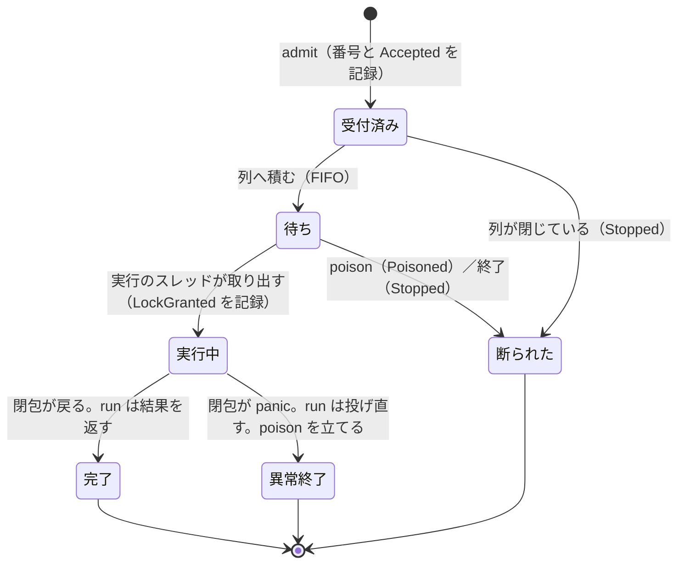
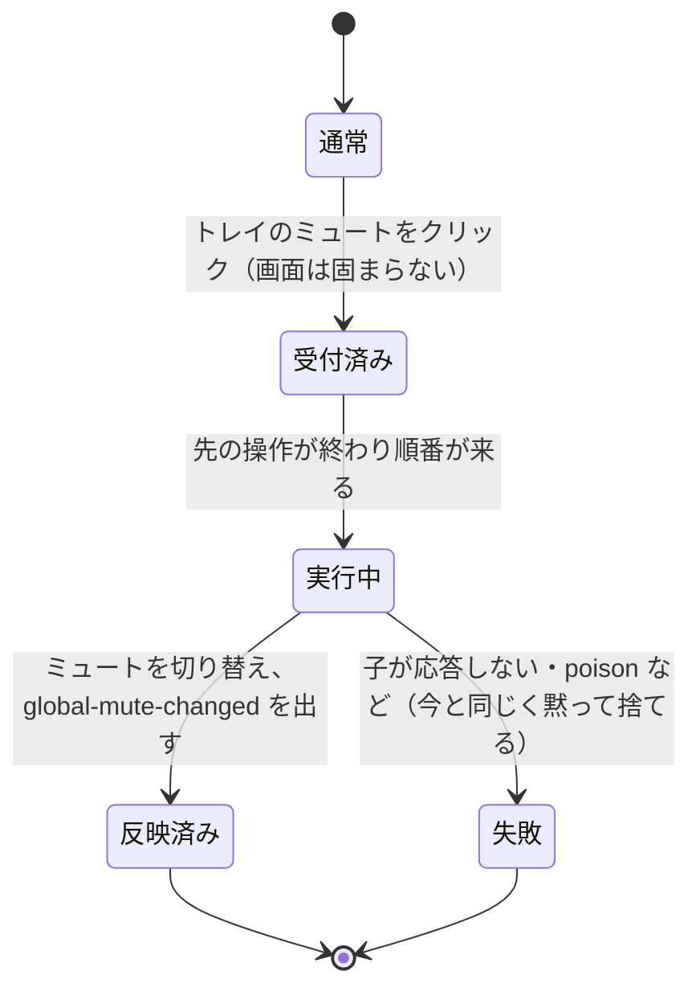

# F1b-0b セッションの中心部の作り直しの設計（第1版・骨子）

状態：設計の骨子（第2版）。Gemini 4 Neon のレビュー（条件つき）を受け、7章で方式と分け方を決めた。段ごとの詳細設計は、8章（F1b-0b-0）・9章（F1b-0b-1）・10章（未決の決定）・11章（F1b-0b-2a）まで書いた。次は 2b 以降。

前提の文書：
- 今の事実：`audio-session-f1b0b-inventory.md`（bcd2dca2 の時点。以下「洗い出し」）。
- 変わる挙動：`audio-session-f1b0-changes.md`（C1・C4・N1・N2・N3、J-17・J-18・J-20）。
- 土台：`audio-session-f1b0a-design.md`（F1b-0a-1）、`audio-session-f1b0a2-design.md`（F1b-0a-2）。両方の既知の狭い競合3件（F1b-0a-1 の11章、F1b-0a-2 の6章）を、この段の合格の条件にする。
- 利用者の決定（2026-11-22）：F1b-0b は「部分的な作り直し」として進める。親の側のセッションの中心部（状態の持ち主・受付・接続）を `AudioControl` の後ろで新しく作り、今の95か所の入口はつなぎとして流す。子との IPC と旧い通知はそのまま。

## 1. この段で達すること

| # | 挙動（利用者から見て） | 今（洗い出し 4章） |
|---|---|---|
| C1 | 停止は、先に並んでいる通常の操作より先に実行する。停止より前に受け付けた「音を鳴らす・子を起動する」操作は、実行の前に断る | ロックを取れた順。std の `Mutex` は公平でない |
| C4 | 終わっていない操作が256件を超えたら断る。通常の操作は受付から60秒で始まらなければ失敗。停止は断らない。長い操作は一歩ごとの期限だけ（J-20） | 上限なし。`Admission` は記録だけで、件数も完了も持たない |
| N1 | トレイ・ショートカットは呼び出しのスレッドで待たない | トレイはイベントループのスレッドでホストのロックを待つ |
| N2 | 古い接続の通知を出さない（完全な形） | 通知の直前の確認だけ（1つの列が出うる） |
| N3 | 終了の確認の待ちで、ほかの操作が止まらない | `ensure_clear` がホストのロックと `Store.slots` を持ったまま最大10秒待つ |
| K1〜K3 | 既知の狭い競合3件をなくす | 洗い出し 2.4 |

変えないもの：子との IPC、旧い通知の名前・中身・順（K13・W5）、エラーの文言（C1・C4 で足す文言を除く）、`engine_generation` の更新点、読み取りが先の操作の完了を待つ境界（K2・K10）。

## 2. 方式の比較（決めること3つ）

### 2.1 実行の持ち主：どこで命令を実行するか

| 案 | 中身 | 良い点 | 危険 |
|---|---|---|---|
| 2.1-A 実行のスレッド（推奨） | 1本の「実行のスレッド」が `AudioHost`（主と配信ミックスの子を含む）を持つ。入口は `AudioControl::run(entry, |host| …)` で、閉包を受付の列に積み、結果を待つ。今の入口の本体は閉包の中身としてそのまま使う | 実行の順を1か所で決められる（C1・C4）。入口の本体を書き換えない。トレイは積んですぐ戻れる（N1） | 閉包の中で子の応答を待つ間、実行のスレッドは止まる（今のロックを持った待ちと同じ） |
| 2.1-B 今の `Mutex` の前に順番の入口を置く | ロックは残し、取る順だけを入口で決める | 変更が小さい | 第1回の方式比較で、ロックを貸し出す形を残すと二重の移行になると判断した（options 7.1） |

### 2.2 reader の役割：通知と状態の更新を誰が行うか

| 案 | 中身 | 良い点 | 危険 |
|---|---|---|---|
| 2.2-A reader は今のまま通知を出し、状態だけを1つの遷移にまとめる（推奨） | reader は今と同じく旧い通知を直接出す（W5・K13 の順を保つ）。ただし、reader と実行のスレッドの両方が触る接続の状態（`LinkState`・`ReplySlot`・`vst_operations` の終了の原因・配信ミックスの切断の記録）を、**1つの `Mutex` の下の1つの状態機械（`LinkCell`）**にまとめる。CAS と送り側の取り出しと原因の採取を、同じロックの区間で行う | 既知の狭い競合3件の根（2つの状態が別々に変わる）を直接なくす。通知の順は今のまま | reader が `LinkCell` のロックを取る間、`emit` をしない規則が要る |
| 2.2-B reader は行を実行のスレッドへ送るだけにし、通知も実行のスレッドが出す | 状態の持ち主が完全に1つになる | 閉包が子の応答を待つ間は、実行のスレッドが通知を出せない。応答より前に通知を出す今の順（K13）を保つには、待ちの中で受信箱を読む「ポンプ」が要り、再入の順が複雑になる（第1回の方式比較で、案 A の最大の危険とした点） |

### 2.3 終了の確認（N3）

| 案 | 中身 |
|---|---|
| 2.3-A reaper（推奨） | 子ごとに reaper のスレッドが `WaitForSingleObject` で待ち、終わったら `retired` の記録を消して実行のスレッドへ知らせる。`ensure_clear` は、期限まで reaper の知らせを条件変数で待つ（`Store.slots` のロックを持たない）。待つ間も実行のスレッドは止まるが、ほかの入口の受付（C1 の停止の受付、N1）は止まらない |
| 2.3-B 実行のスレッドの外で作り直しを待つ | 作り直しを要する操作を「保留」にして、終わったら再開する。段の状態機械が要る（F1b 本体の範囲） |

## 3. 推奨の組み合わせと、その理由

**2.1-A ＋ 2.2-A ＋ 2.3-A。**
- 閉包の中の待ちは、今の「ロックを持った待ち」と同じ性質なので、K2・K10・K13 の互換を保てる。2.2-B のポンプを避けられる。
- 既知の狭い競合3件は、どれも「reader と実行の側が、別々の状態を別々の順で変える」ことが根（洗い出し 2.4）。2.2-A の `LinkCell` で、その根を1か所で断つ。
- C1 の「停止を先に」は、受付の列の優先度で決まる。実行中の閉包は割り込まない（J-18）。
- N1 は、トレイ・ショートカットが閉包を積んで戻るだけになる。

## 4. 互換の安全網（洗い出し 5章の事実への対応）

- 公開の入口だけで書かれた試験（K 群、`control_tests`）は、そのまま通る必要がある。
- 内部に結び付いた試験（`post_mix_life_tests` 153 か所、`config_storage_tests` 128、`link_tests` 61、`engine_life_tests` 44、`reply_deadline_tests` 29 など）は、作り直しで壊れうる。**作り直しの前に、それらの試験の性質を、公開の入口（または `AudioControl::run` の上）から確かめる形へ移す段（F1b-0b-0）を置く。** 期待値は変えない。移せない試験は、理由と、代わりに守る性質を記録する。
- W5 は手動の測定。F1b-0b の後に測り直す。

## 5. 分け方（案）

| 段 | 中身 | 挙動 |
|---|---|---|
| F1b-0b-0 | 安全網を公開の入口へ移す（4章） | 変えない |
| F1b-0b-1 | `LinkCell`（2.2-A）。既知の狭い競合3件を根から直す | 競合の窓が閉じる（K1〜K3） |
| F1b-0b-2 | 実行のスレッド（2.1-A）と受付の列。C1・C4・N1 | 変える（J-17） |
| F1b-0b-3 | reaper（2.3-A）。N3 | 変える（ほかの入口が止まらない） |
| F1b-0b-4 | N2 の完全な形（`LinkCell` の世代で、通知の列の直前に照合） | 変える（古い通知が出ない） |

## 6. 未決（レビューで決めたいこと）

1. 2章の3つの選択（推奨の組み合わせ）は妥当か。
2. 2.2-A の `LinkCell` で、既知の狭い競合3件が本当に根から消えるか（洗い出し 2.4 の窓ごとに）。
3. 2.1-A で、閉包の中で子の応答を待つ間に実行のスレッドが止まることが、C1（停止を先に）・N3 と矛盾しないか（J-18：実行中の命令は応答を待ってから停止）。
4. F1b-0b-0（安全網を移す段）を先に置く判断と、その範囲。
5. 5章の分け方と順。

## 7. Neon のレビュー（骨子の第1版）を受けた決定

判定は「条件つき」。必須の3点を、次のとおり決めた（統括）。2.1-A・2.2-A は妥当、2.3-A は直す。

### 7.1 `LinkCell` の範囲を広げる（必須1：既知の狭い競合3件を根から閉じる）

- **競合1**：`begin`（`Open` の確認・`ReplySlot` の登録・`vst_operations.begin`）と、reader の `close_eof`（閉鎖・待ち手の取り出し・`take_exit`）を、同じ `LinkCell` のロックの区間にする。さらに、writer が書き込みの直前に `LinkCell` の下で操作を「送った」に上げ、`Aborted` になった操作を終了の原因から外す。`cut_off` の順（`vst_operations.response` が CAS の前）も、同じ区間の中の順にそろえる。
- **競合2**：配信ミックスの失敗の後始末を、`LinkCell::close(Intentional)` の1つの遷移にする。勝ったときだけ `discard_child()`、すでに EOF・期限切れで閉じていれば `detach_with()`（`enabled` を残す）へ分ける（今の「`settle()` の後に `detached` の数を比べる」2段をやめる）。
- **競合3**：経路 (b)（別の回収が待ち手を横取りする）は `LinkCell` で閉じる。経路 (a)（`reply_timed_out` が EOF に負けたとき、通知の前に `ENGINE_EXITED` を返す）は、負けたら `LinkCell` と通知の列のロックを持たずに、reader が通知の後に送る `Eof` を待ってから返す。

### 7.2 N3：作り直しの待ちを実行のスレッドの外へ出す（必須2。案 (a) を採る）

- 2.3-A のままでは、`ensure_clear` の最大10秒の待ちで実行のスレッドが止まり、停止もミュートも読み取りも止まる。N3 と C1 に反する。
- **決定**：子を起動しうる入口は、`retired` が空でなければ、**実行のスレッドへ入る前に**（受付の側で）reaper の知らせを期限まで待つ。待つ間、ほかの入口は実行のスレッドで進む。実行のスレッドの中の再確認で記録が残っていた場合は、待たずに今の規則（`engine_unconfirmed`）で答える。待っている間に C1 の停止が届いたら、待ちを起こして、その開始を断る（停止より前に受け付けた開始の扱い、C1）。
- `retire_child` の最大2秒の確認は、この段では今のまま実行のスレッドの中に残す（`engine_unconfirmed` の判定を変えないため）。reaper へ移すかは F1b で決める。

### 7.3 N2 の完全な形（必須3）

- 世代の照合だけでは、照合の直後に閉じたときの1列の窓が残る。**閉じる側は、閉じた後に通知の列のロックを1度通して、進行中の旧い列を掃き切ってから次へ進む**（または、通知の側の有効な世代の更新を、通知の列のロックの下で行う）。どちらにするかは詳細設計で決める。
- 旧い reader の `voice_activity.store(true)` が `kill_primary_engine` の後に残る窓と、`ensure_clear` の間に `engine_epoch` が古いまま `engine_event` が通る窓も、`LinkCell` の閉鎖と `retire_engine` にそろえて閉じる。

### 7.4 段の分け方の直し

| 段 | 中身 | 挙動 |
|---|---|---|
| F1b-0b-0 | 安全網の整理（範囲を絞る）：(1) 洗い出し 5.3 の固定していない約束（既知の競合3件、`cut_off`、`voice_activity`）の試験を足す。(2) `LinkCell`・reaper で壊れる試験（`link_tests`・`reply_deadline_tests`・`post_mix_life_tests`・`engine_life_tests` の内部の直接の参照）だけを、今の公開の入口と最小の継ぎ目へ寄せる。`config_storage_tests`・`device_scan_tests` は触らない | 変えない |
| F1b-0b-1 | `LinkCell`（7.1） | 競合の窓が閉じる |
| F1b-0b-2a | 実行のスレッドへの移し替えと N1（受付の順は今と同じ FIFO） | ほぼ変えない |
| F1b-0b-2b | C1・C4（受付の列の優先度と上限） | 変える（J-17） |
| F1b-0b-3 | reaper と、作り直しの待ちを外へ出す（7.2）。N3 | 変える |
| F1b-0b-4 | N2 の完全な形（7.3） | 変える |

### 7.5 詳細設計で扱うこと（Neon の未決3の指摘）

- 複数の IPC を続ける閉包（`apply_profile`・`set_output_gain` の100回の確認など）には途中の確かめの点がなく、停止が全段の後まで遅れる。J-20（一歩ごとの期限、停止が来たら次の命令を送る前に止める）の確かめの点を、共通の IPC の口に置く。
- トレイ・ショートカットのミュートが `interrupt_restore` を取らない（洗い出し 6.9）。C1 の停止の受付と同じ扱いにするかを決める。

## 8. F1b-0b-0 の詳細（安全網の整理。挙動は変えない）

前提：コードは main `5d4e8d31` のとおり。`ファイル:行` は `src-tauri/src/` を基準にする（試験は `audio/tests/`）。7章の決定は変えない。決め切れない点は「未決」として 9.9 にまとめた。なお、依頼にあった「`audio-session-f1a0-design.md` の 11章」は、このフォルダーに無い。同じ内容（既知の狭い競合3件）は `audio-session-f1b0a-design.md` の 11章にあるので、それを使った。

### 8.1 方針：継ぎ目を1か所に集める

- F1b-0b-1 で消える型は `ReplySlot`・`engine_exit::Operations`・`LinkState` の3つ（`audio.rs:292,293,298`）。試験がこれらを直接つかむ場所は、`ReplySlot` の `begin`・`deliver`・`close`・`cancel`、`Operations` の `begin`・`response`、`Reader` の構造体リテラル（`link`・`operations`・`replies`）、「reader の勝ちを真似る」ための `link.close(Eof)` と `pending_reply_tx.close()` の組、の4種類に限られる。
- F1b-0b-0 では、試験の側に **継ぎ目の窓口の1つのファイル `audio/tests/link_seam.rs`（新設。`#[cfg(test)]` の自由関数）** を置き、上の4種類をすべてここ経由にする。F1b-0b-0 の時点の中身は今の部品を呼ぶだけ。F1b-0b-1 では、窓口の中身だけを書き換える。
- 窓口の関数（案）：

| 関数 | F1b-0b-0 の中身（今） | F1b-0b-1 の中身 |
|---|---|---|
| `begin_request(&AudioHost, Option<&Command>) -> Result<Receiver<ReplyOutcome>>` | `pending_reply_tx.begin()`、続けて `vst_operations.begin(cmd)`（`audio.rs:1075-1076` と同じ順） | `link.begin(cmd)` |
| `deliver(&AudioHost, Response)`・`deliver_at(…, Instant)` | `pending_reply_tx.deliver*` | `link.deliver*` |
| `win_eof(&AudioHost) -> Option<Sender<ReplyOutcome>>` | `link.close(Eof)` が勝てば、`pending_reply_tx.close()` を返す（reader の勝ちの真似） | `link.close_eof()` の `waiter`（`exit` は**捨てる**。原因を見ない試験だけが使う） |
| `cas_eof(&AudioHost) -> bool`・`take_exit(&AudioHost) -> ExitPayload`（S5 専用の組） | `cas_eof` は `link.close(Eof)` だけ（送り側にも記録にも触れない）。`take_exit` は `vst_operations.take_exit()`（後から、`cut_off` の後に採る） | `cas_eof` は `link.close_eof()` を呼び、返った `EofWin` を窓口が保持する。`take_exit` は、**保持した `exit`（`close_eof` が返した原因）**を返す。S5 はこの原因を検査する |
| `finish_eof(reader) -> JoinHandle` | 先に `reader_for(&AudioHost, epoch)` で組んだ reader（`pause` を足せる）を受け取り、別スレッドで `finish()` を走らせる（通知の列を出し切り、待ち手へ `Eof` を送るところまで進める。ホストを別スレッドが持つ間も使えるよう、組む側と走らせる側を分ける） | 同じ（`mark_notified()` も呼ばれる） |
| `register_sent_operation(&AudioHost, &Command)` | `vst_operations.begin(cmd)` | `begin` の後に `mark_sent` |
| `reader_for(&AudioHost, epoch) -> Reader` | `Reader { link, operations, replies, … }` を組む（`link_tests.rs:30-41`、`reply_deadline_tests.rs:56-69` の2つを1つにする） | `Reader { link, … }` |
| `cancel(&AudioHost)` | `pending_reply_tx.cancel()` | `link.cancel()` |

- `host.link.is_open()`・`host.link.cause()`・`host.link.close(cause) -> bool`・`Writer::start(sink, host.link.clone())`・`set_link_for_test`・`attach_stdin_for_test`・`fail_writes_for_test`・`replace_writer_for_test` は、F1b-0b-1 の `LinkCell` が同じ名前と戻り値で残す（9.1）ので、寄せない。これで寄せる数が小さくなる。

### 8.2 足す試験の一覧（9本）

ID は 8章の中だけで使う（`S1`〜`S9`）。「今」の挙動を固定する試験は、名前に `today_` を付ける。F1b-0b-1 で期待値を変えるものは、9.6 の表で「どう変えるか」を決めてある。

| ID | 名前の案 | 置く場所 | 使う継ぎ目 | 確かめること（今の挙動） |
|---|---|---|---|---|
| S1 | `s1_today_an_unsent_vst_operation_is_named_as_the_exit_cause` | `link_tests.rs` | `reader_for` の `Reader::pause`（`reader.rs:289-292`）、`link_seam::begin_request`、`await_reply` に `Aborted` の `WriteDone` を直接渡す（`link_tests.rs:702` と同じ形）。pause の解放は別スレッドで少し後に行う | reader が EOF の CAS に勝って止まっている間に `begin_request(Some(LoadPlugin))` が通る。`await_reply` は `Engine Crashed/Exited`（ENGINE_EXITED）。解放後の `audio-engine-exited` の `cause == "vst_operation"`・`op == "load"`（送っていない操作が原因に載る。競合1） |
| S2 | `s2_today_an_eof_right_after_settle_drops_enabled` | `post_mix_life_tests.rs` | 新しい継ぎ目 `after_failure_settle`（`post_mix.rs` の `State` に `#[cfg(test)]` で足す。`post_mix.rs:1155` の `state.settle()` と `:1156` の `detached` の比較の間で呼ぶ。`after_exec_check`（`post_mix.rs:312,451-454`）と同じ型）。子は台本つきで `LoadPlugin` に `Error` を返す | 公開の操作 `Request::Add` が、切断ではない理由で失敗する。継ぎ目で子の `link.close(Eof)` を挟むと、`enabled == false`・`error` が立つ・`disconnected` が空（切断として数えられない）。競合2 |
| S3 | `s3_today_the_c3_loser_returns_before_the_eof_notices` | `reply_deadline_tests.rs` | `paused_eof_reader`（`reply_deadline_tests.rs:56-69` を窓口の `reader_for` に置き換える）、`await_reply`（`WriteDone` を12秒前にして期限切れを作る。`:161-170` と同じ形） | 負けた `reply_timed_out`（`audio.rs:1155`）は、reader を止めたまま `Engine Crashed/Exited` で戻る。戻った時点で記録された通知に `audio-engine-exited` が無い。解放後に3つの通知が出る。競合3 (a) |
| S4 | `s4_today_a_host_close_drops_the_waiter_before_the_eof_notices` | `link_tests.rs` | `Reader::pause`、`link_seam::begin_request`、`host.drop_connection(Intentional)`（`audio.rs:718`。試験から呼べる）。tick の待ち手を真似て `rx.try_recv()` を使う | reader が CAS に勝って止まっている間に、別の入口が `drop_connection` する。`rx.try_recv()` は `Disconnected`（`Eof` ではない）。このとき通知は未発行。競合3 (b) |
| S5 | `s5_today_cut_off_clears_the_operation_even_when_eof_won` | `link_tests.rs` | `link_seam::register_sent_operation(LoadPlugin)`、`link_seam::cas_eof`（**今の段では CAS だけで止める**。共通の `win_eof` は原因を捨てるので使わない）、`await_reply` に `broken_pipe()`（`link_tests.rs:55-60`）の `WriteDone`、`link_seam::take_exit` | EOF が先に勝っていても、`cut_off`（`audio.rs:1180-1183`）が `vst_operations.response(Error)` を CAS の前に呼ぶので、続く `take_exit()` の `cause == "unknown"`（本当の VST が消える）。`reply_timed_out` は同じ状況で `vst_operations` に触れない（`reply_deadline_tests.rs:189` の T13 が固定済み）ので、2つの経路の違いを並べて固定する |
| S6 | `s6_today_a_closed_reader_can_still_raise_voice_activity` | `link_tests.rs` | `reader_for`、`reader.handle_event(EngineEvent::VoiceCheckState{…})`（`reader.rs:64`）。`host.link.close(Intentional)`、`host.voice_activity.store(false)`（`kill_primary_engine` の `audio.rs:2819` の真似） | 閉じた接続の reader が、検査を通過していた1行で `voice_activity` を `true` に戻す（`reader.rs:191-199`）。F1b-0b-1 では変えない。期待値を変えるのは F1b-0b-4（7.3） |
| S7 | `s7_start_is_cut_off_at_its_deadline_retired_and_no_stop_is_sent` | `reply_deadline_tests.rs` | `silent_host` と同じ形で `("Start", [WaitGate("never")])`。`set_limits_for_test(None, Some(SHORT))`。`Start` は `frontend_bootstrap.rs:497` の組み立てに倣う | F1b-0a-2 設計 9章の1点目。`Start`（B）で `execute_command` が `REPLY_TIMED_OUT`、`link.cause() == ReplyTimeout`、子が回収される、`Stop` が送られない（`observer.sent()`）、`audio-error` が1回、`confirming_start` が偽、次の `execute_command` で作り直し（`spawn_count == 2`）。`Start` の `device_open` の記録が `timeout()` で残る（`engine_exit.rs:329-342`）ことが、作り直した接続へ持ち越されない（新しい接続の原因が `unknown`）。10秒の互換の試験（`commands/audio/compat_tests.rs:645`）は `SetChannelScan`（A。`:646`）のまま |
| S8 | `s8_t2_c3_keeps_the_saved_post_mix_settings_in_memory_and_on_disk` | `post_mix_life_tests.rs` | `t2_…`（`post_mix_life_tests.rs:717`）と同じ `Rig`。保存した設定は `Request::Save` で作る（`save_request`、`:728`）。`rig.host.post_mix.file_checkpoint()`（`post_mix.rs:424`）と `std::fs::read` | F1b-0a-2 設計 9章の2点目。期限切れの前後で、`state.saved`・`state.raw`・`post-mix.json` の中身が変わらない（`enabled` が残るだけでなく、保存した中身が残る） |
| S9 | 既存の `t12_the_retire_finishes_while_the_reader_is_stuck_in_emit_whether_c3_wins_or_loses`（`reply_deadline_tests.rs:266`）の拡張 | `reply_deadline_tests.rs` | `engine_life::seam::on_stage`（`engine_life.rs:569`）に `Stage::Retired(Role)` を足し、`retire_child`（`engine_life.rs:243-261`）の2つの出口（確認できた `:247-248` と、記録へ移す `:251-260`）の直後に呼ぶ。フックは cutter のスレッドで設定する（`seam` はスレッドごと）。**`eof_wins` の疑似 EOF（`:305` の `link.close(Eof)`）は、CAS で止めず、`link_seam::finish_eof` で通知の列を出し切るところまで進める**（通知は止めた記録器に塞がれるので、`f.recorder.release()` の後に完了する。完了してから `JoinHandle` を `join` する） | F1b-0a-2 設計 9章の3点目。`f.recorder.release()`（`:312`）の前に、回収の完了の印が立っていること（今は `wait_exit`＝子の終了だけで、回収の完了ではない）。勝ち・負けの両方。`eof_wins` では、解放の後に EOF の通知3件が出て、`finish_eof` が戻り、cutter が `ENGINE_EXITED` で戻る |

補足：
- S1・S3・S4 は、reader を止める継ぎ目が `Reader::pause` に限られる（`finish` の直後で止める）。`reader_for` の `Reader` を直接 `finish` させる形で、実プロセスは使わない。
- S2 の継ぎ目 `after_failure_settle` だけが、製品のコードへ足す試験用のコード（`#[cfg(test)]`）。S9 の `Stage::Retired` も同じ。挙動は変えない。
- S5 の「`reply_timed_out` との違い」を同じファイルで並べるのは、F1b-0b-1 で2つの経路が1つの規則（負けたら `vst_operations` に触れない）にそろうことを、差分として見せるため。
- **`Admission`・トレイのミュート・N1 の固定（洗い出し 5.3 の 4〜6）は、この段では足さない。** F1b-0b-2a 以降の対象で、`LinkCell` と無関係だから。

### 8.3 寄せる試験の一覧（期待値は変えない）

対象は、F1b-0b-1 の `LinkCell` で**コンパイルできなくなる**参照と、「reader の勝ちを真似る」組の意味が変わる参照。概算は次のとおり（grep の行数。1つの試験が複数行を持つ）。

| ファイル | 寄せる参照（概算） | 内訳と代表の例 | 寄せ先 |
|---|---|---|---|
| `link_tests.rs` | 約16か所 | `pending_reply_tx.begin()` 10行（`:159,173,188,201,230,245,250,350,360,717`）・`.deliver(…)`（`:160`）・`.close()`（`:203,362`）・`.clone()` で別スレッドへ渡す（`:251`）、`reader_for` の構造体リテラル（`:30-41`）。`link.close(Eof)` と `pending_reply_tx.close()` を続けて reader の勝ちを真似る組（`:202-203`） | `link_seam::begin_request`・`deliver`・`win_eof`・`reader_for`・`cancel`。期待値は変えない |
| `reply_deadline_tests.rs` | 約11か所 | `pending_reply_tx.begin()`（`:160,198,233,243,253`）・`.deliver_at(…)`（`:236,246`）・`vst_operations.begin(&load)`（`:195`。**これは `LinkCell` では「送った」に上げる前の操作になり、原因に載らなくなる**ので、`register_sent_operation` に寄せる）、`paused_eof_reader` の構造体リテラル（`:58-68`） | 同上＋`register_sent_operation` |
| `reply_deadline_tests.rs` の T3（`:155`）・T13（`:189`） | 2本の組み立て直し | 今は `await_reply` を試験のスレッドで呼び、**戻った後に** `pause.release()` する（`:180,208`）。F1b-0b-1 の競合3 (a) で、負けた側は `Eof` を待つので、戻らなくなる（試験が止まる）。**F1b-0b-0 で、`pause.release()` を別スレッド（`await_reply` の開始の少し後）から行う形に直す。** 今の挙動（戻りが先でも、後でも通る）のまま通る。順序そのものは S3 が固定する | 試験の組み立てだけ。期待値は変えない |
| `post_mix_life_tests.rs` | 0か所（コンパイル） | `child.link.close(CloseCause::Eof)` は14か所あるが（`:368,480,517,588,672,867,918,1010,1076,1165,1181,1216,1246,1281`）、すべて待ち手のいない接続を閉じる形（`after_exec_check`・`between_ops` の継ぎ目の中）。`LinkCell::close(cause) -> bool` が同じ名前・戻り値で残るので、そのまま通る。`replace_writer_for_test`（`:675,944`）・`fail_writes_for_test`（`:95,369,673`）・`set_link_for_test`（`:110`）も残る。名前・コメントに残る「`ReplySlot` がまだ開いていても」（`:1154`）は文言だけ直す | 触らない（コメントのみ） |
| `engine_life_tests.rs` | 0か所 | `fail_writes_for_test`（`:324`）だけで、残る。内部の参照44か所（洗い出し 5.1）は `.conditions`・`.retired`・`.child` で、reaper（F1b-0b-3）で壊れる側。`LinkCell` では壊れない | 触らない。reaper の寄せは F1b-0b-3 の前（未決 9.9-U5） |

代表的な書き換え（`link_tests.rs:201-203`）：
```text
今：  let rx = host.pending_reply_tx.begin().unwrap();
      assert!(host.link.close(CloseCause::Eof));
      let sender = host.pending_reply_tx.close().expect("待ち手がいる");
寄せた後：  let rx = link_seam::begin_request(&host, None).unwrap();
            let sender = link_seam::win_eof(&host).expect("待ち手がいる");
```
期待値（`Engine Crashed/Exited`・`audio-error` が出ない・`engine_generation == 0`）は変えない。

**4つのファイルの外にも、同じ型を直接つかむ試験がある**（7.4 の範囲に入っていない。未決 9.9-U1）：

| ファイル | 件数（概算） | 例 |
|---|---|---|
| `audio/mode_vst.rs` の試験部（`:1360-` 以降） | 約50行 | `pending_reply_tx.begin/deliver/close/cancel` 約25行（`:1796,2152,2158,2290,2314,2354,2392,2410,2474,2484,2531,2545,2564,2569,2715,2729,2760,2786`）、`link.close(Eof)` 10行（`:2320,2337,2349,2365,2377,2717,2744,2762,2784,2812`）、`Writer::start(…, host.link.clone())`（`:2375,2413,2444,2557,2742`） |
| `audio/engine_exit.rs` の試験部（`:357-`） | 26行 | `host.vst_operations.begin/response`（`:522-524,734,750-752`）・`Operations` の `.0.lock()`（`:759`）・`exit(&host.vst_operations)`（`:760`） |
| `audio/output_bundle.rs`・`session_rack.rs`・`mixing_bundle_tests.rs` | 5・1・1行 | `host.pending_reply_tx.clone()` で応答の台本を返す（`output_bundle.rs:177,247`、`session_rack.rs:347`） |
| `audio/replies.rs`・`link.rs`・`writer.rs` の単体試験 | 9・5・10行 | 型そのものの試験。型が変わるので、F1b-0b-1 で書き直す（寄せない） |

### 8.4 触らない試験と、その理由

- `config_storage_tests.rs`（36本。内部参照128）：保存ファイル・設定の試験で、`LinkCell` と関係が薄い。`set_link_for_test`（`:105,124,154,573,…`）・`host.link.is_open()`（`:235,459,…`）・`attach_stdin_for_test`（`:151,861,967`）は、9.1 で名前を残すので通る。**ただし、`host.pending_reply_tx.clone()` を取って `deliver` する3か所（`:155`・`:866`・`:976`）は、F1b-0b-1 でコンパイルできなくなる**。7.4 は「触らない」と決めているので、未決 9.9-U2 に挙げる。
- `device_scan_tests.rs`（7本。参照20）：機器のスキャンの試験で、`LinkCell` と関係が薄い。`set_link_for_test`（`:165,199`）・`attach_stdin_for_test`（`:195`）・`fail_writes_for_test`（`:203`）・`host.link.is_open()`（`:205`）は、すべて残る。壊れる参照は無い。
- どちらも、`LinkCell` の型が変わっても、試験の意味が変わらない。寄せると、保存・スキャンの安全網に不要な差分が入るだけ。

## 9. F1b-0b-1（`LinkCell`）の詳細

### 9.1 型の案

今の3つ（`LinkState`・`ReplySlot`・`vst_operations` の終了の原因の部分）と、配信ミックスの切断の判断を、**接続ごとに1つの `Arc<LinkCell>`（`std::sync::Mutex` の下の1つの状態機械）**にまとめる。`AudioHost` の項目は3つ（`link`・`vst_operations`・`pending_reply_tx`、`audio.rs:292,293,298`）が1つの `link: Arc<LinkCell>` になる。接続を作り直すたびに新しい `LinkCell` を作る（今の `reset_engine_reader`、`audio.rs:1058-1064`）。

```text
LinkCell
  inner: Mutex<Inner>           // 状態の正本。すべての遷移と勝ち負けの判断はここ
  notified: Condvar             // `inner` の Mutex と組む。「EOF の通知済み」を知らせる（9.5）
  phase: AtomicU8               // 開閉の鏡。遷移のたびに、ロックの中で `Release` で書く

Inner
  state: Idle | Registered(Sender<ReplyOutcome>) | InFlight(Sender<ReplyOutcome>) | Closed(CloseCause)
  eof_notified: bool            // 勝った reader が、EOF の通知の列を出し終えたら立てる（`Closed(Eof)` のときだけ意味を持つ）
  log:   engine_exit::OperationLog      // 今の `Operations` の `State`（in_flight・awaiting・settling・plugins）
                                         // InFlight 項目に `sent: bool` を足す。`Stop` の「`settling` を消す」印も持つ（E1・E4）
```

**`Operations` の中身は丸ごと `Inner.log` へ移す**（原因の部分＝`in_flight`・`settling` だけでなく、`awaiting`・`plugins` も）。`begin`・`response`・`timeout`・`exit` が互いに同じ項目を読み書きしており（`engine_exit.rs:53-189`）、分けると新しい競合の窓ができるため。`State` の各メソッドは `&mut self` で、既に1つのロックの下にある（`engine_exit.rs:316-355` の `Operations` は薄い包み）。`State` を `pub(super)` の `OperationLog` にして、包みを外す。

**鏡 `phase`（10章の U6）**：`is_open()`・`cause()` は、**ロックを持たずに** `phase` を `Acquire` で読む。書くのは `LinkCell` のロックの中だけで、`Release` で書く。読む場所は、reader の行ごとの確認（`reader.rs:33`）、通知の列の直前の確認（`chain_if`。`reader.rs:28`、`emit.rs:110-123`）、Host・tick の `is_open()`・`cause()`・`connection_lost()`。`chain_if` が使うのは、通知の列のロック（`order`）を持つ間は、ほかのロックを取れない決まり（`emit.rs:61-63`）だから。`Closed` は終端なので、鏡が古いときの誤りは「開いていると見える」側だけ（閉じたと見えることはない）。**勝ち負け・登録・「送った」の判断（`begin`・`mark_sent`・`close`・`close_eof`）は、鏡を使わず、正本の `LinkCell` のロックの下で行う。** エラーの文字列を作る処理（`anyhow!`・`format!`）は、ロックの外に置く（ロックの中では、エラーの種類を表す値だけを返す）。

#### 状態（4つ。`Closed` の原因は5種）

| 状態 | 意味 | 今の対応 |
|---|---|---|
| `Idle` | 開いている。待ちの要求なし | `LinkState::Open` ＋ `ReplySlot::Idle` |
| `Registered` | 開いている。要求を登録した。**まだ書き込みを始めていない**（`log.in_flight.sent == false`） | `ReplySlot::Waiting` ＋ `Operations.in_flight`（送信前も区別しない） |
| `InFlight` | 開いている。writer が書き込みを始めた（`sent == true`） | 同上（区別なし） |
| `Closed(cause)` | 閉じた（終端）。原因は `Intentional`・`Eof`・`WriteFailed`・`WriteTimeout`・`ReplyTimeout`。待ち手の送り側は、閉じた者が取り出し済み | `LinkState::Closed(cause)` ＋ `ReplySlot::Closed` |

#### 遷移の表（各行は同じロックの区間）

「しないこと」は共通で、ロックの中では `emit`・I/O・ほかのロックをしない（9.3）。

| # | 遷移 | 呼ぶ者 | 状態の変化 | 同じ区間で行うこと | 戻り値 |
|---|---|---|---|---|---|
| E1 | `begin(Option<&Command>)` | 呼び出し側（`audio.rs:1075-1076`）・tick（`mode_vst.rs:701`） | `Idle → Registered` | 受け側を作る。`Some(cmd)` なら `log.begin(cmd)`（`sent = false`）。**`Stop` の `settling` の消去（今の `engine_exit.rs:77-80`）は、ここではしない。** `Stop` だという印だけを `log` に残す（E4 で消す） | `Ok(rx)` |
| E2 | `begin` | 同 | `Registered`/`InFlight`：変えない | — | `Err(Busy)`。ロックの外で、今の文言「前の音声操作の応答待ちです。しばらく待つか、エンジンを再起動してください。」（`replies.rs:43-45`）にする |
| E3 | `begin` | 同 | `Closed`：変えない | — | `Err(Closed)`。ロックの外で `CLOSED`（`replies.rs:9`）にする |
| E3b | `begin` | 同 | `Mutex` が poison：変えない | — | `Err(Poisoned)`。ロックの外で、今の文言「IPC応答の状態を取得できません」（`replies.rs:41`）にする。**`begin` だけは、今の挙動を残す**（`into_inner` で進めない）。ほかの遷移は、今と同じく poison を `into_inner` で進む（`replies.rs:100-103` と同じ。今の `Operations` の `if let Ok` は、何もせず戻る） |
| E4 | `mark_sent()` | writer（書き込みの直前。`writer.rs:190-199`） | `Registered → InFlight` | `log.in_flight.sent = true`。`Stop` の印があれば、**ここで** `log.settling = None`（利用者が止めた後の終了を、開始直後の障害と取り違えない。`engine_exit.rs:77-80` の消去をここへ移す） | `true`（書いてよい） |
| E5 | `mark_sent` | 同 | `Idle`/`InFlight`：変えない | — | `true`（登録なしの書き込み・試験の writer は今どおり書く） |
| E6 | `mark_sent` | 同 | `Closed`：変えない | — | `false`（`Aborted`） |
| E7 | `deliver_at(resp, at)` | reader（`reader.rs:45-50`） | `Registered`/`InFlight → Idle` | `log.response(&resp)`、続けて送り側へ `Response{resp, received_at}` を送る（`mpsc` の送信は待たない） | `true` |
| E8 | `deliver_at` | 同 | `Idle`：変えない | `log.response(&resp)` だけ（今の `operations.response` が先に走る挙動を保つ） | `false`（ログ「no one is waiting」） |
| E9 | `deliver_at` | 同 | `Closed`：変えない | 何もしない | `false` |
| E10 | `close_eof()` | reader の終端（`reader.rs:280-306`） | `Idle`/`Registered`/`InFlight → Closed(Eof)` | 送り側を取り出す（`Idle` は無し）。`log.exit(now)` で原因を採る。**原因の選び方は今の `exit()`（`engine_exit.rs:169-189`）と同じ順で、`in_flight` は `sent == true` のものだけを候補にする。** `sent == false` の登録は候補から外し、**無条件に `unknown` にはしない**：次の候補は、起動の直後の `settling`（`DEVICE_OPEN_SETTLING` の内のもの）で、それも無ければ `unknown`。`phase` を `Release` で更新 | `Some(EofWin{waiter, exit})`（勝ち） |
| E11 | `close_eof` | 同 | `Closed`：変えない | 何もしない（送り側は閉じた者が処理済み） | `None`（負け） |
| E12 | `close(cause)` | Host（`close_connection`・`reply_timed_out`・`cut_off`・`fail_mode_deadline`・差し替え。`audio.rs:710,1156,1183`・`mode_vst.rs:693`・`audio.rs:1060`） | `Idle`/`Registered`/`InFlight → Closed(cause)` | 送り側を取り出して**捨てる**（待ち手は `Disconnected`）。原因ごとに記録を片づける：`WriteFailed`・`WriteTimeout` は `log.response(Error(文言))`（今の `cut_off` の `audio.rs:1181-1182`）、`ReplyTimeout` は `log.timeout()`（今の `audio.rs:1157-1159`）、`Intentional` は何もしない | `true`（勝ち） |
| E13 | `close(cause)` | 同 | `Closed`：変えない | **何もしない。送り側にも記録にも触れない**（今の `cut_off` の「CAS の前の `response`」と、`close_connection` の「負けても送り側を取る」を、やめる） | `false`（負け） |
| E14 | `cancel()` | tick（`mode_vst.rs:703,716`） | `Registered`/`InFlight → Idle` | 送り側を捨てる。`log` は変えない（モード VST は操作の記録を持たない） | — |
| E15 | `set_open_for_test(bool)` | 試験 | 直接決める | `Idle` か `Closed(Intentional)` | — |
| E16 | `mark_notified()` | reader（EOF の通知の列を出し終え、**通知の列のロック（`order`）を放した後**） | `Closed(Eof)`：変えない | `eof_notified = true`。`Condvar::notify_all` | — |
| E17 | `wait_notified(deadline)` | EOF に負けた呼び出し側（9.5） | 変えない | 絶対期限まで `Condvar::wait_timeout` で待つ。待つ間はロックを放し、起きるたびに `eof_notified` と期限を確かめ直す | `true`（通知済み）／`false`（期限） |

**状態の数の確認**：状態は `Idle`・`Registered`・`InFlight`・`Closed` の4つ。今は `LinkState`（開閉と原因）×`ReplySlot`（3つ）×`in_flight`（有無）の組から、整合しない組（`Closed` なのに待ちが `Waiting` のまま、など）が出る。`LinkCell` はその組を作れない。

#### 公開の窓口（`AudioHost` の側）

- `is_open()`・`cause()`・`close(cause) -> bool` は、`LinkState` と同じ名前・戻り値で残す。`Writer::start(sink, host.link.clone())`・`rack_pin: Option<Arc<LinkCell>>`（`post_mix.rs:310`）の `Arc::ptr_eq`（`:575`）も、型だけが変わる。
- `close_eof()`・`mark_sent()`・`begin()`・`deliver_at()`・`cancel()`・`mark_notified()`・`wait_notified()` は新設・改名。

### 9.2 7.1 の3つの競合が、どの遷移で閉じるか（窓ごと）

#### 競合1：未送信の VST の操作が終了の原因に載る

| 窓 | 今の順 | 直した後の順 |
|---|---|---|
| 1a. reader の CAS の後に、`begin` が通る | R：`link.close(Eof)`（CAS、`reader.rs:282`）→（止まる）→ H：`is_open()` が真だった後に `pending_reply_tx.begin()`（`audio.rs:1068,1075`）・`vst_operations.begin(&cmd)`（`audio.rs:1076`）→ R：`take_exit()`（`reader.rs:294`）が未送信の `LoadPlugin` を原因にする。writer は `Aborted`（`writer.rs:190-199`） | H の `begin`（E1）と R の `close_eof`（E10）は同じロックの区間で、**どちらかが先**。(i) `begin` が先：`Registered`。`close_eof` が送り側を取り、`log.exit()` は `sent == false` の登録を候補から外し、次の候補（有効な起動直後の `settling`、無ければ `unknown`）を採る。writer の `mark_sent`（E6）は `false`（`Aborted`）。待ち手は `Eof` で解放（`Engine Crashed/Exited`）。(ii) `close_eof` が先：`begin` は `Err(CLOSED)`（E3）。登録は起きない |
| 1b. `begin` の後、writer が書く前に閉じる | 上と同じ（`Aborted` でも記録が残る） | 1a (i) と同じ |
| 1c. 書き込みを始めた後に閉じる | `vst_operations` に載る（これは正しい） | `mark_sent`（E4）で `InFlight`。`close_eof` が `sent == true` の操作を原因にする（同じ結果） |
| 1e. 未送信の `Stop` と `settling` | 今は `begin` が `Stop` の `settling` を先に消す（`engine_exit.rs:77-80`）。`Stop` を登録しただけで書かずに閉じても、`settling`（起動直後の障害の候補）が消えている | `settling` の消去は `mark_sent`（E4）へ移す。`Stop` が書かれなかったとき（`Aborted`）は `settling` が残り、`close_eof` が `settling` を原因の候補にできる（main と同じ。「利用者が止めた後」という事実が無いため） |
| 1d. `cut_off` の順 | H：`vst_operations.response(Error)`（`audio.rs:1181-1182`）→ `link.close(cause)`（`:1183`）。EOF が先に勝っていても、`response` が `in_flight` を先に消す（洗い出し 6.1） | H：`close(cause)`（E12）。勝ったときだけ同じ区間で `log.response(Error)`。負けたとき（E13）は `log` に触れず、reader の `exit()` が本当の原因を採る |

#### 競合2：`settle()` の直後の EOF で `enabled` が落ちる

| 窓 | 今の順 | 直した後の順 |
|---|---|---|
| 2a. 公開の操作の失敗の処理 | `state.settle()`（`post_mix.rs:1155`）が `connection_lost()` を読む（開いている）→（reader が `close(Eof)`）→ `detached == detached_before`（`:1156`）→ `discard_child()`（`:1157`、`enabled = false`、`:797-804`） | 子があれば、`child.link.close(Intentional)`（E12）の戻り値で分ける。**勝った（`true`）：** 閉じたのは自分。`discard_child()`（今と同じ。`enabled = false`・`error` を立てる）。**負けた（`false`）：** すでに EOF・期限切れ・書き込みの失敗で閉じている。`detach_with(None)`（`enabled` を残す）。子が無ければ、今どおり `detached` の数で分ける（`exec_child` が先に外した場合） |
| 2b. 「`settle()` の後に `detached` の数を比べる」2段 | 2段の間に窓 | 1回の `close(Intentional)` の戻り値 1つ。窓は無い |
| 2c. ほかの `settle()`（`exec_child`・`start`・`Enable`。`post_mix.rs:450,845,1018`） | 開いている・閉じているを読み、閉じていれば外す | 変えない。開いていれば何もしないので、読んだ後の EOF は次の呼び出しで外れる（失敗の処理で判断を変える場所は、2a だけ） |

#### 競合3：K13 で、通知の前に `Disconnected` になる

| 窓 | 今の順 | 直した後の順 |
|---|---|---|
| 3a. 期限切れの負け（`reply_timed_out`） | H：`link.close(ReplyTimeout)` に負ける（`audio.rs:1156`）→ `kill_engine` → `drop_connection` → `ReplySlot::close()` が送り側を取って捨てる（`audio.rs:712`）→ `Ok(Error(ENGINE_EXITED))` を返す（`:1167-1169`）。reader の通知3件より前 | `close(ReplyTimeout)` に負ける（E13。送り側には触れない）。子を回収する（I3。通知を待たない）。回収の**前**に、対象の接続（`Arc<LinkCell>`）を保持しておく。回収の後、**負けた原因が `Eof` のときだけ**、同じ接続の「通知済み」（E16・E17）を、`LinkCell` と通知の列のロックを持たずに、絶対期限つきで待つ（9.5）。通知済みになってから（＝reader が3つの通知を出し終え、`order` を放してから）`Ok(Error(ENGINE_EXITED))` を返す。`Eof` 以外の負け方（`WriteFailed` など）では待たない |
| 3b. 別の入口の回収が送り側を横取りする（tick が待ち手） | reader が CAS に勝って止まっている間に、別の入口の `kill_engine`／停止が `drop_connection`（`audio.rs:718-725`）→ `close_connection` が `ReplySlot::close()` で送り側を捨てる（`:712`）。tick の `try_recv` は `Disconnected`（`mode_vst.rs:596`）。通知より前に待ち手が解放される | **閉じるのは送り側の横取りだけ。** `close(Intentional)` が負ける（E13）ので、送り側は reader の `EofWin` に残る。tick の `try_recv` は、reader が `Eof` を送るまで `Empty` になる。tick は「EOF まで待つ」のではない：`Empty` のあいだ次の tick へ戻る（`mode_vst.rs:600-604`）が、`pending.sent.elapsed()` が `pending.limit` に達すれば、今のとおり `fail_mode_deadline`（`ReplyTimeout`・文言「VST切替の応答が不明です」。`mode_vst.rs:605-607`）で失敗する。**期限の処理と文言は変えない。** 通知より前に失敗しうることは、通知の順だけの既存の例外として残す（9.10 の (g)）。回収（`writer = None`・`child.take()`・`retire_child`）は無条件に進む。（`close(Intentional)` が**勝った**ときは、EOF は競りに負けるので EOF の通知自体が出ない。K13 の対象外で、今と同じ） |

### 9.3 ロックの規則

**共通：** `LinkCell` のロックは**葉**。持つ間は、メモリの更新と、待たない `mpsc` の `Sender::send`・`drop` だけをする。`emit`・I/O・ホストのロック・`order`（通知の列）・`emitter`・`Store.slots`・`held_notices`・ほかの `LinkCell`・`Conditions` の更新・`kill`・`sleep`・`recv`・`join`・エラーの文字列を作る処理をしない。**例外は `Condvar::wait_timeout`（E17）だけ**で、待つ間はロックを放し、起きたら条件を確かめ直す。ロックの順は **ホスト → `order` → 鏡の読み取り（ロックを持たない）** で、`order` を持つ間は `LinkCell` のロックを取らない。`LinkCell` のロックから外へは出ない。鏡は `Release` で書き `Acquire` で読む（9.1）。`Mutex` の poison は、`begin` 以外は `into_inner` で進む（`emit.rs:86-107` と同じ）。**`begin` は、今の「IPC応答の状態を取得できません」（`replies.rs:41`）を残す**（E3b。K13 の文言を変えない。T1・T10 で固定する）。

| 役者 | 使い方 |
|---|---|
| reader | 行ごとの `is_open()`（`reader.rs:33`）・`chain_if` の確認（`reader.rs:28`）は鏡だけ。応答は `deliver_at`（E7〜E9）。終端は `close_eof()`（E10・E11）を1回呼び、**ロックを放してから**、`conditions.engine_event`・通知の列・`waiter.send(Eof)` を今の順で行う（`reader.rs:293-305` の順を保つ：先に通知、後で解放）。通知の列を出し終えて `order` を放した後に `mark_notified()`（E16）を呼び、その後に `waiter.send(Eof)`。`Reader::pause` は `close_eof()` の戻りの直後（`reader.rs:289-292` の位置）に置く |
| writer | 書き込みの直前に `mark_sent()` を1回（E4〜E6）。書き込み（`write_payload`）はロックの外。`Aborted` は `false` のとき |
| 呼び出し側（ホストのロックを持つ H・tick） | `begin`（E1〜E3）→ 提出 → `await_reply` → 失敗なら `close(cause)`（E12・E13）。`await_reply` の `recv_timeout` と、EOF に負けた後の「通知済み」の待ち（E17）は、`LinkCell` のロックを持たずに行う（待つ間は `Condvar` がロックを放す。9.5）。`is_open()`・`cause()`・`connection_lost()` は鏡 |
| 回収（`drop_connection`・`kill_engine`・`release_engine`・`Drop`） | `close(Intentional)`（E12）を1回。その後に `writer = None`・`child.take()`・`retire_child`（`kill`・確認の最大2秒）を行う。`retire_child` の間は `LinkCell` のロックを持たない（`close` はもう戻っている） |
| 配信ミックスの失敗の処理（`post_mix.rs:1151-1163`） | `child.link.close(Intentional)` を1回呼び、戻り値で `discard_child` か `detach_with` に分ける（9.2 の 2a）。戻った後に子の回収（`kill_engine`・`release_engine`）をする |

### 9.4 writer が書き込みの直前に「送った」に上げる仕組み（競合1）

- `writer::run`（`writer.rs:190-199`）は、今は `link.is_open()` を読んで書くか `Aborted` にする。これを `link.mark_sent()`（E4〜E6）に置き換える。`mark_sent` は同じロックの区間で、「開いているか」と「登録した操作を `sent` に上げる」を行う。**書く判断と記録の更新が1つの区間**なので、「`Aborted` の操作が原因に載る」ことも「`sent` なのに書かなかった」ことも起きない。
- `Writer::start`・`start_with` の引数は `Arc<LinkState>` から `Arc<LinkCell>` に変わる（`writer.rs:133,145`）。`Job` には操作の識別を持たせない（接続は直列で、登録は同時に1つ。E2）。
- 書き込みの失敗（`Err`）・5秒の期限切れの後は、`sent == true` の操作が `InFlight` に残る。`cut_off` の `close(WriteFailed/WriteTimeout)` が勝てば `log.response(Error)` で片づく（E12）。EOF に負ければ、`close_eof` が `sent == true` の操作を原因にする。
- `mark_sent` は、`Stop` の `settling` の消去も担う（E4）。書かれなかった `Stop`（`Aborted`）は `settling` を消さない。
- モード VST の tick は操作の記録を持たない（`begin(None)`）。`mark_sent` は `Registered → InFlight` の遷移だけを行い、`log` は変えない。
- 試験の継ぎ目：`mark_sent` の直前で止める `before_mark_sent`（`#[cfg(test)]`、`writer.rs`）。T3 で使う。

### 9.5 7.1 の競合3 (a)：EOF に負けたら、ロックを持たずに「通知済み」を待つ（10章の U3・U4）

`rx`（応答の受け側）では待たない。遅い応答を受け取り済みの待ち手は、送り側がもう無く `rx` では待てないため、接続の側の「通知済み」を待つ。

1. **回収の前に、対象の接続を保持する。** `reply_timed_out` の先頭で `let link = self.link.clone()`（`audio.rs:1155` の先頭）。回収の後に `self.link` が差し替わっても、待つのは同じ接続。
2. `link.close(ReplyTimeout)`（E12）。勝てば、今のとおり（`audio-error`・`REPLY_TIMED_OUT`）。
3. 子の回収（`kill_engine`／`kill_primary_engine`。今のまま。I3：回収は通知を待たない）。
4. **負けたときだけ、かつ負けた原因（`link.cause()`）が `Eof` のときだけ**、`link.wait_notified(deadline)`（E17）を呼ぶ。`deadline` は、回収が終わった時点の `Instant::now() + EOF_WAIT` の**絶対期限**。`Condvar::wait_timeout` で待ち、待つ間は `LinkCell` のロックを放す。起きるたびに `eof_notified` と期限を確かめ直す（偽の起床・早い起床に備える）。`WriteFailed`・`WriteTimeout`・`Intentional` に負けたときは、通知の列が出ないので、待たない。
5. **reader は、通知の列を出し終え、`order` を放した後に**、`mark_notified()`（E16）で `eof_notified` を立てて `notify_all` し、その後に `waiter.send(Eof)`。待ち手は `order` を持たない。
6. 結果は、`true`（通知済み）でも `false`（期限）でも `Ok(Error(ENGINE_EXITED))`（今の結果と文言。順序の保証だけが違う）。

**上限 `EOF_WAIT`（案：2秒）：**
- 2秒は、「待ちに足される分」の上限。**手順 3 の回収の後に、`hold_notices` の保持した通知を出すとき `order` を待つ時間（F1b-0a-1 設計 3.3 の既知の範囲）は含まない。** その待ちは今のまま、上限なしの既存の範囲に残る。
- `false`（期限）になったら、待たずに今の `Ok(Error(ENGINE_EXITED))` を返し、**警告を1回だけ**ログに残す。通知の前に返りうる（9.10 の (c)）。上限のあとも reader は通知の列を1列だけ出す（二重には出ない：列は `close_eof` の勝ちを持つ reader だけが出す）。
- ホストのロックを持つ時間の延びは、通常は通知3件の発行だけ（ミリ秒）。reader が `emit` の途中で止まっているときは、最大で `EOF_WAIT` が足される。値は2秒で始め、実装の試験で見直す。

- 経路 (b)（tick）は待たない：tick の `try_recv`（`mode_vst.rs:569-609`）が `Empty` のあいだ次の tick へ戻る（今の構造のまま。期限の処理と文言は変えない）。

### 9.6 変える箇所の一覧（`ファイル:関数`）

製品のコード：

| ファイル:行 | 関数・項目 | 変えること |
|---|---|---|
| `audio/link.rs:45-84` | `LinkState` | `LinkCell` に置き換える（9.1 の E1〜E15）。`CloseCause`（`:6-18`）は残す。単体試験（`:86-`）を書き直す |
| `audio/replies.rs:28-109` | `ReplySlot` | 削除。`CLOSED`（`:9`）・`ReplyOutcome`（`:12-20`）は `link.rs`（または残す）。単体試験（`:111-`）は `LinkCell` の遷移の試験へ移す |
| `audio/engine_exit.rs:36-190,316-355` | `State`・`Operations` | `State` を `pub(super) OperationLog` にし、`InFlight` に `sent` を足す。`exit()`（`:169-189`）は `sent == false` の `in_flight` を候補から外し、次の候補（`settling`、無ければ `unknown`）へ進む。`begin`（`:77-80`）の `Stop` の `settling` の消去は `mark_sent` へ移す。`Operations` の包み（`:316-355`）を削除 |
| `audio.rs:292,293,298` | `AudioHost` の項目 | 3つ（`link`・`vst_operations`・`pending_reply_tx`）を `link: Arc<LinkCell>` の1つに |
| `audio.rs:567-571` | `AudioHost::with_retired` 相当の初期化 | `LinkCell::closed()` |
| `audio.rs:610-619` | `attach_stdin_for_test`・`set_link_for_test` | `LinkCell` の型へ。`reopen_for_test` の呼び出しをなくす |
| `audio.rs:709-715` | `close_connection` | `close(cause)`（E12）1回。`pending_reply_tx.close()` の呼び出しを削除 |
| `audio.rs:893` | `ensure_engine_running` の C5 の確認 | 鏡の `cause()`。変わらない |
| `audio.rs:932-945` | `ensure_engine_running` の writer・reader の組み立て | `Writer::start(stdin, self.link.clone())`・`Reader { link, … }`（`operations`・`replies` を除く） |
| `audio.rs:1058-1064` | `reset_engine_reader` | 新しい `LinkCell::open()` 1つ |
| `audio.rs:1066-1080` | `execute_running_command_inner` | `ensure!(is_open)`（`:1068`）と、`begin`・`vst_operations.begin`（`:1075-1076`）を `self.link.begin(Some(&cmd))` 1つに。`before_begin_hook::run()`（`:1070-1071`）は `begin` の直前のまま |
| `audio.rs:1097-1149` | `await_reply` | `rx` は渡さず、`reply_timed_out()` を呼ぶ形のまま（`:1141-1143`）。`Disconnected` の分岐（`:1145`）も変えない |
| `audio.rs:1155-1177` | `reply_timed_out` | 先頭で `self.link.clone()` を保持。`close(ReplyTimeout)` の中で `log.timeout()` を行う（`:1157-1159` を削除）。回収の後、負けた原因が `Eof` のときだけ `wait_notified(deadline)`（9.5）。上限で警告を1回 |
| `audio.rs:1180-1201` | `cut_off` | `vst_operations.response(Error)`（`:1181-1182`）を削除（`close` の勝ちの側へ移る） |
| `audio/reader.rs:8-19` | `Reader` | `operations`・`replies` を除く |
| `audio/reader.rs:43-50` | `run`（応答の行） | `operations.response`＋`replies.deliver_at` を `link.deliver_at` 1つに |
| `audio/reader.rs:280-306` | `finish` | `close_eof()` 1回。負け（`None`）は何もせず戻る（`:282-286` の `replies.close()` を削除）。勝ちは `waiter`・`exit` を取り、通知の列の後に `mark_notified()`、その後に `Eof` を送る |
| `audio/writer.rs:133-199` | `Writer::start`・`start_with`・`run` | `Arc<LinkCell>`。`run` は `mark_sent()` |
| `audio/mode_vst.rs:693,698,701-716` | `fail_mode_deadline`・`connection_lost`・`send_mode_command` | `close(ReplyTimeout)`・鏡の `is_open()`・`begin(None)`・`cancel()`。tick の判定の順（`:537-615`）は変えない |
| `audio/post_mix.rs:310,551-575` | `rack_pin`・ラックの読み取り | 型を `Arc<LinkCell>` に |
| `audio/post_mix.rs:1151-1163` | `post_mix` の公開の操作の失敗の処理 | `settle()`＋`detached` の比較を、`close(Intentional)` の戻り値による分岐に（9.2 の 2a） |
| `audio/engine_life.rs:243-261` | `retire_child` | `Stage::Retired`（S9。`#[cfg(test)]`）。挙動は変えない |

試験のコード：
- `audio/tests/link_seam.rs`：窓口の中身（9.7 の最初の行）。
- 期待値を変える試験は 9.8。
- `mode_vst.rs`・`engine_exit.rs`・`output_bundle.rs`・`session_rack.rs`・`replies.rs`・`link.rs`・`writer.rs` の試験部：型の変更に合わせて書き換える（8.3 の最後の表。範囲は未決 9.9-U1）。
- `config_storage_tests.rs:155,866,976`：未決 9.9-U2。

### 9.7 合格の条件と試験の形

ID（`T1`〜）は 9章の中だけで使う。

| # | 確かめること | 形 |
|---|---|---|
| T1 | `LinkCell` の遷移の表（E1〜E15）。各行の「状態の変化・同じ区間で行うこと・戻り値」。`Closed` からは戻らない。`close` の負けは何もしない（E13）。`close_eof` の勝ちが送り側と原因を1度だけ渡す（E10・E11）。`mark_notified`・`wait_notified`（E16・E17）：通知済みで起きる、絶対期限で `false`、偽の起床で確かめ直す、待つ間に別スレッドの `is_open()`・`begin()` が返る。**poison：`begin` は「IPC応答の状態を取得できません」を返し（E3b）、`close`・`close_eof`・`deliver_at` は panic せず進む。** 原因の選び方：`sent == true` の操作 → 有効な `settling` → `unknown` の順 | 単体（`link.rs`） |
| T2 | 競合1（1a・1b）：`begin` と `close_eof` を、両方の順で衝突させる。(i) `begin` が先：`mark_sent` は `false`、`audio-engine-exited` の `cause == "unknown"`（有効な `settling` が無いとき。ある場合は T3 の (i)）、待ち手は `Eof`。(ii) `close_eof` が先：`begin` は `CLOSED`。多数回の競り（`link.rs` の `exactly_one_of_many_racing_closers_wins` に倣う）で、未送信の操作が原因に載ることが一度もない | 単体＋継ぎ目（`Reader::pause`、`begin` の直前の `before_begin_hook`） |
| T3 | 競合1（1c）：`mark_sent` の直前で止める（`before_mark_sent`）。止めたまま `close_eof` を通すと原因に載らない。`mark_sent` を通した後に `close_eof` を通すと、その操作が載る。**2つの場合を足す：** (i) `Start` の応答の直後（`log.settling` が有効）に、未送信の `LoadPlugin` を登録して `close_eof` を通すと、原因は `unknown` ではなく `settling` の `device_open`（`phase == "settling"`）。有効期間（`DEVICE_OPEN_SETTLING`）を過ぎていれば `unknown`。(ii) `settling` が有効なときに未送信の `Stop` を登録して `mark_sent` の前に閉じると、`settling` は消えず、原因の候補になる。`mark_sent` を通した後に閉じると、`settling` は消えており `unknown` | 継ぎ目（`writer.rs` の新設） |
| T4 | 競合1（1d）：EOF が先に勝っていても、`cut_off` は `log` に触れず、reader の `exit()` が本当の VST を採る。`cut_off` が勝つときは `log.response(Error)` が効く | 継ぎ目 |
| T5 | 競合2：継ぎ目 `after_failure_settle`（失敗の処理の決定の直前）で子の `link.close(Eof)` を挟む。`enabled` が残る・`disconnected` が立つ・`error` が立たない。挟まない通常の失敗は、今どおり `enabled == false`・`error` が立つ（`discard_child`） | 継ぎ目（配信ミックス） |
| T6 | 競合3 (a)：reader を `close_eof` の直後で止める。`reply_timed_out` は子を回収した後に「通知済み」を待ち、止めている間は戻らない。別スレッドで解放すると、通知3件が出てから `Ok(Error(ENGINE_EXITED))` が返る（順は `[CC, "audio-engine-exited", "audio-error"]` の後で解放）。待っている間、別のスレッドが `link.is_open()`・`link.begin()`・`Notifier::emit` を呼んで、ブロックしない（`LinkCell` と `order` を持っていない）。回収は待ちの前に終わっている（S9 の `Stage::Retired`）。**足す場合：** (i) **期限のあとの応答を受け取り済み**：`received_at` が期限の後の応答を `deliver_at` で渡して `await_reply` が `reply_timed_out` へ進み、その後に EOF に負ける。送り側が無い待ち手でも、「通知済み」を待ち、通知3件の後に戻る（`rx` では待てない場合）。(ii) **上限**：reader を解放しないと、`EOF_WAIT`（`set_limits_for_test` に足す継ぎ目で短くする）の後に `ENGINE_EXITED` で戻り、警告が**1回だけ**ログに出る。そのあとで reader を解放すると、**通知は1列だけ**出る（3件が二重にならない）。待ちに足された時間は `EOF_WAIT` の近くに収まる（回収の後の通知の列の待ちは含まない）。(iii) `Eof` 以外（`WriteFailed`）に負けたときは待たない（即座に戻る）。(iv) 絶対期限：偽の起床を挟んでも、期限を延ばさない | 継ぎ目（`Reader::pause`） |
| T7 | 競合3 (b)：reader を `close_eof` の直後で止め、別の入口が `drop_connection(Intentional)` する。tick 役の `rx.try_recv()` は、`pending.limit` の**期限の中**では `Empty`（送り側を横取りされない）。解放後に `Eof`。回収は進む（`child` が外れ、`writer` が `None`）。**期限の処理は変えない：** reader を解放しないまま `pending.sent.elapsed()` が `limit` に達すると、tick は今のとおり `fail_mode_deadline`（`ReplyTimeout`・文言「VST切替の応答が不明です」。`mode_vst.rs:605-607`）で失敗する（通知より前でもよい。9.10 の (g)）。`close(Intentional)` が勝つ側（reader より先）では、通知は出ず `Disconnected`（今と同じ） | 継ぎ目 |
| T8 | ロックの規則：reader を `emit` の途中で止める（`Recorder::block_after`）。その間に、別のスレッドの `begin`・`close(Intentional)`・`cancel`・`mark_sent` が返る（`LinkCell` のロックを `emit` をまたいで持っていない）。`close_eof` の戻りの後は `LinkCell` を持たずに通知を出す | 継ぎ目（`Recorder`） |
| T9 | 鏡：試験専用のヘルパーで `LinkCell` のロックを持ったまま、別のスレッドの `is_open()`・`cause()` と `Notifier::chain_if` が返る（`order` を持つ間に `LinkCell` のロックを取らない）。遷移の直後の鏡が `Closed` を示す | 継ぎ目 |
| T10 | 互換：K 群（`compat_tests`・`commands/audio/compat_tests.rs`）・`control_tests`・`engine_life_tests`・`post_mix_life_tests`・`link_tests`・`reply_deadline_tests`・モード VST の試験が通る。K13（EOF の通知3件の名前・中身・順、待ち手の解放が通知より先）・`engine_generation` の更新点・書き込みと応答の期限の起点（`flushed_at`）が変わらない。**poison のときの `begin` のエラー文言「IPC応答の状態を取得できません」（今の `replies.rs:41`）が変わらない**（E3b）。**期待値を変えるのは 9.8 の表の S1〜S5 だけ**（S6〜S9 は変えない） | 既存 |
| T11 | 壊して確かめる（一時的な改変）：(a) `begin` と `close_eof` を別のロックに戻す → T2 が失敗。(b) `mark_sent` を `is_open()` に戻す → T3。(c) `close` の勝ち側の記録の片づけを CAS の前に戻す → T4。(d) 失敗の処理を `settle()`＋`detached` の比較に戻す → T5。(e) 負けの側の「通知済み」の待ちを外す → T6。(e2) `Stop` の `settling` の消去を `begin` に戻す → T3。(e3) `mark_notified` を `order` を持ったまま呼ぶ、または待ちの期限を相対期限（起床のたびに延びる）にする → T6。(f) `close` が負けても送り側を取る → T7。(g) `LinkCell` のロックを持ったまま `send` 以外（通知）を呼ぶ → T8 | 一時的な改変 |
| T12 | `voice_activity`（S6）と `engine_event` の epoch の窓は、**この段では変えない**（F1b-0b-4）。S6 が今の挙動のまま通る | 既存（S6） |
| T13 | W5：旧の通知とコマンドの応答の到着順を、対応する release の子で測り直す（`docs/TESTING.md:42-110`。reader の通知の順を変えていないことの確認。手動） | 手動 |

### 9.8 8章で足した試験の期待値を「直った」に変える一覧

| ID | 試験 | 今の期待値 | F1b-0b-1 の期待値（直った） |
|---|---|---|---|
| S1 | `s1_today_an_unsent_vst_operation_is_named_as_the_exit_cause` → `an_unsent_vst_operation_is_not_named_as_the_exit_cause` | `begin_request` が通り、`cause == "vst_operation"`・`op == "load"` | `begin_request` が `CLOSED`（reader が先のとき）。`begin` が先のときは、有効な `settling` が無ければ `cause == "unknown"`（あれば `settling` の `device_open`。T3 の (i)）（T2 の (i)・(ii) の両方） |
| S2 | `s2_today_an_eof_right_after_settle_drops_enabled` → `an_eof_right_after_settle_keeps_enabled` | `enabled == false`・`error` が立つ・`disconnected` が空 | `enabled == true`・`disconnected` が立つ・`error` が空・子は外れて回収済み |
| S3 | `s3_today_the_c3_loser_returns_before_the_eof_notices` → `the_c3_loser_waits_for_the_eof_notices` | reader を止めたまま `await_reply` が戻る。戻った時点で `audio-engine-exited` が無い | reader を止めている間は戻らない。解放後、通知3件が出てから戻る。上限で戻る場合も `ENGINE_EXITED`（T6） |
| S4 | `s4_today_a_host_close_drops_the_waiter_before_the_eof_notices` → `a_host_close_before_the_eof_race_still_reports_the_exit_to_the_waiter` | `rx.try_recv()` が `Disconnected`・通知は未発行 | `Empty`。解放後、通知3件の後に `Eof` |
| S5 | `s5_today_cut_off_clears_the_operation_even_when_eof_won` → `cut_off_leaves_the_operation_as_the_exit_cause_when_eof_won` | `cas_eof` だけで止め、`take_exit` の `cause == "unknown"` | `cas_eof` が呼んだ `close_eof` が返した原因（窓口が保持）を検査する：`cause == "vst_operation"`・`op == "load"`。`cut_off` の `close(WriteFailed)` は負けて `log` に触れない（E13） |
| S6 | `s6_today_a_closed_reader_can_still_raise_voice_activity` | `voice_activity == true` | **変えない**（F1b-0b-4 で `false` に） |
| S7 | `s7_start_is_cut_off_…` | — | 変えない |
| S8 | `s8_t2_c3_keeps_…` | — | 変えない |
| S9 | T12 の拡張 | — | 変えない（`Stage::Retired` の呼ぶ位置は変わらない） |
| （既存）T3・T13 の組み立て直し（8.3） | 別スレッドから解放 | 同じ（F1b-0b-0 で済んでいる） |

### 9.9 未決（決め切れない点。統括の判断を待つ）

- **U1：7.4 の4ファイルの外の試験。** `audio/mode_vst.rs` の試験部（約50行。`pending_reply_tx`・`link.close(Eof)`・`Writer::start(…link.clone())`）、`engine_exit.rs` の試験部（26行）、`output_bundle.rs`（`:177,247`）・`session_rack.rs`（`:347`）は、F1b-0b-1 でコンパイルできなくなる。F1b-0b-0 の継ぎ目（`link_seam.rs`）に寄せる範囲へ入れるか、F1b-0b-1 で型と一緒に直すか。推奨は、`mode_vst.rs`・`output_bundle.rs`・`session_rack.rs` の `pending_reply_tx` の呼び出しだけを `link_seam` 経由にする（約30行。期待値は変えない）。`engine_exit.rs`・`replies.rs`・`link.rs`・`writer.rs` の単体は、型そのものの試験なので F1b-0b-1 で直す。
- **U2：`config_storage_tests.rs:155,866,976`。** 3か所が `host.pending_reply_tx.clone()` を取って `deliver` する。7.4 の「触らない」を守ると、F1b-0b-1 でコンパイルできない。(a) `AudioHost` に試験専用の `reply_slot_for_test()`（戻り値は `Arc<LinkCell>`、`deliver` を残す）を足し、この3行だけを F1b-0b-0 で書き換える。(b) 項目名 `pending_reply_tx` を残す（`Arc<LinkCell>` の別名の項目）。(a) を推奨するが、7.4 を変える。
- **U3：`EOF_WAIT` の値と上限後の振る舞い。** 10章で決定済み。2秒で始め、上限後は `ENGINE_EXITED` を返して警告を1回だけ出す。2秒は待ちに足される分の上限で、回収の後の既存の通知の列の待ちを含まない（9.5）。
- **U4：負けた側が待つ手段。** 10章で決定済み。`rx` ではなく、`LinkCell` の条件変数で「通知済み」を待つ（9.5。E16・E17）。9.3 の「葉」の規則の例外は `Condvar::wait_timeout` だけ。
- **U5：reaper で壊れる試験の寄せ。** 7.4 は、`LinkCell` と reaper の両方で壊れる試験を F1b-0b-0 で寄せるとした。`engine_life_tests`（内部参照44。`.retired`・`.child`・`engine_life::seam`）と `post_mix_life_tests` の `retired` まわりは、`LinkCell` では壊れない（8.3）。reaper（F1b-0b-3）の寄せを、F1b-0b-0 に含めるか、F1b-0b-3 の前の段にするか。この文書は前者を含めていない。
- **U6：鏡（`phase: AtomicU8`）。** 10章で決定済み（書き方は 9.1 にそろえた）。正本は `LinkCell`。鏡は `LinkCell` のロックの中で `Release` で書き、ロックを持たずに `Acquire` で読む（reader の行ごとの確認・`chain_if`・Host の `is_open()`／`cause()`）。勝ち負けは正本で決める。
- **U7：`Operations` の全体を `LinkCell` へ入れる範囲。** 依頼は「`vst_operations` の終了の原因の部分」。`awaiting`・`plugins`（読み込んだ VST の一覧。`engine_exit.rs:42-47`）も、`begin`・`response` が同じ項目を触るので一緒に移した（9.1）。`plugins` を別のロックに残す案は、`response` の中で2つのロックを取ることになり、規則（9.3）に反する。
- **U8：`voice_activity` と epoch の窓の時期。** 7.3 は「`LinkCell` の閉鎖と `retire_engine` にそろえて閉じる」とだけ書き、段は F1b-0b-4 とある。この文書は F1b-0b-1 では変えないとした（T12・S6）。確認したい。
- **U9：書き込みの失敗の通知の規則（E12）。** `close` が負けたときに、`log` にも送り側にも触れない（E13）ことで、今の `close_connection` の「負けても送り側を取って捨てる」（`audio.rs:712`）が変わる。reader が先に EOF に勝つ場合、送り側は reader が持つので問題ないが、**試験専用の `link.close(Eof)`（reader なしで CAS だけ勝つ）は、送り側を捨てるだけになる**（E12 の勝ち）。そのため、reader の勝ちを真似る試験は `win_eof`（8.1）へ寄せる必要がある（寄せた）。製品のコードに影響はない。

### 9.10 既知の狭い競合として残るもの

- **(a) `mark_sent` の後から、子が読むまでの間の原因の推定。** `mark_sent` で `sent` を立てた後、書き込みは成功しても、子が読む前に終わると、子が受け取っていない操作が原因に載る。パイプの書き込みの成功は、子の受け取りを意味しない（今も同じ。区別できない）。`Aborted`（書かなかった）の操作は載らない（競合1で閉じた）。
- **(b)（欠番）** 受け取り済みの待ち手が負けたときの残りは、U4 の決定（条件変数）で消えた。
- **(c) `EOF_WAIT` の上限のあとの通知の順。** reader が `emit` の途中で止まっていて、「通知済み」が上限（2秒）までに立たないとき、待ち手は通知の前に `ENGINE_EXITED` を返す（結果は同じで、通知との順だけが崩れる）。警告は1回。そのあとの通知の列は1列だけ出る（9.5）。
- **(d) 鏡の読み取り。** reader が行の先頭で `is_open()` を読んだ後に閉じると、1つの列が出うる（通知の列の直前の確認の後に閉じる窓。F1b-0a-1 設計 3.4 と同じ）。完全な形は F1b-0b-4（7.3）。
- **(e) `voice_activity.store(true)`・epoch の古い `engine_event`。** 変えない（F1b-0b-4）。S6 が固定する。
- **(f) 配信ミックスの `settle_with`（`post_mix.rs:450,845,1018`）の読み取り。** 開いていると読んだ後の EOF は、その操作の中では何も外さず、次の呼び出しで外れる。結果は切断として失敗するだけで、`enabled` は落ちない（`discard_child` を呼ぶ判断は 2a だけ）。
- **(g) tick が待ち手のときの、期限と通知の順（競合3 (b)）。** 閉じるのは送り側の横取りだけ。tick は `pending.limit` に達すれば、今のとおり `fail_mode_deadline`（`ReplyTimeout`）で失敗する。通知3件より前に失敗しうる。期限の処理と文言は変えない。通知の順だけの既存の例外として残す。
- **(h) 切替の復旧通知と EOF の通知の列の順（`mode_vst.rs` の `send_mode_command`）。** tick の最後の接続確認と `begin` の間に EOF の競りが勝つと、`begin` は `CLOSED` で断られ、切替の復旧の通知が reader の EOF の通知の列より先に出うる。復旧の文言は `ENGINE_EXITED` のまま。完全な順序の保証は F1b-0b-4 で行い、そのとき、通知の前に閉じた接続へ登録しようとした場合を試験に加える。

## 10. 未決 U1〜U9 の決定（統括、2026-11-23）

| # | 決定 |
|---|---|
| U1 | `LinkCell` で壊れる試験は、7.4 の4ファイルの外（`mode_vst.rs`・`engine_exit.rs`・`output_bundle.rs`・`session_rack.rs` の試験部）も含めて、F1b-0b-0 で `audio/tests/link_seam.rs` の窓口へ寄せる。範囲は「`LinkCell` で壊れる参照のすべて」とし、7.4 の表の F1b-0b-0 の行をこの意味に読み替える。期待値は変えない |
| U2 | `config_storage_tests` は、壊れる3か所（`:155`・`:866`・`:976`）だけを窓口へ寄せる。それ以外は触らない |
| U3 | `EOF_WAIT` は2秒の案で始め、実装の試験で見直す。**2秒は、待ちに足される分の上限**で、回収の後の既存の通知の列の待ち（`hold_notices` が `order` を待つ範囲）までを含む上限ではない。上限を過ぎたら、待たずに `Engine Crashed/Exited` を返し、警告を1回だけ出す（結果は同じで、通知との順だけが崩れる。9.10 の (c)）。待つのは EOF に負けたときだけで、期限は絶対期限（9.5） |
| U4 | 負けた側の待ちは、`rx` ではなく `LinkCell` の条件変数にする。回収の前に対象の接続を保持し、回収の後、EOF に負けた場合だけ、同じ接続の「通知済み」を待つ。待つ間はロックを放し、起きたら条件を確かめ直す。reader は、通知の列のロックを放してから「通知済み」を立てる。EOF 以外の負け方では待たない。遅い応答を受け取り済みの待ち手も、同じ条件変数で待てる（9.5。E16・E17） |
| U5 | reaper で壊れる試験の寄せは、F1b-0b-3 の段に含める（F1b-0b-0 には入れない） |
| U6 | 鏡（`AtomicU8`）を許す。正本は `LinkCell` で、勝ち負けは正本で決める。鏡は `LinkCell` のロックの中でだけ `Release` で書き、ロックを持たずに `Acquire` で読む（読む場所は、通知の列の直前の確認だけでなく、reader の行ごとの確認と、Host・tick の `is_open()`／`cause()` を含む。9.1）。エラーの文字列を作る処理は、ロックの外に置く |
| U7 | `Operations` の全体（`awaiting`・`plugins` を含む）を `LinkCell` に移す。`LinkCell` のロックの区間では I/O と `emit` をしない規則を守る |
| U8 | `voice_activity` と epoch の窓は F1b-0b-4 で直す |
| U9 | 試験専用の `link.close(Eof)` は `win_eof` に寄せる（9章のとおり） |

## 11. F1b-0b-2a（実行のスレッドと N1）の詳細

前提：コードは main `cffaba6f`（F1b-0b-1 の後）。`ファイル:行` は `src-tauri/src/` を基準にし、今のコードで確かめ直した（洗い出しの行は動いている。食い違いは 11.18）。7章の決定（2.1-A・2.2-A）と、7.4 の「2a は、実行のスレッドへの移し替えと N1。受付の順は今と同じ FIFO。挙動はほぼ変えない」を変えない。C1・C4・`interrupt_restore`（洗い出し 6.9）は 2b、reaper・N3 は 3、N2 は 4。

### 11.1 答えの要約（決めること 1〜9）

| # | 決めること | 答え |
|---|---|---|
| 1 | 持ち主の移し替え | 今は `Arc<Mutex<AudioHost>>`（`audio/control.rs:174`）を、入口 95 か所が `AudioControl::lock` で取る。2a では `AudioControl::new` が `AudioHost` を新しい1本のスレッド（`auralyn-audio-control`）へ移し、`Mutex` をなくす。入口の 93 か所（起動時の `setup`・warmup・scheduler を含む）は `run`、トレイとショートカットの2か所は `post` へ（11.4 の表、11.9） |
| 2 | `run` の形 | `run<R: Send + 'static>(entry, FnOnce(&mut AudioHost) -> R + Send + 'static) -> Result<R, ControlError>`。返事は1件ごとの `sync_channel(1)`。受付の列は `Mutex<VecDeque<Job>>`＋`Condvar`（取り出す関数が1か所なので、2b で優先度を足せる）。`admit`（受付の記録）は残し、`Ticket::run`/`post` が列へ積む。Tauri のコマンドは今のまま `async fn` で、`run_blocking` の中で `run` を呼ぶ（11.4） |
| 3 | 再入 | **今の経路は 0 件**（`audio/`・`profile.rs`・`bundle.rs`・`obs_setup/` は `AudioControl` を持たない。入口を持つのは `commands/*`・`lib.rs`・`shortcuts.rs`・`obs.rs`・`migration.rs`・`temporary_session.rs`・`updates.rs` だけで、どれも閉包の外で呼ぶ）。それでも実行のスレッドの上の `run` は、待たずに `Err(Reentrant)` で返す。構造の試験で、持ち込みを防ぐ（11.5） |
| 4 | 閉包の panic | 閉包を `catch_unwind` し、実行のスレッドは死なない。待っている呼び出し側へは panic をそのまま投げ直し（今の `spawn_blocking` の `JoinError` と同じ）、以後の `run` は `Err(Poisoned)`（各入口が今の文言へ写す）。リリースは `panic = "abort"`（`Cargo.toml:117`）なので、今も 2a も即終了で変わらない（11.6） |
| 5 | N1 | トレイとショートカットは `post`（待たない）。閉包は今の本体のまま。結果の `Err` は今と同じく、トレイは捨て、ショートカットは `shortcut-error` を出す。ロックの失敗も閉包が `Err(ControlError)` を受けて同じ文言にする。`interrupt_restore` は 2a では取らない（11.7） |
| 6 | 時間で動くもの | 周期でホストのロックを取るのは、モード VST の scheduler の1本だけ（配信ミックス・メーターは取らない）。scheduler のスレッドは今のまま（10ms 眠る→`run`で1 tick→返事を待つ）。tick は列に溜まらず、期限の起点は `AudioHost` の中の `Instant` のまま（11.8） |
| 7 | 終了・起動 | 最後の `AudioControl` を捨てると列を閉じ、実行のスレッドが残りの仕事を `Err(Stopped)` で断り、ホストを `Drop`（子の回収は今の `Drop` のまま）してから終わる。`Drop` は終わりを `join` して待つ。**Tauri 2.12.4 は終了時に管理中の状態を捨てない**ので、実際の終了では今も `Drop` は走らず、子は Job で回収される（新しい終了の手順は足さない）。起動は `new`→scheduler→`run`（emitter）→warmup のスレッドの順（11.9） |
| 8 | ロックの順 | 実行のスレッドが閉包を走らせている間が「今のホストのロックの中」。その中の順（`Shortcuts` の gate → `Store.slots`／`order`→`emitter`／`held_notices`／`LinkCell`）は今のまま。列と `Admission.log` は葉で、持ったまま何もしない。reader は列も実行のスレッドも取らない（11.10） |
| 9 | 試験 | 既存の試験は、**型名3か所の差し替えだけ**で期待値を変えずに通る。そのために、試験専用の `AudioControl::lock`（実行のスレッドがホストを箱ごと貸し出す `HostLease`）を残す。足す試験は `X1`〜`X12`、壊して確かめる項目は 11.14 の (a)〜(l)（11.14） |

### 11.2 範囲

やること：
- `AudioHost` の持ち主を、`Mutex` から1本の実行のスレッドへ移す。入口 95 か所を `run`／`post` へ書き換える。
- 受付の列（FIFO。取り出す関数は1か所）、返事、poison、再入の検出、起動と終了。
- N1：トレイとショートカットを待たずに戻す。

やらないこと（それぞれの段で行う）：
- 停止を先に実行する・上限・期限・断り（C1・C4。2b）。列の優先度は足さない。`Phase` の名前（`LockGranted`）も変えない（11.16 の U9）。
- トレイ・ショートカットのミュートが `interrupt_restore` を取ること（洗い出し 6.9。2b）。
- reaper・N3（段 3）、N2 の完全な形（段 4）。閉包の中の待ち（`ensure_clear` の最大10秒、`retire_child` の最大2秒、`wait_notified` の最大2秒、`await_reply` の応答の期限）は今のまま閉包の中に残る。
- 子との IPC、通知の名前・中身・順、エラーの文言、`engine_generation` の更新点、読み取りが先の操作の完了を待つ境界（K2・K10）。
- 実際の終了で子を回収する新しい手順。

### 11.3 今の事実（確かめ直したもの）

- 持ち主：`AudioControl { host: Arc<Mutex<AudioHost>>, admission: Arc<Admission> }`（`audio/control.rs:172-176`）。`lock(entry)` は `admit(entry).lock()`（`control.rs:221-223`）で、`Ticket::lock`（`control.rs:248-252`）が `host.lock()` の後に `push_granted` を呼ぶ。返すのは `LockResult<MutexGuard<AudioHost>>`。
- 入口は **95 か所**（洗い出し 3章と同じ数）。`commands/audio.rs` 59・`commands/bundles.rs` 13・`commands/voice_check.rs` 8・`commands/profiles.rs` 3・`obs.rs` 2・`updates.rs` 2・`temporary_session.rs` 2・`migration.rs` 1・`shortcuts.rs` 1・`lib.rs` 3（トレイ `:353-362`・`setup` の emitter `:389-394`・warmup `:397-407`）・scheduler 1（`control.rs:236`）。ほかに、ロックを取らない `note` が `quit_app`（`lib.rs:72-79`）に1か所。
- 呼び出しのスレッド：83 のコマンドと `obs`・`updates`・`migration`・`temporary_session` の 7 か所はすべて `run_blocking`（`commands/mod.rs:7-13`）か `spawn_blocking` の中。トレイはイベントループのスレッド（0洗い出し 1.2）。`setup` はメインのスレッド。warmup と scheduler は専用のスレッド。ショートカットの OS のコールバックは `try_lock` と状態の確認だけをして、ロックを待つ処理を `spawn_blocking` に渡す（`shortcuts.rs:384-418`）。
- 入口の本体はすべて `&mut AudioHost`（または `&AudioHost`）への呼び出しで、`AudioControl` を持たない。`bundle_change_scope(|host| …)`（`commands/bundles.rs:2726`）や `profile::apply_profile(&config_dir, &mut host, …)`（`commands/profiles.rs:150`）も同じ形。
- ロックの失敗の文言は入口ごとに違う（「Failed to lock audio state」「音声状態を取得できません」「音声設定を取得できません」「音声の状態を取得できません」。例：`commands/audio.rs:301,286,1295`）。K の試験が固定している（`commands/audio/compat_tests.rs:445-467`）。
- `quit_app` は `note` と `app.exit(0)` だけ（`lib.rs:72-79`）。Tauri 2.12.4 の `cleanup_before_exit`（`tauri-2.12.4/src/app.rs:1128-1140`）は、トレイ・リソース表・ウィンドウだけを片づける。`App::run` は終了時に `std::process::exit` を直接呼ぶ（`app.rs:1364` の説明）。したがって管理中の `AudioState` の `Drop` は走らない（読み取りによる確認。実機は未確認）。子は `JOB_OBJECT_LIMIT_KILL_ON_JOB_CLOSE`（`process_job.rs:23`）の Job が、プロセスの終了で回収する。`AudioHost::drop`（`audio.rs:2938-2960`）が走るのは、試験と、`AudioControl` を捨てた場合。
- リリースの設定は `panic = "abort"`（`Cargo.toml:117`）。poison が起きるのは、unwind するビルド（試験・dev）だけ。
- `AudioHost` は `Send`（今も `Arc<Mutex<AudioHost>>` を複数のスレッドで共有している）。非試験のコードに、スレッドごとの状態（`thread_local!`）は無い。COM は `routing_diag.rs:154` の `CoInitializeEx(None, COINIT_MULTITHREADED)`（結果は無視）だけで、1本の長寿命のスレッドで繰り返しても `S_FALSE` で済む。
- 試験の継ぎ目の `thread_local!` が6か所：`audio.rs:255-271`（`before_begin_hook`）・`audio/writer.rs:19-25`（`LIMITS`・`EOF_WAIT_OVERRIDE`・`EOF_WAIT_EXCEEDED`）・`writer.rs:144-146`（`NEXT_SINK`）・`audio/conditions.rs:12-15`・`audio/engine_life.rs:510`（`seam`）・`audio/tests/link_seam.rs:8`。**試験のスレッドで設定し、同じスレッドでホストを動かす前提**。
- 試験が `AudioControl` を通ってホストを使う場所：`control_tests.rs`（7）、`commands/audio/compat_tests.rs`（`Fixture` ＋ `mock()`）、`audio/tests/compat_tests.rs:10-14` の `host(&f)`、`link_tests.rs:49-53` と `reply_deadline_tests.rs:34-38` の `lock_host(&f)`、`compat_support.rs:566-573` の `Fixture::drop`。ほかの試験（`engine_life_tests`・`post_mix_life_tests`・`config_storage_tests`・`device_scan_tests`・`link_cell_tests`・`mode_vst.rs`/`engine_exit.rs` の内側）は `AudioHost` を直接作り、`AudioControl` を使わない。

### 11.4 型と動き（決めること 1・2）

```text
AudioControl { shared: Arc<Shared> }                         // Clone。`State<AudioState>` に今のまま入る
Shared {
  queue:     Arc<JobQueue>                                   // 受付の列
  admission: Arc<Admission>                                  // 今のまま
  actor:     実行のスレッドの JoinHandle と ThreadId
}
JobQueue { state: Mutex<QueueState>, ready: Condvar }        // 葉のロック
QueueState { jobs: VecDeque<Job>, closed: bool }
Job { seq: u64, entry: Entry,
      exec: Box<dyn FnOnce(Result<&mut AudioHost, ControlError>) -> Outcome + Send> }
Outcome { Done, Panicked }
ControlError { Poisoned, Stopped, Reentrant }                // #[non_exhaustive]。2b が Busy・Expired などを足す

AudioControl::new(host)  -> Self                             // 実行のスレッドを起動する
AudioControl::run<R: Send + 'static>(&self, entry, f: impl FnOnce(&mut AudioHost) -> R + Send + 'static)
                         -> Result<R, ControlError>          // 結果を待つ
AudioControl::post(&self, entry, f: impl FnOnce(Result<&mut AudioHost, ControlError>) + Send + 'static)
                                                             // 待たない（N1）
AudioControl::admit(&self, entry) -> Ticket                  // 残す（K11）。Ticket::run / Ticket::post が列へ積む
AudioControl::note(&self, entry)                             // 残す（ロックを取らない入口）
```

`run(entry, f)` は `admit(entry).run(f)`。

**`run` の順**
1. 呼び出しのスレッドが実行のスレッドなら、列へ積まず `Err(Reentrant)`（`log::error!`）。待たない。
2. `admit`：受付の番号と `Accepted` を記録する（今と同じ。`Admission::accept`）。
3. 返事の口（`sync_channel(1)`）を作り、`exec` を作る。
4. 列のロックを取り、`closed` なら放して `Err(Stopped)`。そうでなければ `push_back` して `notify_one`、ロックを放す。
5. 返事を `recv()` する（呼び出しのスレッドは何も持たずに待つ。今の `Mutex::lock` の待ちと同じ）。受け取ったのが panic なら `resume_unwind`（11.6）。返事が来ずに口が閉じていれば `Err(Stopped)`。

**実行のスレッドの順**（1 件ずつ）
1. 列のロックを取り、`jobs` が空で `closed` でなければ `Condvar` で待つ。`take_next` で1件取り、ロックを放す。**2a の `take_next` は `pop_front` だけ。2b はここを、停止の優先と断りに差し替える。**
2. `Admission::push_granted(seq, entry)`（`LockGranted`。今は `Ticket::lock` が呼ぶ）。
3. poison していれば `exec(Err(Poisoned))`。そうでなければ `exec(Ok(&mut host))`。`exec` の内側が `catch_unwind` を持ち、`run` なら返事を送り、`Panicked` を返す。
4. `Panicked` なら `poisoned = true`。次の仕事へ。
5. `closed` で空になったら、残りの仕事に `exec(Err(Stopped))` を渡してから、ホストを `Drop` して終わる。

**返事を送るのは、閉包が戻り、閉包の中で出した通知（`emit`）がすべて終わった後。** 今の「`emit` は結果を返す前に終わっている」（K1・K13）と、読み取りが先の操作の完了を待つ境界（K2・K10）は、実行が1件ずつであることから保たれる。



**受付の順の記録（F1a-0）との関係**
- `Accepted` は `admit` で、`LockGranted` は実行のスレッドが取り出した時に、この順で記録する（K12 の `[Accepted, LockGranted]`）。`Scheduler` は今と同じく記録しない。
- 列の順は**積んだ順**で、受付の番号の順ではない。`admit` と積むまでの間に別のスレッドが先に積めば入れ替わる。今の `Mutex` の取得順と同じ性質で、K11（受付 A→B、実行 B→A）の期待値を変えない。2b の「停止より前に受け付けた」は、番号（`seq`）と、最後の停止の番号を取り出す時に比べて決める（11.17 の (a)）。
- `Phase::LockGranted` の名前は 2a では変えない（意味は「実行のスレッドが取り出した」。11.16 の U9）。

**呼び出す側**（95 か所の分け方）

| 呼び出しのスレッド | 数 | 使うもの |
|---|---|---|
| ブロッキングスレッド（`run_blocking`・`spawn_blocking`）：コマンド 83、`obs.rs` 2・`updates.rs` 2・`migration.rs` 1・`temporary_session.rs` 2 | 90 | `run` |
| `setup`（メインのスレッド）の emitter | 1 | `run` |
| warmup の専用スレッド | 1 | `run` |
| scheduler の専用スレッド | 1 | `run` |
| トレイ（イベントループのスレッド） | 1 | `post` |
| ショートカット（今は `spawn_blocking`） | 1 | `post` |

- Tauri のコマンドは今のまま `async fn`。`run_blocking`／`spawn_blocking` の中で `run` を呼ぶ。`run` は今の `lock` と同じく、そのブロッキングスレッドを塞ぐ。`async` で待つ `run_async` は足さない（2b の C4 の上限 256 は、tokio のブロッキングスレッドの既定の上限 512 より小さい）。
- 各入口の書き換えは機械的：`let mut host = state.lock(e).map_err(|_| TEXT)?; BODY` を `state.run(e, move |host| BODY).map_err(|_| TEXT)?` へ。`TEXT` は入口ごとの今の文言のまま。`BODY` が `?` を使うときは、閉包の戻り値の型を `Result<_, String>` と書く。閉包の後でも使う値は、閉包の前に複製する（例：`commands/voice_check.rs:174-193` の `raw_path`・`processed_path`）。
- `ControlError` の3種は、入口では区別せず同じ文言に写す（`Stopped` は 2a では、アプリが止まる途中でしか起きない）。

**実行のスレッド**
- 名前は `auralyn-audio-control`。スタックは tokio のブロッキングスレッドの既定（2MiB）以上にする。
- `AudioControl::new` は `std::thread::Builder::spawn` が失敗したら `expect` する代わりに、`try_new -> io::Result<Self>` を足し、`setup` はそれを使って、失敗したら `setup` が `Err` を返す（`new` は試験用）。
- 実行のスレッドの先頭で、再入の旗（`thread_local! ON_ACTOR: Cell<bool>`）を立てる。非試験のコードの `thread_local!` はこれだけ。

### 11.5 再入（決めること 3）

「閉包の中から別の入口（`run`）を呼ぶ経路」の洗い出し：

| 確かめたこと | 結果 |
|---|---|
| `AudioControl`・`AudioState`・`WeakAudioControl` を持つ・名指す非試験のコード | `audio.rs:3055`（定義）・`audio/control.rs`・`commands/*`・`lib.rs`・`shortcuts.rs`・`obs.rs`・`migration.rs`・`temporary_session.rs`・`updates.rs` だけ。`audio/`（`control.rs` を除く）・`profile.rs`・`bundle.rs`・`obs_setup/` には **0**。`AudioHost` のメソッドと、閉包が `&mut AudioHost` として渡す先（`bundle_change_scope`・`apply_selected`・`capture`・`profile::apply_profile`・`preserve_temporary_runtime`）は、入口を持たないので `run` を呼べない |
| 閉包の中が呼ぶ外：`app.emit`（`shortcuts.rs:502,518,521,534`）は、Rust 側の listener から入口へ戻るか | 戻らない。`listen`・`listen_any` の登録が 0（`on_menu_event`・`on_tray_icon_event` は `lib.rs:344,366` で、`emit` の受け手ではない） |
| 今のコードが、ガードを持ったまま同じ `AudioControl` の `lock` を呼んでいないか | 呼んでいない。`std::sync::Mutex` は再入できず固まるので、動いている今のコードに再入は無い |
| 閉包に分けるときに増える形：ガードを手放した後の `run` を、閉包の中へ入れてしまう | `apply_owned`（`bundles.rs:2721-2731` の後の `settle_capture(host.clone())`、`:2752`）・`undo_owned`（`:2874-2890` の後の `settle_capture`、`:2911`）・`enumerate_devices_async`（`commands/audio.rs:192-243`。`begin_device_scan`／`poll_device_scan` を別々の `run` にし、`sleep` は `async` 側）・`analyze_voice_check`（`voice_check.rs:180-193` の後の読み込み）は、閉包の外に置く。**書き換えの規則：閉包の中は直接 `&mut AudioHost` を使い、`run`・`post` を呼ばない。ガードを `drop` していた位置が、閉包の終わり** |

結論：**今、再入する経路は 0 件**。守り：
1. 実行：実行のスレッドの上で `run` を呼ぶと、待たずに `Err(Reentrant)` と `log::error!`。固まらない。`post` は待たないので、実行のスレッドの上でも呼べる（列の末尾に付く。使う箇所は無い）。
2. 試験 X5：閉包の中から `run` を呼ぶと `Err(Reentrant)` で戻る。
3. 構造の試験 X5b：`audio/`（`control.rs` と試験を除く）・`profile.rs`・`bundle.rs`・`obs_setup/` のソースに `AudioControl`・`AudioState` が現れない。
4. 閉包の中で別のスレッドを起こして、そのスレッドが `run` を呼び、閉包がそれを待つ形は検出できない（今の `Mutex` でも固まる。11.17 の (f)）。

`run` を呼ぶ側にも規則がある：**閉包の中が取りうるロック（`Shortcuts` の gate（`shortcuts.rs:73` の4つ目）・`Store.slots`・`order`・`emitter`・`LinkCell` など）を持ったまま `run` を呼ばない。** 今の `shortcuts.rs:430-433` は、ホストのロックを取った後に gate を取る。閉包へ移した後も、gate は閉包の中で取る。

### 11.6 閉包の panic（決めること 4）

| 場面 | 今 | 2a |
|---|---|---|
| unwind するビルド（試験・dev）で、閉包が panic | 持っているガードが drop されて `Mutex` が poison。panic は呼び出しのスレッドを unwind する（`spawn_blocking` なら `JoinError`。`run_blocking` が `e.to_string()` に写す）。以後の `lock` はすべて `Err` で、各入口が自分の文言（11.3）に写す。poison は戻らない。poison した `Mutex<AudioHost>` の `Drop` も、中身を普通に捨てる | 閉包を `exec` の中で `catch_unwind(AssertUnwindSafe(…))`。`run` の呼び出し側には payload を返し、呼び出し側が `resume_unwind` する（panic のメッセージは二重に出ない）。実行のスレッドは `poisoned = true` にして次の仕事へ進む。以後の仕事は、閉包を実行せず `exec(Err(Poisoned))`。poison は戻らない。poison したホストの `Drop` は、列が閉じたときに普通に走る |
| `post` の閉包が panic | トレイ：イベントループのスレッドの callback の中で panic する（その後は Tauri・tao 次第。未確認）。ショートカット：`spawn_blocking` の `JoinError`（捨てられる） | 受け手がいないので、`log::error!` に payload の文字列を残し、poison する。以後は上と同じ |
| 閉包の外（`Drop` する取り込み値、`exec` の組み立て）の panic | — | 仕事1件の処理の全体も `catch_unwind` し、`Panicked` として扱う。実行のスレッドが何らかの理由で終わる場合は、終わる側（`Drop` する印）が列を `closed` にして、待つ呼び出し側が固まらず `Err(Stopped)` になる |
| リリース（`panic = "abort"`） | 即終了 | 即終了。変わらない |

文言は変えない。X4 が、閉包の panic → 以後の `run` の `Err(Poisoned)` → 各入口の今の文言（`commands/audio/compat_tests.rs:445-467` と同じ3つ）を固定する。

### 11.7 N1（決めること 5）

**トレイ**（`lib.rs:353-362`）：本体を `audio.rs` の `AudioState` の隣の `pub(crate) fn tray_mute_toggle(host: Result<&mut AudioHost, ControlError>)` に出す。中身は今のまま `if let Ok(host) = host { let _ = host.toggle_global_mute(); }`。`lib.rs` は `audio_state.0.post(Entry::new(Tray, "mute_toggle"), tray_mute_toggle)` を呼んで戻る。

- 結果の扱いは今と同じ：失敗は捨てる（今も `let _ =`）。ロックの失敗（poison）も無視する（今は `if let Ok`）。成功の通知（`global-mute-changed`）は閉包の中の `notice` で、今と同じ。
- `toggle_global_mute` は実行の時点の `is_global_muted` を読むので、順番が来た時の状態に対して反転する（今と同じ）。
- `interrupt_restore` は取らない（洗い出し 6.9。2b で停止の受付と同じ扱いにするかを決める）。

**ショートカット**（`shortcuts.rs:384-537`）：OS のコールバックの側（`try_dispatch_gate`・束縛の検索・`intent_sequence`。`:386-417`）は今のまま。`spawn_blocking`（`:418`）をやめ、`audio.0.post(Entry::new(Shortcut, "global_shortcut"), move |host| { … })` に変える。閉包の中身は今の `(|| -> anyhow::Result<()> { … })()` と、その後の `shortcut-error` の発行（`:527-535`）のまま：
- `host` が `Err(ControlError)` なら `ShortcutError::AudioStateUnavailable`（`:427` と同じ）として、同じ `shortcut-error` の経路へ。
- gate は閉包の中で、ホストを受け取った後に取る（`:430-433`）。古い操作の判定（`gate.permits`・`intent_sequence`。`:434-441`）は実行の時点で行う。今と同じで、待っている間に入力の取り込みが始まれば、その操作は実行しない。
- `shortcut-error` は、`host` と gate の借用が終わった後に出す（`:527-535` の順）。実行のスレッドの上で出す。

**順序**：今のショートカットは、押すたびに別の `spawn_blocking` スレッドがホストのロックを取り合う（取得順は不定）。2a は OS のコールバックの順の FIFO になる。利用者から見える変化ではない（11.15）。

**失敗と通知**：
| 場面 | トレイ | ショートカット |
|---|---|---|
| 本体が `Err` | 捨てる（今と同じ） | `shortcut-error`（今と同じ文言） |
| poison・実行のスレッドが止まっている | 何もしない（今と同じ） | `AudioStateUnavailable`（今と同じ文言） |
| 閉包が panic | 11.6 | 11.6 |



連打：2a では列の長さに上限が無い。長い操作の間にクリックした回数だけ、順番が来たときに切り替える（今も、止まっている間のクリックは、イベントループが戻ってから1回ずつ処理されると推定する。実機は未確認）。上限と断りは 2b の C4。

### 11.8 時間で動くもの（決めること 6）

- 今、周期でホストのロックを取るのは **scheduler の1本だけ**（`audio/control.rs:231-240`。10ms 眠る→`upgrade`→`lock`→`poll_mode_vst`）。配信ミックスの子の `AudioHost` は独自のロックも tick も持たず、主のロックの内側でだけ動く（`control.rs:255-260`）。メーター・ラウドネスは reader が直接 `emit` する（`reader.rs:155` ほか）。OBS の `timing_targets` は `Conditions`（atomic）を `ConditionState` から直接読む（`lib.rs:138-142`）。どれもホストのロックを取らない。
- 2a の scheduler：

```text
thread::spawn(move || loop {
    sleep(10ms);
    let Some(control) = weak.upgrade() else { break };
    match control.run(Entry::new(Scheduler, "poll_mode_vst"), |host| host.poll_mode_vst()) {
        Ok(()) | Err(Poisoned) => {}          // 今の `if let Ok` と同じ。poison の後も眠って続ける
        Err(Stopped) | Err(Reentrant) => break,
    }
})
```
- **tick の順**：「眠る→受付→待つ→1 tick→眠る」のまま。次の眠りは前の tick の返事の後に始まるので、scheduler の仕事は列に同時に高々1件で、溜まらない。`Scheduler` は今と同じく `Admission` のログに残さない（`control.rs:102-104,139-141`）。
- **期限の起点**：`tx.started`・`pending.sent`・`flushed_at` など、期限の `Instant` は `AudioHost` の中で作る（`mode_vst.rs:525-536,539-568`）。tick の呼び出し方を変えても、起点は変わらない。
- 違い：今の `Mutex` は取得順が不定（K11）で、tick が並んでいる入口を追い越すこともありうる。2a は FIFO なので、先に積まれた閉包の後に必ず来る。モード VST の期限は 120 秒（`mode_vst.rs:533`）・応答の期限は秒単位で、tick の遅れの上限は、今も 2a も「先に並んだ閉包の合計」。複数の長い入口が並ぶと遅れが伸びる点は 11.17 の (b) に記録し、scheduler の優先度は 2b で決める（11.16 の U8）。

### 11.9 起動と終了（決めること 7）

**起動の順**（`lib.rs`）：
1. `setup`（メインのスレッド）：`AudioHost::new`（`:308`）、必要なら `require_explicit_start`（`:309-311`）、`conditions()` を先に取り出して `ConditionState` へ（`:312`。ホストが実行のスレッドへ移る前に取る）。
2. `AudioControl::try_new(audio_host)`（`:313`）：実行のスレッドを起動する。
3. `start_mode_vst_scheduler`（`:315`）。
4. トレイの構築（`:325-383`）。「ミュート切替」は `try_state::<AudioState>()` を取り、`post` して戻る（11.7）。
5. `run(Entry::new(Startup, "set_event_emitter"), |host| host.set_event_emitter(handle))`（`:389-394`）。メインのスレッドが待つのは、空いている実行のスレッドの1件だけ（U5）。戻った時点で emitter が設定済み、は今と同じ。
6. warmup のスレッド（`:397-407`）：`run(Entry::new(Warmup, "warmup"), |host| host.warmup())`。結果の `Err` を `log::error!` に残すのも今のまま。保存した設定での自動開始は `warmup` の中（`audio.rs:2811-`）で、閉包の中。WebView からの `audio_frontend_bootstrap` などと、列の順（FIFO）で並ぶ（今は `Mutex` の不定順。K8a〜d の試験は、`Fixture` のリースで warmup を直接呼ぶ形でも、入口だけの形でも、順に依存しない）。

**終了**：
- **実際のアプリの終了は変えない。** `quit_app` は `note` と `app.exit(0)` だけ（`lib.rs:72-79`）。Tauri は管理中の状態を捨てずに `std::process::exit` するので、`AudioHost::drop` は走らず、子は Job が回収する（11.3）。新しい停止の手順（`RunEvent::Exit` での `shutdown`）は足さない（U6。足すと終了が最大2秒遅れ、更新・一時利用の再起動の経路に影響する）。
- `temporary_session::switch_session` の `app.exit(0)`（`temporary_session.rs:344`）は、今は `drop(audio)`（`:343`）の後に呼ぶ。2a では閉包の最後に呼ぶ（ホストの借用が終わった後）。`app.exit` はイベントループへ終了を要求して戻るので、実行のスレッドは閉包を終えられる。
- **`AudioControl` を捨てたとき**（試験・将来の終了の手順）：
  1. 最後の強い参照の `Shared::drop` が、列を `closed` にして `notify_all`。
  2. 実行のスレッドは、いま走っている閉包を最後まで走らせ（途中で打ち切らない）、残りの仕事は実行せずに `exec(Err(Stopped))` で断る（終了の途中で、子を起動しうる操作を始めない）。`post` の閉包は `Err(Stopped)` を受ける。待つ `run` は、強い参照を持つので残っていない。
  3. ホストを `Drop` する（`audio.rs:2938-2960` のとおり。`close_connection(Intentional)`→`retire_engine`→主・配信ミックス・記録の子を `terminate_all`（共通の2秒））。配信ミックスの子の `release_engine`（`audio.rs:2964`）は、この `Drop` の中の経路で、変えない。
  4. `Shared::drop` は、実行のスレッドを `join` する。今の同期の `Drop` と同じく、子の回収が終わってから戻る（`Fixture::drop` の後に子の終了を確かめる試験のため）。**`Shared::drop` が実行のスレッドの上で走るとき**（仕事に取り込まれた `AudioControl` の最後の複製が、その仕事の `drop` で捨てられるとき）は、`ThreadId` で見分けて `join` しない（自分を待たない）。
  5. scheduler は `Weak<Shared>` を持つ。`upgrade` で得た強い参照が最後の1つなら、`Shared::drop` は scheduler のスレッドの上で走る（今も `Drop` はそのスレッドで走る）。

### 11.10 ロックの順（決めること 8）

| 持つ者 | 持つもの | その間に取ってよいもの |
|---|---|---|
| 呼び出しの側（`run`・`post`） | 何も持たない。`Admission.log`（葉）→放す→列（葉）→放す。同時には持たない。`run` は、その後、何も持たずに返事を待つ | — |
| 実行のスレッド（取り出す間） | 列のロック | なし（`take_next` と `Condvar` の待ちだけ。放してから `push_granted`（`Admission.log`、葉）→閉包） |
| 実行のスレッド（閉包を走らせている間）＝今の「ホストのロックの中」 | 実行そのもの | 今と同じ順：`Shortcuts` の gate（ショートカットの閉包だけ）→ `Store.slots`、`order`→`emitter`、`held_notices`、`LinkCell`（葉。9.3）。閉包の中で列・`Admission.log` を取るのは、閉包が `post` を呼ぶときだけ（どちらも葉で、持ったまま何もしない） |
| reader・writer | `LinkCell`（葉）、`order`→`emitter`（reader の通知） | 実行のスレッドも列も取らない・待たない。応答は `LinkCell` へ渡すだけ |

禁止：(1) 列のロックを持ったまま、閉包・`exec`・通知・I/O・ほかのロックを使う。(2) 閉包の中が取りうるロックを持ったまま `run` を呼ぶ。(3) 実行のスレッドから `run`（再入。`Err(Reentrant)`）。(4) 実行のスレッドが、`run` で待つスレッドだけが解放できるものを待つ。

**待ちの中で通知を出す reader と固まらないこと（2.2-A）**：
- 閉包の中の待ちは、(i) `await_reply` の `recv_timeout`（応答の期限まで）、(ii) EOF に負けたときの `LinkCell::wait_notified`（`EOF_WAIT` の2秒まで。9.5）、(iii) `retire_child` の確認（最大2秒）、(iv) `ensure_clear`（最大10秒。N3 は段 3）、(v) 通知を出すときの `order` の待ち。どれも reader の `LinkCell`・`order` だけが相手で、**reader が待つのは `order` だけ**。reader は実行のスレッドも列も呼ばない（`reader.rs` に `AudioControl` は出ない）。したがって、実行のスレッドが reader を待ち、reader が実行のスレッドを待つ輪は作れない。
- reader が `AppHandle::emit` の途中で止まったとき：`order` を取りたい閉包は、今と同じく止まる（F1b-0a-1 設計 3.3 の既知の範囲）。ほかの呼び出し側は、列に積んで待つだけで、`order` を取らない。`post`（N1）は積んで戻る。**今あった「イベントループが、ホストのロックを持つ者の `order` の待ちの後ろで固まる」並びは、トレイの `post` で無くなる**（`setup` の1回の `run` を除く。reader はまだ無い）。
- 呼び出しのスレッドが `run` で待つ間、持つロックは無い。`BundleState`・`Updates`（tokio の `Mutex`）を持ったまま `run` を呼ぶ入口（`commands/bundles.rs:2017`・`updates.rs:150`）はあるが、閉包は `BundleState`・`Updates` を取らない。

### 11.11 切断・終了・停止・作り直しの瞬間の、役者×状態×順序

役者：C＝呼び出しのスレッド（`run`）、P＝`post` の呼び手（トレイ・ショートカット）、A＝実行のスレッド、R＝reader、S＝scheduler。矢印は順。

| # | 瞬間（状態） | 順序（2a） | 今との違い |
|---|---|---|---|
| 1 | 子が切れる（EOF）。閉包が走っている | R：`close_eof`→通知3件→`mark_notified`→`Eof` を送る。A（閉包の中）：`await_reply` が `Eof`／`Disconnected` で戻る、または `reply_timed_out` が負けて `wait_notified`（9.5）。C：`recv()` で待つだけ | 閉包の中は同じ。持ち主が「ホストのロックを持つスレッド」から「実行のスレッド」に変わっただけ。reader は列にも A にも触れない |
| 2 | 長い閉包の間に、停止が届く | P（コマンド層）：`interrupt_restore()`→`run_blocking`→`admit`（`Accepted`）→列へ積む。A：長い閉包を最後まで→次を取り出す（`LockGranted`）→`stop()`。J-18：走っている閉包は割り込まない | 今は `Mutex` の取得順が不定。2a は積んだ順。停止が先に並んだ操作を追い越すのは 2b（C1） |
| 3 | 作り直し（`restart_audio_engine`）の最中 | C：`check_microphone_access`（閉包の外。`commands/audio.rs:692-698`）→`run`。A：1件の閉包の中で `preflight_live_changes`→`resolve_input_source`→`preserve_live_changes_for_restart`→`kill_engine`→`start_with_input_source`。ほかの入口は列で待つ | 同じ（今もロックを持ったまま通しで行う） |
| 4 | 閉包が panic | A：`catch_unwind`→`poisoned = true`→次へ。C：`resume_unwind`。以後の C：`Err(Poisoned)`→各入口の文言。S：眠って続ける | 同じ結果（11.6） |
| 5 | トレイのクリック（N1） | P：`admit`→積む→戻る。A：順が来たら `tray_mute_toggle` | **変わる**：イベントループは待たない |
| 6 | 最後の `AudioControl` を捨てる | `Shared::drop`：`closed`→A：走っている閉包を終える→残りを `Err(Stopped)` で断る→ホストを `Drop`→終わる→`Shared::drop` が `join` | 今は同期の `Drop`。`join` で戻る順序を保つ |
| 7 | アプリの終了（`quit_app`・`app.exit`） | `note`→`app.exit`。何も足さない。子は Job が回収 | 同じ |
| 8 | scheduler の tick | S：眠る→`upgrade`→`run`→返事→眠る。列に高々1件 | 取得順が FIFO |
| 9 | 起動の直後 | `setup`：`try_new`→scheduler→`run`（emitter）→warmup のスレッドの `run`。WebView の入口は列で warmup と並ぶ | warmup と入口の順が、不定から FIFO へ |

### 11.12 不変条件

| # | 不変条件 |
|---|---|
| I1 | `AudioHost` に触るのは、実行のスレッドの上で走る閉包だけ（試験専用のリースを除く） |
| I2 | 同時に走る閉包は1件。次の仕事は、前の閉包が戻り、通知が終わってから取り出す |
| I3 | 列は積んだ順（FIFO）。取り出す関数は `take_next` の1か所 |
| I4 | `run` の返事は、閉包が戻り、閉包の中で出した通知が終わった後（K1・K13・K2・K10 の境界） |
| I5 | `post` は待たない。積めない（`closed`）ときは `Err(Stopped)` を閉包に渡して戻る |
| I6 | 閉包の中から `run` を呼ばない（呼べば `Err(Reentrant)`。固まらない） |
| I7 | 閉包の panic の後も実行のスレッドは生きている。以後の `run` は `Err(Poisoned)`。poison は戻らない |
| I8 | 列のロックと `Admission.log` は葉。持ったまま閉包・通知・I/O・ほかのロックを使わない |
| I9 | `Accepted` は `admit` で、`LockGranted` は実行のスレッドが取り出した時に、この順で記録する（K12） |
| I10 | 列が閉じた後は、新しい閉包を実行しない。残りは `Err(Stopped)`。終わる時に、ホストを `Drop` する |
| I11 | 通知の名前・中身・順、エラーの文言、`engine_generation` の更新点は変えない |
| I12 | scheduler の仕事は、列に同時に高々1件 |

### 11.13 変える箇所の一覧（`ファイル:関数`、今の行）

製品のコード：

| ファイル:行 | 関数・項目 | 変えること |
|---|---|---|
| `audio/control.rs:1-4` | モジュールの説明 | 「ロックの種類・保持の長さ・実行するスレッドは変えない」を、実行のスレッドの説明に直す |
| `audio/control.rs:165-170,243-253` | `Ticket`・`Ticket::lock` | `Ticket::run`・`post`。`lock` は `#[cfg(test)]` のリースを返す |
| `audio/control.rs:172-176` | `AudioControl` | `Arc<Shared>`（11.4） |
| `audio/control.rs:178-190` | `WeakAudioControl` | `Weak<Shared>` |
| `audio/control.rs:192-198` | `AudioControl::new` | 実行のスレッドを起動する。`try_new` を足す |
| `audio/control.rs:212-223` | `admit`・`lock` | `admit` は残す。`lock` は試験専用 |
| `audio/control.rs:231-240` | `start_mode_vst_scheduler` | 11.8 |
| 新設（`audio/control/` の下。U10） | `JobQueue`・`Job`・`ControlError`・実行のスレッド・再入の旗・`HostLease`（試験） | 11.4 |
| `audio.rs:3055` | `AudioState` | 変えない。隣に `pub(crate) fn tray_mute_toggle` |
| `audio.rs:3126-3128` | 試験の登録 | `actor_tests` を足す |
| `commands/audio.rs`（59） | 各入口 | 11.4 の機械的な書き換え。`stop_audio`（`:509-515`）・`toggle_global_mute`（`:854-860`）・`set_global_mute`（`:871-877`）は、`interrupt_restore()` を今のとおり `run` の前に取る（K12） |
| `commands/bundles.rs`（13）：`:581,1988,2090,2111,2363,2386,2475,2493,2557,2565,2723,2796,2876` | 各入口 | 同上。ガードを手放した後の処理は閉包の外（11.5） |
| `commands/voice_check.rs`（8）：`:17,69,82,98,113,135,155,182` | 各入口 | 同上。`analyze_voice_check` は `raw_path`・`processed_path` を複製して渡す |
| `commands/profiles.rs`（3）：`:64,148,191` | 各入口 | 同上 |
| `obs.rs:49-52,68-71` | `ReachTone for AudioState` の `play`・`stop` | 同上 |
| `updates.rs:165-182` | `install_update` | `prepare_update` と `finish_update_attempt` を別々の `run` に（間に `update.install`） |
| `migration.rs:475-480` | `apply_migration` | 同上。閉包の中に今の本体 |
| `temporary_session.rs:210-217,285-290` | `acknowledge_session_review`・`switch_session` | 同上。`switch_session` の `app.exit(0)` は閉包の最後（11.9） |
| `shortcuts.rs:418-536` | `dispatch` の `spawn_blocking` | `post`（11.7） |
| `lib.rs:313-315` | `AudioControl::new`・scheduler | `try_new` |
| `lib.rs:353-362` | トレイの `mute_toggle` | `post(…, tray_mute_toggle)`（11.7） |
| `lib.rs:389-394` | emitter | `run` |
| `lib.rs:397-407` | warmup | `run` |

試験のコード：
- `audio/tests/compat_tests.rs:6,10`・`link_tests.rs:49`・`reply_deadline_tests.rs:34`：`MutexGuard<'_, AudioHost>` の型名を `HostLease<'_>`（または試験専用の別名）へ。**これだけ**。
- `audio/tests/actor_tests.rs`（新設）：11.14 の X1〜X12。
- `audio/tests/compat_support.rs:566-573`（`Fixture::drop`）・`control_tests.rs`・`commands/audio/compat_tests.rs`：書き換えなし。

### 11.14 合格の条件と試験の形（決めること 9）

**合格の条件**：
1. 既存の試験が、期待値を変えずに通る。変えるのは、11.13 の型名3か所だけ。
2. X1〜X12 が通る。
3. 11.14 の「壊して確かめる」で、対応する X が落ちる。
4. `npm run verify -- --static --rust` が通る。
5. 実機（未実施）：長い操作（開始など）の最中にトレイのミュートをクリックしても、画面が固まらない。W5（`docs/TESTING.md:42-110`）を測り直し、reader の通知の順が変わっていないことを見る（reader は変えていないが、返事の経路にスレッドの受け渡しが1回足される）。

**既存の試験**：

| 試験 | 今の使い方 | 2a で通るか |
|---|---|---|
| `control_tests.rs`（7） | `new`・`lock`・`admit`・`note`・`start_mode_vst_scheduler`・`downgrade` | 通る。`lock`（リース）は `LockGranted` を、実行のスレッドがホストを貸した時に記録する。K11（`a.lock()` と `b.lock()` を逆順に呼ぶ）は、**積んだ順**で実行されるので、B→A のまま通る。`note` はリースが実行のスレッドを占めていても待たない。`the_scheduler_goes_through_the_entry_and_stops_when_the_state_is_dropped` は `Weak<Shared>` の `upgrade` が `None` になるのを待つ形で通る |
| `commands/audio/compat_tests.rs`（K2・K10・K12・poison・K8・タイムアウトほか） | 実際のコマンドの関数（→`run`）と、`f.control.lock(…)`（→リース） | 通る。K12 の `holder`（`:271`）はリースで、実行のスレッドを止めている間、`stop_audio` は `Accepted` だけで待つ。`lock_failure_texts_are_fixed`（`:446-467`）はリースを持ったスレッドの panic で poison し、`Fixture::drop` の `lock` は `Err` で `kill_engine` を飛ばす（今と同じ）。ホストは列が閉じた時に普通に `Drop` される |
| `audio/tests/compat_tests.rs`（24）・`link_tests.rs`（20）・`reply_deadline_tests.rs`（6） | `host(&f)`・`lock_host(&f)` が `MutexGuard` を返し、ホストの項目を直接触る。試験のスレッドで `thread_local!` の継ぎ目（`set_limits_for_test`・`before_begin_hook` など）を設定する | 型名3か所だけで通る。リースの間、ホストは**試験のスレッドの上**で動く（箱ごと貸し出す）ので、`thread_local!` の継ぎ目はそのまま効く。ほかのスレッドが `lock_host` を呼べば、今と同じく列で待つ（T1 の `reader_thread`） |
| `engine_life_tests`・`post_mix_life_tests`・`config_storage_tests`・`device_scan_tests`・`link_cell_tests`・`mode_vst.rs`／`engine_exit.rs` の内側 | `AudioHost` を直接作り、`&mut AudioHost` を使う | 触らない。そのまま通る |

**通らないものの扱い**：期待値を変える試験は無い。リースは `HostLease { Deref/DerefMut<Target = AudioHost> }` で、実行のスレッドが `Box<AudioHost>` を貸し出し、`Drop` で返す。返す時に `std::thread::panicking()` なら poison を立てて返す（今の `MutexGuard` と同じ）。**規則**：`run`・コマンド経由で走る閉包は実行のスレッドの上で動くので、`thread_local!` の継ぎ目は効かない。そういう継ぎ目が要る試験は、リースを使う（`compat_support.rs` の説明に書く）。

**足す試験（`X1`〜`X12`。置き場所は `audio/tests/actor_tests.rs`）**。待ちはすべて門（`mpsc`）で、時間切れは失敗の上限。時間で成否が決まるものは無い（X7 の「増えない」の確認だけ、観測の間に 100ms 待つ）。

| ID | 名前の案 | 確かめること |
|---|---|---|
| X1 | `x1_jobs_run_in_the_order_they_were_queued` | 実行のスレッドを門で止め、列の長さの観測（試験専用の `queue_len`）で積んだ順を確かめながら、複数のスレッドから `post`・`run` を積む。門を開けると積んだ順に実行される。`admit` を A→B と受け付け、`B.run` を先に積めば B→A（K11 の意味）。**2b が `take_next` を差し替えても、停止以外は FIFO のままであることの基準になる** |
| X2 | `x2_run_returns_after_the_closure_and_its_notices_finish_on_the_one_actor_thread` | すべての閉包が同じ1つのスレッド（呼び出しのスレッドとは別）で走る。閉包の中で `notice` を出し、`run` が戻った時点でその通知が記録済み（K1・K13 の境界）。`R` が戻り値として渡る。閉包が戻るまで `run` は戻らない（K2・K10） |
| X3 | `x3_post_returns_while_the_actor_is_busy_and_runs_later` | 実行のスレッドを門で止め、`post(tray_mute_toggle)` が即座に戻る。`Accepted` は記録済み・閉包は未実行。門を開けると、順番に実行され `is_global_muted` が反転し、`global-mute-changed` が出る。本体の `Err`（子が無い等）は捨てられ、何も出ない。同じ時間、ほかのスレッドの `admission().records()`・`note`・別の `post` も戻る（列のロックを持ったまま閉包を走らせていない） |
| X4 | `x4_a_panicking_closure_poisons_with_the_same_texts_and_the_actor_survives` | `run` の閉包が panic：呼び出し側に panic が投げ直される。続けて `start_audio`・`get_audio_state`・`get_saved_audio_config` が今の3つの文言（`commands/audio/compat_tests.rs:445-467` と同じ）。実行のスレッドは生きている（`post` した閉包が `Err(Poisoned)` を受ける）。`post` の閉包の panic でも同じ。scheduler は眠って続ける |
| X5 | `x5_run_from_inside_a_closure_fails_at_once` | 閉包の中で、取り込んだ `AudioControl` の複製から `run` を呼ぶと `Err(Reentrant)` で戻る（固まらない。門つきで、時間切れは失敗）。その後も実行のスレッドは普通に動く。`post` は戻って、列の末尾で実行される |
| X5b | `x5b_no_entry_handle_outside_the_command_layer` | `audio/`（`control.rs` と試験を除く）・`profile.rs`・`bundle.rs`・`obs_setup/` のソースに `AudioControl`・`AudioState` が現れない（ファイルを読む構造の試験）。持ち込みを防ぐ再発防止 |
| X6 | `x6_dropping_the_last_control_stops_the_actor_and_drops_the_host` | `Fixture` で子を起動し、最後の `AudioControl` を捨てる：`drop` が戻った時点で、子が終わっている（`probe.wait_exit`）。列が閉じた後の `post` は閉包に `Err(Stopped)`、`run` は `Err(Stopped)`。積んであった `post` は実行されず `Err(Stopped)`。**閉包が取り込んだ最後の複製をその仕事が捨てる**場合に、固まらない（`ThreadId` の確認。時間切れは失敗） |
| X7 | `x7_the_scheduler_ticks_through_the_actor_and_never_piles_up` | scheduler の `poll_mode_vst` が実行のスレッドの上で走り、`Scheduler` の受付が増える。実行のスレッドを止めている間、`accepted_of(Scheduler)` の増えは高々1（観測は100msだけ待つ）。`Scheduler` は `records()` に出ない。`control` を捨てると scheduler が止まる（今の試験と同じ） |
| X8 | `x8_the_record_is_accepted_then_granted_when_the_actor_takes_it` | 実行のスレッドを止めている間は `[Accepted]` だけ。取り出した後に `LockGranted` が付き、閉包はその後に始まる（K12 と `control_tests` の記録の形） |
| X9 | `x9_waiters_hold_no_lock_and_the_queue_lock_is_a_leaf` | `run` で待つスレッドが複数いる間、別のスレッドの `admit`・`note`・`post`・`records()` が戻る。取り出しの間（`Condvar` の待ち）も同じ。`exec(Err)` を呼ぶ間も列のロックを持たない |
| X10 | `x10_the_test_lease_hands_the_host_out_and_poisons_on_panic` | リース：ホストを貸している間、実行のスレッドは次の仕事を取り出さない。`Drop` で返すと続く。リースを持ったまま panic すると poison し、以後の `run`・`lock` は `Err`。ホストは `Box` のまま返り、項目の値が変わらない |
| X11 | `x11_post_after_stop_or_poison_hands_the_error_to_the_closure` | N1 の失敗の経路：poison 後・列が閉じた後の `post` が、閉包を `Err(ControlError)` で1回だけ呼ぶ。ショートカットの `ControlError` → `ShortcutError::AudioStateUnavailable` の写しを、`shortcuts.rs` の単体で固定する |
| X12 | `x12_a_reader_blocked_in_emit_does_not_stall_the_queue_or_other_callers` | 2.2-A：`Recorder::block_after` で reader を `emit` の途中で止める。`order` を取りたい閉包は止まるが、ほかの `post`・`run` の受付・`LinkCell` の読み取り・`note` は戻る。reader を解放すると、止まっていた閉包が進み、通知の順が今と同じ（K13） |

**壊して確かめる（T11 型。一時的な改変）**：
(a) `take_next` を末尾から取る → X1。
(b) `post` が返事を待つ → X3。
(c) `catch_unwind` を外す → X4（実行のスレッドが死に、`Stopped` になる）。
(d) panic の後に poison を立てない → X4。
(e) 再入の旗を外す → X5（固まる。門の時間切れで失敗）。
(f) 列のロックを持ったまま `exec` を呼ぶ → X3・X9。
(g) 返事を、閉包の中の通知が終わる前に送る → X2。
(h) `LockGranted` を積む時に記録する → X8・K12。
(i) `Shared::drop` が列を閉じない、または `join` しない → X6。
(j) 実行のスレッドの上でも `join` する → X6（自己 drop の場合が固まる）。
(k) scheduler が返事を待たずに `post` する → X7。
(l) リースが panic で poison しない → X10・`lock_failure_texts_are_fixed`。

### 11.15 利用者から見て変わること

- **N1**：トレイの「ミュート切替」が、先の操作の完了を待たずに戻る。長い操作（開始・再起動・配信セットの適用など）の間も、画面が固まらない。ミュートが効くのは、先の操作が終わって順番が来てからで、効くまでの時間は今と同じ。**承認は不要**（`audio-session-f1b0-changes.md` の 2章の N1。承認が要る C1〜C5 は 2a に含まない）。
- 利用者に見えないが変わるもの：(a) 入口が来た順に実行される（今は `Mutex` の取得順が不定）。同時に押したショートカットは、押した順に実行される。(b) ショートカットが `spawn_blocking` のスレッドを使わなくなる。
- 変わらないもの：通知の名前・中身・順、エラーの文言（ロックの失敗の文言を含む）、待つ時間の上限、`engine_generation`、先の操作の完了を待つ読み取り（K2・K10）、停止がすぐ効くか（C1 は 2b）。
- **要承認の項目：なし。**

### 11.16 未決（決め切れない点）と推奨

| # | 未決 | 推奨 |
|---|---|---|
| U1 | 閉包の型を `'static` にするか（借用を許す `scoped` は `unsafe` が要る） | `'static`。今も `run_blocking(move || …)` の閉包は `'static`。閉包の後でも使う値だけ複製する（11.4） |
| U2 | 試験が `MutexGuard` を使う5つの形を、試験専用のリースで残すか、`run` へ書き換えるか | リース。期待値と `thread_local!` の継ぎ目を変えず、型名3か所だけで済む。`run` 経由の試験は X 群と K 群のコマンドの試験が受け持つ |
| U3 | ショートカットで `spawn_blocking` をやめ、OS のコールバックから直接 `post` するか | やめる（待たない・順が FIFO。11.7）。受け取る束縛の検索・gate の `try_lock`・連番の更新は、今のとおりコールバックの上 |
| U4 | `try_new -> io::Result` を足すか | 足す（スレッドを起動できないときは、`setup` が `Err`） |
| U5 | `setup` の emitter を `run` と `post` のどちらにするか | `run`。メインのスレッドが待つのは起動時の1件で、戻った時点の設定済みを保つ |
| U6 | 実際の終了で、明示の `shutdown`（`RunEvent::Exit`）を足すか | 足さない。今は Job が子を回収する。終了が最大2秒遅れ、更新・一時利用の再起動の経路に影響する。別の段で、実機の確認と一緒に |
| U7 | `ControlError` の3種を入口で区別するか | 区別しない（K の文言を保つ） |
| U8 | scheduler を 2b の優先度の低い種類として、上限の対象外にするか | 2b で決める。2a は FIFO |
| U9 | `Phase::LockGranted` の改名と、完了（`Completed`）の追加 | 2b（C4 が完了の件数を要る）。2a は名前を変えず、意味を「実行のスレッドが取り出した」に読み替える |
| U10 | 実行のスレッドと列を、`audio/control.rs` に置くか、`audio/control/` の下に分けるか | 分ける。`control.rs` は入口（`AudioControl`・`Ticket`・`Admission`）だけにする |

### 11.17 既知の狭い競合として残るもの

- **(a) `admit` と列へ積むまでの間の追い越し**。受付の番号と列の順が入れ替わりうる。今の `Mutex` の取得順と同じ性質で、K11 が固定している。2b の「停止より前に受け付けた」は、番号と、取り出す時点の最後の停止の番号を比べて決める（積む順に頼らない）。
- **(b) 長い閉包の間、停止・読み取り・tick は待つ**（J-18・K2・K10。停止を先にするのは 2b）。閉包の中の待ち（書き込み 5 秒・応答の期限・`ensure_clear` 最大10秒・`retire_child` 最大2秒・`EOF_WAIT` 2秒）も 2a で変わらない。複数の長い入口が並ぶと、tick の遅れが「先に並んだ合計」まで伸びる（今も、最悪は同じ）。
- **(c) 列の長さに上限が無い**。トレイ・ショートカットの連打は、溜まった分だけ順番に実行する。上限と断りは 2b の C4。
- **(d) 実際の終了では `Drop` が走らない**（11.3。読み取りによる確認で、実機は未確認）。子は Job が回収する。今と同じ。
- **(e) 実行のスレッドが止まった後の `post`**：閉包は実行されず、`Err(Stopped)` を受けるだけ（トレイは何も起きない）。2a ではアプリが止まる途中でしか起きない。
- **(f) 検出できない再入**：閉包の中で別のスレッドを起こし、そのスレッドの `run` を閉包が待つ形。今の `Mutex` でも固まる。検出は `Reentrant` の旗（同じスレッド）だけ。
- **(g) 呼び出し側の規則違反**：閉包の中が取りうるロック（`Shortcuts` の gate など）を持ったまま `run` を呼ぶと固まる。コードの規則（11.5）で守り、機械の検査は無い。
- **(h) リリースの panic は abort**。poison の挙動は、unwind するビルドだけ。
- 9.10 の (a)(c)〜(h)（`LinkCell` の狭い競合）は変わらない。

### 11.18 洗い出しと今のコードで食い違っていた点

1. 洗い出し 1.2 の `AudioHost` の項目は 40。今は 38（`link`・`vst_operations`・`pending_reply_tx` が `LinkCell` 1つになった。`audio.rs:292`）。
2. 洗い出しの `audio.rs` の行は、F1b-0b-1 で 8〜17 行ずれた（`execute_command` 1005→993、`ensure_engine_running` 875→865、`reply_timed_out` 1155→1141、`cut_off` 1180→1169、`notice` 659→651、`hold_notices` 676→668、`close_connection` 709→701、`kill_engine` 2789→2776、`kill_primary_engine` 2797→2784、`Drop` 2951→2938、`get_state` 2926→2909）。`control.rs`・`lib.rs`・`shortcuts.rs`・`commands/*` の行は一致（`control.rs:174,231-240,248-252`、`lib.rs:353-362,389-394,397-407`、`shortcuts.rs:418-436`）。洗い出し 4章 N1 の「`lib.rs:353-361`」は閉じ括弧を含めて `:353-362`。
3. 入口は 95 か所で、内訳も一致（`commands/audio.rs` 59・`bundles.rs` 13・`voice_check.rs` 8・`profiles.rs` 3・`obs.rs` 2・`updates.rs` 2・`temporary_session.rs` 2・`migration.rs` 1・`shortcuts.rs` 1・`lib.rs` 3・scheduler 1）。
4. 洗い出し 2.2 の E は「アプリの終了（`Drop`）」を並べているが、実際の終了では `Drop` は走らない（Tauri が `std::process::exit` する。読み取りによる確認）。`quit_app` が `note` と `app.exit(0)` だけである点は一致。
5. 洗い出しに無かった事実：(i) リリースが `panic = "abort"`（`Cargo.toml:117`）。(ii) 試験の継ぎ目の `thread_local!` が6か所あり、実行のスレッドの上では効かない。(iii) 試験が `MutexGuard` の型名を直接書く3か所。(iv) COM の初期化が `routing_diag.rs:154` の1か所（MTA、結果は無視）で、長寿命の1本のスレッドで繰り返しても問題ない。
6. 洗い出し 5.3 の 6（トレイがイベントループのスレッドでロックを待つ）は、依存のソースの読み取りで試験ではない。2a では X3 が「`post` は待たない」ことを試験にする（イベントループそのものではなく、`post` の性質として）。